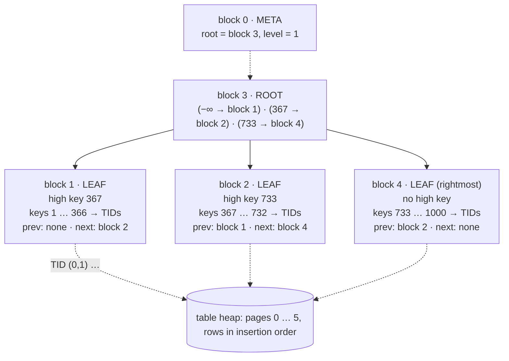

# M03 · Ch1 · §4 — The B-tree index: the structure under almost every lookup

> **Module:** Databases & Storage (from first principles)
> **Chapter:** The relational model from the ground up — relations, keys, normalization, how a query is planned and
> executed, B-tree indexes
> **Section:** Ch1 §3 treated an index as a black box with a price: a few page reads per lookup, plus a heap fetch per
> row. This section opens the box. It shows a real PostgreSQL B-tree page by page, traces one lookup and one range
> scan through it, follows an insert into a full page and the split that results, and then measures what that
> mechanism implies: why a 10-million-key tree is three levels deep, why random UUID (universally unique identifier)
> keys made the same 10 million inserts five times slower than sequential keys and the index 30% larger than ordered
> UUIDs, what a multi-column index can and cannot answer (including PostgreSQL 18's new skip scan, about 1,850× faster
> than PostgreSQL 17 on one query), when an index can skip the table entirely, and what every index costs on every
> write. It closes Ch1.
> **Status:** ✅ finalized 2026-10-24 (body prepared 2026-10-16). Two questions — what `VACUUM` is, and how $k$ and
> $f$ are chosen and whether a hard disk and an SSD (solid-state drive) would want different values — are answered in
> §14, with new measurements on PostgreSQL 18 (Table 7, Table 8) and Gray and Graefe's page-size model (Figure 4).
> **Prerequisites:** **Ch1 §3** (access paths, `EXPLAIN ANALYZE`, bitmap scans — §12a there) and **Ch1 §1 §12** (the
> first look at a B-tree, and why a foreign-key column needs one). Ch1 §1 §3's UUID advice gets its mechanism in §4.

**Estimated study time:** 3.5–4 hours including the hands-on.

---

## Why this section exists — and how it's pitched

Three earlier sections made promises about indexes and deferred the reason. Ch1 §1 §3 said random UUID primary keys
"scatter inserts across the whole index" and left the consequence for here. Ch1 §1 §12 measured a foreign-key index
turning 2,859 ms into 0.26 ms and said the tree was "3 levels deep" without saying why. Ch1 §3's Figure 3 showed an
index losing to a full scan beyond a few percent of rows. All three are consequences of **one data structure**, and
once you can picture it, you can predict them instead of memorizing them.

The section is built the way the last one's Q&A asked for: **every operation is traced on a real, small tree before
its cost is stated**. The tree in §2 and §3 is an actual PostgreSQL 18 index on 1,000 rows, inspected page by page with
the `pageinspect` extension, so every page number, key and pointer you see existed. The measurements in §4 to §10 come
from the same server, at sizes from 1 million to 10 million rows, and the raw data is committed beside the figures.

The running example is still the model-evaluation service. The questions are the ones you will actually face: which
key type for a new table, which columns in which order for a composite index, whether to add one more index, and why an
index that "should" be used is not.

---

## 1. Why a tree of pages

<details>
<summary><b>Vocabulary for this section</b> — terms, abbreviations and every symbol in the formulas (click to expand)</summary>

**Abbreviations**

| Short | Stands for | Meaning |
|---|---|---|

**Symbols used in the formulas**

| Symbol | Reads as | Meaning |
|---|---|---|
| $n$ | "n" | number of keys in the index |
| $k$ | "k" | keys that fit in one leaf page |
| $f$ | "f" | fan-out: children per internal page |
| $h$ | "h" | height: pages read from root to leaf |
| $\lceil x \rceil$ | "ceiling of x" | $x$ rounded up to the next whole number |
| $\log_{f} x$ | "log base f of x" | how many times you multiply by $f$ to reach $x$ |

**Terms**

| Term | Definition |
|---|---|
| **Page** | the fixed-size unit (8 KB in PostgreSQL) in which data is read from and written to storage |
| **Binary search tree** | a tree with one key and two children per node — about $\log_{2} n$ levels deep |
| **B-tree** | a balanced search tree whose nodes are whole pages holding hundreds of keys each |
| **B+-tree** | the variant every database uses: all keys and row pointers live in the leaves, which are linked in order |
| **Fan-out** | how many children one internal page points to |
| **Balanced** | every leaf is the same distance from the root |
| **B-link tree** | Lehman and Yao's B-tree variant with right-links and high keys, allowing concurrent access with little locking |

</details>

The problem a database index solves is narrower than "fast lookup". It is **finding one key among millions when
storage is read in pages** — 8 KB at a time in PostgreSQL — and when each page read that misses the cache is the
expensive part. Counting page reads, not comparisons, is what makes the design obvious.

A **binary search tree** holds one key per node. Ten million keys need $\lceil \log_{2} 10^{7} \rceil = 24$ levels,
and each level is a different node — up to 24 page reads per lookup. The fix, published by Rudolf Bayer and Edward
McCreight in 1972 from work at Boeing, is to make **each node a whole page**: put hundreds of keys in one node, so every
page read chooses among hundreds of children instead of two. The result is the **B-tree**. Every relational database
uses its **B+-tree** variant, where internal pages hold only keys for navigation and all the row pointers sit in the
leaves, which are linked left to right so a range can be read without going back up. Douglas Comer's 1979 survey
already called it "ubiquitous", and it still is.

The height follows from two numbers you can measure — $k$, the keys per leaf page, and $f$, the children per internal
page:

$$h = 1 + \left\lceil \log_{f} \frac{n}{k} \right\rceil$$

PostgreSQL's 10,000,000-row `bigint` primary key from §4 has 27,323 leaf pages under 97 internal pages — about $k = 366$
keys per leaf and $f = 282$ children per internal page. Then $n / k \approx 27322$, and since $282^{2} = 79524$ is the
first power of 282 above that, the tree is $h = 3$ levels deep: root, one internal level, leaves.


**Figure 1** — B-tree height against index size, from the fan-out measured on a real PostgreSQL 18 primary key: three
levels hold 29 million keys, four hold 8.2 billion, and each further level multiplies capacity by about 282.

That staircase is the whole reason indexes work at scale. An index with one key per person alive — about 8.2 billion —
would sit right at the edge of four levels. A lookup is three or four page reads, and since the root and the internal
pages of a busy index are almost always in cache, it is usually **one** page read that can miss — the leaf — plus the
heap page the row lives on. That is the "3 levels" of Ch1 §1 §12, and the 0.26 ms.

---

## 2. Inside the pages: a real tree, inspected

<details>
<summary><b>Vocabulary for this section</b> — terms and abbreviations used below (click to expand)</summary>

**Abbreviations**

| Short | Stands for | Meaning |
|---|---|---|
| **TID** | tuple identifier | a row's physical address: (heap page number, slot within the page) |

**Terms**

| Term | Definition |
|---|---|
| **Meta page** | block 0 of every PostgreSQL B-tree; records where the root is and how many levels there are |
| **Root page** | the single top page; every search starts here |
| **Internal page** | a page of separator keys and child-page pointers |
| **Leaf page** | a bottom-level page of (key, TID) entries, in key order |
| **Separator key** | a key in an internal page marking where one child's range ends and the next begins |
| **Downlink** | an internal page's pointer to a child page |
| **High key** | the first entry on a non-rightmost page: the upper bound of keys allowed on that page |
| **Sibling link** | each page's pointers to its left and right neighbours on the same level |
| **"Minus infinity"** | the first downlink of an internal page, which has no key: "everything below the next separator" |
| **pageinspect** | a PostgreSQL extension that shows the raw contents of index and table pages |
| **Fillfactor** | how full the B-tree packs leaf pages when it builds or extends at the right edge (default 90%) |

</details>

Here is a real index: the primary key of a 1,000-row table, `small (id int PRIMARY KEY, name text)`, loaded with ids 1
to 1,000 in order, on PostgreSQL 18. The `pageinspect` extension shows its pages.

```sql
SELECT root, level FROM bt_metap('small_pkey');
--  root | level
--     3 |     1          ← the root is block 3, one level above the leaves: 2 levels in all

SELECT blkno, type, live_items, free_size, btpo_prev, btpo_next
FROM bt_multi_page_stats('small_pkey', 1, -1);
--  blkno | type | live_items | free_size | btpo_prev | btpo_next
--      1 | l    |        367 |       808 |         0 |         2     ← leaf, left neighbour none, right neighbour 2
--      2 | l    |        367 |       808 |         1 |         4
--      3 | r    |          3 |      8096 |         0 |         0     ← the root
--      4 | l    |        268 |      2788 |         2 |         0     ← rightmost leaf
```

Block 0 is the **meta page**, which records where the root is. The root, block 3, holds three entries:

```sql
SELECT itemoffset, ctid, data FROM bt_page_items('small_pkey', 3);
--  itemoffset | ctid  | data
--           1 | (1,0) |                           ← no key: "minus infinity" → child block 1
--           2 | (2,1) | 6f 01 00 00 00 00 00 00   ← key 0x016f = 367    → child block 2
--           3 | (4,1) | dd 02 00 00 00 00 00 00   ← key 0x02dd = 733    → child block 4
```

The key bytes are the integer in little-endian order, padded to 8 bytes; in an internal page the `ctid` column holds
the child block number. So the root says: **keys below 367 are in block 1, 367 to 732 in block 2, 733 and above in
block 4.** Now a leaf:

```sql
SELECT itemoffset, ctid, data FROM bt_page_items('small_pkey', 1);
--  itemoffset |  ctid   | data
--           1 | (1,1)   | 6f 01 00 00 00 00 00 00   ← the HIGH KEY: 367, the upper bound for this page
--           2 | (0,1)   | 01 00 00 00 00 00 00 00   ← key 1   → heap page 0, slot 1
--           3 | (0,2)   | 02 00 00 00 00 00 00 00   ← key 2   → heap page 0, slot 2
--         …
--         367 | (1,181) | 6e 01 00 00 00 00 00 00   ← key 366 → heap page 1, slot 181
```

Each leaf entry is a key and a **TID** — the row's physical address in the table (the heap), as (page, slot). Key 366's
TID is `(1,181)`; asking the table directly, `SELECT ctid FROM small WHERE id = 367` returns `(1,182)`, the next slot.
Every entry is 16 bytes (an 8-byte header holding the TID, then the 4-byte integer padded to 8), plus a 4-byte line
pointer in the page's item array.

<!-- DIAGRAM:START -->


<details>
<summary>Diagram source (Mermaid)</summary>



</details>
<!-- DIAGRAM:END -->

**Figure 2** — the real 1,000-key PostgreSQL index of this section: a meta page, a root with three downlinks, and three
leaves linked to their neighbours (prev / next), each leaf entry pointing at one row in the table.

Four details in that output carry the rest of the section:

- **The tree is balanced.** All three leaves are exactly one step below the root. Every lookup costs the same number
  of page reads, and §4 shows how inserts keep it that way.
- **Leaves are linked.** `btpo_prev` and `btpo_next` chain the leaves in key order, so a range scan walks sideways
  instead of returning to the root (§3).
- **Each non-rightmost page has a high key.** Block 1's first entry, 367, is not a row; it is the upper bound of keys
  that may live on the page. This, plus the right-link, is the **B-link tree** design of Philip Lehman and S. Bing Yao
  (1981) that PostgreSQL's B-tree implements: a search that arrives at a page just after a concurrent split moved its
  key away can see from the high key that the key is now further right, and follow the right-link, without the writer
  having locked the whole path. It is why index lookups and inserts can run concurrently with very little blocking.
- **The leaves are 90% full, not 100%.** Each full leaf holds 367 entries and leaves 808 bytes free. An 8 KB page
  minus its headers has room for about 407 of these 20-byte entries; 367 is 90% of that. That is the B-tree's default
  **fillfactor** of 90: when keys arrive in increasing order, PostgreSQL fills each leaf to 90% before starting the
  next, leaving room for a later update or out-of-order insert to land without splitting. §4 shows what happens when
  keys do not arrive in order.

---

## 3. A lookup and a range scan, traced

<details>
<summary><b>Vocabulary for this section</b> — terms and abbreviations used below (click to expand)</summary>

**Abbreviations**

| Short | Stands for | Meaning |
|---|---|---|
| **TID** | tuple identifier | a row's physical address in the table |

**Terms**

| Term | Definition |
|---|---|
| **Descent** | the walk from the root down to the one leaf that can contain a key |
| **Binary search** | halving the sorted entries of one page until the key is found — about 9 comparisons for 367 entries |
| **Range scan** | finding the first key of a range by descent, then walking right along the leaves |
| **Heap fetch** | following a TID to read the row itself from the table |
| **Backward scan** | walking the leaves right to left, for `ORDER BY … DESC` |

</details>

**Lookup: `WHERE id = 500`.** On the tree of §2:

1. Read the **meta page**: the root is block 3.
2. Read **block 3**. Binary search among its separators: 500 is at least 367 and below 733, so follow the downlink to
   **block 2**.
3. Read **block 2**, a leaf. Binary search its 367 sorted entries (about nine comparisons) for 500, and find its TID.
4. Read the **heap page** the TID names and return the row.

Two index pages and one table page. On a 10-million-row index it would be three index pages — and as §1 noted, the
upper ones are almost always cached. If no entry equals 500, the search ends in step 3 with "no match", which is how a
`UNIQUE` constraint checks a new key: descend to where the key would go, and see whether it is already there.

**Range scan: `WHERE id BETWEEN 360 AND 375 ORDER BY id`.**

1. Descend exactly as for a lookup, for the **first** key, 360: root → block 1.
2. Return entries 360 to 366 from block 1, in order.
3. Reach block 1's high key, 367: the range continues, so follow the **right sibling link** to block 2 — no return to
   the root.
4. Return 367 to 375 from block 2, and stop at the first key above 375.

The rows come out **already in key order**, which is why an index can satisfy `ORDER BY` with no sort, and why
`ORDER BY id LIMIT 10` costs one descent plus ten entries however large the table. `ORDER BY id DESC` walks the same
leaves leftward along `btpo_prev`. `min(id)` and `max(id)` are one descent to the leftmost or rightmost leaf.

**What a range scan costs, and why Ch1 §3's crossover exists.** The *index* part of a range scan is cheap and
sequential — consecutive leaves, each read once. The expensive part is **step 4 of the lookup, repeated per row**: each
entry's TID points to a heap page, and if the table is not stored in index order those pages are scattered. That is
exactly the difference between the two panels of Ch1 §3's Figure 3: same index, same leaf walk, but one table had its
rows in random order and the other in index order. §8 shows how to skip the heap entirely.

---

## 4. Inserts, page splits, and why random keys hurt

<details>
<summary><b>Vocabulary for this section</b> — terms, abbreviations and every symbol in the formulas (click to expand)</summary>

**Abbreviations**

| Short | Stands for | Meaning |
|---|---|---|
| **UUID** | universally unique identifier | a 16-byte identifier; version 4 is random, version 7 starts with a timestamp |
| **WAL** | write-ahead log | the log every change is written to before the data pages, for crash recovery |

**Symbols used in the formulas**

| Symbol | Reads as | Meaning |
|---|---|---|
| $\ln 2$ | "natural log of two" | about 0.693 — the expected fullness of B-tree leaves under random inserts |

**Terms**

| Term | Definition |
|---|---|
| **Page split** | moving about half of a full page's entries to a new page and adding a separator for it to the parent |
| **Rightmost split** | the special case of splitting the last page on a level, used when keys arrive in increasing order |
| **Leaf density** | how full the leaf pages are, on average |
| **Leaf fragmentation** | the share of leaf pages whose physical order on disk differs from their key order |
| **Working set** | the set of pages a workload touches often enough that they need to stay in cache |
| **Full-page write** | PostgreSQL writing a whole 8 KB page image to the WAL the first time a page changes after a checkpoint |
| **`REINDEX`** | rebuilding an index from scratch, packed to its fillfactor |

</details>

**An insert, traced.** Inserting key 400 into the tree of §2: descend exactly as for a lookup (root → block 2), then
place the new entry in sorted position. Block 2 is 90% full, so there is room; the insert touches one leaf page.

**When the page is full: a split.** Suppose block 2 had no room. PostgreSQL then:

1. allocates a new page, say block 5;
2. moves roughly the upper half of block 2's entries to block 5, so each page is about half full;
3. sets block 2's high key to block 5's first key, and links block 2 ↔ block 5 ↔ block 4 through the sibling pointers;
4. inserts a new separator and downlink for block 5 into the **parent** — here, the root.

If the parent is full too, it splits the same way and pushes a separator into *its* parent. If the **root** splits, a
new root is created above it with two downlinks. **That is the only way a B-tree grows taller** — from the top — which
is why every leaf always stays at the same depth and Figure 1's staircase holds.

**Splitting at the right edge.** When keys arrive in increasing order — a sequential `bigint`, a timestamp — every
insert lands on the **rightmost** leaf. Splitting that page 50/50 would leave a trail of half-empty pages that will
never receive another key. So PostgreSQL does not: when the rightmost leaf fills, it leaves the old page at the
fillfactor (90%) and starts a fresh page for the new keys. That is why §2's leaves are exactly 90% full.

**When keys arrive in random order** — a UUID version 4 — each insert lands on a *random* leaf, every split is a 50/50
split in the middle of the key space, and pages fill back up only gradually. A classic analysis of random insertions
(Andrew Yao, 1978) predicts that leaves then average about **69% full** — a fraction $\ln 2 \approx 0.693$ of
capacity. Measured on PostgreSQL 18:

**Table 1** — the primary-key index after 10,000,000 inserts, by key type (PostgreSQL 18, default settings).

| Primary key | Key size | Index size | Leaf pages | Leaves full (avg) | Leaf pages out of order | Load time | Write-ahead log (WAL) written |
|---|---|---|---|---|---|---|---|
| `bigint`, sequential | 8 bytes | **214 MB** | 27,323 | 90.0% | 0% | **8.6 s** | 1,321 MB |
| UUID v7 (`uuidv7()`) | 16 bytes | **301 MB** | 38,315 | 90.0% | 0% | **13.9 s** | 1,485 MB |
| UUID v4 (`uuidv4()`) | 16 bytes | **392 MB** | 49,926 | **69.1%** | **49.9%** | **44.5 s** | 2,035 MB |
| UUID v4, after `REINDEX` | 16 bytes | 301 MB | — | 90.0% | — | — | — |

The 69.1% is Yao's $\ln 2$, reproduced to within a fifth of a percentage point. Read the table in pairs:

- **v7 against v4 isolates the insert pattern.** Same type, same 16 bytes per key, same number of keys. The random keys
  leave the index **30% larger** (392 MB against 301 MB) purely from half-empty pages, and **half its leaf pages
  physically out of order**, so a range scan over it jumps around the file. A `REINDEX` repacks it to exactly v7's size.
- **`bigint` against v7 isolates the key size.** Both arrive in order; v7's index is larger only because each key is 16
  bytes instead of 8.

![Left: a line chart of seconds per 500,000-row batch as ten million rows are inserted. The sequential bigint line is flat at about 0.43 seconds and the UUID version 7 line flat at about 0.7 seconds; the UUID version 4 line rises from 1.0 second for the first batch to between 2.8 and 3.8 seconds for the last batches. Right: a bar chart of the resulting primary-key index sizes: 214 MB for bigint, 301 MB for UUID version 7, 392 MB for UUID version 4 with leaves 69 percent full, and 301 MB for UUID version 4 after REINDEX.](diagrams/04-btree-fig3.svg)

**Figure 3** — the same 10,000,000 inserts with three kinds of primary key: sequential and time-ordered keys keep a
constant insert speed, random keys get steadily slower as the index outgrows the cache, and leave an index 30% larger.

**Why random keys get slower as the table grows** — Figure 3's left panel — is the working-set argument. With a
sequential or time-ordered key, every insert touches the same rightmost leaf, which is always in cache: the **working
set is one page per level**, and speed stays constant at any size. With random keys, every insert touches a random
leaf, so the **working set is the whole index**. Once the index outgrows PostgreSQL's cache — 128 MB by default here,
shared with the table's own pages, and passed a few million rows in — an increasing share of inserts must first bring
their leaf page in from the operating system's cache or the disk. Random inserts also wrote 54% more to the WAL —
2,035 MB against 1,321 MB. The likely reason is the **full-page write**: PostgreSQL logs a whole 8 KB image of a page
the first time it changes after each checkpoint, and scattered inserts touch far more distinct pages between
checkpoints than inserts that all land at the right edge. The batches went from 1.0 s to between 2.8 and 3.8 s, and
the total was **5.2× the sequential key's**.

This is the mechanism behind Ch1 §1 §3's advice, now measured: **if you need UUIDs, use version 7.** They are as
unguessable as most applications need, globally unique without coordination, and they behave in the index like a
sequential key, because their leading bits are a timestamp. On this machine the difference was 13.9 s against 44.5 s
for the same 10 million rows, and 301 MB against 392 MB. On a server whose index is far larger than its memory, the gap
grows, because the random-key working set grows with the table while the ordered one does not.

---

## 5. Deletes, updates, and why indexes bloat

<details>
<summary><b>Vocabulary for this section</b> — terms and abbreviations used below (click to expand)</summary>

**Abbreviations**

| Short | Stands for | Meaning |
|---|---|---|
| **MVCC** | multi-version concurrency control | keeping old row versions so readers and writers do not block each other (M03 Ch2) |
| **HOT** | heap-only tuple | an update that creates the new row version on the same page and adds no index entries |

**Terms**

| Term | Definition |
|---|---|
| **Row version** | one physical copy of a row; an update writes a new version and leaves the old one for a while |
| **Dead tuple / dead index entry** | a version no transaction can see any more, and an index entry that points at one |
| **`VACUUM`** | the background process that removes dead versions and their index entries |
| **Bottom-up deletion** | PostgreSQL 14+ removing dead entries from a leaf just before it would otherwise split |
| **Deduplication** | PostgreSQL 13+ storing a repeated key once, followed by a list of TIDs |
| **Bloat** | space an index or table occupies beyond what its live entries need |
| **`REINDEX CONCURRENTLY`** | rebuilding an index without blocking writes |

</details>

PostgreSQL never updates a row in place. An `UPDATE` writes a **new row version** and leaves the old one until no
running transaction can still need it — the mechanism behind its isolation levels, which is M03 Ch2's subject. For an
index this has two consequences.

**Every new version can need new index entries.** If the new version lands on a different heap page, every index on
the table gets a new entry pointing at it — even indexes on columns that did not change. The exception is a **HOT
(heap-only tuple) update**, which PostgreSQL's documentation says is possible when the update modifies no column used
by the table's indexes (BRIN — block range indexes, §10 — aside) and there is free space on the same heap page: then
the new version is chained from the old one inside the page, and no index is touched. Two practical rules follow —
**every index you add makes fewer of your updates eligible for HOT**, and leaving free space in heap pages (a table
`fillfactor` below 100) makes more of them eligible.

**Dead entries linger until cleaned.** An entry pointing at a dead version stays in the leaf until `VACUUM` removes it,
or until PostgreSQL 14's **bottom-up deletion** removes dead entries from a leaf that is about to split because of
exactly this version churn. Space freed inside a page is reused for new keys in that page's range. But PostgreSQL only
deletes a leaf page when it becomes **completely** empty; half-empty pages are not merged. An index whose table had a
large delete, or years of updates, can therefore be much larger than its live content — **bloat** — and the fix is
`REINDEX CONCURRENTLY`, which builds a fresh copy alongside the old one without blocking writes.

**Deduplication works the other way.** Since PostgreSQL 13, a key repeated across many rows is stored once, followed by
a list of TIDs. Ch1 §1 §12 measured it: an index on a foreign key repeated 100 times per value was 65 MB, against
214 MB for the primary key of the same 10-million-row table. Indexes on low-distinct columns are smaller than intuition
suggests.

---

## 6. What a B-tree can answer — and what it cannot

<details>
<summary><b>Vocabulary for this section</b> — terms and abbreviations used below (click to expand)</summary>

**Terms**

| Term | Definition |
|---|---|
| **Operator class** | the set of comparison operators an index uses for a type; the default for `text` follows the column's collation |
| **Collation** | the rules for comparing and ordering text in a language |
| **`text_pattern_ops`** | an operator class that compares text byte by byte, so `LIKE 'abc%'` can use the index under any collation |
| **Prefix match** | a pattern fixed at the start, like `LIKE 'orca%'` — a range in sorted order |
| **Sargable** | a condition the index can search, with the column bare on one side (Ch1 §3 §6a) |

</details>

Everything a B-tree does follows from one property: **its leaves are the keys in sorted order.** Any question that
becomes "find a position in sorted order, then walk" is cheap. Any question that does not, is not.

**Table 2** — what a B-tree on a column can and cannot answer.

| Query shape | Uses the index? | Why |
|---|---|---|
| `col = v` | yes | descend to `v` |
| `col < v`, `col BETWEEN a AND b` | yes | descend to the start, walk right |
| `col IN (a, b, c)` | yes | up to one descent per value |
| `ORDER BY col` (`LIMIT n`) | yes, no sort needed | the leaves are already in order |
| `min(col)`, `max(col)` | yes | one descent to an end |
| `col IS NULL` | yes | PostgreSQL B-trees store `NULL`s, sorted at one end |
| `col LIKE 'orca%'` | yes, **only** with the `C` collation or a `text_pattern_ops` index | a prefix is a range — but only if sorting is byte-by-byte |
| `col LIKE '%orca'` or `'%orca%'` | **no** | the match is not at a position in sorted order; use a trigram (`pg_trgm`) GIN (generalized inverted index) index |
| `lower(col) = v`, `col + 0 = v` | **no** | the expression's values are not the sorted keys; use an expression index (§9) |
| `col <> v` | effectively no | it matches almost everything, so a scan is cheaper |
| a `UNIQUE` or `PRIMARY KEY` constraint | yes — that is how it is enforced | a descent finds whether the key already exists |

The `LIKE` row catches people every year. Under a language-aware collation such as `en_US.UTF-8`, the sort order is not
simple byte order, so "all strings starting with `orca`" is not guaranteed to be one contiguous range of the index, and
PostgreSQL will not use the default index for it. Either the database uses the `C` collation, or you create the index
with `text_pattern_ops` for the columns you search by prefix.

---

## 7. Multi-column indexes: order matters, and PostgreSQL 18's skip scan

<details>
<summary><b>Vocabulary for this section</b> — terms and abbreviations used below (click to expand)</summary>

**Terms**

| Term | Definition |
|---|---|
| **Composite / multi-column index** | one index on several columns, sorted by the first, then the second within equal firsts, and so on |
| **Leading column** | the first column of a multi-column index |
| **Leftmost-prefix rule** | a condition can use the index efficiently only through an unbroken run of leading columns |
| **Skip scan** | PostgreSQL 18+: searching an index once per distinct value of an unconstrained leading column |
| **`Index Searches`** | the `EXPLAIN ANALYZE` line, new in PostgreSQL 18, counting how many descents a scan made |

</details>

An index on `(a, b)` sorts its entries by `a`, and **within each value of `a`**, by `b` — like a phone book sorted by
surname, then first name:

```
(0, 17) (0, 9,240) (0, 812,003) | (1, 55) (1, 61,872) … | (2, …) … | (9, 3) (9, 999,817)
 └──── all a = 0, b ascending ──┘ └─── a = 1 ───────────┘           └──── a = 9 ─────────┘
```

So it answers anything that pins down a **prefix** of that order. To measure it, a 5,000,000-row table had an index on
`(a, b)`, where `a` takes 10 distinct values and `b` is random:

**Table 3** — what an index on `(a, b)` answers, measured on PostgreSQL 18 (5,000,000 rows; median of 5–7 runs).

| Condition | `Index Searches` | Time | What happened |
|---|---|---|---|
| `a = 3 AND b = 500000` | 1 | **0.017 ms** | one descent to the exact entry |
| `a = 3 ORDER BY b LIMIT 10` | 1 | **0.019 ms** | descend to the start of `a = 3`, read ten entries — already sorted by `b` |
| `a BETWEEN 2 AND 4 AND b = 500000` | 3 | — | one descent per value of `a` in the range |
| `b = 500000` alone, `a` has **10** distinct values | **12** | **0.021 ms** | **skip scan**: one descent per value of `a` |
| `b = 500000` alone, leading column has **100,000** distinct values | 1 | **50.5 ms** | the whole index read end to end |
| `b = 500000` alone, 10 values, on **PostgreSQL 17** | — | **39 ms** | no skip scan: the whole index read end to end |

The classic rule is the **leftmost prefix**: a condition on `b` alone cannot use an index on `(a, b)` efficiently,
because the `b = 500000` entries are scattered through every section of the index. PostgreSQL 17 shows that: 39 ms,
reading the whole index. **PostgreSQL 18 added skip scan**, listed among its release's headline features: when the
leading column has few distinct values, the scan treats `b = 500000` as "`a = 0 AND b = 500000`, then `a = 1 AND …`" —
one quick descent per value of `a`, about ten in all (the plan counted 12). The result was 0.021 ms, about **1,850×
faster** than PostgreSQL 17 on the same data. With 100,000 distinct leading values, ten descents become 100,000, and
reading the whole index is cheaper again: skip scan rescues a leading column with **few** distinct values, not many.

**How to order the columns of a composite index**, then:

1. **Columns compared with `=` first, range columns after.** For `WHERE a = ? AND b > ?`, an index on `(a, b)` finds one
   contiguous run; `(b, a)` would scatter the `a` matches across the whole `b` range.
2. **Put the column you sort by right after the equality columns**, so `WHERE a = ? ORDER BY b LIMIT 10` needs no sort —
   the 0.019 ms row above.
3. **Among equality columns, put the one other queries also filter on alone first**, so one index serves both. With
   PostgreSQL 18 a leading column with few distinct values is no longer fatal for queries that skip it — but a
   high-distinct one still is.
4. **Do not build `(a)`, `(a, b)` and `(a, b, c)` separately.** `(a, b, c)` already answers anything on `a` or on `a`
   and `b`.

---

## 8. Index-only scans and covering indexes: skipping the table

<details>
<summary><b>Vocabulary for this section</b> — terms and abbreviations used below (click to expand)</summary>

**Abbreviations**

| Short | Stands for | Meaning |
|---|---|---|
| **MVCC** | multi-version concurrency control | why visibility must be checked at all (M03 Ch2) |

**Terms**

| Term | Definition |
|---|---|
| **Index-only scan** | answering a query from the index alone, without reading the table's rows |
| **Covering index** | an index containing every column a query needs |
| **`INCLUDE`** | extra columns stored in the leaf entries for covering, not used for searching or ordering |
| **Visibility map** | one bit per heap page: "every row here is visible to every transaction" |
| **`Heap Fetches`** | in an index-only scan, how many rows still had to be checked in the table |

</details>

§3's lookup ended with a heap fetch per row. If every column the query needs is **in the index**, that step can be
skipped — an **index-only scan**. There is one catch, and it is MVCC (multi-version concurrency control, §5): an index
entry does not record whether the row version it points to is visible to *this* transaction. PostgreSQL solves it with
the **visibility map**, one bit per heap page meaning "every row on this page is visible to everyone". An index-only
scan checks that bit; where it is set, the heap is skipped; where it is not, the row is fetched to check, and the plan
counts it in `Heap Fetches`. `VACUUM` sets the bits; any change to a page clears its bit.

To cover columns you filter by, list them in the key. To cover columns you only **return**, add them with `INCLUDE`:
they ride along in the leaf entries without affecting the sort order. Measured on the same 5,000,000-row table, for
`SELECT sum(c) FROM m WHERE a = 3 AND b < 20000` (10,098 matching rows):

**Table 4** — the same query with and without a covering index, and with a stale visibility map (PostgreSQL 18).

| Index | Plan | `Heap Fetches` | Time | Index size |
|---|---|---|---|---|
| `(a, b)` | Bitmap Heap Scan — 9,490 heap pages read | — | **4.3 ms** | 101 MB |
| `(a, b) INCLUDE (c)`, after `VACUUM` | Index Only Scan | 0 | **0.74 ms** | 150 MB |
| the same, after updating 3,399 of the matching rows | Index Only Scan | **7,124** | **1.27 ms** | — |
| the same, after `VACUUM` again | Index Only Scan | 0 | 0.89 ms | — |

Covering the query made it **6× faster** by not touching 9,490 heap pages, and cost **49 MB** of extra index. The third
row is the trap: updating a third of the matching rows cleared the visibility bit on every page they touched, so 7,124
of the 10,098 entries needed a heap check — more than the 3,399 rows updated, because one update dirties the bit for its
whole page. An index-only scan is only as good as the last `VACUUM`. On a table with heavy write traffic, check
`Heap Fetches` before you count on one.

---

## 9. What an index costs, and the indexes worth having

<details>
<summary><b>Vocabulary for this section</b> — terms and abbreviations used below (click to expand)</summary>

**Abbreviations**

| Short | Stands for | Meaning |
|---|---|---|
| **HOT** | heap-only tuple | an update that adds no index entries (§5) |

**Terms**

| Term | Definition |
|---|---|
| **Write amplification** | one logical write causing many physical ones — here, one row insert updating every index |
| **Partial index** | an index over only the rows matching a `WHERE` clause |
| **Expression index** | an index on the result of an expression, like `lower(email)` |
| **`pg_stat_user_indexes`** | a statistics view with `idx_scan`, the number of times each index has been used |

</details>

Every index is a second sorted copy that every write must maintain (Ch1 §1 §12b). Measured — one million rows inserted
into the same table with a primary key and zero to five extra B-tree indexes:

**Table 5** — insert time against the number of secondary indexes (PostgreSQL 18, 1,000,000 rows).

| Secondary indexes | 0 | 1 | 2 | 3 | 4 | 5 (the fifth on a 32-character text column) |
|---|---|---|---|---|---|---|
| Time to insert 1,000,000 rows | **1.5 s** | 2.8 s | 4.3 s | 5.8 s | 7.3 s | **10.8 s** |

Each index on a random integer column added about 1.5 seconds per million rows — on a busy table, roughly as much as
the insert itself — and the text index added 3.5. Five extra indexes made the same inserts **7× slower**, and each one
also takes memory away from the cache and makes updates less likely to be HOT (§5). An index is a trade: one query's
reads, paid for by every write.

**Indexes that pay for themselves:**

- **Foreign-key columns on the child table** (Ch1 §1 §12) — needed by parent deletes and by the joins you run anyway.
- **The leading columns of your most frequent filters and sorts**, ordered by §7's rules.
- **Partial indexes** for queries that always target a small subset: `CREATE INDEX ON battle (created_at) WHERE status
  = 'open'` indexes only open battles, so it is tiny and cheap to maintain. A partial *unique* index is how Ch1 §1 §5
  enforced "at most one open battle per user".
- **Expression indexes** for conditions that apply a function: `CREATE INDEX ON app_user (lower(email))` makes
  `WHERE lower(email) = …` sargable (Ch1 §3 §6a). The query must use exactly the indexed expression.

**Indexes that do not:** duplicates and prefixes of other indexes (§7 rule 4), indexes on columns nobody filters by,
and indexes created during one investigation and never removed. PostgreSQL counts every use in
`pg_stat_user_indexes.idx_scan`; an index whose count stays at zero over a full business cycle is paying its write cost
for nothing. Check it on each replica separately — statistics are per server.

---

## 10. Beyond the B-tree

<details>
<summary><b>Vocabulary for this section</b> — terms and abbreviations used below (click to expand)</summary>

**Abbreviations**

| Short | Stands for | Meaning |
|---|---|---|
| **BRIN** | block range index | stores only a summary (here, minimum and maximum) per range of table pages |
| **GIN** | generalized inverted index | indexes the elements inside a value — array items, `jsonb` keys, words |
| **GiST** | generalized search tree | an index framework for overlap and nearness — ranges, geometry |
| **LSM tree** | log-structured merge tree | a write-optimized structure used by RocksDB, Cassandra and others |
| **HNSW** | hierarchical navigable small world | a graph index for approximate nearest-neighbour search over vectors |

**Terms**

| Term | Definition |
|---|---|
| **Block range** | a group of consecutive table pages (128 by default) that BRIN summarizes with one entry |
| **Lossy index** | one that can say only "matches might be here", so the rows must be re-checked |
| **Recall** | the share of true nearest neighbours an approximate search actually returns |

</details>

The B-tree is the default because it answers equality, ranges and order at once. Other structures answer one question
better.

**BRIN — when the table is already in order.** A block range index stores, for every 128 consecutive table pages, only
the minimum and maximum value of the column. It is useful exactly when the column is correlated with physical order — a
timestamp in an append-only table, an increasing id. Measured on the 5,000,000-row table:

**Table 6** — BRIN against B-tree, on a physically ordered column and a random one (PostgreSQL 18).

| Index | Size | 1% range on the ordered column | 11-value range on the random column |
|---|---|---|---|
| B-tree | 107 MB | **2.2 ms** (index-only scan) | (not measured) |
| BRIN | **32 kB** | **2.8 ms** — 822 page ranges marked, 7,427 rows re-checked | **270 ms** — every one of 71,478 pages marked, 4,999,949 rows re-checked |

On the ordered column BRIN was **3,400× smaller** and nearly as fast. On the random column every page range contains
both small and large values, so every range "might match", and BRIN degenerates into a full scan with extra steps — and
the planner still chose it, a reminder of Ch1 §3 §8's lesson about estimates. BRIN is the right index for huge
append-only tables queried by time; it is useless otherwise.

**The others, in one line each:**

- **Hash** — equality only, no ranges or order; rarely better than a B-tree in PostgreSQL.
- **GIN** — indexes the *elements* inside a value: tags in an array, keys in `jsonb` (Ch1 §2 §3), words in full-text
  search, trigrams for `LIKE '%orca%'` with the `pg_trgm` extension.
- **GiST** (generalized search tree) — overlap and nearness for ranges and geometry; it is what enforces Ch1 §1 §5's
  exclusion constraints.
- **LSM (log-structured merge) trees** — not a PostgreSQL index but a different storage design (RocksDB, Cassandra)
  that batches writes in memory and merges sorted files later, trading read cost for write speed — the trade the
  2026-06-26 reading compared.
- **Vector indexes** — the `pgvector` extension adds HNSW (hierarchical navigable small world) and IVFFlat (inverted
  file, flat) indexes for approximate nearest-neighbour search over embeddings. They are **approximate**: its
  documentation warns that results can differ after adding such an index, because it trades some recall for speed.
  That makes them a different kind of tool from everything above, which always returns exactly the right rows.

---

## 11. Failure modes — the index checklist

<details>
<summary><b>Vocabulary for this section</b> — terms and abbreviations used below (click to expand)</summary>

**Abbreviations**

| Short | Stands for | Meaning |
|---|---|---|
| **UUID** | universally unique identifier | a 16-byte identifier; v4 random, v7 time-ordered |
| **HOT** | heap-only tuple | an update that adds no index entries |

**Terms**

| Term | Definition |
|---|---|
| **Bloat** | index space beyond what live entries need |
| **Leftmost-prefix rule** | a multi-column index is searched efficiently only through a run of leading columns |
| **Write amplification** | one row write updating every index on the table |

</details>

- **Inserts that get slower as the table grows.** Random primary keys (UUID v4): the whole index is the working set
  (§4). Use a sequential key or UUID v7.
- **An index far larger than its data.** Random-key splits (69% full leaves) or bloat from deletes and updates (§4, §5).
  `pgstatindex()` shows `avg_leaf_density`; `REINDEX CONCURRENTLY` repacks.
- **A composite index that is not used.** The query constrains a non-leading column with a high-distinct leading column
  in front (§7). Reorder the columns, or add a second index — and check whether you are on PostgreSQL 18, whose skip
  scan changes the answer for low-distinct leading columns.
- **`LIKE 'abc%'` doing a full scan.** A language-aware collation without `text_pattern_ops` (§6).
- **`LIKE '%abc%'` expected to use a B-tree.** It cannot; use a trigram GIN index (§6, §10).
- **An "index-only" scan that is not.** Large `Heap Fetches` on a write-heavy table: the visibility map is stale (§8).
- **Writes slowing after an indexing spree.** Each index costs about as much as the insert itself (§9). Drop the ones
  `pg_stat_user_indexes` says are unused.
- **Updates that stopped being cheap.** A new index on a frequently updated column made those updates ineligible for HOT
  (§5).
- **A BRIN index on a column that is not physically ordered.** It reads the whole table (§10).
- **Redundant indexes.** `(a)` alongside `(a, b)` — the second already serves the first's queries (§7).

---

## 12. Check your understanding

1. Why does a database use a B-tree rather than a binary search tree, when both give logarithmic lookups?
2. Using $h = 1 + \lceil \log_{f}(n / k) \rceil$ with $k = 366$ and $f = 282$, how many levels does a 1-billion-key
   index have? Why do the upper levels rarely cost a disk read?
3. In §2's tree, which pages does `WHERE id BETWEEN 700 AND 740` read, in what order, and why does it never return to
   the root after the first descent?
4. Why are §2's leaves 90% full rather than 100%, and why does sequential insertion not leave half-empty pages behind?
5. A UUID v4 index came out 392 MB and its UUID v7 twin 301 MB, with the same number of identical-size keys. Explain
   the difference, and why `REINDEX` made them equal.
6. Why did the UUID v4 inserts get slower as the table grew, while the UUID v7 inserts did not?
7. You have an index on `(status, created_at)`. Which of these use it efficiently: (a)
   `WHERE status = 'open' AND created_at > now() - interval '1 day'`; (b)
   `WHERE created_at > now() - interval '1 day'`; (c) `WHERE status = 'open' ORDER BY created_at DESC LIMIT 20`? How
   does PostgreSQL 18 change the answer for (b)?
8. A query is an index-only scan but takes as long as an ordinary index scan, and the plan shows
   `Heap Fetches: 48210`. What is happening, and what fixes it?
9. A colleague proposes adding six indexes to a table that receives 5,000 inserts a second "to be safe". What do you
   tell them, using §9's measurement?
10. Your events table is append-only and queried almost entirely by time range, and its B-tree on `created_at` is 40
    GB. What alternative would you test, and what single property of the data decides whether it works?

<details>
<summary>Answers</summary>

1. **Because cost is counted in page reads, not comparisons** (§1). A binary tree has one key per node, so 10 million
   keys need 24 levels — up to 24 page reads. A B-tree puts hundreds of keys in each page-sized node, so each page
   read chooses among hundreds of children, and the same 10 million keys need 3 levels.
2. **Four levels** (§1, Figure 1). $n / k = 10^{9} / 366 \approx 2.73$ million; $282^{2} = 79524$ is too small and
   $282^{3} \approx 22.4$ million is enough, so the ceiling of the logarithm is 3 and $h = 4$. The root and the few
   hundred internal pages are touched by every lookup, so they stay in cache; typically only the leaf — and the heap
   page — can miss.
3. **Root (block 3), then leaf block 2, then leaf block 4** (§3). The descent for 700 goes root → block 2 (700 is in
   367–732). Entries 700–732 are returned from block 2; its high key is 733, so the scan follows block 2's right
   sibling link to block 4 and returns 733–740. Leaves are linked in key order, so a range continues sideways without
   a new descent.
4. **The fillfactor of 90** (§2, §4). When keys arrive in increasing order PostgreSQL fills each rightmost leaf to 90%
   and then starts a new page instead of splitting 50/50, leaving 10% for later updates or out-of-order inserts. Since
   no key will ever arrive below the right edge again, a 50/50 split would leave pages half empty forever; the
   rightmost-split rule avoids that.
5. **Random inserts split pages in the middle of the key space, leaving leaves about 69% full** (§4, Table 1), against
   90% for ordered inserts — Yao's $\ln 2$ result. Same keys, more pages: 49,926 leaf pages against 38,315. `REINDEX`
   rebuilds from sorted data, packing every leaf to the fillfactor, so the v4 index becomes the same 301 MB.
6. **Working set** (§4, Figure 3). Every v7 insert lands on the rightmost leaf, so the pages being written are always
   the same few cached ones. Every v4 insert lands on a random leaf, so the whole index is in use; once it outgrew the
   128 MB cache, more and more inserts had to fetch their leaf first, and the scattered changes wrote more to the WAL
   (2,035 MB against 1,485 MB for v7) — most likely extra full-page images of the many distinct pages touched.
7. **(a) and (c) yes; (b) not efficiently before PostgreSQL 18** (§7). (a) is equality on the leading column then a
   range on the second — one contiguous run. (c) is equality on the leading column with order on the second — one
   descent, read backwards, no sort. (b) constrains only the second column, whose matches are spread through every
   `status` section. PostgreSQL 18's skip scan makes (b) one descent per distinct `status` — cheap, because a status
   column has only a handful of values.
8. **The visibility map is stale** (§8, Table 4). Rows on many pages have changed since the last `VACUUM`, clearing
   their pages' all-visible bits, so most entries need a heap check and the index-only scan is doing an index scan's
   work. Run `VACUUM` (or tune autovacuum to run more often on that table); then confirm `Heap Fetches` drops near
   zero.
9. **Each index costs roughly as much as the insert itself** (§9, Table 5): in the measurement, five extra indexes
   made a million inserts 7× slower, from 1.5 s to 10.8 s. At 5,000 inserts a second that is the difference between
   headroom and saturation, plus extra memory, WAL and lost HOT updates. Add an index for a specific query you have
   measured, check `pg_stat_user_indexes` later, and drop it if unused.
10. **A BRIN index on `created_at`** (§10, Table 6). It would be kilobytes or megabytes instead of 40 GB. It works
    only if `created_at` is **correlated with physical row order** — true for an append-only table where rows arrive
    roughly in time order (check `pg_stats.correlation`, close to 1). Measured, BRIN was 3,400× smaller and nearly as
    fast on an ordered column, and useless — a full scan — on a random one.

</details>

---

## 13. Optional: get your hands dirty (60–75 min)

Everything here needs Docker and `psql`. Start PostgreSQL 18 with the default 128 MB cache, so §4's effect appears:

```sh
docker run -d --name m03b -e POSTGRES_PASSWORD=pw postgres:18 -c max_wal_size=8GB
docker exec -it m03b psql -U postgres
```

```sql
CREATE EXTENSION pageinspect;
CREATE EXTENSION pgstattuple;
SET max_parallel_workers_per_gather = 0;
\timing on
```

**1. Walk a real tree.** Rebuild §2's index and read its pages yourself:

```sql
CREATE TABLE small (id int PRIMARY KEY, name text);
INSERT INTO small SELECT g, 'name' || g FROM generate_series(1, 1000) g;
SELECT * FROM bt_metap('small_pkey');
SELECT blkno, type, live_items, free_size, btpo_prev, btpo_next FROM bt_multi_page_stats('small_pkey', 1, -1);
SELECT itemoffset, ctid, data FROM bt_page_items('small_pkey', 3);    -- the root (check bt_metap first)
SELECT ctid, id FROM small WHERE id IN (366, 367);
```

Trace `WHERE id = 500` by hand through the root's separators. Then insert 200,000 more rows and watch `bt_metap`'s
level go from 1 to 2 — two levels hold only about 103,000 keys (Figure 1).

**2. Random against ordered keys.** Load 5 million rows into each and compare:

```sql
CREATE TABLE k_v4 (id uuid PRIMARY KEY);
CREATE TABLE k_v7 (id uuid PRIMARY KEY);
INSERT INTO k_v7 SELECT uuidv7() FROM generate_series(1, 5000000);
INSERT INTO k_v4 SELECT uuidv4() FROM generate_series(1, 5000000);
SELECT 'v7', pg_size_pretty(pg_relation_size('k_v7_pkey')), (pgstatindex('k_v7_pkey')).avg_leaf_density
UNION ALL
SELECT 'v4', pg_size_pretty(pg_relation_size('k_v4_pkey')), (pgstatindex('k_v4_pkey')).avg_leaf_density;
REINDEX INDEX k_v4_pkey;   -- and check again
```

**3. Skip scan.** Build a table with a low-distinct leading column and query the second column alone:

```sql
CREATE TABLE m AS SELECT g AS id, g % 10 AS a, floor(random() * 1000000)::int AS b
FROM generate_series(1, 5000000) g;
CREATE INDEX ON m (a, b);
VACUUM ANALYZE m;
EXPLAIN ANALYZE SELECT count(*) FROM m WHERE b = 500000;    -- look for "Index Searches"
```

If you have a PostgreSQL 17 container to hand (`postgres:17`), run the same three statements there and compare.

**4. Make an index-only scan stop being one.** Add `CREATE INDEX ON m (a, b) INCLUDE (id)`, run `SELECT sum(id) FROM m
WHERE a = 3 AND b < 20000` under `EXPLAIN ANALYZE`, update a few thousand of those rows, run it again and read
`Heap Fetches`, then `VACUUM m` and run it once more.

**5. BRIN.** `CREATE INDEX ON m USING brin (id)` and compare its size with a B-tree on `id`; then try a BRIN index on
`b` and a narrow range on it, and read `Heap Blocks: lossy=`.

When you are done: `docker rm -f m03b`.

---

## 14. Applied — captured from our session Q&A

*(The session, 2026-10-24. Two questions: what `VACUUM` is — §5 and §8 lean on it without explaining it — and how
§1's $k$ and $f$ are chosen, and whether a hard disk and a solid-state drive would want different values. Both answers
were measured on PostgreSQL 18 for this section, and the second is checked against Gray and Graefe's published
page-size model.)*

### 14a. What `VACUUM` is

**It is PostgreSQL's garbage collector for row versions.** The command is spelled `VACUUM`, with one C and two Us.

The reason it has to exist is §5's first sentence: PostgreSQL never updates a row in place. An `UPDATE` writes a new
version and leaves the old one, because a transaction that started earlier may still need to read the old value; a
`DELETE` only marks the row as ended. This is MVCC (multi-version concurrency control), and M03 Ch2 is about what it
buys. What it costs is that **nothing removes the old version at the moment it stops being needed**. Once no running
transaction can see it, it is a **dead tuple** — still occupying heap space, still pointed at by an entry in every
index. Something has to come back later and clean up. That is `VACUUM`, and it does four jobs:

1. **Removes dead tuples** from the heap and **their entries from every index**, and records the freed space so later
   inserts and updates can reuse it.
2. **Sets the visibility map** — §8's one bit per heap page meaning "every row here is visible to everyone". Only
   `VACUUM` sets it; any change to a page clears it. That is why an index-only scan "is only as good as the last
   `VACUUM`".
3. **Freezes old rows.** PostgreSQL stamps each row version with a 32-bit transaction ID (XID), and that counter wraps
   around after about four billion transactions. `VACUUM` marks sufficiently old rows as visible to every future
   transaction, so a wrapped counter cannot make them look like they come from the future. A database that is never
   vacuumed eventually stops accepting writes to protect itself; this is the one `VACUUM` job that is not optional.
4. **Refreshes planner statistics** if you write `VACUUM ANALYZE` — the statistics of Ch1 §3 §5. Plain `VACUUM` does
   not.

**Table 7** — `VACUUM` at work on 10,000,000 rows, 2,000,000 of them updated (PostgreSQL 18, autovacuum off).

| Step | Heap | Primary-key index | Dead tuples | Heap free space | All-visible pages |
|---|---|---|---|---|---|
| after the load and a first `VACUUM` | 422 MB | 214 MB | 0 | — | all |
| `UPDATE` 2,000,000 rows (ids 1–2,000,000) | 507 MB | 257 MB | 2,000,000 | 0.3% | 43,243 of 64,865 |
| `VACUUM` (0.61 s) | 507 MB | 257 MB | **0** | **16.9%** | **64,865 of 64,865** |
| `UPDATE` 2,000,000 other rows (ids 8,000,001–10,000,000) | **507 MB** | **300 MB** | 2,000,000 | — | — |
| `VACUUM FULL` | 422 MB | 214 MB | 0 | — | — |

The table has a `bigint` primary key, and the updates change a column no index covers. Four things to read off it:

- **Every update grew the index.** The column changed was not indexed, yet none of the 2,000,000 updates was HOT
  (heap-only tuple, §5): the heap pages were full, so each new version went to another page and needed a new
  primary-key entry. That is §5's argument for a table `fillfactor` below 100.
- **`VACUUM` does not shrink files.** Nothing got smaller in row 3. It turned 2,000,000 dead rows into 16.9% free space
  inside the existing heap pages and set every visibility bit. The space is reusable, not returned to the operating
  system.
- **The heap reuses free space anywhere; an index reuses it only for the right keys.** In row 4 the next 2,000,000
  updates fit into the freed heap space — the heap has no order, so a new version can go on any page with room — and the
  heap did not grow at all. The index grew by another 43 MB, because the freed entries sat in leaves for ids 1 to
  2,000,000 and the new entries belonged in leaves for ids above 8,000,000. That is §5's "space freed inside a page is
  reused for new keys in that page's range", in numbers.
- **`VACUUM FULL` is the one that shrinks**, by rewriting the table and its indexes into new files. It holds an
  exclusive lock for the duration, so no reads or writes happen meanwhile. On a live system the online tools are
  `REINDEX CONCURRENTLY` for an index (§5) and the `pg_repack` extension for a table.

**Who runs it.** You rarely type `VACUUM` in production. The **autovacuum** daemon checks every database once a minute
and vacuums any table whose dead tuples exceed

$$\text{threshold} = 50 + 0.2 \times \text{rows in the table}$$

which for this 10,000,000-row table is about 2,000,050 — the size of the bulk update above. PostgreSQL 18 adds a cap,
`autovacuum_vacuum_max_threshold`, of 100,000,000, so a billion-row table no longer waits for 200 million dead rows.
For a large table with heavy updates, the usual fix is a lower scale factor for that table (for example
`ALTER TABLE votes SET (autovacuum_vacuum_scale_factor = 0.02)`), so it is vacuumed in small, frequent passes.

**What stops it.** `VACUUM` can remove a version only when **no** running transaction could still see it. One
transaction left open — a forgotten `BEGIN` in a console, a stuck job, a replica reporting an old snapshot — holds back
cleanup for the whole database. Measured with one idle `REPEATABLE READ` transaction open during an update of 1,000,000
rows, `VACUUM VERBOSE` reported:

```
tuples: 0 removed, 11000000 remain, 1000000 are dead but not yet removable
```

Nothing was removed. This is the most common reason a PostgreSQL database bloats with autovacuum switched on, and the
check is to look for old transactions in `pg_stat_activity` (its `xact_start` column).

### 14b. How $k$ and $f$ are chosen — and whether the disk type should change them

**Nobody chooses them. They follow from the page size and the size of an entry**, and the page size is the only one of
these anyone chooses — once, for the whole server.

For §1's `bigint` primary key on 8 KB pages, measured with `bt_page_stats` on the same 10,000,000-row index:

**Table 8** — where $k = 366$ and $f = 282$ come from (PostgreSQL 18, 8 KB pages).

| Quantity | Value | Where it comes from |
|---|---|---|
| Usable bytes per page | 8,152 | 8,192 minus a 24-byte page header and a 16-byte B-tree trailer |
| Bytes per leaf entry | 20 | an 8-byte tuple header holding the 6-byte row pointer (TID, tuple identifier), the 8-byte key, and a 4-byte slot in the page's item array |
| Entries in a full page | about 407 | 8,152 ÷ 20 |
| Leaf pages, filled to 90% | **367 entries, 808 bytes free** | the leaf fillfactor of 90 (§2); one entry is the high key, leaving $k = 366$ keys |
| Internal pages, filled to 70% | **286 entries, 2,444 bytes free** | a fixed 70% for internal pages, compiled into PostgreSQL, applied on build and on rightmost splits |
| Fan-out $f$ | **282** | 27,323 leaves ÷ 97 internal pages |

So $k$ and $f$ move when the **entry** changes size, never because of the device: a 16-byte `uuid` key or a two-column
key makes each entry larger and both numbers smaller, and a lower `fillfactor` lowers $k$. The page size itself is a
**compile-time constant** in PostgreSQL (`--with-blocksize`, 1 to 32 KB, default 8 KB) and is almost never changed.
Other engines fix it when the database is created: InnoDB's `innodb_page_size` defaults to 16 KB, SQL Server always
uses 8 KB, SQLite stores it per database file. None of them adapt it to the drive.

**Your intuition is right in theory, though — the best page size does depend on the device.** Jim Gray and Goetz
Graefe gave the standard way to compute it. A page read costs one access time; what it buys is how far it narrows the
search, which is $\log_{2}$ of the entries on the page (a binary search inside it). So the best page maximizes

$$\frac{\log_{2}(\text{entries per page})}{\text{latency} + \text{page size} / \text{bandwidth}}$$

Small pages waste the fixed latency; large pages spend transfer time for only a logarithmic gain. Graefe's 2009 paper
ran this with 20-byte entries at 70% fill — the numbers in Table 8 — and found about **256 KB for a hard disk and 2 KB
for the flash drives of 2007**. Figure 4 redraws his model and adds a modern NVMe (Non-Volatile Memory Express) drive
with illustrative numbers.


**Figure 4** — the B-tree page size that gives the most search progress per second of I/O, by device, in Gray and
Graefe's node-utility model: a hard disk wants pages around 50 times larger than 8 KB, 2007-era flash about 4 times
smaller, and a modern NVMe drive about 5 times larger.

Two things in Figure 4 go against intuition. **A faster device does not simply want smaller pages.** The 2007 flash
drive had low latency and also low bandwidth, so transfer time dominated and small pages won; a modern NVMe drive has
high bandwidth too, so its optimum moves back up to tens of kilobytes. And **every curve is flat near its top**: 8 KB
gets between two thirds and nine tenths of the best search rate on all three devices. That flatness is why one page
size has survived three generations of storage.

**Why real systems still do not tune it per device** — the model counts one lookup's I/O and nothing else:

1. **The upper levels are cached anyway.** The root and the 96 internal pages of a 10,000,000-key index are touched by
   every lookup and stay in memory, so a lookup usually misses at most once — at the leaf. The model optimizes a cost
   that a warm system mostly does not pay.
2. **Height moves in whole levels, and slowly.** Doubling to 16 KB gives about $k = 735$ and $f = 572$, so three
   levels hold about 240 million keys instead of 29 million (Figure 1). For most tables the height stays the same.
3. **Every page you write is written whole.** An update changes one 20-byte entry and dirties the whole page. The first
   change after a checkpoint writes a full page image to the WAL (write-ahead log, §4's full-page write), and the page
   is later written back whole. Larger pages mean more bytes written and more WAL per change.
4. **Large pages waste cache on random access.** A point lookup wants one entry; a 256 KB page fills 256 KB of memory
   to deliver it, so under random access the cache holds fewer useful entries.

**What does change between a hard disk and an SSD (solid-state drive)** is the planner's cost model, not the page.
`random_page_cost` defaults to 4.0, which assumes a random read costs four times a sequential one, as on a hard disk.
On SSDs, or with the working set in memory, it is commonly set to about 1.1, and Ch1 §3 §6 and Ch1 §3 §7 measured
what that changes: some plans get faster, one got slower.

---

## Key terms (English · 大陆 简体 · 台灣 繁體)

| English | 大陆 (简体) | 台灣 (繁體) | Note |
|---|---|---|---|
| B-tree / B+-tree | B 树 / B+ 树 | B 樹 / B+ 樹 | |
| Index | 索引 | 索引 | |
| Page | 页 | 頁 / 頁面 | |
| Root / internal / leaf node | 根 / 内部 / 叶子节点 | 根 / 內部 / 葉節點 | ⚠ 节点 ↔ **節點**; 叶子 ↔ **葉** |
| Fan-out | 扇出 | 扇出 | |
| Page split | 页分裂 | 頁面分割 | ⚠ 分裂 ↔ **分割** |
| Fill factor | 填充因子 | 填滿因數 / 填充因數 | ⚠ 因子 ↔ **因數**; Microsoft's 台灣 documentation uses 填滿因數 |
| Composite index | 复合索引 / 组合索引 | 複合索引 | |
| Covering index | 覆盖索引 | 涵蓋索引 | ⚠ 覆盖 ↔ **涵蓋** |
| Index-only scan | 仅索引扫描 | 僅索引掃描 | |
| Clustered index | 聚集索引 | 叢集索引 | ⚠ 聚集 ↔ **叢集** |
| Leftmost prefix | 最左前缀 | 最左前綴 | |
| Skip scan | 跳跃扫描 | 略過掃描 | ⚠ no settled 台灣 term; 略過 follows Microsoft usage for "skip" |
| Bloat | 膨胀 | 膨脹 | |
| Visibility map | 可见性映射 | 可見性對應 | ⚠ 映射 ↔ **對應** |
| Partial index | 部分索引 | 部分索引 / 篩選索引 | ⚠ Microsoft's 台灣 SQL Server term is 篩選索引 (filtered index) |
| Expression index | 表达式索引 | 運算式索引 | ⚠ 表达式 ↔ **運算式** |
| Write amplification | 写放大 | 寫入放大 | |
| Dead tuple | 死元组 | 死元組 / 失效元組 | |
| Vacuum (garbage collection of row versions) | 清理 (VACUUM) | 清理 (VACUUM) | usually left as `VACUUM` in both |
| Transaction ID wraparound | 事务 ID 回卷 | 交易 ID 回繞 | ⚠ 事务 ↔ **交易** (transaction) |

---

## References

- R. Bayer and E. McCreight — *Organization and Maintenance of Large Ordered Indexes*, Acta Informatica 1(3), 1972 —
  the B-tree — <https://doi.org/10.1007/BF00288683>
- D. Comer — *The Ubiquitous B-Tree*, Association for Computing Machinery (ACM) Computing Surveys 11(2), 1979 — the
  B+-tree variant and its spread — <https://doi.org/10.1145/356770.356776>
- P. L. Lehman and S. B. Yao — *Efficient Locking for Concurrent Operations on B-Trees*, ACM Transactions on Database
  Systems 6(4), 1981 — the high key and right-link design PostgreSQL's B-tree implements (§2) —
  <https://doi.org/10.1145/319628.319663>
- A. C. Yao — *On Random 2–3 Trees*, Acta Informatica 9(2), 1978 — the $\ln 2$ space-utilization result for random
  insertions (§4) — <https://doi.org/10.1007/BF00289075>
- PostgreSQL documentation — *B-Tree Indexes* (structure, deduplication, bottom-up deletion) —
  <https://www.postgresql.org/docs/current/btree.html> · *CREATE INDEX* (the B-tree fillfactor of 90, applied to
  initial builds and to extending the index at the right) —
  <https://www.postgresql.org/docs/current/sql-createindex.html>
- PostgreSQL documentation — *Multicolumn Indexes* (skip scan) —
  <https://www.postgresql.org/docs/current/indexes-multicolumn.html> · *Release 18* (skip scan and `uuidv7()` among
  the headline features) — <https://www.postgresql.org/docs/18/release-18.html>
- PostgreSQL documentation — *Index-Only Scans and Covering Indexes* (the visibility map, `INCLUDE`) —
  <https://www.postgresql.org/docs/current/indexes-index-only-scans.html> · *Heap-Only Tuples (HOT)* —
  <https://www.postgresql.org/docs/current/storage-hot.html>
- PostgreSQL documentation — *Operator Classes and Operator Families* (`text_pattern_ops` for `LIKE` under non-C
  collations) — <https://www.postgresql.org/docs/current/indexes-opclass.html> · *BRIN Indexes* —
  <https://www.postgresql.org/docs/current/brin.html>
- PostgreSQL documentation — *pageinspect* and *pgstattuple* (the tools behind §2 and Table 1) —
  <https://www.postgresql.org/docs/current/pageinspect.html> ·
  <https://www.postgresql.org/docs/current/pgstattuple.html>
- J. Gray and G. Graefe — *The Five-Minute Rule Ten Years Later, and Other Computer Storage Rules of Thumb*, SIGMOD
  Record 26(4), 1997 — node utility and the optimal index page size (§14b) — <https://arxiv.org/abs/cs/9809005>
- G. Graefe — *The Five-Minute Rule 20 Years Later (and How Flash Memory Changes the Rules)*, Communications of the ACM
  52(7), 2009 — Tables 4 and 5, about 256 KB for disk and 2 KB for flash (§14b, Figure 4) —
  <https://doi.org/10.1145/1538788.1538805>
- PostgreSQL documentation — *Routine Vacuuming* (dead tuples, the visibility map, transaction ID wraparound,
  autovacuum thresholds) — <https://www.postgresql.org/docs/current/routine-vacuuming.html>
- pgvector — *Open-source vector similarity search for Postgres* (HNSW and IVFFlat approximate indexes) —
  <https://github.com/pgvector/pgvector>

### What's next

**Ch1 is complete:** the relational model (§1), normalization (§2), how a query is planned (§3), and the structure
under the plans (§4). **M03 Ch2 — Transactions, concurrency and consistency** — is the material you parked in June for
lack of exactly this background: what a transaction guarantees, the isolation levels and the anomalies each one
allows, how PostgreSQL's multi-version rows (§5's "every update writes a new version") let readers and writers avoid
blocking each other, where locks are still needed, and how the check-then-act races of Ch1 §1 §4 and Ch1 §2 §8b are
actually prevented.
