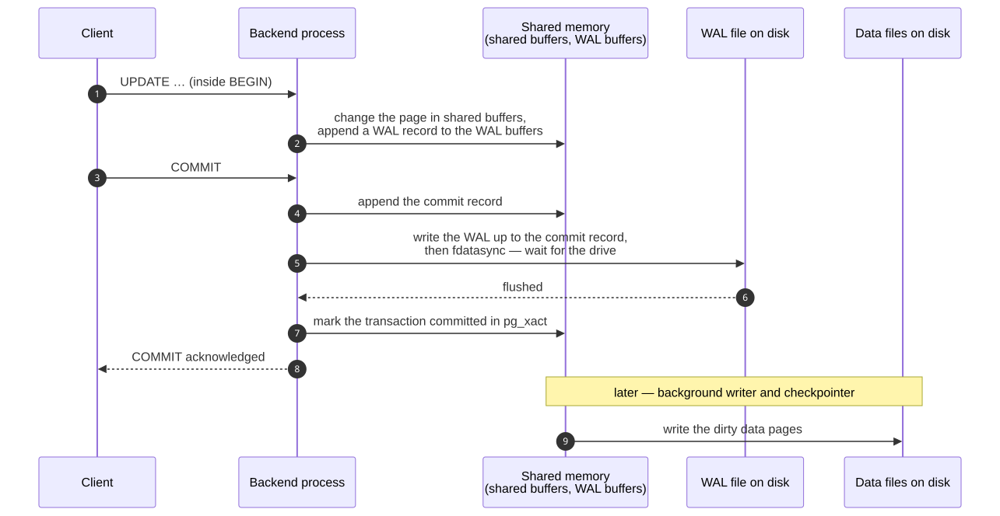
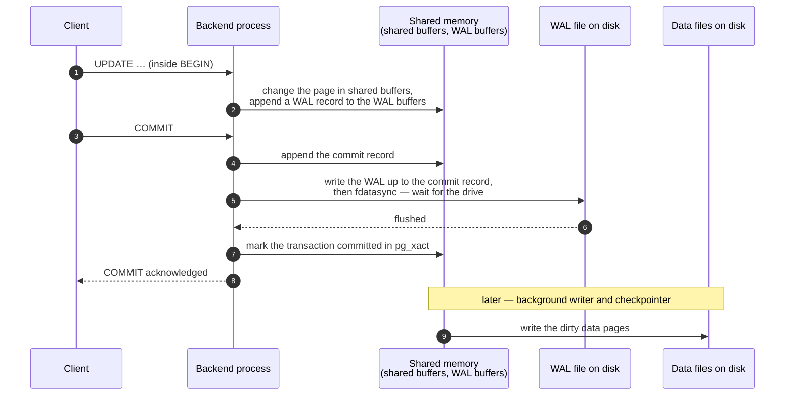
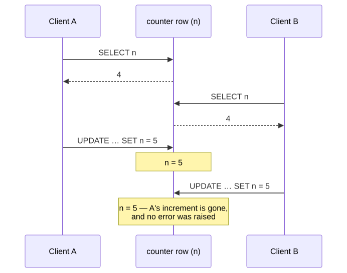
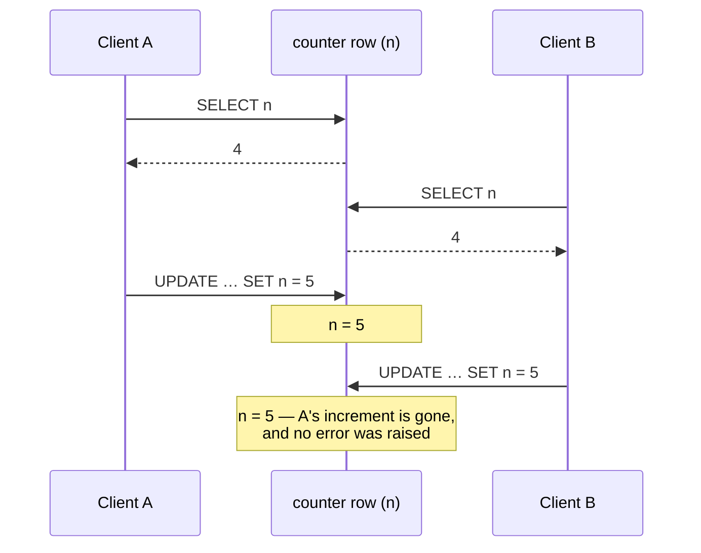

# M03 · Ch2 · §1 — What a transaction guarantees: all-or-nothing, survives a crash, and the races that remain

> **Module:** Databases & Storage (from first principles)
> **Chapter:** Transactions, concurrency and consistency — ACID (atomicity, consistency, isolation, durability),
> isolation levels, locking, MVCC (multi-version concurrency control)
> **Section:** Ch1 treated each statement as if it ran alone, on a machine that never failed. Neither is true. This
> section takes the two ways a unit of work goes wrong — it is **interrupted** (a crash, an error halfway through) or it
> is **interleaved** with someone else's work — and shows what a transaction does about each. It traces how PostgreSQL
> makes a transaction all-or-nothing without undoing anything, how the write-ahead log makes a commit survive a crash
> (the server is killed mid-load on camera), what that durability costs per commit and how group commit and batching
> buy it back, and then measures the race a transaction does **not** fix by default: eight clients adding 1 to the same
> counter 16,000 times end at 2,000. It opens Ch2.
> **Status:** 🔵 PREPARED 2026-10-24 — body written, awaiting your read and the Q&A.
> **Prerequisites:** **Ch1 §4 §5** and **Ch1 §4 §14a** (row versions, dead tuples, `VACUUM`) and **M01 Ch3 §3** (races
> and atomicity in a program). Ch1 §1's check-then-act race comes back in §6.

**Estimated study time:** 3–3.5 hours including the hands-on.

---

## Why this section exists — and how it's pitched

In M01 Ch3 §3 §11 you reached that section's best design point on your own: the safest fix for races is **not to have
shared mutable state** — keep the flowing data immutable and the lock apparatus becomes unnecessary. A database is the
place where that advice runs out. Every instance of your service, every worker and every cron job reads and writes the
same rows; the database **is** the shared mutable state, on purpose. Transactions are how it is made safe anyway, and
this chapter is about exactly how far they go.

Two facts set the pitch. First, the guarantees are easy to state and easy to misread — "my code is in a transaction,
so it is safe" is the single most common wrong belief about databases, and §6 measures it failing. Second, each
guarantee has a **price** and a **mechanism**, and both are visible if you look: the write-ahead log can be watched
replaying after a crash, a commit's cost can be timed against the drive's flush time, and the lost update can be
counted. So, as in Ch1, everything here was run on PostgreSQL 18, and the raw data is committed beside the figures.

The chapter's plan: **§1 (this section)** — what a transaction promises and what it costs; **Ch2 §2** — the isolation
levels, each anomaly reproduced at each level; **Ch2 §3** — how PostgreSQL implements isolation: snapshots, row
versions and locks, including advisory locks; **Ch2 §4** — the application patterns that make concurrent code correct:
optimistic concurrency, idempotency keys, queues and the outbox.

---

## 1. Two ways a unit of work goes wrong, and the four promises

<details>
<summary><b>Vocabulary for this section</b> — terms and abbreviations used below (click to expand)</summary>

**Abbreviations**

| Short | Stands for | Meaning |
|---|---|---|
| **ACID** | atomicity, consistency, isolation, durability | the four guarantees of a database transaction |
| **MVCC** | multi-version concurrency control | keeping several versions of a row so readers and writers do not block each other |
| **WAL** | write-ahead log | the sequential log every change is recorded in before the data pages change |

**Terms**

| Term | Definition |
|---|---|
| **Transaction** | a group of reads and writes the database treats as one unit: it either takes effect entirely or not at all |
| **Commit** | the end of a transaction that makes its changes permanent and visible to others |
| **Rollback / abort** | the end of a transaction that discards all its changes |
| **Invariant** | a rule the data must always satisfy — "money is neither created nor destroyed by a transfer" |
| **Interleaving** | two transactions' steps running alternately, so one sees or overwrites the other's partial work |

</details>

The running example is the oldest one in the field, because it has every problem at once: move 150 from account 1 to
account 2. That is two writes.

```sql
UPDATE acct SET balance = balance - 150 WHERE id = 1;
UPDATE acct SET balance = balance + 150 WHERE id = 2;
```

The invariant is that the total does not change. It can break in two independent ways:

- **Interrupted.** The server crashes, the connection drops or the second statement fails after the first has run.
  Account 1 has lost 150 and account 2 never received it.
- **Interleaved.** While the transfer runs, another session reads both balances — a report summing all accounts sees
  the debit but not the credit, and reports 150 missing. Or two transfers out of account 1 each check that the balance
  covers them, both see 100, and both proceed.

A **transaction** wraps the statements so the database deals with both: `BEGIN`, the statements, `COMMIT`. What it
promises is usually given as the four letters of ACID, named by Theo Härder and Andreas Reuter in 1983 from Jim Gray's
earlier work. They are not four features of equal weight. Two are mechanisms the database provides outright, one is a
dial with a default you need to know, and one is mostly your job:

**Table 1** — the four ACID guarantees: what each promises, who provides it, and where this chapter covers it.

| Letter | Promise | Against | Provided by | Mechanism in PostgreSQL | Where |
|---|---|---|---|---|---|
| **A**tomicity | all of the transaction's writes take effect, or none | interruption | the database, always | aborted transactions' row versions are never visible (no undo needed) | §2 |
| **C**onsistency | a transaction moves the data from one valid state to another | bad writes | **you**, helped by constraints | constraints checked at statement or commit time; everything else is application code | §5 |
| **I**solation | concurrent transactions do not see or damage each other's partial work | interleaving | the database, **to the level you choose** | snapshots and row locks; default level READ COMMITTED | §6, Ch2 §2, Ch2 §3 |
| **D**urability | once commit returns, the change survives a crash | crashes | the database plus the drive | WAL flushed to disk before commit returns | §3, §4 |

Keep two of those cells in mind for the rest of the chapter. **Atomicity and durability are not optional**: you get
them from the moment you write `BEGIN` (or from every single statement, which is its own transaction). **Isolation is
negotiable**, and the default level permits several anomalies — §6 is the first measurement of what that means.

---

## 2. Atomicity: all or nothing, traced

<details>
<summary><b>Vocabulary for this section</b> — terms and abbreviations used below (click to expand)</summary>

**Abbreviations**

| Short | Stands for | Meaning |
|---|---|---|
| **XID** | transaction ID | the 32-bit number PostgreSQL assigns to each transaction that writes |

**Terms**

| Term | Definition |
|---|---|
| **Aborted transaction state** | after an error inside `BEGIN … COMMIT`, PostgreSQL refuses every further statement until the transaction ends |
| **Savepoint** | a named point inside a transaction you can roll back to without abandoning the whole transaction |
| **Commit log (`pg_xact`)** | PostgreSQL's record of each transaction's status: in progress, committed or aborted |
| **Undo log** | in engines such as MySQL's InnoDB and Oracle, a log of old values used to reverse an aborted transaction's changes |
| **Dead tuple** | a row version no transaction can see any more — including every version an aborted transaction wrote |
| **`VACUUM`** | the process that removes dead tuples and their index entries (Ch1 §4 §14a) |

</details>

Run the transfer with too little money, on a table with a `CHECK (balance >= 0)` constraint and balances of 100 and 0.
This is the real PostgreSQL 18 output:

```
BEGIN
UPDATE 1                                   ← account 2 credited: 0 → 150
ERROR:  new row for relation "acct" violates check constraint "acct_balance_check"
DETAIL:  Failing row contains (1, -50).    ← account 1 would go to -50
ERROR:  current transaction is aborted, commands ignored until end of transaction block
COMMIT
ROLLBACK                                   ← the reply to COMMIT
```

Afterwards the balances are 100 and 0. Three details are worth more than the headline:

- **The credit that had already succeeded was discarded too.** That is atomicity: the unit is the transaction, not the
  statement.
- **After an error, the transaction is dead but still open.** PostgreSQL rejects everything until you end it. Other
  databases behave differently — MySQL, for example, rolls back only the failing statement by default and lets the
  transaction continue — so code ported between them can change meaning.
- **`COMMIT` on an aborted transaction does not fail; it replies `ROLLBACK`.** A driver that only checks whether
  `COMMIT` raised an error, and not what it returned, can report success for work that was thrown away. Mainstream
  Python drivers raise an exception at the failing statement, so this bites hand-written protocol code and shell scripts
  piping SQL (Structured Query Language) into `psql` more than application code.

**Savepoints** give you a partial undo inside a transaction:

```sql
BEGIN;
UPDATE acct SET balance = balance + 50 WHERE id = 2;
SAVEPOINT s1;
UPDATE acct SET balance = balance - 150 WHERE id = 1;   -- fails the CHECK
ROLLBACK TO SAVEPOINT s1;                                -- undoes only the failed part; transaction alive again
UPDATE acct SET balance = balance - 50 WHERE id = 1;
COMMIT;                                                  -- balances now 50 and 50
```

This is what an ORM's (object-relational mapper's) "nested transaction" usually is underneath. Use it for an optional step whose failure should not
sink the rest; do not use it in a loop of thousands, since each savepoint costs a subtransaction.

### How PostgreSQL makes it atomic without undoing anything

The obvious implementation of rollback is to remember the old values and put them back. InnoDB and Oracle do that with
an **undo log**. PostgreSQL does not need one, and the reason is Ch1 §4 §5: it never overwrites a row. Every write
creates a new row version stamped with the writer's transaction ID (XID), and a separate, compact **commit log**
(`pg_xact`, two bits per transaction) records whether that XID is in progress, committed or aborted. Whether a reader
sees a version depends on that status. So:

- **Commit** = flip the XID's status to committed (after the log flush of §3). Every version it wrote becomes visible at
  once, because visibility is computed from the status.
- **Rollback** = flip it to aborted. Nothing is copied back; the new versions simply never become visible, and become
  dead tuples for `VACUUM` to remove.
- **A crash mid-transaction** leaves the XID marked in progress with no one running it; on restart it is treated as
  aborted. Measured in §3: 1,000 rows inserted by a transaction that never committed were still physically on disk
  after the crash — 989 of them were counted as dead tuples by `pgstattuple` — and invisible to every query, until
  `VACUUM` removed them.

The trade is the one Ch1 §4 §14a measured from the other side. Rollback is instant whatever the transaction's size,
but every aborted or superseded version stays in the table until `VACUUM` runs. An engine with an undo log pays at
rollback time (a large rollback can take as long as the work it reverses) and keeps its tables compact.

---

## 3. Durability: the write-ahead log

<details>
<summary><b>Vocabulary for this section</b> — terms and abbreviations used below (click to expand)</summary>

**Abbreviations**

| Short | Stands for | Meaning |
|---|---|---|
| **WAL** | write-ahead log | the sequential log of every change, written before the changed data pages |
| **LSN** | log sequence number | a position in the WAL, shown like `0/2C97A000` (a byte offset) |
| **SSD** | solid-state drive | flash storage; here a consumer NVMe drive |
| **NVMe** | Non-Volatile Memory Express | the interface modern SSDs use on the PCIe (Peripheral Component Interconnect Express) bus |
| **OS** | operating system | here, Linux and its page cache |

**Terms**

| Term | Definition |
|---|---|
| **`fsync` / `fdatasync`** | system calls that return only when the file's data has reached durable storage, not just the OS's memory |
| **Page cache** | the OS's in-memory copy of file contents; a plain `write()` lands here and reaches the disk later |
| **Shared buffers** | PostgreSQL's own cache of data pages in shared memory |
| **Dirty page** | a cached page changed in memory but not yet written to its data file |
| **Checkpoint** | writing all dirty pages to the data files, so recovery can start from that point in the WAL |
| **Redo** | replaying WAL records after a crash to bring the data files up to date |
| **Power-loss protection** | capacitors on some (mostly enterprise) SSDs that let them finish writing cached data when power fails |

</details>

A commit has to survive a crash, and the data it changed lives in pages spread across the table and every index — one
insert touches a heap page and a leaf page in each index (Ch1 §4 §9). Writing all of them to disk, at their random
positions, before replying to the client would make every commit cost several random writes. The **write-ahead log** avoids that
with one rule:

> **A change is recorded in the log, and the log is flushed to disk, before the commit is acknowledged. The changed
> data pages can be written whenever is convenient.**

The log is append-only, so a commit costs **one sequential write and one flush**, however many pages it touched. The
data pages stay dirty in shared buffers and reach the data files later, written in bulk by the background writer and
at each checkpoint. If the server crashes first, the log has everything needed to redo them.

<!-- DIAGRAM:START -->


<details>
<summary>Diagram source (Mermaid)</summary>



</details>
<!-- DIAGRAM:END -->

**Figure 1** — the path of a commit in PostgreSQL: only the WAL is forced to disk before the client hears "committed";
the data pages follow later.

Step 5 is the whole price of durability, and it is a property of the **drive**, not of PostgreSQL. `pg_test_fsync`,
run on the volume used for this section's measurements (a consumer SK hynix NVMe solid-state drive), reported:

```
fdatasync      621 ops/sec    1610 usecs/op     ← one 8 KB write, then wait until it is on flash
write    3,860,097 ops/sec       0 usecs/op     ← the same write, left in the OS page cache
```

A flushed write costs about 1.6 ms here; an unflushed one about a quarter of a microsecond. That factor of several
thousand is why the next section exists.

### Killing the server mid-load

To watch the log do its job, the PostgreSQL container was loaded with 1,000 committed rows, then a second session
inserted 1,000 more inside a transaction and was left open, and the container was killed with `SIGKILL` — no shutdown,
no chance to write anything. On restart, the server log reads:

```
database system was not properly shut down; automatic recovery in progress
redo starts at 0/1761990
redo done at 0/2C979F98 system usage: CPU: user: 2.10 s, system: 0.15 s, elapsed: 2.25 s
checkpoint starting: end-of-recovery immediate wait
database system is ready to accept connections
```

**Table 2** — what survived a `SIGKILL` of the server (PostgreSQL 18).

| Rows | Before the kill | After recovery |
|---|---|---|
| 1,000 committed | visible | **visible — all 1,000** |
| 1,000 inserted by an open, uncommitted transaction | visible only to their own session | **gone from every query**; 989 found on disk as dead tuples, removed by the next `VACUUM` |

Recovery replayed about 720 MB of WAL — everything since the last checkpoint — in 2.25 seconds, then wrote a fresh
checkpoint. That is the general shape: **recovery time is proportional to the WAL written since the last checkpoint**,
which is what `checkpoint_timeout` (default 5 minutes) and `max_wal_size` (default 1 GB) bound. Checkpoint more often
and recovery is faster, at the cost of more full-page writes during normal running (Ch1 §4 §4).

### What a process kill does not test

`SIGKILL` kills PostgreSQL, not the machine. The host kernel survived, and so did its page cache — any WAL that had
been `write()`n but not yet flushed would still have reached disk. The flush in step 5 is what protects against the
harder failures, a kernel crash or a power cut, and it only works if three layers each do their part:

- **PostgreSQL must call it.** The `fsync` setting can switch flushing off entirely. PostgreSQL's documentation is
  blunt that this can cause **unrecoverable corruption** after a power failure, not just lost recent commits; it exists
  for throwaway bulk loads, never for a database you want back.
- **The OS must tell the truth about it.** In 2018 PostgreSQL developers found that on Linux, if a background write-back
  failed, the kernel could mark the pages clean, discard them and report the error to only one `fsync` call; PostgreSQL
  retried, the retry succeeded, and the data was silently gone. The fix, shipped in February 2019 across every supported
  version (11.2, 10.7, 9.6.12 …), was to **stop retrying and crash on purpose** — `PANIC` — so recovery replays the WAL,
  which may hold the only good copy. It is a useful lesson in itself: the safe response to "the disk may have lost
  data" was to restart from the log.
- **The drive must not lie either.** A drive acknowledges a flush when the data is durable. Consumer drives without
  power-loss protection do this by actually writing to flash — the 1.6 ms above. Enterprise SSDs with power-loss
  protection can acknowledge from their capacitor-backed cache, much faster. A drive or virtual disk that acknowledges
  a flush it has not made durable defeats every layer above it, and no database setting can detect it.

---

## 4. What durability costs, and how to buy it back

<details>
<summary><b>Vocabulary for this section</b> — terms and abbreviations used below (click to expand)</summary>

**Abbreviations**

| Short | Stands for | Meaning |
|---|---|---|
| **WAL** | write-ahead log | see §3 |
| **tps** | transactions per second | committed transactions per second, all clients together |
| **ms / µs** | millisecond / microsecond | a thousandth / a millionth of a second |

**Symbols used in the formulas**

| Symbol | Reads as | Meaning |
|---|---|---|
| $t_{\text{flush}}$ | "t-flush" | the time for one WAL flush to be confirmed by the drive — about 1–3.5 ms on this laptop |
| $N$ | "N" | the number of rows written per commit, or the number of concurrent committing clients |

**Terms**

| Term | Definition |
|---|---|
| **Group commit** | one WAL flush covering the commit records of several transactions that are waiting at the same time |
| **`synchronous_commit = off`** | acknowledging a commit before its WAL is flushed; a crash can lose the last fraction of a second of commits, but never corrupts |
| **Batching** | putting many rows in one transaction so they share one commit flush |
| **In-doubt commit** | a commit whose outcome the client never learned, because the connection failed after `COMMIT` was sent |
| **Idempotent** | safe to repeat: doing it twice has the same effect as doing it once |

</details>

If each commit waits for one flush of time $t_{\text{flush}}$, then one client committing one row at a time can never
exceed

$$\text{commits per second} \leq \frac{1}{t_{\text{flush}}}$$

— about 600 to 1,000 per second on this drive, whatever the CPU. There are three ways past that ceiling, and Figure 2
measures each one.

![Two panels. Left: rows committed per second by one client on a log scale — about 1,067 with one row per commit and synchronous_commit on, about 46,027 with 100 rows per commit, and about 50,064 with one row per commit and synchronous_commit off. Right: commits per second against concurrent clients from 1 to 64 on log–log axes; the median rises from about 1,067 at one client, roughly flat to 4 clients, then doubling with each doubling of clients to about 18,243 at 64 clients, while a dashed line marks one flush per commit at about 620 per second.](diagrams/01-acid-fig2.svg)

**Figure 2** — what a durable commit costs on a laptop NVMe SSD (PostgreSQL 18, `pgbench`, three 10-second runs each):
batching or relaxing the flush gives about 45 times more rows per second, and concurrent clients share flushes.

**Way 1 — batch rows into fewer commits.** 100 inserts in one transaction delivered about 46,000 rows per second
against about 1,070 for one row per commit, a factor of 43, with full durability. The commit cost is per transaction,
not per row: a batch of $N$ rows pays $t_{\text{flush}}$ once. This is why a bulk load in a loop of single-row
autocommitted inserts is the classic slow import, and why the fix is usually one line (wrap the loop in a transaction,
or use `COPY`, or the driver's batch execution). The limit is the other direction: a transaction that holds rows for a
long time holds their locks and holds back `VACUUM` (§7), so batches of hundreds to a few thousand rows are the usual
middle.

**Way 2 — let concurrent commits share a flush (group commit).** In the right panel, one row per commit, fully
durable, the total rate climbs from about 1,070 commits per second with one client to about 18,200 with 64 —
roughly doubling with every doubling of clients from 8 upward, while each commit's latency stays around 3.5 ms. The
mechanism needs no configuration: when a backend flushes the WAL, it flushes everything written so far, including the
commit records of every other backend that is waiting; those find their commit already on disk and return without a
flush of their own. A busy server therefore commits far more often than its drive can flush. (PostgreSQL also has
`commit_delay`, which deliberately waits a few microseconds to gather more commits per flush; its default is 0, and on
most systems it is best left there.)

The runs with 2 and 4 clients scatter widely — the shaded band — because at low concurrency the result depends on the
drive's flush time from moment to moment, and this consumer drive's varies between about 0.6 and 3.5 ms. What is robust
is the shape: one client is capped by the flush, many clients are not.

**Way 3 — stop waiting for the flush.** `synchronous_commit = off` acknowledges the commit once its WAL record is in
memory and lets the WAL writer flush it shortly afterwards (it runs every `wal_writer_delay`, default 200 ms).
Measured: about 50,000 commits per second for one client, 47 times the durable rate. It is settable **per
transaction**, which is its real value: `SET LOCAL synchronous_commit = off` inside the transactions that write data
you can afford to lose — analytics events, a cache table, a log of page views — while payments and votes stay durable.
What it costs was measured directly:

4 clients inserted one row per commit and the server was killed with `SIGKILL` after about 6 seconds, three times
for each setting:

**Table 3** — acknowledged commits lost when the server is killed under load (PostgreSQL 18).

| `synchronous_commit` | Commits the client was told succeeded | Rows present after recovery | Lost |
|---|---|---|---|
| `off` | 752,903 · 751,496 · 722,454 | 749,270 · 746,799 · 719,068 | **3,633 · 4,697 · 3,386** |
| `on` | 7,316 · 6,968 · 7,328 | 7,319 · 6,970 · 7,331 | **none** — and 3 · 2 · 3 **more** rows than acknowledged |

With `off`, each crash lost between 3,386 and 4,697 commits the application had been told were saved — at about
125,000 commits per second, roughly the last 25 to 40 milliseconds of work. PostgreSQL's documentation bounds the window at
three times `wal_writer_delay`, 600 ms by default, and promises that nothing **else** is affected: no corruption, no
half-transactions, the database is consistent, just slightly in the past. That bound is what makes it a legitimate
tool rather than a gamble.

The `on` row has its own lesson, and it applies to every database. Each crash left **two or three more rows than the
client had been told about**: commits that reached the disk, but whose acknowledgement never reached the client before
the connection died. From the client's side, those transactions are **in doubt** — it sent `COMMIT` and got an error,
and cannot tell whether the commit happened. No setting removes this window; it exists wherever a network sits between
the decision and the person waiting for it. A client that simply retries will insert those rows twice. The only robust
answer is to make the write **idempotent** — give it a key the database can recognise on the second attempt, such as a
client-generated request ID under a `UNIQUE` constraint (Ch1 §1's idempotency key; M02 Ch2 §1's idempotent methods).
Ch2 §4 builds that pattern properly.

### Replicas move the boundary, not the principle

On a managed database the "disk" in step 5 is often a replicated volume, or a standby server receiving the WAL. The
same setting then decides how far the WAL must travel before the commit is acknowledged — `synchronous_commit` also
takes `remote_write` and `remote_apply` when a synchronous standby is configured — and the same trade appears: every
extra copy required before the reply adds a network round trip to every commit, and every copy not waited for is a
window of acknowledged commits that a failover can lose. M03 Ch4 measures replication; the decision is the one in
Table 3.

---

## 5. Consistency: the letter that belongs to you

<details>
<summary><b>Vocabulary for this section</b> — terms and abbreviations used below (click to expand)</summary>

**Abbreviations**

| Short | Stands for | Meaning |
|---|---|---|
| **CAP** | consistency, availability, partition tolerance | the distributed-systems trade-off (M03 Ch3); its C means something else entirely |

**Terms**

| Term | Definition |
|---|---|
| **Constraint** | a rule the database itself enforces on every write: `NOT NULL`, `UNIQUE`, `CHECK`, `FOREIGN KEY`, exclusion |
| **Deferrable constraint** | a constraint checked at `COMMIT` instead of after each statement |
| **Application invariant** | a rule only your code knows, such as "a user has at most three active API keys" |

</details>

Consistency in ACID means a transaction takes the data from one valid state to another. "Valid" is defined by **you**.
The database contributes exactly the rules you declared to it — Ch1 §1's constraints — and enforces them atomically:
a violation aborts the transaction, as in §2. Every rule you did not declare is enforced only by the code that happens
to be running, and only if that code is correct under concurrency, which §6 shows it often is not.

Martin Kleppmann argues in *Designing Data-Intensive Applications* that the letter does not really belong in ACID:
atomicity, isolation and durability are properties of the database, while consistency is a property of the
application, which the other three make possible. Two practical consequences:

- **Push every invariant you can into a constraint.** A rule in a `CHECK`, `UNIQUE` or foreign key is enforced on every
  path, including the one written next year by someone who never read your code, and it cannot race (Ch1 §1 §4's
  check-then-act). The rules left in application code are the ones that need isolation to be correct — the subject of
  the next section and of Ch2 §2.
- **When a rule spans several rows that must be updated together, check it at commit.** A constraint declared
  `DEFERRABLE INITIALLY DEFERRED` is checked at `COMMIT` rather than after each statement, so a transaction can pass
  through a temporarily invalid state — two rows swapping their positions in a `UNIQUE` ordering, for example — as
  long as it ends valid.

And one warning about vocabulary: the C in **CAP** (M03 Ch3) is a different idea — whether every replica returns the
latest write. It is closer to what this chapter calls isolation than to ACID's C. When someone says "consistency",
ask which one.

---

## 6. Isolation: what concurrency does without it

<details>
<summary><b>Vocabulary for this section</b> — terms and abbreviations used below (click to expand)</summary>

**Abbreviations**

| Short | Stands for | Meaning |
|---|---|---|
| **SQL** | Structured Query Language | — |

**Terms**

| Term | Definition |
|---|---|
| **Isolation level** | how much of other transactions' concurrent work a transaction may observe or overwrite |
| **Anomaly** | an outcome that could not happen if the transactions had run one after another |
| **Serial execution** | transactions running strictly one at a time — the reference that defines "correct" |
| **Dirty read** | reading another transaction's uncommitted write |
| **Non-repeatable read** | reading the same row twice in one transaction and getting different committed values |
| **Phantom** | re-running a query with a condition and getting a different set of rows |
| **Lost update** | two transactions read a value, both compute from it, and the second write silently erases the first |
| **Write skew** | two transactions read overlapping data, write different rows, and together break a rule neither broke alone |
| **Row lock** | a lock on one row, taken by `UPDATE`, `DELETE` or `SELECT … FOR UPDATE`, held until the transaction ends |
| **Serialization failure** | an error by which a stricter isolation level aborts a transaction it cannot fit into a serial order; the client must retry |
| **Hot row** | a single row that many transactions update, so they queue on its row lock |

</details>

Isolation is defined against a simple reference: run the transactions **one at a time**, in some order. Any outcome
that no serial order could produce is an **anomaly**. Databases do not run transactions serially, because that would
waste every core but one, so the question is which anomalies each **isolation level** allows. The SQL standard of 1992
defined its levels by three anomalies; Hal Berenson and colleagues showed in 1995 that the list was incomplete, and
the catalogue used today is theirs:

**Table 4** — the anomalies, and what PostgreSQL's isolation levels do about each (a preview; Ch2 §2 reproduces them).

| Anomaly | Interleaving (T1 and T2 are two transactions) | READ COMMITTED (default) | REPEATABLE READ | SERIALIZABLE |
|---|---|---|---|---|
| **Dirty write** | T1 writes x; T2 overwrites x; T1 rolls back | prevented | prevented | prevented |
| **Dirty read** | T1 writes x; T2 reads x; T1 rolls back | prevented | prevented | prevented |
| **Non-repeatable read** | T1 reads x; T2 updates x and commits; T1 reads x again | **allowed** | prevented | prevented |
| **Phantom** | T1 counts rows `WHERE status = 'open'`; T2 inserts an open row and commits; T1 counts again | **allowed** | prevented | prevented |
| **Lost update** | T1 and T2 read x = 4; both write x = 5 | **allowed** | aborted with a serialization failure | aborted |
| **Write skew** | two doctors on call; T1 and T2 each check "the other is on call" and each remove themselves | **allowed** | **allowed** | aborted |

PostgreSQL's REPEATABLE READ is stricter than the standard requires (it also prevents phantoms), and PostgreSQL has no
real READ UNCOMMITTED — asking for it gives READ COMMITTED. MySQL's InnoDB, SQL Server and Oracle each draw these lines
differently; Ch2 §2 compares them.

### The lost update, measured

The anomaly that hits application code most often is the **lost update**, because the natural way to write a change
produces it:

```python
n = db.execute("SELECT n FROM counter WHERE id = 1").scalar()   # read
db.execute("UPDATE counter SET n = :v WHERE id = 1", {"v": n + 1})  # compute in the app, write
```

Eight clients each ran that 2,000 times against the same row: 16,000 increments. Then the same work written five other
ways. The timeline of one collision shows what goes wrong:

<!-- DIAGRAM:START -->


<details>
<summary>Diagram source (Mermaid)</summary>



</details>
<!-- DIAGRAM:END -->

**Figure 3** — a lost update: both clients compute from the same old value, and the second write erases the first
without any error.


**Figure 4** — the same 16,000 increments written six ways (PostgreSQL 18, 8 clients, medians of three runs): the
three read-then-write versions lost between 84% and 88% of the increments; the three correct versions lost none.

Four findings, in order of how often they matter:

1. **Wrapping the read and the write in `BEGIN … COMMIT` changed nothing.** The final value was 2,000 with or without
   the transaction. At READ COMMITTED a transaction is atomic and durable, but its `SELECT` takes no lock and the
   `UPDATE` writes a value the client computed from a read that is already stale. "It's in a transaction" is not a
   concurrency argument.
2. **`UPDATE counter SET n = n + 1` is correct even at READ COMMITTED.** The difference is where the arithmetic
   happens. When a second `UPDATE` finds the row locked by an uncommitted update, it waits; when the first commits,
   PostgreSQL re-reads the **newest committed version** of the row and applies `n + 1` to that. The client never holds
   a stale value, so there is nothing to lose. **Whenever a change can be expressed as an expression over the current
   value, write it in SQL.** `SET stock = stock - 1 WHERE id = 7 AND stock > 0` is the same move with the check-then-act
   race of Ch1 §1 §4 folded into one statement.
3. **When the computation has to happen in the application — a decision, a large language model's (LLM's) answer, anything SQL cannot do —
   lock the row when you read it, or let the database detect the conflict.** `SELECT … FOR UPDATE` takes the row lock at
   read time, so the second client waits at its `SELECT` and reads the first one's result. REPEATABLE READ takes no
   lock; instead the second writer is aborted with `could not serialize access due to concurrent update`, and the
   application retries — here `pgbench` retried 1,356 to 1,475 times per 16,000 increments. In one of the three runs a
   single transaction ended in an error that was reported to the client: the counter ended at 15,999, but **nothing
   was lost silently**, which is the property that matters. The choice between the two is the
   classic pessimistic-versus-optimistic trade, and it is Ch2 §3 and Ch2 §4's subject.
4. **A hot row has a ceiling, and the correct versions sit on it.** All three correct versions ran at about 535 to 590
   transactions per second, against up to 3,000 for the broken ones. They are slower because they actually serialize:
   each increment must wait for the previous transaction to commit — including its WAL flush — before it can take the
   row lock. Group commit cannot help, because the next transaction cannot start its write until the previous one has
   finished. So a single row updated by every request is capped near

   $$\text{updates per second} \approx \frac{1}{t_{\text{flush}}}$$

   whatever the hardware. A global counter, a "last seen" timestamp on a shared row or a single inventory row for a
   popular item is a scalability limit you design around (sharded counters, append-and-aggregate — M03 Ch4), not one
   you tune away.

One curiosity in Figure 4 deserves its explanation, because "exactly 2,000" looks like a bug. With durable commits the
eight clients fell into **lockstep**: all eight read the same value, all eight updates queued on the row lock, a single
group commit flushed them together, and every client wrote the same number. Each round therefore added exactly 1, and
each client ran 2,000 rounds. With `synchronous_commit = off` the lockstep broke up and the count came out at about
2,500 to 2,600 — still 84% lost. The anomaly does not depend on the timing; only its exact size does.

---

## 7. Where a transaction begins and ends in application code

<details>
<summary><b>Vocabulary for this section</b> — terms and abbreviations used below (click to expand)</summary>

**Abbreviations**

| Short | Stands for | Meaning |
|---|---|---|
| **ORM** | object-relational mapper | a library mapping rows to objects — SQLAlchemy, Django's ORM |
| **LLM** | large language model | — |
| **API** | application programming interface | here, a remote service called over the network |

**Terms**

| Term | Definition |
|---|---|
| **Autocommit** | every statement is its own transaction, committed immediately |
| **Implicit begin (autobegin)** | a driver or ORM opening a transaction automatically at the first statement, to be ended by your `commit()` |
| **Idle in transaction** | a session with an open transaction that is not currently running a statement — the application is doing something else |
| **Outbox pattern** | writing "send this message" as a row in the same transaction as the data change, and sending it afterwards from that table |

</details>

Nothing in SQL is outside a transaction. A statement sent without `BEGIN` runs as its own transaction and commits when
it finishes — **autocommit**. Most Python database code, however, is not in autocommit mode, and what decides it is the
library's default rather than anything visible in your code:

**Table 5** — when common Python libraries start and end a transaction by default.

| Library | Default | What that means |
|---|---|---|
| psycopg (version 3) and psycopg2 | not autocommit | the first statement on a connection opens a transaction; it stays open until you call `commit()` or `rollback()` |
| SQLAlchemy 2.0 `Session` / `Connection` | "autobegin" | the first statement opens a transaction; it ends at `commit()`, `rollback()` or the end of a `with Session.begin():` block |
| Django ORM | autocommit | each query commits on its own unless wrapped in `transaction.atomic()` |
| `asyncpg` | autocommit | statements commit individually unless run inside `async with conn.transaction():` |

The consequence of the first two rows is that a transaction is open from the first query until you end it, **including
the time your code spends doing anything else**. Measured: a session ran `BEGIN; UPDATE counter …` and then spent five
seconds in client-side code before `COMMIT`. During that time `pg_stat_activity` showed it as

```
idle in transaction | UPDATE counter SET n = n + 1 WHERE id = 1;
```

and another session's `UPDATE` of the same row took **4.3 seconds** — it waited on the row lock for the whole of the
first session's pause. Now replace "five seconds in client-side code" with what that time usually is in an AI service:
an LLM call.

```python
with Session() as s, s.begin():                  # transaction opens at the first query
    job = s.get(Job, job_id)
    job.status = "running"                       # row lock on the job, held from here…
    answer = llm.generate(job.prompt)            # …through a 20–60 s network call…
    job.result = answer
    job.status = "done"
# …to here, when the block commits
```

Three things go wrong at once, and none of them shows up in a test with one user:

- **Locks are held for the length of the call.** Anything else that touches that job row — a status poll that updates
  a heartbeat, a cancel button, a retry — waits, as the 4.3 seconds above did.
- **`VACUUM` is held back for the whole database.** Ch1 §4 §14a measured it: one open transaction made a `VACUUM` remove
  nothing. A fleet of workers each holding a transaction open across a minute-long LLM call keeps the oldest snapshot
  permanently a minute old, and dead rows accumulate in every table.
- **The external effect is not part of the transaction.** The LLM call happened and was paid for whether or not the
  transaction commits. If the commit fails, the database has no record of the answer you paid for; if you instead sent
  an email or published a message inside the transaction and it then rolled back, the world was told about a change
  that never happened. A transaction's guarantees stop at the database's edge.

The fix is structural: **keep transactions around database work only, and never across a call to anything else.**

```python
with Session() as s, s.begin():                  # transaction 1: claim the job — milliseconds
    job = s.get(Job, job_id, with_for_update=True)
    job.status = "running"

answer = llm.generate(job.prompt)                # no transaction open

with Session() as s, s.begin():                  # transaction 2: record the result — milliseconds
    job = s.get(Job, job_id, with_for_update=True)
    if job.status == "running":                  # still ours? (it may have been cancelled meanwhile)
        job.result, job.status = answer, "done"
```

Splitting the work this way creates a new question — what if the process dies between the two transactions? — and the
answers to it (a timeout on `running`, queue claims with `FOR UPDATE SKIP LOCKED`, and the **outbox pattern** for
messages that must be sent if and only if the data changes) are Ch2 §3 and Ch2 §4. The principle comes first: a
transaction is a short, database-only unit.

**Put limits in place regardless**, because a bug elsewhere will eventually leave a transaction open. All four of these
default to 0, which means no limit:

**Table 6** — PostgreSQL's timeouts for runaway transactions (all default to 0, meaning disabled).

| Setting | Ends | A reasonable start for a web service |
|---|---|---|
| `statement_timeout` | a single statement running longer than this | a few seconds for request paths; separate settings for batch jobs |
| `lock_timeout` | waiting for a lock longer than this | a few seconds, so a blocked request fails instead of piling up |
| `idle_in_transaction_session_timeout` | a session idle inside an open transaction longer than this | tens of seconds — the forgotten-`commit()` safety net |
| `transaction_timeout` (PostgreSQL 17+) | any transaction older than this, idle or not | set per role or per job type; too blunt as a global default |

Set them per role (`ALTER ROLE app SET idle_in_transaction_session_timeout = '30s'`) so the application, migrations
and analysts each get limits that suit them.

---

## 8. Failure modes — the transaction checklist

<details>
<summary><b>Vocabulary for this section</b> — terms and abbreviations used below (click to expand)</summary>

**Abbreviations**

| Short | Stands for | Meaning |
|---|---|---|
| **WAL** | write-ahead log | the log flushed at every durable commit |

**Terms**

| Term | Definition |
|---|---|
| **Lost update** | a write computed from a stale read that silently erases another write |
| **In-doubt commit** | a commit whose outcome the client never learned |
| **Idle in transaction** | an open transaction whose session is not running a statement |
| **Hot row** | one row updated by many concurrent transactions |

</details>

- **Imports that crawl at a few hundred rows per second.** One autocommitted insert per row: every row pays a WAL flush
  (§4). Batch into transactions of hundreds to thousands of rows, or use `COPY`.
- **Counters, balances or stock levels that come out low under load.** A read-then-write in application code at READ
  COMMITTED (§6). Move the arithmetic into the `UPDATE`, or lock with `FOR UPDATE`, or use REPEATABLE READ with retries.
- **"It's inside a transaction, so it's safe."** At the default level a transaction is atomic and durable, not
  isolated against lost updates or write skew (§6, Table 4).
- **Duplicate rows after a network error.** A retry of an in-doubt commit (§4, Table 3). Give the write an idempotency
  key under a `UNIQUE` constraint.
- **Requests that hang behind one slow request.** An open transaction holding row locks across an external call
  (§7). Look for `idle in transaction` in `pg_stat_activity`; move the call outside the transaction.
- **Tables bloating although autovacuum is on.** A long-open transaction holding back cleanup (§7, Ch1 §4 §14a). Check
  `xact_start` in `pg_stat_activity`; set `idle_in_transaction_session_timeout`.
- **A message sent for a change that was rolled back, or a change with no message.** An external effect inside a
  transaction (§7). Use the outbox pattern (Ch2 §4).
- **Throughput that will not rise however many workers you add.** A hot row serializing every transaction at about one
  commit flush each (§6). Redesign the data — shard the counter, or append and aggregate.
- **`COMMIT` "succeeded" but the data is not there.** The transaction had already aborted on an earlier error and
  `COMMIT` replied `ROLLBACK` (§2). Check the outcome, not just the absence of an exception, in hand-written protocol
  code and scripts.
- **`fsync = off` or a drive without honest flushes in production.** Not lost commits but possible corruption after a
  power cut (§3). Leave `fsync` on; relax durability per transaction with `synchronous_commit` instead.

---

## 9. Check your understanding

1. Name the two independent ways the account transfer can break its invariant, and which ACID letter answers each.
2. In §2's run, the credit to account 2 succeeded before the debit failed. Why are both balances unchanged afterwards,
   and why did `COMMIT` reply `ROLLBACK`?
3. PostgreSQL has no undo log. How does it roll back a transaction that wrote a million rows, and what does that cost
   later?
4. Why does the write-ahead log make a commit cheaper than writing the changed pages directly, and what exactly must
   reach the disk before the client is told "committed"?
5. On a drive whose flush takes 2 ms, what is the most one client can commit per second, one row per commit? Give two
   ways to load 1,000,000 rows much faster without giving up durability.
6. In Figure 2, 64 clients committed about 18,000 times per second on a drive that flushes about 600 times per second.
   How?
7. When is `SET LOCAL synchronous_commit = off` a sound choice, what is the worst a crash can do to such a transaction,
   and what can it never do?
8. After a crash, the `on` runs in Table 3 had two or three **more** rows than the client had been told about. Explain,
   and say what the application must do about it.
9. Why did wrapping the read-then-write in `BEGIN … COMMIT` not stop the lost updates, while `SET n = n + 1` did, at the
   same isolation level?
10. A colleague's job worker opens a transaction, marks a job `running`, calls an LLM for 40 seconds, then saves the
    result and commits. Name three problems and the fix.

<details>
<summary>Answers</summary>

1. **Interruption and interleaving** (§1). An interrupted transfer — crash, error, dropped connection between the two
   updates — is answered by **atomicity** (and durability for the committed part). An interleaved one — another
   transaction seeing or overwriting partial work — is answered by **isolation**.
2. **Atomicity is per transaction, not per statement** (§2). The `CHECK` violation aborted the whole transaction, so the
   already-successful credit was discarded with it. After the error PostgreSQL refuses every statement until the
   transaction ends, and `COMMIT` on an aborted transaction ends it the only way it can — as a rollback — and says so.
3. **By marking its transaction ID aborted in the commit log** (§2). Visibility is computed from that status, so all
   million row versions become invisible at once, with nothing copied back. The cost comes later: the versions remain in
   the table as dead tuples until `VACUUM` removes them (Ch1 §4 §14a), whereas an engine with an undo log pays at
   rollback time instead.
4. **One sequential append and one flush replace many random page writes** (§3). The WAL records every change; only the
   WAL up to the transaction's commit record must be flushed (step 5 of Figure 1). The dirty data pages stay in memory
   and are written later; after a crash, redo rebuilds them from the WAL.
5. **About 500 per second**, from $1 / t_{\text{flush}} = 1 / 0.002$ (§4). Faster, still durable: **batch** many rows per
   transaction (or use `COPY`), so the flush is paid per batch — 43 times more rows per second at 100 rows per commit in
   Figure 2; and **load in parallel** from several connections, so group commit shares flushes.
6. **Group commit** (§4). Each WAL flush writes everything appended so far, including the commit records of every
   backend waiting at that moment; those backends find their commit already durable and return. Many commits share one
   flush, so the commit rate rises with concurrency while each commit still takes a few milliseconds.
7. **When the data is worth less than the latency** — analytics events, caches, logs (§4). A crash can lose the last
   fraction of a second of such commits — measured 3,386 to 4,697 commits, bounded by three times `wal_writer_delay` —
   even though the client was told they succeeded. It can **never** corrupt the database or leave a half-applied
   transaction; the database recovers consistent, just slightly in the past.
8. **They are in-doubt commits** (§4). The commit reached the disk but the acknowledgement never reached the client
   before the connection died, so the client saw an error for a transaction that actually committed. A blind retry
   would duplicate it; the write must be **idempotent**, for example keyed by a client-generated request ID under a
   `UNIQUE` constraint, so a retry finds the first attempt instead of repeating it.
9. **Because the transaction did not change where the value was computed** (§6). At READ COMMITTED a `SELECT` takes no
   lock, so both clients still read the same old value and wrote the same new one; the transaction only made each
   client's pair atomic. With `SET n = n + 1`, the second `UPDATE` waits for the first's row lock and then re-reads the
   newest committed version before adding 1, so no stale value is ever written.
10. **Locks, `VACUUM` and the external effect** (§7). (a) The job's row lock is held for 40 seconds, so anything else
    updating that row waits. (b) The open transaction holds back `VACUUM` for the whole database. (c) The LLM call is
    not part of the transaction: if the commit fails, the paid-for answer is lost, and any message sent inside would
    describe a change that may roll back. Fix: one short transaction to claim the job, the LLM call with no transaction
    open, a second short transaction to store the result after checking the job is still claimed — plus timeouts as a
    safety net (Table 6).

</details>

---

## 10. Optional: get your hands dirty (45–60 min)

Everything above can be reproduced on Docker in under an hour. Start a server with its data on a named volume, so it
survives being killed:

```sh
docker run -d --name m03t -v m03t-data:/var/lib/postgresql -e POSTGRES_PASSWORD=x postgres:18
docker exec -it m03t psql -U postgres
```

**1. Atomicity and the aborted state.** Create `acct (id int PRIMARY KEY, balance int CHECK (balance >= 0))` with
balances 100 and 0, run §2's failing transfer, and read the reply to `COMMIT`. Then repeat it with a savepoint around
the debit.

**2. Your drive's flush time.** Inside the container: `pg_test_fsync -s 2 -f /var/lib/postgresql/18/docker/t`. The
`fdatasync` line is your $t_{\text{flush}}$; compare it with the unflushed `write` line.

**3. Commit cost and group commit.** In the container, `CREATE TABLE e (id bigserial PRIMARY KEY, v int)` with `psql`,
then write `INSERT INTO e(v) VALUES (1);` to `one.sql` and run:

```sh
pgbench -U postgres -n -c1 -T 10 -f one.sql postgres                                   # one client, durable
PGOPTIONS='-c synchronous_commit=off' pgbench -U postgres -n -c1 -T 10 -f one.sql postgres
pgbench -U postgres -n -c32 -j8 -T 10 -f one.sql postgres                              # group commit
```

Then build a `hundred.sql` (`BEGIN;`, 100 copies of the insert, `COMMIT;`) and compare rows per second.

**4. Kill it.** Insert some committed rows; in a second terminal start a transaction that inserts more and leave it
open; then `docker kill -s KILL m03t`, `docker start m03t`, and read `docker logs m03t` for the redo lines. Count what
survived, and run `SELECT * FROM pgstattuple('your_table')` (after `CREATE EXTENSION pgstattuple`) before and after a
`VACUUM`.

**5. Lose some updates.** `CREATE TABLE counter (id int PRIMARY KEY, n bigint); INSERT INTO counter VALUES (1, 0);` and
a script `rmw.sql`:

```
SELECT n AS cur FROM counter WHERE id = 1 \gset
UPDATE counter SET n = :cur + 1 WHERE id = 1;
```

Run `pgbench -U postgres -n -c8 -j8 -t 2000 -f rmw.sql postgres` and read the counter. Reset it, and try the fixes:
`UPDATE counter SET n = n + 1 WHERE id = 1;`, a `FOR UPDATE` version inside `BEGIN … COMMIT`, and a `BEGIN ISOLATION
LEVEL REPEATABLE READ` version run with `--max-tries=1000` — read the `number of transactions retried` line.

**6. Idle in transaction.** In one `psql`, `BEGIN; UPDATE counter SET n = n + 1 WHERE id = 1;` and stop. In a second,
time the same `UPDATE` with `\timing on`, and from a third run
`SELECT pid, state, xact_start, query FROM pg_stat_activity WHERE state LIKE 'idle in%';`. Then
`SET idle_in_transaction_session_timeout = '10s'` in a fresh session, leave a transaction open, and watch it be ended.

When you are done: `docker rm -f m03t && docker volume rm m03t-data`.

---

## Key terms (English · 大陆 简体 · 台灣 繁體)

| English | 大陆 (简体) | 台灣 (繁體) | Note |
|---|---|---|---|
| Transaction | 事务 | 交易 / 異動 | ⚠ 事务 ↔ **交易**; Microsoft's 台灣 documentation uses 交易 |
| Atomicity / consistency / isolation / durability | 原子性 / 一致性 / 隔离性 / 持久性 | 原子性 / 一致性 / 隔離性 / 持久性 | |
| Commit | 提交 | 認可 / 提交 | ⚠ Microsoft's 台灣 SQL Server term is 認可 |
| Rollback | 回滚 | 復原 / 回滾 | ⚠ 回滚 ↔ **復原** (Microsoft 台灣) |
| Savepoint | 保存点 | 儲存點 | ⚠ 保存 ↔ **儲存** |
| Write-ahead log | 预写日志 | 預寫式日誌 / 預寫記錄 | ⚠ 日志 ↔ **日誌 / 記錄** |
| Checkpoint | 检查点 | 檢查點 | |
| Crash recovery | 崩溃恢复 | 當機復原 / 崩潰復原 | ⚠ 崩溃 ↔ **當機**; 恢复 ↔ **復原** |
| Group commit | 组提交 | 群組提交 | ⚠ 组 ↔ **群組** |
| Isolation level | 隔离级别 | 隔離等級 | ⚠ 级别 ↔ **等級** |
| Dirty read | 脏读 | 髒讀 / 中途讀取 | |
| Non-repeatable read | 不可重复读 | 不可重複讀取 | |
| Phantom read | 幻读 | 幻影讀取 | ⚠ 幻读 ↔ **幻影讀取** |
| Lost update | 丢失更新 | 遺失更新 | ⚠ 丢失 ↔ **遺失** |
| Write skew | 写偏斜 | 寫入偏斜 | |
| Row lock | 行锁 | 資料列鎖定 | ⚠ 行 ↔ **資料列** (row) — a frequent split |
| Idempotent | 幂等 | 冪等 | |

---

## References

- J. Gray — *The Transaction Concept: Virtues and Limitations*, Very Large Data Bases (VLDB) 1981 — atomicity,
  durability and the transaction as a unit — <https://jimgray.azurewebsites.net/papers/thetransactionconcept.pdf>
- T. Härder and A. Reuter — *Principles of Transaction-Oriented Database Recovery*, ACM (Association for Computing
  Machinery) Computing Surveys 15(4), 1983 — where the ACID acronym was coined — <https://doi.org/10.1145/289.291>
- H. Berenson, P. Bernstein, J. Gray, J. Melton, E. O'Neil and P. O'Neil — *A Critique of ANSI SQL Isolation Levels* (ANSI: American National Standards Institute),
  SIGMOD (Special Interest Group on Management of Data) 1995 — the anomaly catalogue of §6 —
  <https://arxiv.org/abs/cs/0701157>
- M. Kleppmann — *Designing Data-Intensive Applications*, O'Reilly, 2017, chapter 7 — the argument that ACID's C belongs to
  the application (§5)
- PostgreSQL documentation — *Reliability and the Write-Ahead Log* (WAL, `fsync`, drive caches, checkpoints) —
  <https://www.postgresql.org/docs/current/wal.html> · *Asynchronous Commit* (the three-times-`wal_writer_delay`
  bound) — <https://www.postgresql.org/docs/current/wal-async-commit.html>
- PostgreSQL documentation — *Transaction Isolation* (the levels and anomalies of Table 4) —
  <https://www.postgresql.org/docs/current/transaction-iso.html> · *Client Connection Defaults* (the timeouts of
  Table 6) — <https://www.postgresql.org/docs/current/runtime-config-client.html>
- PostgreSQL 11.2 release notes, 2019 — `PANIC` on `fsync` failure and `data_sync_retry` (§3) —
  <https://www.postgresql.org/docs/release/11.2/> · LWN coverage of the 2018 discovery —
  <https://lwn.net/Articles/752063/>
- psycopg 3 documentation — *Transactions management* (a transaction opens at the first statement) —
  <https://www.psycopg.org/psycopg3/docs/basic/transactions.html> · SQLAlchemy 2.0 — *Session Basics* ("autobegin") —
  <https://docs.sqlalchemy.org/en/20/orm/session_basics.html> · Django — *Database transactions* (autocommit by
  default) — <https://docs.djangoproject.com/en/stable/topics/db/transactions/>

### What's next

**M03 Ch2 §2 — Isolation levels, reproduced.** Table 4 was a preview; the next section runs every anomaly at every
level on PostgreSQL 18, two sessions side by side, including the write skew that only SERIALIZABLE stops and the retry
loop SERIALIZABLE requires of the application, and compares where MySQL's InnoDB, SQL Server and Oracle draw the same
lines differently.
