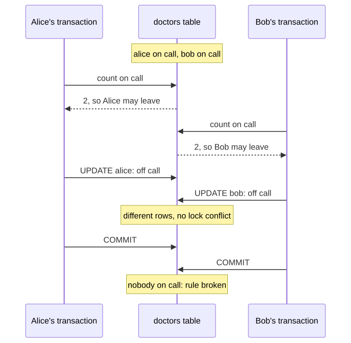
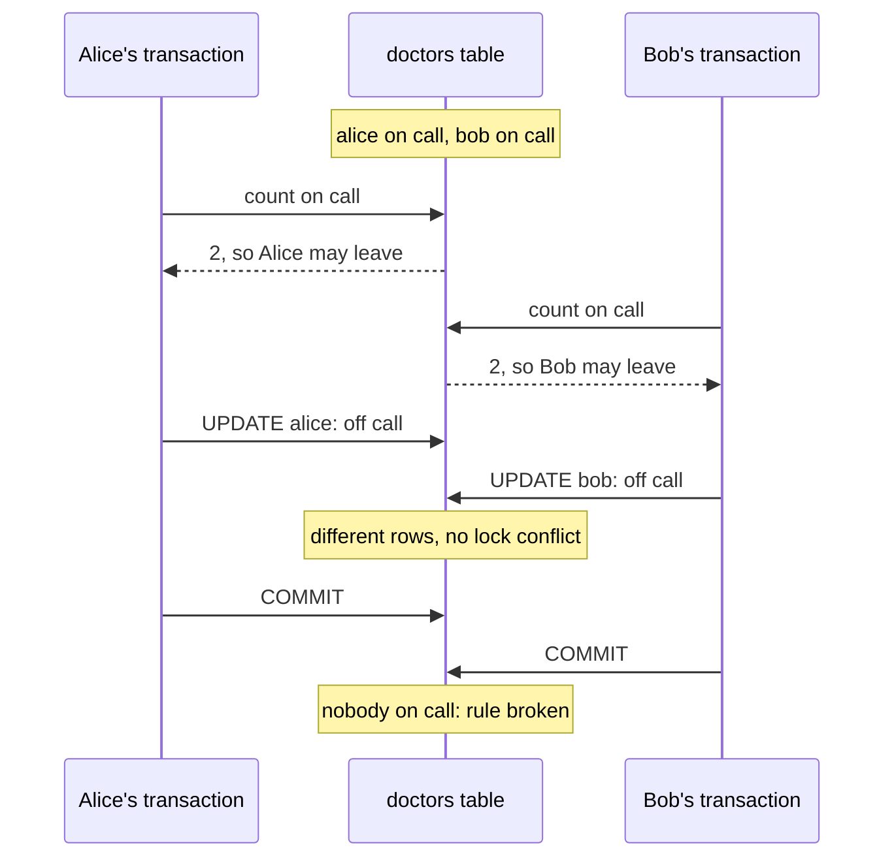

# M03 · Ch2 · §2 — Isolation levels, reproduced: every anomaly, at every level, in two engines

> **Module:** Databases & Storage (from first principles)
> **Chapter:** Transactions, concurrency and consistency — ACID (atomicity, consistency, isolation, durability),
> isolation levels, locking, MVCC (multi-version concurrency control)
> **Section:** Ch2 §1's Table 4 listed what each isolation level allows, as a preview. This section runs it. Eleven
> small schedules — two or three sessions, a fixed order of statements — were executed at every isolation level of
> PostgreSQL 18 and of MySQL 8.4's InnoDB engine, and every cell of the resulting matrix (Figure 1) is an observation,
> not a claim from a manual. Along the way it shows the three mechanisms underneath the levels — a snapshot per
> statement, a snapshot per transaction, and a conflict detector on top — and what each costs, including the write
> skew that only SERIALIZABLE stops, the read-only transaction that sees an impossible state, the retry loop
> SERIALIZABLE requires, and the places where MySQL, SQL Server and Oracle use the same level names for different
> guarantees.
> **Status:** 🔵 PREPARED 2026-10-29 — body written, awaiting your read and the Q&A.
> **Prerequisites:** **Ch2 §1 §6** (the anomalies, Table 4, the lost update measured) and **Ch2 §1 §11** (what
> REPEATABLE READ does at the moment of a write conflict, and the retry loop). **Ch1 §4 §14a** for row versions and
> `VACUUM`.

**Estimated study time:** 3–3.5 hours including the hands-on.

---

## Why this section exists — and how it's pitched

Isolation levels are usually taught as a table of ticks and crosses, and Ch2 §1 did the same. A table like that is
easy to memorise and hard to use, for two reasons this section is built around.

First, **the table is not the mechanism.** Each level is a specific rule about which version of a row a statement
sees and what happens when two transactions write. Once you know the rule, every cell follows, including the cells
that surprise people — a single `DELETE` at READ COMMITTED that misses a row which matched both before and after, or a
read-only report that sees an impossible state at REPEATABLE READ. So each level below is introduced by its rule and
then traced.

Second, **the level names do not mean the same thing across databases.** InnoDB's default REPEATABLE READ lets the
counter of Ch2 §1 lose 87% of its increments, exactly as READ COMMITTED does; Oracle's SERIALIZABLE is not
serializable. You will meet more than one engine in your career, and an ORM (object-relational mapper) that sets
"REPEATABLE READ" sets whatever the engine underneath calls that.

The method is borrowed from Martin Kleppmann's Hermitage project, which tests exactly this across databases: write
each anomaly as a short schedule of statements in separate sessions, run it at every level, and record what happens.
Here the schedules were automated (the harness is committed beside the figures, `diagrams/02-isolation-data/`), so
every result quoted below can be re-run in a few minutes.

---

## 1. The method: schedules, and the one definition of "correct"

<details>
<summary><b>Vocabulary for this section</b> — terms and abbreviations used below (click to expand)</summary>

**Abbreviations**

| Short | Stands for | Meaning |
|---|---|---|
| **MVCC** | multi-version concurrency control | keeping several versions of each row so readers and writers do not block each other |
| **T1, T2, T3** | transaction 1, 2, 3 | the concurrent transactions in a schedule, each in its own session |
| **ORM** | object-relational mapper | a library that maps classes to tables and issues the SQL for you |

**Terms**

| Term | Definition |
|---|---|
| **Schedule** | a fixed interleaving of the statements of several transactions — the unit every test below runs |
| **Serial execution** | running the transactions one at a time, in some order |
| **Serializable (outcome)** | an outcome that some serial order of the same transactions could have produced |
| **Anomaly** | an outcome that **no** serial order could have produced |
| **Isolation level** | the rule a database follows about what a transaction may see of concurrent transactions, and what happens when they conflict |
| **Blocked** | a statement waiting for a lock held by another transaction; it resumes when that transaction ends |
| **Serialization failure** | an error (SQLSTATE `40001`) by which the database aborts a transaction it cannot fit into a serial order |
| **Hermitage** | Martin Kleppmann's open-source suite of such schedules, run against many databases |

</details>

There is only one definition of a correct concurrent execution, and everything else is measured against it:

> **An execution is correct if its outcome is one that running the same transactions one at a time, in some order,
> could have produced.**

That property is **serializability**. It does not say which order — T1 then T2 and T2 then T1 are both acceptable — and
it says nothing about speed. Every **anomaly** is a concrete way of producing an outcome outside that set. An
**isolation level** is a promise about which anomalies the database will prevent. Only SERIALIZABLE promises all of
them; the weaker levels trade some away for concurrency.

To test a promise you need a schedule — a fixed interleaving of statements in separate sessions — whose outcome can be
checked against the serial orders. The table below lists the eleven used in this section. Each starts from a two-row
table `test (id, value)` holding `(1, 10)` and `(2, 20)`, unless it says otherwise.

**Table 1** — the eleven schedules, and the outcome that gives the anomaly away.

| Anomaly | Schedule (in order) | Anomalous outcome | Why no serial order gives it |
|---|---|---|---|
| **Dirty write** | T1 sets row 1 to 11; T2 sets row 1 to 12; T1 sets row 2 to 21; T1 commits; T2 sets row 2 to 22; T2 commits | rows end as (12, 21) or (11, 22) | each serial order leaves both rows from the same transaction |
| **Dirty read** | T1 sets row 1 to 101; T2 reads row 1; T1 rolls back | T2 read 101 | 101 never existed in any committed state |
| **Non-repeatable read** | T1 reads row 1; T2 sets it to 12 and commits; T1 reads row 1 again | T1 reads 10, then 12 | in a serial order T1's two reads are either both before T2 or both after |
| **Read skew** | T1 reads row 1; T2 moves 2 from row 2 to row 1 (12, 18) and commits; T1 reads row 2 | T1 sees 10 + 18 = 28, not 30 | T1 saw half of T2's transfer |
| **Phantom** | T1 selects `WHERE value % 3 = 0`; T2 inserts (3, 30) and commits; T1 selects again | the second select returns a row the first did not | same as the non-repeatable read, for a set of rows |
| **Lost update** | T1 and T2 both read row 1 (10); each writes 11; both commit | row 1 ends at 11, not 12 | serially, the second would read 11 and write 12 |
| **Write skew** | T1 and T2 both read rows 1 and 2; T1 writes row 1, T2 writes row 2; both commit | both writes land | the rule each checked (see §3) holds serially and fails here |
| **Write skew, inserts** | T1 and T2 both select `WHERE value % 3 = 0` (none); each inserts a matching row; both commit | two rows where each checked there were none | serially, the second would see the first's row |
| **Read-only anomaly** | three transactions; §3 traces it | a read-only report sees a state no serial order passes through | §3 |
| **Re-check surprise** (PostgreSQL only) | T1 adds 1 to every row; T2 deletes `WHERE hits = 10`; T1 commits | T2 deletes nothing | a row had `hits = 10` both before and after T1 |
| **Error mid-transaction** | T1 updates row 1, then hits a duplicate-key error, then commits | half of T1 committed | not an isolation anomaly: an atomicity one (§6) |

**How the harness runs a schedule.** Each session is its own database connection in its own thread. Statements are
issued in the order written. If a statement has not returned after one second it is recorded as **blocked**, and the
schedule carries on with the next statement; the blocked one is recorded again when it returns. That is how a lock
wait shows up in the traces below, and it is exactly what you would see with two `psql` windows side by side.

---

## 2. READ COMMITTED: a fresh snapshot for every statement

<details>
<summary><b>Vocabulary for this section</b> — terms and abbreviations used below (click to expand)</summary>

**Abbreviations**

| Short | Stands for | Meaning |
|---|---|---|
| **RC** | READ COMMITTED | the isolation level; PostgreSQL's default |
| **SQLSTATE** | — | the SQL standard's five-character error code; `40001` is serialization failure |

**Terms**

| Term | Definition |
|---|---|
| **Snapshot** | the set of committed transactions a statement (or transaction) treats as visible; row versions written by anyone else are invisible to it |
| **Row lock** | the lock an `UPDATE`, `DELETE` or `SELECT … FOR UPDATE` takes on each row it changes, held until the transaction ends |
| **Re-check** | at READ COMMITTED, what PostgreSQL does after waiting for a locked row: re-read its newest committed version and test the `WHERE` clause again |
| **Read skew** | reading two related values at different moments, so that together they describe a state that never existed |

</details>

**The rule.** At READ COMMITTED every **statement** takes a new snapshot when it starts: it sees everything committed
before that moment, and nothing uncommitted except its own transaction's writes. Writes take row locks. When a write
finds a row locked by another transaction, it waits; when that transaction ends, it **re-checks** the row's newest
committed version and carries on with it.

Everything in the READ COMMITTED column of Figure 1 follows from that rule:

- **No dirty reads**, because uncommitted versions are never in a snapshot: T2 read 10 while T1's 101 was pending.
- **No dirty writes**, because the second writer waits for the first's row lock. In the dirty-write schedule T2 blocked
  at its first `UPDATE`, ran after T1 committed, and the rows ended as (12, 22) — T2's values in both, which is the
  serial order T1, T2.
- **Non-repeatable reads, read skew and phantoms all happen**, because the second read is a new statement with a new
  snapshot that includes T2's commit. In the read-skew schedule T1 read row 1 = 10 before T2's transfer and row 2 = 18
  after it: a total of 28, where every committed state had 30. A report that sums balances one query at a time at READ
  COMMITTED can do exactly this.
- **Lost updates happen** when the value is computed in the application (Ch2 §1 §6), but `SET value = value + 1` is
  safe, because of the re-check: after waiting, the second `UPDATE` applies `+ 1` to the newest committed value. The
  harness confirms it — that schedule ended at 12.
- **Write skew happens**, because two transactions that write different rows never touch each other's locks (§3).

![A grid of outcomes. Rows are nine anomalies: dirty write, dirty read, non-repeatable read, read skew, phantom, lost update, write skew, write skew with inserts, and the read-only anomaly. Columns are PostgreSQL 18 at READ COMMITTED, REPEATABLE READ and SERIALIZABLE, and MySQL 8.4 InnoDB at READ UNCOMMITTED, READ COMMITTED, REPEATABLE READ and SERIALIZABLE. PostgreSQL READ COMMITTED: dirty write prevented by waiting, dirty read prevented, everything else happened. PostgreSQL REPEATABLE READ: dirty write and lost update aborted with 40001, the three read anomalies prevented, write skew, write skew with inserts and the read-only anomaly happened. PostgreSQL SERIALIZABLE: every anomaly prevented or aborted with 40001. InnoDB READ UNCOMMITTED: dirty write prevented by waiting, everything else happened including the dirty read. InnoDB READ COMMITTED: dirty write prevented by waiting, dirty read prevented, everything else happened. InnoDB REPEATABLE READ: dirty write prevented by waiting, dirty read, non-repeatable read, read skew and phantom prevented, lost update, write skew, write skew with inserts and the read-only anomaly happened. InnoDB SERIALIZABLE: the read anomalies prevented by waiting, the write anomalies aborted with deadlock error 1213.](diagrams/02-isolation-fig1.svg)

**Figure 1** — each schedule of Table 1, run once at every isolation level of PostgreSQL 18 and of MySQL 8.4's InnoDB
(the schedules are deterministic): "prevented" means the anomaly could not occur, "waits" that a lock made one session
wait until the other finished, "aborted" that the database killed one transaction with an error, and "HAPPENED" that
the anomalous outcome of Table 1 was observed.

### The re-check surprise

The re-check is what makes `value + 1` safe, and it has a side effect worth seeing once. This is the example from the
PostgreSQL manual, reproduced: a table `website` with rows (1, 9) and (2, 10). T1 adds 1 to every row; T2, meanwhile,
deletes the rows with `hits = 10`.

```text
T1: UPDATE website SET hits = hits + 1          ->  UPDATE 2          (rows now 10, 11 — uncommitted)
T2: DELETE FROM website WHERE hits = 10         ->  (blocked)
T1: COMMIT                                      ->  COMMIT
T2: ... DELETE FROM website WHERE hits = 10     ->  DELETE 0          (returned)
final: (1, 10), (2, 11)
```

A row with `hits = 10` existed before T1 (row 2) and after it (row 1), and T2 deleted neither. The mechanism is in the
rule. T2's statement took its snapshot before T1 committed, so the `WHERE` clause matched row 2 (10) and not row 1 (9).
Row 2 was locked, so T2 waited; after T1 committed, T2 re-checked row 2's newest version — 11 — found it no longer
matched, and skipped it. Row 1 never matched in T2's snapshot, so it was never re-checked at all. **A single statement
at READ COMMITTED can see a mixture of two states** — the snapshot for the rows it scans, the newest version for the
rows it waits on.

At REPEATABLE READ and SERIALIZABLE the same schedule ends with `ERROR 40001` on T2's `DELETE` instead, for the reason
Ch2 §1 §11b traced: the row changed after T2's snapshot, and the stricter levels refuse to act on a stale view.

**Why READ COMMITTED is still the default.** It never aborts a transaction for a concurrency reason, readers never
wait for writers or writers for readers, and every anomaly it allows needs a read followed by a dependent write in the
same transaction. Most short statements — `INSERT` a row, `UPDATE … SET n = n + 1` — are not affected. The trouble is
the read-then-decide-then-write transaction, and that is the pattern the next two sections are about.

---

## 3. REPEATABLE READ: one snapshot for the whole transaction

<details>
<summary><b>Vocabulary for this section</b> — terms and abbreviations used below (click to expand)</summary>

**Abbreviations**

| Short | Stands for | Meaning |
|---|---|---|
| **RR** | REPEATABLE READ | the isolation level; in PostgreSQL it is snapshot isolation |
| **SI** | snapshot isolation | each transaction reads from one snapshot taken at its first statement; concurrent writes to the same row abort one writer |

**Terms**

| Term | Definition |
|---|---|
| **First-updater-wins** | the snapshot-isolation rule: if a row was changed and committed after your snapshot was taken, you may not change it; the attempt aborts with `40001` |
| **Write set** | the rows a transaction writes |
| **Read set** | the rows (and, for a query with a condition, the range of possible rows) a transaction read |
| **Write skew** | two transactions read overlapping data and write **different** rows, so neither's write conflicts with the other's, yet together they break a rule each one checked |
| **Read-only anomaly** | a transaction that only reads, under snapshot isolation, seeing a state that no serial order of the writers passes through |

</details>

**The rule.** At REPEATABLE READ the snapshot is taken at the transaction's **first statement** and used for every
statement until it ends. Writes still take row locks. When a write meets a row that was changed **and committed** by
another transaction after its snapshot, it does not re-check; it aborts with `40001` — first-updater-wins (Ch2 §1
§11b).

PostgreSQL's REPEATABLE READ is what the research literature calls **snapshot isolation**. It is stronger than the SQL
standard's REPEATABLE READ (which allows phantoms) and weaker than serializable. Its column in Figure 1 follows:

- **Non-repeatable reads, read skew and phantoms are gone.** Every read in the transaction comes from the same
  snapshot, so T1 read 10 twice, read row 2 as 20 (total 30), and saw no new row on its second select.
- **Lost updates abort.** The second writer gets `40001` (Ch2 §1 §11).
- **So does `SET value = value + 1`.** This is the one to remember: at READ COMMITTED that statement was safe without
  any help, but at REPEATABLE READ it hits first-updater-wins like any other write, and the harness recorded `40001`
  for it. **Moving to a stricter level means every write transaction, including the ones that were already correct,
  needs the retry loop.**
- **Dirty write: blocked, then aborted.** T2 waited for T1's lock as before, but then aborted instead of overwriting.

What remains are the anomalies where the two transactions' **write sets do not overlap**. First-updater-wins only
compares writes with writes, so it cannot see them.

### Write skew: the doctors on call

The standard example has a rule — **at least one doctor must be on call** — and two doctors, Alice and Bob, both on
call and both feeling unwell. Each runs the same transaction: count the doctors on call; if there are at least two, go
off call.

<!-- DIAGRAM:START -->


<details>
<summary>Diagram source (Mermaid)</summary>



</details>
<!-- DIAGRAM:END -->

**Figure 2** — write skew: each transaction checks the rule against its own snapshot, writes a different row, and
commits; the rule both of them checked is broken by the pair.

The harness ran it at each level. At REPEATABLE READ:

```text
Alice: SELECT count(*) FROM doctors WHERE on_call                ->  (2)
Bob:   SELECT count(*) FROM doctors WHERE on_call                ->  (2)
Alice: UPDATE doctors SET on_call = false WHERE name = 'alice'   ->  UPDATE 1
Bob:   UPDATE doctors SET on_call = false WHERE name = 'bob'     ->  UPDATE 1
Alice: COMMIT                                                    ->  COMMIT
Bob:   COMMIT                                                    ->  COMMIT
final: (alice, False), (bob, False)
```

Nobody is on call. Each transaction's check was correct against its snapshot, and each wrote a row the other did not
touch, so there was no lock to wait for and no write-write conflict to detect. Run serially, the second transaction
would have counted 1 and stayed.

Write skew is the general shape of **check, then act on something else**. It turns up as:

- **Double-booking.** Two requests check that a meeting room is free from 10:00 to 11:00, and each inserts its own
  booking. The "write skew, inserts" schedule is this case: both selects found no matching row, both inserts committed.
  Because the conflicting rows do not exist at check time, there is no row to lock, which is why it is the harder
  variant to fix (§5).
- **Limits across rows.** "A user may have at most three active API keys", "the total of these allocations may not
  exceed the budget", "a username must be unique across two tables".
- **Overspending.** Two purchases each check that the gift card's balance covers them, then each insert a debit row
  rather than updating the balance.

The last one is not hypothetical. In 2014 the Flexcoin bitcoin exchange shut down after an attacker sent thousands of
simultaneous transfer requests, each of which checked a balance and then moved coins, and drained the exchange. In 2017
Todd Warszawski and Peter Bailis audited 12 popular self-hosted e-commerce applications and found **22 such
vulnerabilities** — coupons redeemed many times, stock oversold, gift cards overspent — on about 2 million websites.
**All 22 worked at the default isolation level of the databases they ran on.** Their second finding is the more
uncomfortable one: **17 of the 22 would have worked at SERIALIZABLE too**, because the application did the check and the
write in separate transactions (or no transaction at all). No isolation level protects a check that is not in the
same transaction as the act.

### The read-only anomaly

Snapshot isolation has one more gap, discovered by Alan Fekete, Elizabeth O'Neil and Patrick O'Neil in 2004, and it
surprises people who believe that a transaction which only reads cannot be part of a problem.

A bank has a checking account $x$ and a savings account $y$, both at 0. Three transactions:

- **T1** deposits 20 into savings.
- **T2** withdraws 10 from checking. If the withdrawal would leave the combined balance $x + y$ negative, it also
  charges a fee of 1.
- **T3** is a read-only report: it reads both balances.

```text
T2: SELECT k, bal FROM bank          ->  (x, 0), (y, 0)       T2 sees a combined 0: it will charge the fee
T1: UPDATE bank SET bal = bal + 20 WHERE k = 'y'               ->  UPDATE 1
T1: COMMIT                                                     ->  COMMIT
T3: SELECT k, bal FROM bank          ->  (x, 0), (y, 20)      the report
T3: COMMIT                                                     ->  COMMIT
T2: UPDATE bank SET bal = bal - 11 WHERE k = 'x'               ->  UPDATE 1
T2: COMMIT                                                     ->  COMMIT
final: (x, -11), (y, 20)
```

Each pair of transactions looks fine; the three together do not fit any order. T2 charged the fee, so in any serial
order T2 must come **before** T1 (it did not see the deposit). T3 saw the deposit but not the withdrawal, so T3 comes
after T1 and before T2. That gives T1 before T3 before T2, contradicting T2 before T1. The report T3 showed a customer
balances of 0 and 20 — a state from which the withdrawal should **not** have charged a fee — and then the fee
appeared. The final state is consistent; what the report saw is not consistent with it.

Take away from this one that **read-only does not mean safe** under snapshot isolation: a report, an audit or an
export that reads at REPEATABLE READ can show a state the system never legitimately passed through. It is rare, and
it needs at least two concurrent writers, but it is the reason PostgreSQL's SERIALIZABLE can abort transactions
involved with read-only ones, and why it offers a special mode for long reports (§4).

---

## 4. SERIALIZABLE: snapshot isolation plus a conflict detector

<details>
<summary><b>Vocabulary for this section</b> — terms and abbreviations used below (click to expand)</summary>

**Abbreviations**

| Short | Stands for | Meaning |
|---|---|---|
| **SSI** | serializable snapshot isolation | snapshot isolation plus tracking of read-write dependencies, aborting a transaction when they could form a cycle; PostgreSQL's SERIALIZABLE since 9.1 (2011) |
| **SIREAD lock** | snapshot-isolation read lock | PostgreSQL's record of what a SERIALIZABLE transaction read; blocks nothing, only remembered |

**Terms**

| Term | Definition |
|---|---|
| **rw-dependency** | T1 read a version that T2 then overwrote (or T1's query would have matched a row T2 inserted), so T1 must come before T2 in any serial order |
| **Dangerous structure** | two consecutive rw-dependencies, T1 → T2 → T3 (T1 may equal T3); every snapshot-isolation anomaly contains one |
| **Pivot** | the middle transaction of a dangerous structure |
| **False positive** | an abort of a transaction that was actually serializable, caused by coarse tracking |
| **Predicate lock** | a lock on "the rows matching this condition", including rows that do not exist yet |
| **Granularity** | how finely a lock covers data: one row (tuple), one page of a table or index, or a whole table (relation) |
| **DEFERRABLE** | a mode for a read-only SERIALIZABLE transaction: it waits for a safe snapshot, then can never fail or cause failures |

</details>

**The rule.** PostgreSQL's SERIALIZABLE is REPEATABLE READ with one addition: while transactions run, it records
**what each one read**, and at the moments a conflict could complete a cycle — a write, or a commit — it checks for a
specific pattern and aborts one transaction if it finds it. This is **serializable snapshot isolation** (SSI), from Michael
Cahill, Uwe Röhm and Alan Fekete (2008), built into PostgreSQL 9.1 by Dan Ports and Kevin Grittner in 2011.

The pattern comes from one theorem. Draw an arrow from T1 to T2 whenever T1 **read** something that T2 later
**overwrote** — a read-write dependency, which forces T1 before T2 in any serial order. Fekete and colleagues proved in
2005 that every anomaly snapshot isolation allows contains **two such arrows in a row**, T1 → T2 → T3, where the
first and last may be the same transaction and T3 commits first. So the database does not need to search for cycles
in a whole graph; it only needs to notice when a transaction acquires both an incoming and an outgoing rw-arrow.

The doctors fit it exactly. Alice read Bob's row (count on call) and Bob overwrote it: Alice → Bob. Bob read Alice's
row and Alice overwrote it: Bob → Alice. Two arrows in a row, so one must go:

```text
Alice: SELECT count(*) FROM doctors WHERE on_call                ->  (2)
Bob:   SELECT count(*) FROM doctors WHERE on_call                ->  (2)
Alice: UPDATE doctors SET on_call = false WHERE name = 'alice'   ->  UPDATE 1
Bob:   UPDATE doctors SET on_call = false WHERE name = 'bob'     ->  UPDATE 1
Alice: COMMIT                                                    ->  COMMIT
Bob:   COMMIT  ->  ERROR 40001: could not serialize access due to read/write dependencies among transactions
final: (alice, False), (bob, True)
```

Three things to read off this trace, and the two other SERIALIZABLE traces in the harness output:

- **Nothing waited.** SIREAD locks block nobody; they are bookkeeping. Every statement ran as fast as at REPEATABLE
  READ, and the cost arrived as an abort.
- **The error came at `COMMIT`.** Bob's every statement succeeded. Code that treats a successful `UPDATE` as success
  and does not check the `COMMIT` is wrong at this level. In the read-only-anomaly schedule the abort came earlier, at
  T2's `UPDATE`, because T1 and T3 had already committed and the structure was complete at that write. **A serialization
  failure can arrive at any statement, including `COMMIT`.**
- **The read-only transaction was not the victim**, but it was part of the structure: without T3 the deposit and the
  withdrawal alone are serializable (T2 before T1), and SSI let them through when the harness ran the schedule without
  T3. Reads are not free at SERIALIZABLE; they create the arrows.

**What it tracks, and why indexes matter.** "T1 read something T2 overwrote" needs a record of what T1 read, including
rows that did not exist yet — the phantom in "write skew, inserts". PostgreSQL records it at the granularity of the
access path: an index scan locks the **index pages** it visited (which cover the key range, so a later insert into that
range is caught); a sequential scan has no range to lock and takes a lock on the **whole table**. When too many locks
accumulate, they are promoted to coarser ones (`max_pred_locks_per_transaction` and its relatives). Coarse locks are
never wrong — they catch every real conflict — but they also catch conflicts that were not real, and abort
transactions that were serializable. Those are **false positives**, and how many you get depends on your indexes:

**Table 2** — false positives from coarse tracking: the doctors-on-call check per shift, 100 shifts of 10 doctors, 8 clients for 10 s, no retries (PostgreSQL 18, medians of 3 runs).

| Index the check can use | Level | Failed, % of attempts | Committed per second |
|---|---|---|---|
| unique index on `(shift, doc)` | REPEATABLE READ | 0.54% | 56,453 |
| unique index on `(shift, doc)` | SERIALIZABLE | 6.0% | 47,515 |
| none (sequential scan) | REPEATABLE READ | 0.60% | 24,213 |
| none (sequential scan) | SERIALIZABLE | **85%** | **2,837** |

Each transaction counts the doctors on call in one random shift and toggles one doctor in that shift. At REPEATABLE
READ about half a percent fail, from two transactions toggling the same doctor — first-updater-wins. At SERIALIZABLE
with the index, 6% fail: partly genuine write skew between two transactions on the same shift, partly coarseness,
because one index page holds the entries of many shifts and a lock on the page covers all of them. **Without the index
the check is a sequential scan, its SIREAD lock covers the whole table, and every toggle anywhere conflicts with every
concurrent check: 85% of attempts failed and throughput fell to 2,837 a second, 17 times lower than with the index.**
Nothing about the data or the transactions changed. At SERIALIZABLE, the indexes your checks use are part of
correctness-under-load, not only of speed.

### What each level costs

To put a number on the price, a transfer workload ran at each level: 8 clients for 10 seconds, each transaction
reading the source balance and then moving 1 between two random accounts, spread over 10 to 100,000 accounts, with no
retries so that every failure was counted. Durable commit was switched off (`synchronous_commit = off`), so the numbers
measure isolation rather than the drive's flush time (Ch2 §1 §4).

![Two log-scale line charts against the number of accounts, 10 to 100,000. Left: percentage of transactions that failed. REPEATABLE READ and SERIALIZABLE fall together from 61% and 85% at 10 accounts to 17% at 100, 2.2% at 1,000, 0.22% at 10,000 and 0.02% at 100,000. READ COMMITTED fails only through deadlocks, 3.7% at 10 accounts, 0.04% at 100, and none from 10,000 accounts. Right: committed transactions per second, about 28 to 59 at 10 accounts for all three levels, 2,000 to 4,000 at 100, and 35,000 to 52,000 from 1,000 accounts upward with the three levels close together.](diagrams/02-isolation-fig3.svg)

**Figure 3** — a transfer workload at each level over 10 to 100,000 accounts (PostgreSQL 18, 8 clients, 10 s, no
retries, medians of 3 runs): the failure rate is set by contention, and SERIALIZABLE costs about the same as REPEATABLE
READ here.

- **Failures follow contention.** At REPEATABLE READ the failure rate fell about tenfold for each tenfold increase in
  accounts — 61% at 10, 17% at 100, 2.2% at 1,000, 0.23% at 10,000 and 0.02% at 100,000 — because the chance that two
  of eight in-flight transfers touch the same account falls in proportion to the number of accounts. With a retry loop
  each of those percentages becomes extra work rather than errors.
- **SERIALIZABLE added almost nothing on this workload.** Every account a transfer reads, it also writes, so any
  read-write dependency between two transfers is also a write-write conflict that first-updater-wins already aborts.
  SSI only found something extra at 10 accounts (85% against 61%), where three-transaction structures are common. It
  is the workloads that read rows they do not write — checks, like Table 2's — where SERIALIZABLE costs more.
- **READ COMMITTED had no serialization failures at all**, only deadlocks (two transfers locking the same two accounts in
  opposite orders) — 10 to 14 per run at 10 accounts, none from 10,000. It was correct here only because the transfer
  writes `bal = bal - 1` and does not act on the balance it read; add "refuse if the balance is too low" and it would
  need `FOR UPDATE` (§5).
- **Throughput depends on contention far more than on the level.** At 10 accounts every level collapsed to 28 to 59
  committed transactions a second, because transactions queue on the same ten row locks and each deadlock waits out
  `deadlock_timeout` (one second) before it is detected. From 1,000 accounts up, every level ran at 35,000 to 52,000 a
  second, and the run-to-run spread was larger than the differences between levels.

**Read-only reports: `SERIALIZABLE READ ONLY DEFERRABLE`.** A long report at SERIALIZABLE would accumulate SIREAD locks
for minutes and drag everything that writes into dangerous structures. For a transaction declared `READ ONLY
DEFERRABLE`, PostgreSQL instead waits at the start until it can take a snapshot that no concurrent writer can make
anomalous, then runs with no tracking and no possibility of failure. The wait is usually short and is the price of a
report that can never show the read-only anomaly of §3.

---

## 5. Fixing write skew without SERIALIZABLE

<details>
<summary><b>Vocabulary for this section</b> — terms and abbreviations used below (click to expand)</summary>

**Abbreviations**

| Short | Stands for | Meaning |
|---|---|---|
| **GiST** | generalized search tree | a PostgreSQL index type for ranges, geometry and similar; exclusion constraints use it |

**Terms**

| Term | Definition |
|---|---|
| **Locking read** | `SELECT … FOR UPDATE` (or `FOR SHARE`): a read that takes row locks on what it returns |
| **Materializing the conflict** | creating a row that stands for the thing being checked (a shift, a room, a day), so there is something to lock |
| **Exclusion constraint** | a PostgreSQL constraint that no two rows may satisfy a given operator together — for example, no two bookings of the same room with overlapping times |
| **Range type** | a PostgreSQL column type holding an interval, such as `tstzrange` (a span of timestamps) |

</details>

SERIALIZABLE fixes write skew for every transaction at once, at the price of §4. When you would rather fix one rule,
the ways to do it in PostgreSQL, each run through the harness, are:

**Table 3** — four ways to keep "at least one doctor on call" at READ COMMITTED, as measured (PostgreSQL 18).

| Approach | What Bob's transaction did | Final state | Correct? |
|---|---|---|---|
| Check, then update (the original) | counted 2, updated | both off call | ✗ |
| One statement: `UPDATE … WHERE name = 'bob' AND (SELECT count(*) …) >= 2` | `UPDATE 1` — the subquery saw its own statement's snapshot | both off call | ✗ |
| Lock what you check: `SELECT … WHERE on_call FOR UPDATE`, then update | **blocked** on Alice's lock; after her commit its re-check returned 1, so it did not update | Alice off, Bob on | ✓ |
| SERIALIZABLE (§4) | `40001` at `COMMIT` | Alice off, Bob on | ✓ (after a retry, Bob stays on call) |

The second row is the trap. Folding the check into the `UPDATE` makes it one statement, but not one atomic check: the
subquery reads its snapshot, takes no lock on the rows it counts, and Alice's concurrent change to a different row does
not block it. **A single statement is atomic; it is not isolated against write skew.** Only the row being written is
locked, and the rows that the rule depends on are not.

The rule of thumb is **lock what the decision depends on, not only what you change**:

- **The rows exist → `SELECT … FOR UPDATE` on them.** That is the third row. The second transaction waits at its
  check and then sees the first's result. At REPEATABLE READ the same code gets `40001` instead of a fresh result, so
  it needs the retry loop.
- **The rows do not exist yet (bookings, unique-across-tables) → materialize the conflict.** There is nothing to lock
  in an empty time slot, so create a row that stands for the thing being checked — one row per room per day, say —
  and lock that with `FOR UPDATE` before checking. It serializes exactly the transactions that compete for that room
  and day.
- **The rule can be stated as a constraint → let the database enforce it.** This is the strongest fix, because it
  holds for every code path, including the ones written next year. For overlapping bookings PostgreSQL has the
  **exclusion constraint**:

  ```sql
  CREATE EXTENSION btree_gist;          -- lets the GiST index compare plain integers with =
  CREATE TABLE booking (
      room   int,
      during tstzrange,
      EXCLUDE USING gist (room WITH =, during WITH &&)   -- no two rows: same room AND overlapping times
  );
  ```

  In the harness, two transactions each checked that room 1 was free (both counted 0), and each inserted an
  overlapping booking. The second `INSERT` blocked on the first's uncommitted row, and when T1 committed it failed
  with `ERROR 23P01: conflicting key value violates exclusion constraint` — at every isolation level, READ COMMITTED
  included. Uniqueness across rows (`UNIQUE`, partial unique indexes such as "one active subscription per user") works
  the same way.

---

## 6. The retry loop, in general

<details>
<summary><b>Vocabulary for this section</b> — terms and abbreviations used below (click to expand)</summary>

**Abbreviations**

| Short | Stands for | Meaning |
|---|---|---|
| **SQLSTATE** | — | the SQL standard's five-character error code |
| **LLM** | large language model | — |
| **HTTP** | Hypertext Transfer Protocol | — |

**Terms**

| Term | Definition |
|---|---|
| **`40001` serialization_failure** | the error REPEATABLE READ and SERIALIZABLE use for a conflict they will not allow |
| **`40P01` deadlock_detected** | the error PostgreSQL raises when two transactions wait for each other's locks; one is aborted |
| **Backoff** | waiting before a retry, usually for a randomised and growing interval, so the colliding transactions do not collide again |
| **Idempotent** | safe to perform more than once with the same effect as once |

</details>

Ch2 §1 §11 built the retry loop for one counter. At REPEATABLE READ and SERIALIZABLE it is needed by **every**
transaction that writes, and §3 and §4 added three facts it has to respect:

```python
import random, time
import psycopg
from psycopg import errors

RETRYABLE = (errors.SerializationFailure, errors.DeadlockDetected)    # SQLSTATE 40001, 40P01

def run_serializable(conn, work, max_tries=10):
    for attempt in range(max_tries):
        try:
            with conn.transaction():                    # BEGIN … COMMIT; ROLLBACK on any exception
                conn.execute("SET TRANSACTION ISOLATION LEVEL SERIALIZABLE")
                return work(conn)                       # every read and every write, inside the attempt
        except RETRYABLE:
            time.sleep(random.uniform(0, 0.01 * 2 ** attempt))      # backoff with jitter
    raise RuntimeError(f"gave up after {max_tries} attempts")       # surface it; never swallow it
```

- **The whole transaction is the unit**, because the failure can come at any statement including `COMMIT` (§4). The
  function `work` must do all its reads inside the attempt, so that a retry decides again from a new snapshot.
- **Retry on the code, `40001` and `40P01`, not on the message.** Deadlocks are retryable in the same way and happen
  at every level (the transfer workload in §4 produced them even at READ COMMITTED, when two transfers locked the same
  two accounts in opposite orders).
- **Nothing outside the database is rolled back.** An email sent, an HTTP call made, a message published or an LLM
  called inside `work` happens once per attempt. Keep external effects outside the transaction, after it commits, or
  make them idempotent (Ch2 §1 §4 and Ch2 §1 §7; Ch2 §4's outbox).
- **Most frameworks will not do this for you.** Django and SQLAlchemy surface the error and leave the retry to you;
  Spring has a retry module you must configure. CockroachDB, whose default level is SERIALIZABLE, documents a
  client-side retry loop of exactly this shape.

---

## 7. The same names in other engines

<details>
<summary><b>Vocabulary for this section</b> — terms and abbreviations used below (click to expand)</summary>

**Abbreviations**

| Short | Stands for | Meaning |
|---|---|---|
| **InnoDB** | — | MySQL's default storage engine; it implements MySQL's transactions and isolation |
| **RU** | READ UNCOMMITTED | the weakest SQL level; allows dirty reads |
| **RCSI** | read committed snapshot isolation | SQL Server's READ COMMITTED with the `READ_COMMITTED_SNAPSHOT` option on: a snapshot per statement, as in PostgreSQL |
| **SCN** | system change number | Oracle's logical clock; a snapshot is "as of an SCN" |

**Terms**

| Term | Definition |
|---|---|
| **Consistent read** | InnoDB's name for a plain `SELECT` that reads from the transaction's snapshot |
| **Current read** | InnoDB's name for a read that sees the newest committed version and locks it: `UPDATE`, `DELETE`, `SELECT … FOR UPDATE` / `FOR SHARE` |
| **Gap lock / next-key lock** | InnoDB locks on the space between index entries, which stop inserts into a range |
| **Deadlock** | two transactions each waiting for a lock the other holds; the database aborts one (MySQL error `1213`) |
| **Statement rollback** | undoing only the failed statement, leaving the rest of the transaction open — InnoDB's response to most errors |

</details>

The SQL standard of 1992 defined its four level names by which of three anomalies each forbids, and Hal Berenson and
colleagues showed in 1995 that the definitions were ambiguous and incomplete. Each engine then filled in the gaps its
own way. The same harness ran against MySQL 8.4 with its default InnoDB engine, and the right half of Figure 1 is the
result. Five differences matter in practice.

**1. InnoDB's default REPEATABLE READ does not prevent lost updates.** In the lost-update schedule both transactions
committed and the row ended at 11 — no error. To see what that does at scale, Ch2 §1's counter was run against InnoDB:

**Table 4** — Ch2 §1's counter on MySQL 8.4 InnoDB: 8 clients each add 1 to one row 2,000 times (3 runs).

| Method | Level | Final value (of 16,000) | Retries |
|---|---|---|---|
| read, then write | READ COMMITTED | 2,018 – 2,024 | — |
| read, then write | **REPEATABLE READ (the default)** | **2,013 – 2,029** | — |
| read, then write, retrying deadlocks | SERIALIZABLE | 16,000 | 94,641 – 94,869 deadlocks |
| `UPDATE … SET n = n + 1` | REPEATABLE READ | 16,000 | — |
| `SELECT … FOR UPDATE`, then write | REPEATABLE READ | 16,000 | — |

The default level lost 87% of the increments, the same as READ COMMITTED. In PostgreSQL the same level raised `40001`
on every one of them. **Code that is safe on PostgreSQL's REPEATABLE READ because of first-updater-wins is not safe on
MySQL's**; on MySQL, use `n = n + 1` or `FOR UPDATE`.

**2. In InnoDB, reads and writes in one transaction look at different data.** A plain `SELECT` is a **consistent
read** from the transaction's snapshot. An `UPDATE`, `DELETE` or locking `SELECT` is a **current read** of the newest
committed rows. So a transaction can update rows its own `SELECT` cannot see:

```text
T1: SELECT id, value FROM test WHERE value % 3 = 0            ->  no rows
T2: INSERT INTO test VALUES (3, 30); COMMIT
T1: UPDATE test SET value = value + 3 WHERE value % 3 = 0     ->  1 row(s)      (PostgreSQL RR: UPDATE 0)
T1: SELECT id, value FROM test WHERE value % 3 = 0            ->  (3, 33)       (PostgreSQL RR: no rows)
```

After its own update, the row appeared in T1's snapshot — a phantom that the level is supposed to prevent, produced by
the transaction itself. This is also why the lost update gets through: T2's `UPDATE` is a current read, so it simply
overwrites the newest version instead of checking it against T2's snapshot.

**3. InnoDB's SERIALIZABLE is locking, not snapshot-based.** Inside a transaction it turns every plain `SELECT` into
`SELECT … FOR SHARE`,
so readers take shared locks and writers wait for them. In Figure 1 that shows as "waits" for the read anomalies and as
`ERROR 1213: Deadlock found when trying to get lock` for the write ones: both transactions hold a shared lock on the
row they read and each needs an exclusive lock on it to write, so they deadlock and one is killed. It is correct — the
counter came out at 16,000 — but under contention it costs about six deadlocks per increment (94,700 for 16,000), and
readers block writers, which neither PostgreSQL level does.

**4. An error inside an InnoDB transaction rolls back only the statement.** The "error mid-transaction" schedule:

```text
T1: UPDATE test SET value = 11 WHERE id = 1     ->  1 row(s)
T1: INSERT INTO test VALUES (2, 99)             ->  ERROR 1062: Duplicate entry '2' for key 'test.PRIMARY'
T1: COMMIT                                      ->  OK
final: (1, 11), (2, 20)                             PostgreSQL: 23505, then COMMIT replies ROLLBACK, final (1, 10)
```

In PostgreSQL the error aborts the whole transaction and `COMMIT` turns into `ROLLBACK` (Ch2 §1 §2). In InnoDB the
transaction stays open with the `UPDATE` still in it, and a client that ignores the error and commits **commits half a
transaction**. Deadlocks are the exception — they roll back the whole transaction — and lock-wait timeouts roll back
only the statement unless `innodb_rollback_on_timeout` is on. Atomicity in MySQL therefore depends on the client
rolling back on error, which drivers and ORMs usually do and hand-written scripts often do not.

**5. READ UNCOMMITTED is real.** InnoDB at READ UNCOMMITTED returned 101 to T2 — a value that was rolled back a moment
later. PostgreSQL accepts the name and gives you READ COMMITTED.

**SQL Server and Oracle** were not run here; their manuals and the Hermitage results say:

**Table 5** — what each engine actually provides under each level name (PostgreSQL and InnoDB measured above; SQL Server and Oracle from their documentation and Hermitage).

| Level name | PostgreSQL 18 | MySQL 8.4 InnoDB | SQL Server | Oracle |
|---|---|---|---|---|
| READ UNCOMMITTED | = READ COMMITTED | dirty reads allowed | dirty reads allowed | not offered |
| READ COMMITTED | snapshot per statement (**default**) | snapshot per statement | **locking** by default: readers wait for writers (**default**); snapshot per statement if `READ_COMMITTED_SNAPSHOT` is on (the default in Azure SQL Database) | snapshot per statement (**default**) |
| REPEATABLE READ | snapshot isolation; lost update aborts | snapshot reads, current-read writes; **lost update allowed** (**default**) | locking: shared locks held to the end; phantoms allowed | not offered |
| SNAPSHOT | — | — | snapshot isolation (error 3960 on a write conflict); must be enabled per database | — |
| SERIALIZABLE | **serializable** (SSI) | serializable by locking; conflicts become deadlocks | serializable by locking (key-range locks) | **snapshot isolation** (`ORA-08177` on a write conflict): **write skew allowed** |

Two cells deserve emphasis. **Oracle's SERIALIZABLE is snapshot isolation** — the same guarantee as PostgreSQL's
REPEATABLE READ — so the doctors both go off call at Oracle's strongest level; Hermitage records it, and the ACIDRain
audit above found its vulnerabilities on Oracle 12c among others. And **SQL Server's default READ COMMITTED takes
shared locks**, so on a default on-premises install a long report blocks writers and a writer blocks the report — the
behaviour MVCC was invented to remove, and the reason most SQL Server shops turn on `READ_COMMITTED_SNAPSHOT`.

The lesson generalises: **an isolation level is identified by its behaviour, not its name.** When an application moves
between databases, or an ORM's documentation says "use REPEATABLE READ", run the schedules — Hermitage has them for a
dozen engines — rather than trusting the label.

---

## 8. Choosing a level

<details>
<summary><b>Vocabulary for this section</b> — terms and abbreviations used below (click to expand)</summary>

**Terms**

| Term | Definition |
|---|---|
| **Invariant** | a rule the data must always satisfy, such as "at least one doctor on call" |
| **Contention** | how often concurrent transactions touch the same rows |
| **Hot row** | a row that many transactions update, so they queue on its lock |

</details>

**Table 6** — a starting point for PostgreSQL; the reasoning is in the sections cited.

| Situation | Level | What you must also do |
|---|---|---|
| Single statements; increments written as `SET n = n + 1`; inserts | READ COMMITTED (default) | nothing (§2) |
| Read, decide in the application, write the **same** rows | READ COMMITTED + `SELECT … FOR UPDATE` | keep the transaction short (Ch2 §1 §7) |
| Read, decide, write **other** rows (an invariant across rows) | a constraint if one fits; otherwise `FOR UPDATE` on what you checked, a materialized conflict, or SERIALIZABLE | §5 |
| Many such invariants, written by many people, hard to audit one by one | SERIALIZABLE everywhere | retry loop on every transaction (§6); indexes on what the checks read (Table 2) |
| A report or export that must be consistent across several queries | REPEATABLE READ, or `SERIALIZABLE READ ONLY DEFERRABLE` if it must also be free of the read-only anomaly | no retry needed for a read-only REPEATABLE READ transaction |
| A hot row | none of the levels helps throughput | redesign the data (Ch2 §1 §6 finding 4) |

Two judgments sit under that table. **SERIALIZABLE trades a design problem for an operational one**: you no longer
have to find every write skew in the code, but every transaction can fail and must be retried, and the failure rate
depends on contention and indexes. On a codebase where many people write transactions against shared invariants, that
trade is usually worth it; on one with a few well-understood write paths, targeted locks and constraints are cheaper
and fail less. And **a level is a property of a transaction, not of a database**: you can run the money-moving
transactions at SERIALIZABLE and leave everything else at READ COMMITTED. SSI only checks transactions that are
themselves SERIALIZABLE, so a READ COMMITTED transaction that writes the same rows is not protected against.

---

## 9. Failure modes — the isolation checklist

<details>
<summary><b>Vocabulary for this section</b> — terms and abbreviations used below (click to expand)</summary>

**Terms**

| Term | Definition |
|---|---|
| **Write skew** | two transactions check a rule, write different rows, and together break it |
| **False positive** | a serialization failure for a transaction that was in fact serializable |
| **Statement rollback** | undoing only the failed statement, not the transaction |

</details>

- **A rule that holds in tests and breaks under load** — two on-call doctors gone, a room booked twice, a coupon used
  twice. Write skew (§3). Look for check-then-act across rows; fix with a constraint, `FOR UPDATE` or SERIALIZABLE
  (§5).
- **"We put the check in the same `UPDATE`, so it's atomic."** Atomic, not isolated (Table 3). The rows the subquery
  reads are not locked.
- **A report whose totals don't add up.** Several queries at READ COMMITTED, each with its own snapshot — read skew
  (§2). Run the report as one REPEATABLE READ transaction.
- **A `DELETE` or `UPDATE` at READ COMMITTED that missed rows it should have hit**, under concurrency only. The re-check
  surprise (§2).
- **Moving to REPEATABLE READ or SERIALIZABLE produced errors in code that "was correct".** First-updater-wins applies to
  `SET n = n + 1` too (§3). Every writing transaction needs the retry loop (§6).
- **Serialization failures reported at `COMMIT`, ignored.** At SERIALIZABLE the failure often arrives at `COMMIT` (§4);
  check its outcome.
- **A sudden rise in serialization failures after a schema change.** An index the checks used was dropped, or a query
  switched to a sequential scan, and SIREAD locks went from pages to the whole table (Table 2).
- **Lost updates on MySQL "even though we use REPEATABLE READ".** InnoDB's REPEATABLE READ does not prevent them
  (Table 4). Use `n = n + 1` or `FOR UPDATE`.
- **Half a transaction committed on MySQL.** An error rolled back only the statement and the client committed anyway
  (§7). Roll back on any error.
- **Reports blocking writers on SQL Server.** Locking READ COMMITTED; turn on `READ_COMMITTED_SNAPSHOT` (§7).
- **"SERIALIZABLE" on Oracle and write skew in production.** It is snapshot isolation (Table 5).
- **Check in one request, act in another.** No isolation level can help (§3, the ACIDRain finding); put both in one
  transaction or make the act re-check with a lock or a constraint.

---

## 10. Check your understanding

1. State the definition of a correct concurrent execution that every isolation level is measured against.
2. At READ COMMITTED, why does `UPDATE … SET n = n + 1` not lose updates, while reading `n` and writing `n + 1` from the
   application does?
3. In the re-check surprise, explain why T2's `DELETE … WHERE hits = 10` deleted nothing, row by row.
4. A report runs `SELECT sum(balance) FROM accounts WHERE branch = 1` and then `SELECT sum(balance) FROM accounts WHERE
   branch = 2` while transfers between branches commit. At READ COMMITTED the grand total is sometimes wrong. Name the
   anomaly and give the smallest fix.
5. Why does `SET n = n + 1` fail with `40001` at REPEATABLE READ when it was safe at READ COMMITTED, and what does
   that mean for the code?
6. Explain why snapshot isolation cannot detect the doctors' write skew, in terms of write sets.
7. In the read-only anomaly, derive the contradiction that shows no serial order exists.
8. What exactly does SSI look for, and why is it enough to look for that instead of a full cycle?
9. In Table 2, why did dropping the index raise the serialization-failure rate, although the data and the transactions
   were the same?
10. A colleague fixes write skew in a room-booking service with `INSERT … SELECT … WHERE NOT EXISTS (overlapping
    booking)` as one statement at READ COMMITTED. Will it work? What would you use instead?
11. Your service moves from PostgreSQL to MySQL, keeping REPEATABLE READ. Name two behaviours that change and what
    could break.
12. Oracle's documentation calls its strongest level SERIALIZABLE. Does the doctors' write skew happen there? Why?

<details>
<summary>Answers</summary>

1. **An execution is correct if its outcome could have been produced by running the same transactions one at a time,
   in some order** — serializability (§1). Any outcome outside that set is an anomaly.
2. **The arithmetic happens on the newest committed value.** The second `UPDATE` waits for the first's row lock and then
   re-checks the row's newest version, applying `+ 1` to it (§2). An application that read `n` earlier computed from a
   value that is stale by the time it writes, and READ COMMITTED does not compare the two.
3. **Row 2 was re-checked and no longer matched; row 1 was never checked** (§2). T2's snapshot had (1, 9) and (2, 10),
   so its `WHERE` matched only row 2. Row 2 was locked by T1, so T2 waited, then re-read its newest version, 11, which
   failed `hits = 10`. Row 1 did not match in T2's snapshot and is not re-read, so its new value 10 was never seen.
4. **Read skew** — each query has its own snapshot, so a transfer committed between them is counted on neither side or
   both (§2). The smallest fix is to run both queries in one REPEATABLE READ transaction, so they share a snapshot (or
   compute both sums in one statement).
5. **First-updater-wins applies to every write** (§3). The row was changed and committed after the transaction's
   snapshot, and REPEATABLE READ refuses to change such a row rather than re-checking it. So at REPEATABLE READ and
   SERIALIZABLE every writing transaction, including ones that were correct at READ COMMITTED, must be retried on
   `40001` (§6).
6. **Their write sets do not overlap** (§3). Snapshot isolation only aborts a transaction that writes a row someone
   else wrote and committed after its snapshot. Alice writes Alice's row and Bob writes Bob's, so there is no
   write-write conflict; the conflict is between each one's **read** and the other's **write**, which snapshot isolation
   does not track.
7. **T2 must precede T1, and T1 must precede T3, which must precede T2** (§3). T2 charged the fee, so it did not see the
   deposit: T2 before T1. T3 saw the deposit: T1 before T3. T3 did not see the withdrawal: T3 before T2. T2 before T1
   before T3 before T2 is a cycle, so no serial order exists.
8. **Two consecutive read-write dependencies, T1 → T2 → T3** — a transaction with both an incoming and an outgoing
   rw-arrow (§4). Fekete and colleagues proved that every snapshot-isolation anomaly contains such a structure, so
   detecting it catches every anomaly; it can also flag structures that would not have closed into a cycle, which is
   one source of false positives.
9. **Without the index the check's read was a sequential scan, so its SIREAD lock covered the whole table** (§4). Every
   update to any shift then counted as overwriting something every concurrent checker had read, creating rw-arrows
   between transactions on different shifts that never really conflicted. With the index, the locks covered only the
   pages for the shift each transaction read.
10. **No** (§5, Table 3). The `NOT EXISTS` subquery reads the statement's snapshot and locks nothing; two concurrent
    inserts for overlapping times both see no conflict and both succeed — the "write skew, inserts" schedule. Use an
    exclusion constraint (`EXCLUDE USING gist (room WITH =, during WITH &&)`), which fails the second insert at any
    level; or lock a materialized row per room and day before checking; or run at SERIALIZABLE.
11. **Lost updates stop raising `40001` and silently happen, and writes start seeing rows the snapshot does not** (§7,
    Table 4). Any code relying on PostgreSQL's first-updater-wins (read, compute, write, retry on `40001`) will lose
    updates. Also, errors no longer abort the transaction: code that relied on PostgreSQL turning `COMMIT` into
    `ROLLBACK` can commit half a transaction.
12. **Yes** (§7, Table 5). Oracle's SERIALIZABLE is snapshot isolation: it aborts write-write conflicts with `ORA-08177`
    but does not track read-write dependencies, so two transactions that read both rows and write different ones both
    commit.

</details>

---

## 11. Optional: get your hands dirty (60 min)

Everything here runs on Docker. The harness that produced Figure 1 is `diagrams/02-isolation-data/schedules.py`; it
needs `pip install 'psycopg[binary]' pymysql`.

```sh
docker run -d --name iso-pg -p 55432:5432 -e POSTGRES_PASSWORD=x postgres:18
docker run -d --name iso-my -p 53306:3306 -e MYSQL_ROOT_PASSWORD=x -e MYSQL_DATABASE=t mysql:8.4
python schedules.py pg "doctors on call"          # one schedule, every PostgreSQL level
python schedules.py my                            # every schedule, every InnoDB level
```

**1. Two windows.** Open two `psql` sessions and run the doctors schedule by hand at each level. At SERIALIZABLE, note
which statement fails. Then swap the order of the two `COMMIT`s and see which transaction is chosen.

**2. The re-check surprise.** Reproduce §2's `website` example by hand at READ COMMITTED, then change T2's statement to
`DELETE FROM website WHERE hits >= 10` and predict the result before running it.

**3. Watch SSI's bookkeeping.** In a SERIALIZABLE transaction run the doctors' `count(*)`, then in another session
`SELECT locktype, relation::regclass, page, tuple FROM pg_locks WHERE mode = 'SIReadLock';`. Drop the index (or query
a column with none) and look again.

**4. Find the lost update on MySQL.** With two `mysql` sessions at REPEATABLE READ, run the lost-update schedule and
confirm both commit. Then repeat it with `SELECT … FOR UPDATE` and with `UPDATE … SET value = value + 1`.

**5. Half a transaction.** On MySQL, run `START TRANSACTION;`, an `UPDATE`, an `INSERT` that repeats an existing
primary key, and `COMMIT;`, then check what was saved. Do the same on PostgreSQL and read the reply to `COMMIT`.

**6. An exclusion constraint.** Create §5's `booking` table and try to insert two overlapping bookings for the same
room, then for different rooms, then two that touch at an endpoint (`[10:00, 11:00)` and `[11:00, 12:00)`).

When you are done: `docker rm -f iso-pg iso-my`.

---

## Key terms (English · 大陆 简体 · 台灣 繁體)

| English | 大陆 (简体) | 台灣 (繁體) | Note |
|---|---|---|---|
| Isolation level | 隔离级别 | 隔離等級 | ⚠ 级别 ↔ **等級** |
| Serializability / serializable | 可串行化 | 可序列化 | ⚠ 串行 ↔ **序列** |
| Schedule | 调度 | 排程 | ⚠ 调度 ↔ **排程** |
| Snapshot isolation | 快照隔离 | 快照隔離 | |
| Read committed | 读已提交 | 讀取已認可 | ⚠ 提交 ↔ **認可** (Microsoft 台灣) |
| Repeatable read | 可重复读 | 可重複讀取 | |
| Read skew | 读偏斜 | 讀取偏斜 | |
| Write skew | 写偏斜 | 寫入偏斜 | |
| Phantom read | 幻读 | 幻影讀取 | ⚠ 幻读 ↔ **幻影讀取** |
| Lost update | 丢失更新 | 遺失更新 | ⚠ 丢失 ↔ **遺失** |
| Serialization failure | 串行化失败 | 序列化失敗 | ⚠ 串行 ↔ **序列** |
| Predicate lock | 谓词锁 | 述詞鎖定 | ⚠ 谓词 ↔ **述詞** |
| Deadlock | 死锁 | 死結 | ⚠ 锁 ↔ **結** |
| False positive | 误报 / 假阳性 | 誤報 / 偽陽性 | |
| Exclusion constraint | 排他约束 | 排除條件約束 | ⚠ 约束 ↔ **條件約束** |
| Retry | 重试 | 重試 | |

---

## References

- H. Berenson, P. Bernstein, J. Gray, J. Melton, E. O'Neil and P. O'Neil — *A Critique of ANSI SQL Isolation Levels*
  (ANSI: American National Standards Institute), SIGMOD (Special Interest Group on Management of Data) 1995 — the
  anomaly catalogue and snapshot isolation defined — <https://arxiv.org/abs/cs/0701157>
- A. Fekete, E. O'Neil and P. O'Neil — *A Read-Only Transaction Anomaly Under Snapshot Isolation*, SIGMOD Record
  33(3), 2004 — §3's three-transaction example — <https://doi.org/10.1145/1031570.1031573>
- A. Fekete, D. Liarokapis, E. O'Neil, P. O'Neil and D. Shasha — *Making Snapshot Isolation Serializable*, ACM
  (Association for Computing Machinery) Transactions on Database Systems 30(2), 2005 — the two-consecutive-dependencies
  theorem of §4 — <https://doi.org/10.1145/1071610.1071615>
- M. Cahill, U. Röhm and A. Fekete — *Serializable Isolation for Snapshot Databases*, SIGMOD 2008 — the SSI algorithm
  of §4 — <https://doi.org/10.1145/1376616.1376690>
- D. Ports and K. Grittner — *Serializable Snapshot Isolation in PostgreSQL*, VLDB (Very Large Data Bases) 2012 —
  PostgreSQL's implementation, SIREAD lock granularity, `DEFERRABLE` — <https://arxiv.org/abs/1208.4179> · PostgreSQL
  wiki, *SSI* — worked examples — <https://wiki.postgresql.org/wiki/SSI>
- M. Kleppmann — *Hermitage: Testing transaction isolation levels* — the method of §1 and the SQL Server and Oracle
  cells of Table 5 — <https://github.com/ept/hermitage>
- T. Warszawski and P. Bailis — *ACIDRain: Concurrency-Related Attacks on Database-Backed Web Applications*, SIGMOD
  2017 — Flexcoin, the 22 vulnerabilities and the 17 that SERIALIZABLE would not stop —
  <http://www.bailis.org/papers/acidrain-sigmod2017.pdf>
- PostgreSQL documentation — *Transaction Isolation* (the re-check example of §2, SERIALIZABLE and `DEFERRABLE`) —
  <https://www.postgresql.org/docs/current/transaction-iso.html> · *Serialization Failure Handling* (which SQLSTATEs to
  retry) — <https://www.postgresql.org/docs/current/mvcc-serialization-failure-handling.html>
- MySQL 8.4 Reference Manual — *Transaction Isolation Levels* —
  <https://dev.mysql.com/doc/refman/8.4/en/innodb-transaction-isolation-levels.html> · *Consistent Nonlocking Reads*
  (consistent versus current reads) — <https://dev.mysql.com/doc/refman/8.4/en/innodb-consistent-read.html> · *InnoDB
  Error Handling* (statement versus transaction rollback) —
  <https://dev.mysql.com/doc/refman/8.4/en/innodb-error-handling.html>
- Microsoft — *SET TRANSACTION ISOLATION LEVEL (Transact-SQL)* (locking READ COMMITTED, `READ_COMMITTED_SNAPSHOT`,
  SNAPSHOT) — <https://learn.microsoft.com/en-us/sql/t-sql/statements/set-transaction-isolation-level-transact-sql>
- Oracle — *Database Concepts: Data Concurrency and Consistency* (READ COMMITTED, SERIALIZABLE, `ORA-08177`) —
  <https://docs.oracle.com/en/database/oracle/oracle-database/23/cncpt/data-concurrency-and-consistency.html>
- Cockroach Labs — *Transactions* (SERIALIZABLE by default, client-side retries) —
  <https://www.cockroachlabs.com/docs/stable/transactions>
- Jepsen — *Consistency Models* — a map of the isolation levels and how they relate —
  <https://jepsen.io/consistency>

### What's next

**M03 Ch2 §3 — MVCC and locks in PostgreSQL.** This section used snapshots, row locks and SIREAD locks as rules; the
next one opens them up: how a snapshot is represented (`xmin`, `xmax` and the list of in-progress transactions), how a
row version decides whether it is visible, the full set of row-lock and table-lock modes and what conflicts with what,
`SKIP LOCKED` for job queues, how deadlocks are detected, and advisory locks — including the pattern you used in June.
