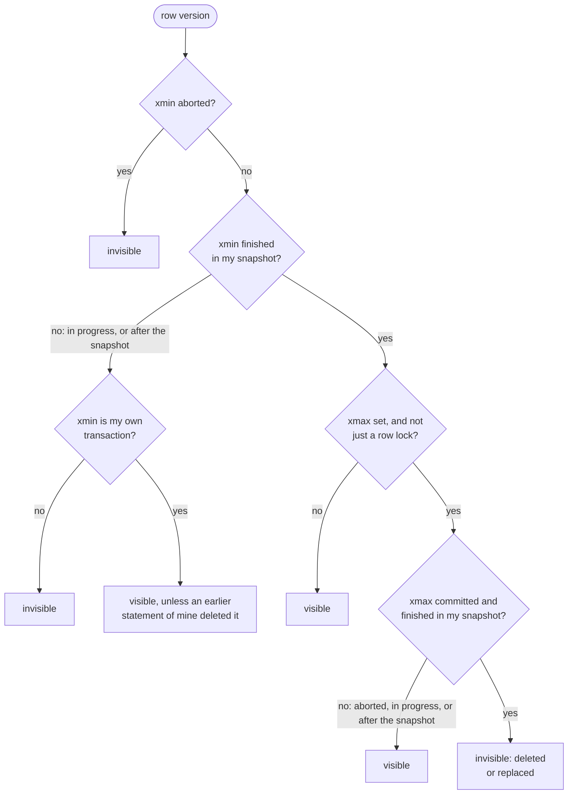
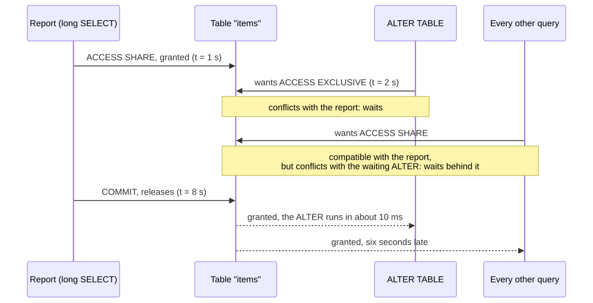
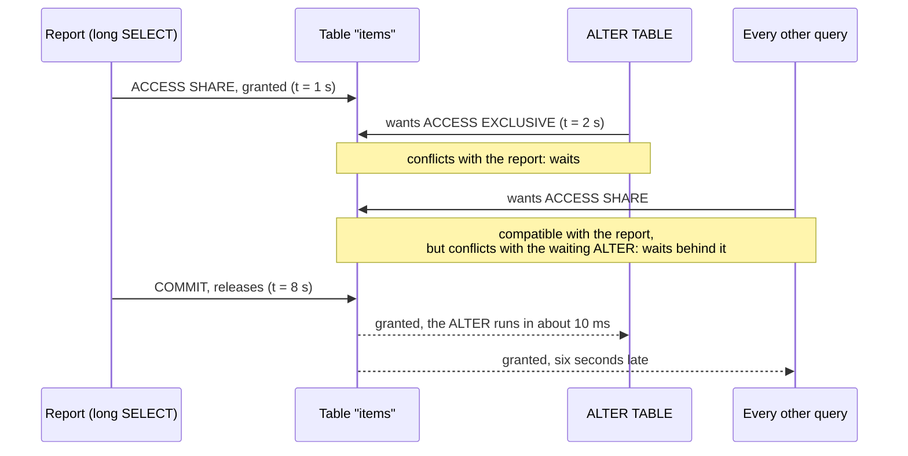
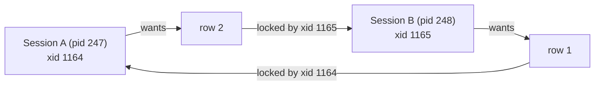
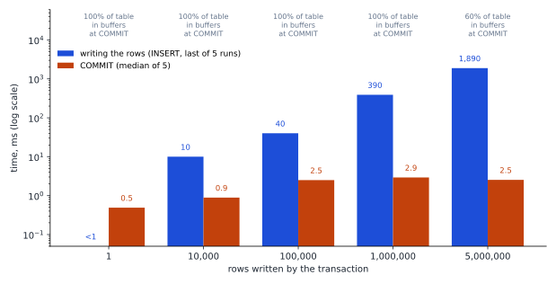

# M03 · Ch2 · §3 — MVCC and locks in PostgreSQL: snapshots, row locks, table locks, queues, deadlocks and advisory locks

> **Module:** Databases & Storage (from first principles)
> **Chapter:** Transactions, concurrency and consistency — ACID (atomicity, consistency, isolation, durability),
> isolation levels, locking, MVCC (multi-version concurrency control)
> **Section:** Ch2 §2 used snapshots and row locks as rules and measured what they do. This section opens them up on
> PostgreSQL 18: what a row version carries in its header, what a snapshot is made of and how the two decide
> visibility; the four row-lock modes and where they are stored; the eight table-lock modes and the lock queue that
> lets one `ALTER TABLE` stop every query on a table; job queues with `SKIP LOCKED`; how deadlocks are detected and
> what they cost; and advisory locks, including the pattern you used in June and the two places it breaks — connection
> poolers and long-lived AWS (Amazon Web Services) Lambda connections. Every trace and number below was measured; the scripts are committed in
> `diagrams/03-mvcc-data/`.
> **Status:** ✅ finalized 2026-11-09 (body prepared 2026-11-02). Your two questions about hint bits and one about
> upgrading on RDS are in §12: why the bits are not set at `INSERT` or `COMMIT` (Table 12, Figure 7), who else sets
> them, including `VACUUM` and `COPY … FREEZE` (Table 13), and the three ways to upgrade on RDS and why `pg_upgrade`
> leaves the row headers alone (Table 14).
> **Prerequisites:** **Ch2 §2** (the three mechanisms under the isolation levels, write skew, the retry loop) and **Ch2
> §1 §2** (a rolled-back transaction leaves its rows behind). **Ch1 §4 §14a** for `VACUUM`, dead tuples and transaction
> ID wraparound — not re-taught here.

**Estimated study time:** 3–3.5 hours including the hands-on.

---

## Why this section exists — and how it's pitched

Ch2 §2 described each isolation level by a rule: a snapshot per statement, a snapshot per transaction, a conflict
detector on top. A rule is enough to predict an outcome. It is not enough to run a database in production, because the
problems you will actually be called about are rarely "which anomaly does this level allow". They are:

- a migration that took a few milliseconds in staging and took the site down for minutes in production;
- a job that ran twice, or a queue whose workers sit idle while thousands of jobs are pending;
- `ERROR: deadlock detected` in the logs once a day, and nobody can say which two pieces of code are involved;
- a table that keeps growing although rows are deleted, because something holds an old snapshot;
- an advisory lock that "never gets released", or two copies of a job that both believe they hold the lock.

Every one of those is explained by machinery that is small and inspectable: two transaction IDs in each row's header,
a three-part snapshot, a lock table in shared memory with a queue in front of each lock, and a timer that looks for
cycles. This section takes each piece apart with `pageinspect` (an extension that shows the raw contents of a data
page), `pg_locks` and `pg_stat_activity`, then measures what it does under load.

You do not need to remember the bit names or the full conflict matrices. The figures and tables are there to be looked
up. What is worth keeping is in §9's checklist and in four sentences: **a row version is visible if its creator
committed before your snapshot and its deleter did not; a row lock is written into the row; a table lock waits in a
queue, and so does everything behind it; an advisory lock belongs to whatever holds the connection.**

---

## 1. Row versions: `xmin`, `xmax`, `ctid` and the commit log

<details>
<summary><b>Vocabulary for this section</b> — terms, abbreviations and system columns used below (click to expand)</summary>

**Abbreviations**

| Short | Stands for | Meaning |
|---|---|---|
| **MVCC** | multi-version concurrency control | keeping several versions of each row so that readers and writers do not block each other |
| **xid** | transaction ID | a 32-bit number PostgreSQL gives a transaction when it first writes |
| **CLOG** | commit log | the old name of `pg_xact`; still used in the source code and in many articles |
| **HOT** | heap-only tuple | an update whose new version stays on the same page and needs no new index entry (Ch1 §4 §5) |
| **WAL** | write-ahead log | the log every change is written to before the data pages (Ch2 §1 §3) |
| **FPI** | full-page image | a copy of a whole 8 KB page written to the WAL the first time the page changes after a checkpoint |

**System columns and fields**

| Name | Meaning |
|---|---|
| **`xmin`** | the xid of the transaction that created this row version (by `INSERT` or `UPDATE`) |
| **`xmax`** | the xid of the transaction that deleted or replaced it, or that locked it; 0 if none |
| **`ctid`** | the physical address of the version, `(page, item)`; in an old version it points to its replacement |
| **`t_infomask`** | a 16-bit field of flags in each row header: hint bits, lock bits, "updated", and so on |
| **`pg_xact`** | the files in the data directory that record each transaction's status in 2 bits |

**Terms**

| Term | Definition |
|---|---|
| **Tuple** | PostgreSQL's word for one physical row version |
| **Heap** | the table's main data file, made of 8 KB pages, rows in no particular order |
| **Hint bit** | a flag in the row header recording that `xmin` (or `xmax`) is known to have committed or aborted, so the next reader need not look it up |
| **`pageinspect`** | a contrib extension that decodes the raw bytes of a page: `get_raw_page`, `heap_page_items`, `heap_tuple_infomask_flags` |
| **Checkpoint** | the moment PostgreSQL flushes all dirty pages to disk, after which the WAL before it is no longer needed for recovery |
| **Wraparound** | the 32-bit xid counter running out and starting again; `VACUUM` freezing old rows prevents it (Ch1 §4 §14a) |

</details>

PostgreSQL never changes a row in place. An `UPDATE` writes a new version and marks the old one as replaced; a `DELETE`
only marks the row. Ch1 §4 §14a showed the cost of that — dead tuples and `VACUUM`. Here is the bookkeeping that makes
it work, read straight off a page with `pageinspect`.

**Every row version carries two transaction IDs (xids).** `xmin` is the transaction that created it; `xmax` is the one that
deleted or replaced it, or 0. Both are ordinary columns you can select — `SELECT ctid, xmin, xmax, * FROM acct` — and
`heap_page_items(get_raw_page('acct', 0))` shows the same fields together with the flag bits. The trace below is
`diagrams/03-mvcc-data/mvcc-trace-out.txt`, abridged. One transaction (xid 1013) inserted three accounts:

```text
lp | t_xmin | t_xmax | t_ctid | flags                                   (lp = item number on the page)
 1 |  1013  |    0   | (0,1)  | HEAP_XMAX_INVALID
 2 |  1013  |    0   | (0,2)  | HEAP_XMAX_INVALID
 3 |  1013  |    0   | (0,3)  | HEAP_XMAX_INVALID
```

Then a second transaction, xid 1014, ran `UPDATE acct SET bal = 150 WHERE id = 1` and had not yet committed:

```text
lp | t_xmin | t_xmax | t_ctid | flags
 1 |  1013  |  1014  | (0,4)  | HEAP_XMIN_COMMITTED HEAP_HOT_UPDATED      the old version, now "replaced by 1014"
 4 |  1014  |    0   | (0,4)  | HEAP_XMAX_INVALID HEAP_UPDATED HEAP_ONLY_TUPLE      the new version
```

Both versions are on the page. The old one's `xmax` is 1014 and its `ctid` points to item 4, the new version, so an
update chain can be followed forward. At that moment the updating session read `(0,4) | bal 150` and every other
session read `(0,1) | bal 100`. Nothing was copied, locked for readers, or written to a separate undo area. **Which
version a reader sees is decided entirely by comparing these two numbers with the reader's snapshot (§2).**

**Whether 1014 committed is not in the row.** It is in `pg_xact` — the commit log, `CLOG` in older documentation and
in the source — which keeps 2 bits per transaction: in progress, committed, aborted, or sub-committed (for
subtransactions). One 8 KB page of it covers 32,768 transactions. `pg_xact_status('1014')` reads it: `in progress`
before the `COMMIT` and `committed` after. **Committing a transaction is, at its core, flipping those 2 bits** (after
the WAL — write-ahead log — flush of Ch2 §1 §3). No row is touched at commit time, which is why a commit costs the same whether the
transaction changed one row or a million.

**An aborted transaction is the same, with the other value.** xid 1015 ran `UPDATE acct SET bal = 999 WHERE id = 2`
and rolled back. The page afterwards:

```text
lp | t_xmin | t_xmax | t_ctid | flags
 2 |  1013  |  1015  | (0,5)  | HEAP_XMIN_COMMITTED HEAP_XMAX_INVALID HEAP_HOT_UPDATED     still the live version
 5 |  1015  |    0   | (0,5)  | HEAP_XMIN_INVALID HEAP_XMAX_INVALID HEAP_UPDATED ...       created by an aborted xid
```

Nothing was undone. The 999 version is still there, and every reader ignores it because `pg_xact` says 1015 aborted;
row 2's `xmax` of 1015 is ignored for the same reason. That is Ch2 §1 §2's "no undo log", seen in the bytes, and it is
why a large rollback in PostgreSQL is instant while the dead rows it leaves wait for `VACUUM`.

### Hint bits: the first reader writes

Looking up `pg_xact` for every row on every read would be slow, so the first reader that learns a transaction's fate
records it in the row: `HEAP_XMIN_COMMITTED` or `HEAP_XMIN_INVALID` for the creator, and the same pair for `xmax`.
These are **hint bits**. In the first listing above the freshly committed rows had no `XMIN_COMMITTED`; after one
`SELECT` they all had it. Later readers check the bit and skip the lookup.

The consequence surprises people: **the first read of freshly written rows modifies the pages it reads.** A load of
1,000,000 rows, a checkpoint, then two identical `SELECT count(*)` scans (`observe.py hint`):

**Table 1** — the same full scan twice after a bulk load and a checkpoint (PostgreSQL 18.6, data checksums on — the PostgreSQL 18 default — 1,000,000 rows, 35 MB).

| Scan | Pages read | Pages dirtied by the read | WAL written by the read | Time |
|---|---|---|---|---|
| first `SELECT count(*)` | 4,425 | **4,425** (every page) | **36.5 MB** | 45.9 ms |
| second `SELECT count(*)` | 4,425 | 0 | 0 | 19.4 ms |

The first scan set a hint bit on every row, and because PostgreSQL 18 enables data checksums by default, changing a
hint bit for the first time after a checkpoint writes a full-page image of the page to the WAL, so that a torn write
cannot leave a page whose checksum is wrong. A read-only query generated tens of megabytes of WAL. On a replica-backed
system that is replication traffic; on a pay-per-I/O storage system it is a bill. `VACUUM` after a bulk load sets the
bits (and the visibility map) once, in the background, instead of leaving it to the first unlucky reader. Why the
bits are not simply set at `COMMIT`, and everything else that can set them first: §12a and §12b.

**Transaction IDs are assigned lazily.** A transaction gets an xid only when it first writes, including when it locks a
row. A read-only transaction never takes one: `pg_current_xact_id_if_assigned()` returned NULL after a `SELECT` and
1021 after a `SELECT … FOR SHARE` in the same transaction. That is why read-only traffic does not advance the counter
towards wraparound (Ch1 §4 §14a), and it is the first hint that a row lock is a write — §3.

---

## 2. Snapshots, and the rule that decides visibility

<details>
<summary><b>Vocabulary for this section</b> — terms, abbreviations and the snapshot's three parts (click to expand)</summary>

**Abbreviations**

| Short | Stands for | Meaning |
|---|---|---|
| **xid** | transaction ID | the number a writing transaction gets; `xmin` and `xmax` in a row header are xids |
| **RC** | READ COMMITTED | PostgreSQL's default level: a new snapshot for each statement |
| **RR** | REPEATABLE READ | one snapshot for the whole transaction (snapshot isolation) |
| **SSI** | serializable snapshot isolation | PostgreSQL's SERIALIZABLE: REPEATABLE READ plus read tracking (Ch2 §2 §4) |

**The snapshot `xmin:xmax:xip_list`** (as printed by `pg_current_snapshot()`)

| Part | Meaning |
|---|---|
| **snapshot `xmin`** | the oldest transaction still running when the snapshot was taken; every xid below it has finished |
| **snapshot `xmax`** | one past the newest finished xid; every xid at or above it is treated as still running |
| **`xip_list`** | the xids between the two that were still in progress; they are invisible too |

(The snapshot's `xmin` and `xmax` are not the row header's `xmin` and `xmax`. Same names, different things: §1's are
stamped in each row; these bound a snapshot.)

**Terms**

| Term | Definition |
|---|---|
| **Snapshot** | the record of which transactions had finished when it was taken; a row version is visible only if its creator is among them |
| **Visibility rule** | the test applied to every row version against a snapshot: creator committed and visible, deleter not |
| **Command ID** | a counter within one transaction, so a statement does not see rows written by itself and does see the transaction's earlier statements |
| **`backend_xmin`** | the column of `pg_stat_activity` showing the snapshot `xmin` a session is holding; the oldest one sets `VACUUM`'s horizon |
| **EvalPlanQual** | the step in which an `UPDATE` or `DELETE` at READ COMMITTED, after waiting for a row lock, follows the `ctid` chain to the newest version and re-checks its `WHERE` clause |

</details>

A snapshot is three things, printed by `pg_current_snapshot()` as `xmin:xmax:xip_list`. The harness opened three
writing transactions — C (xid 1016), D (1017) and A (1018) — committed D only, and then took a snapshot in a fourth
session B:

```text
B: SELECT pg_current_snapshot()          ->  1016:1018:1016
B: SELECT id, xmin FROM acct WHERE id >= 10   ->  (11, 1017)          only D's row
B: pg_visible_in_snapshot(C, D, A)       ->  False, True, False
```

Read it as: **everything below 1016 has finished; everything from 1018 up counts as running; and between them, 1016 is
still running.** So 1017 (D, committed) is visible; 1016 (C) is in the in-progress list; 1018 (A) was already running
but is at or above the snapshot's `xmax`, so it counts as running without being listed. A snapshot never lists every
transaction in the system — only the handful between its two bounds that were in flight — which is why taking one is
cheap.

The visibility rule combines the snapshot with the two IDs in each row:

**Table 2** — whether a row version is visible to a snapshot, by the state of its creator (`xmin`) and its deleter (`xmax`). "Finished" means below the snapshot's `xmax` and not in its in-progress list.

| Creator `xmin` | Deleter `xmax` | Visible? |
|---|---|---|
| aborted | (anything) | no — it never existed |
| in progress, or started after the snapshot | (anything) | no — not yet committed as far as this snapshot knows |
| is my own transaction | none, or my own later statement | yes (subject to the command ID: a statement does not see its own writes) |
| committed and finished in the snapshot | 0, aborted, or only a locker | **yes** |
| committed and finished in the snapshot | in progress or started after the snapshot | **yes** — the delete has not happened yet for this snapshot |
| committed and finished in the snapshot | committed and finished in the snapshot | no — it was deleted or replaced |

The same rule, as the order in which PostgreSQL actually tests it (the hint bits short-circuit the `pg_xact` lookups):

<!-- DIAGRAM:START -->


<details>
<summary>Diagram source (Mermaid)</summary>



</details>
<!-- DIAGRAM:END -->

**Figure 1** — the visibility test each row version goes through for a snapshot; "finished in my snapshot" means below
the snapshot's `xmax` and not in its in-progress list.

**The isolation levels differ only in when the snapshot is taken.** The harness took a snapshot in two consecutive
statements of one transaction, with another session committing an update in between:

```text
READ COMMITTED    statement 1: snapshot 1019:1019:   bal=300    statement 2: snapshot 1020:1020:   bal=301
REPEATABLE READ   statement 1: snapshot 1020:1020:   bal=301    statement 2: snapshot 1020:1020:   bal=301
```

That is the whole difference between Ch2 §2 §2 and Ch2 §2 §3. READ COMMITTED takes a fresh snapshot at the start of
every statement, and the commit of 1019 moved the second one forward. REPEATABLE READ takes one at the first statement
and keeps it. SERIALIZABLE keeps one too and adds the SIREAD (snapshot-isolation read) lock bookkeeping of Ch2 §2 §4. The rows, the visibility test
and the locks are identical at all three levels.

Two more pieces of Ch2 §2 fall out of this:

- **The re-check at READ COMMITTED.** When an `UPDATE` finds that the version its snapshot sees has an `xmax` from a
  transaction still in progress, it waits for that transaction (§3 shows how). If the other transaction commits, the
  version is dead and the `ctid` points to its replacement. READ COMMITTED follows the `ctid` chain to the newest
  version and re-evaluates the `WHERE` clause on it — the EvalPlanQual step. That is Ch2 §2 §2's re-check, and why
  `SET n = n + 1` adds to the newest value. REPEATABLE READ instead sees that the replacing transaction is not in its
  snapshot and raises `40001`: first-updater-wins.
- **Why one old snapshot blocks `VACUUM` everywhere.** A dead version can be removed only when no snapshot could still
  see it, that is, when its `xmax` is older than every running snapshot's `xmin`. `pg_stat_activity.backend_xmin` shows
  each session's; the oldest one is the horizon for the whole database. A REPEATABLE READ report, an idle-in-transaction
  session or a replication slot holding an old `xmin` is what Ch1 §4 §14a measured as "1,000,000 dead but not yet
  removable".

---

## 3. Row locks: four modes, written into the row

<details>
<summary><b>Vocabulary for this section</b> — terms and abbreviations used below (click to expand)</summary>

**Abbreviations**

| Short | Stands for | Meaning |
|---|---|---|
| **FK** | foreign key | a column whose value must exist as a key in another (parent) table |
| **MultiXact** | multiple transaction | an ID standing for a set of transactions that lock the same row together, stored in `pg_multixact` |
| **WAL** | write-ahead log | the log every change is written to first |

**Terms**

| Term | Definition |
|---|---|
| **Row lock** | a lock on one row version, taken by `UPDATE`, `DELETE` and `SELECT … FOR <mode>`; held until the transaction ends |
| **`FOR UPDATE`** | the strongest row lock: the row may be deleted or have its key changed; blocks every other row lock |
| **`FOR NO KEY UPDATE`** | the lock a plain `UPDATE` of non-key columns takes; does not block `FOR KEY SHARE` |
| **`FOR SHARE`** | a shared lock: nobody may change the row, several may hold it |
| **`FOR KEY SHARE`** | the weakest: nobody may delete the row or change its key; what a foreign-key check takes on the parent row |
| **Key column** | for row-lock purposes, a column in a unique index that a foreign key can reference |
| **`NOWAIT`** | fail at once with `55P03 lock_not_available` instead of waiting for a row lock |
| **`SKIP LOCKED`** | silently leave out rows that are locked by someone else (§5) |
| **`pgrowlocks`** | a contrib extension that lists the locked rows of a table and who holds them |

</details>

Ch2 §2 used "a row lock" as one thing. There are four modes, from strongest to weakest:

- **`FOR UPDATE`** — taken by `DELETE`, by an `UPDATE` that changes a key column, and by `SELECT … FOR UPDATE`.
- **`FOR NO KEY UPDATE`** — taken by every other `UPDATE`, and by `SELECT … FOR NO KEY UPDATE`.
- **`FOR SHARE`** — `SELECT … FOR SHARE`: "do not change this row while I look at it".
- **`FOR KEY SHARE`** — "do not delete this row or change its key". Taken by foreign-key checks.

Here is which ones conflict, measured by holding each mode on a row in one session and requesting each mode with
`NOWAIT` in another (`mvcc_trace.py`, part 9):

**Table 3** — row-lock conflicts, measured on PostgreSQL 18: "conflict" means the requester would have to wait (with `NOWAIT`, it got `55P03`). The last three rows are what the write statements take.

| Held ↓ / requested → | `FOR KEY SHARE` | `FOR SHARE` | `FOR NO KEY UPDATE` | `FOR UPDATE` |
|---|---|---|---|---|
| `FOR KEY SHARE` | ok | ok | ok | conflict |
| `FOR SHARE` | ok | ok | conflict | conflict |
| `FOR NO KEY UPDATE` | ok | conflict | conflict | conflict |
| `FOR UPDATE` | conflict | conflict | conflict | conflict |
| `UPDATE` of a non-key column | ok | conflict | conflict | conflict |
| `UPDATE` that changes the key | conflict | conflict | conflict | conflict |
| `DELETE` | conflict | conflict | conflict | conflict |

One detail in the measurement: `UPDATE acct SET id = 1 WHERE id = 1` took `FOR NO KEY UPDATE`, not `FOR UPDATE`.
PostgreSQL compares the old and new values of the key columns, and a key "changed" to the same value has not changed.

### Where a row lock lives

**In the row.** There is no entry per locked row in shared memory. Locking a row writes the locker's xid into the
row's `xmax` and sets flag bits that say "this `xmax` is only a locker, not a deleter", plus which mode. Each mode taken
in turn on the same row (part 7):

**Table 4** — what each row-lock mode writes into the row header (PostgreSQL 18, read with `pageinspect`).

| Mode | `xmax` | Lock bits set |
|---|---|---|
| `FOR KEY SHARE` | the locker's xid | `HEAP_XMAX_LOCK_ONLY`, `HEAP_XMAX_KEYSHR_LOCK` |
| `FOR SHARE` | the locker's xid | `HEAP_XMAX_LOCK_ONLY`, `HEAP_XMAX_KEYSHR_LOCK` + `HEAP_XMAX_EXCL_LOCK` (both together mean "share") |
| `FOR NO KEY UPDATE` | the locker's xid | `HEAP_XMAX_LOCK_ONLY`, `HEAP_XMAX_EXCL_LOCK` |
| `FOR UPDATE` | the locker's xid | `HEAP_XMAX_LOCK_ONLY`, `HEAP_XMAX_EXCL_LOCK`, `HEAP_KEYS_UPDATED` |
| two sessions `FOR SHARE` | a **MultiXact** (multiple-transaction) **ID** (13) | the above + `HEAP_XMAX_IS_MULTI`; `pgrowlocks` lists members 1026 and 1027 |

Three consequences follow, each measured:

- **The number of row locks is unlimited**, because they cost no shared memory. `pg_locks` shows none of them: with two
  sessions holding `FOR SHARE` on a row, it listed only each transaction's lock on its own xid. To see row locks, use
  `pgrowlocks('table')`, which reads the pages.
- **A row lock is a write.** It dirties the page and is WAL-logged, which is why §1 found that locking a row assigns an
  xid. `SELECT count(*)` over 100,000 rows wrote 0 bytes of WAL; the same with `FOR SHARE` wrote 5.6 MB (about 56
  bytes per row) and took 12 times as long, 26 ms against 2 ms. Locking a large result set "just in case" is not free.
- **Waiting for a row lock means waiting for a transaction.** A session that finds a row's `xmax` held by a running
  transaction cannot queue on the row, since the row is not in the lock table. It briefly takes a lock on the row's
  tuple, then waits on a lock every transaction holds on its own xid until it ends. That is why §6's deadlock message
  reads "waits for ShareLock on transaction 1165", and `pg_stat_activity` shows the wait as `Lock:transactionid`.

**MultiXacts.** When a second transaction locks a row that another already holds compatibly — two `FOR SHARE`s, or a
`FOR KEY SHARE` beside an `UPDATE` — there is only one `xmax` field, so PostgreSQL allocates a **MultiXact ID**, records
its member transactions and their modes in `pg_multixact`, and stores that ID in `xmax` with a flag. MultiXact IDs are
a second 32-bit counter with its own wraparound and its own `VACUUM` freezing. Workloads that have many concurrent
transactions taking `KEY SHARE` locks on the same parent rows — many child inserts per parent — can consume them fast,
and `pg_multixact` growth is one of the less familiar reasons for an anti-wraparound `VACUUM`.

### Why a foreign-key insert takes `FOR KEY SHARE`

Inserting a child row must make sure the parent exists **and keeps existing until the insert commits**. So the
foreign-key check takes `FOR KEY SHARE` on the parent row — the weakest mode that stops a `DELETE` or a key change.
`pgrowlocks('parent')` showed exactly that while a child `INSERT` was open. What it blocks:

**Table 5** — what a transaction holding each lock on a parent row does to a concurrent `INSERT` of a child row that references it (PostgreSQL 18; "blocked" = still waiting after 1 s).

| Held on the parent row | Child `INSERT` |
|---|---|
| `UPDATE parent SET credits = credits + 1` (non-key column) | ok |
| `SELECT … FOR NO KEY UPDATE` | ok |
| `SELECT … FOR UPDATE` | **blocked** |
| `UPDATE parent SET id = 2` (key column) | **blocked** |

This is why the four modes exist. Before PostgreSQL 9.3 (2013) there were only `FOR UPDATE` and `FOR SHARE`, and
foreign-key checks took `FOR SHARE`. Any update to a parent row — bumping a counter, touching `updated_at` — then
blocked every child insert for that parent, and two transactions that each inserted a child and updated the parent
deadlocked. 9.3 split each mode in two so that ordinary updates and foreign-key checks no longer conflict.

The practical rule: **when you lock a row in order to update it, use `FOR NO KEY UPDATE` unless you will delete it or
change its key.** `SELECT … FOR UPDATE` is what every tutorial and most ORMs write (Django's `select_for_update()`,
SQLAlchemy's `with_for_update()`), and on a parent table it blocks inserts of children for as long as you hold it, as
Table 5's third row shows. Both ORMs (object-relational mappers) have an option for the weaker mode:
`select_for_update(no_key=True)` in Django, and `with_for_update(key_share=True)` in SQLAlchemy, which on PostgreSQL
renders `FOR NO KEY UPDATE`.

---

## 4. Table locks: eight modes, and the queue in front of them

<details>
<summary><b>Vocabulary for this section</b> — terms and abbreviations used below (click to expand)</summary>

**Abbreviations**

| Short | Stands for | Meaning |
|---|---|---|
| **DDL** | data definition language | statements that change the schema: `CREATE`, `ALTER`, `DROP`, `TRUNCATE` |
| **DML** | data manipulation language | statements that read or change rows: `SELECT`, `INSERT`, `UPDATE`, `DELETE`, `MERGE` |

**Terms**

| Term | Definition |
|---|---|
| **Table lock** | a lock on a whole table (a *relation*), recorded in shared memory and visible in `pg_locks`; every statement takes one |
| **`ACCESS SHARE`** | the weakest table lock, taken by every `SELECT`; conflicts only with `ACCESS EXCLUSIVE` |
| **`ROW EXCLUSIVE`** | the table lock every `INSERT`, `UPDATE`, `DELETE` and `MERGE` takes — despite the name, a lock on the table |
| **`SHARE UPDATE EXCLUSIVE`** | taken by `VACUUM`, `ANALYZE`, `CREATE INDEX CONCURRENTLY`; conflicts with itself, so two never run on one table at once |
| **`ACCESS EXCLUSIVE`** | the strongest: nobody else may even read the table; taken by most `ALTER TABLE` forms, `TRUNCATE`, `DROP`, `VACUUM FULL` |
| **Lock queue** | the waiting list in front of a lock; a new request that conflicts with a request already waiting joins the queue behind it |
| **`lock_timeout`** | a setting: give up with `55P03` if a lock cannot be acquired within this time |
| **`statement_timeout`** | a setting: cancel any statement that runs longer than this, waiting included |

</details>

Every statement — DML (data manipulation language: `SELECT`, `INSERT`, `UPDATE`, `DELETE`) and DDL (data
definition language: `CREATE`, `ALTER`, `DROP`) alike — also takes a lock on each table it touches. There are eight modes. Their names are historical and
misleading — `ROW EXCLUSIVE` is a lock on the table, taken by every `INSERT` — so the useful way to read them is by what
takes them and what they conflict with. Figure 2 was measured the same way as Table 3: each mode held with `LOCK
TABLE`, each mode requested with `NOWAIT`.

![An eight by eight grid. Rows are the lock held, columns the lock requested, both in the order ACCESS SHARE, ROW SHARE, ROW EXCLUSIVE, SHARE UPDATE EXCLUSIVE, SHARE, SHARE ROW EXCLUSIVE, EXCLUSIVE, ACCESS EXCLUSIVE. ACCESS SHARE conflicts only with ACCESS EXCLUSIVE. ROW SHARE conflicts with EXCLUSIVE and ACCESS EXCLUSIVE. ROW EXCLUSIVE conflicts with SHARE and everything stronger. SHARE UPDATE EXCLUSIVE conflicts with itself and everything stronger. SHARE conflicts with ROW EXCLUSIVE, SHARE UPDATE EXCLUSIVE, SHARE ROW EXCLUSIVE, EXCLUSIVE and ACCESS EXCLUSIVE but not with itself. SHARE ROW EXCLUSIVE conflicts with ROW EXCLUSIVE and everything stronger. EXCLUSIVE conflicts with everything except ACCESS SHARE. ACCESS EXCLUSIVE conflicts with everything. Under each row label are the statements that take that mode.](diagrams/03-mvcc-fig2.svg)

**Figure 2** — the eight table-lock modes and which pairs conflict, measured on PostgreSQL 18, with the statements that
take each mode.

Three rows of Figure 2 carry most of the practical weight:

- **Reads and writes never conflict at the table level.** `ACCESS SHARE` (every `SELECT`) and `ROW EXCLUSIVE` (every
  `INSERT`, `UPDATE`, `DELETE`) are compatible with each other and with themselves. Conflicts between DML statements
  happen at the row level, §3.
- **`ACCESS EXCLUSIVE` conflicts with everything, including a plain `SELECT`.** While it is held — or, as below, while it
  is *waiting* — nobody reads the table.
- **`SHARE` (plain `CREATE INDEX`) blocks writes but not reads**, for as long as the index build takes. `CREATE INDEX
  CONCURRENTLY` takes `SHARE UPDATE EXCLUSIVE` instead, which lets writes continue, at the price of two table scans and
  of not being allowed inside a transaction block.

Which statement takes which mode is the part people get wrong, so it was measured too, by running each statement and
reading `pg_locks`:

**Table 6** — the table lock each statement took, read from `pg_locks` while it ran (PostgreSQL 18; `table_locks.py stmts`).

| Statement | Table lock (strongest mode held) |
|---|---|
| `SELECT` | `ACCESS SHARE` |
| `SELECT … FOR UPDATE` / `FOR SHARE` | `ROW SHARE` |
| `INSERT`, `UPDATE`, `DELETE`, `MERGE` | `ROW EXCLUSIVE` |
| `VACUUM` (plain), `ANALYZE` | `SHARE UPDATE EXCLUSIVE` |
| `CREATE INDEX CONCURRENTLY`, `REINDEX … CONCURRENTLY` | `SHARE UPDATE EXCLUSIVE` |
| `ALTER TABLE … VALIDATE CONSTRAINT`, `… SET STATISTICS`, `… SET (fillfactor = …)` | `SHARE UPDATE EXCLUSIVE` |
| `CREATE INDEX`, `REINDEX TABLE` | `SHARE` |
| `CREATE TRIGGER`; `ALTER TABLE … ADD FOREIGN KEY` (on **both** tables) | `SHARE ROW EXCLUSIVE` |
| `REFRESH MATERIALIZED VIEW` (plain) | `ACCESS EXCLUSIVE` |
| `ALTER TABLE … ADD COLUMN` (with or without a default) | `ACCESS EXCLUSIVE` |
| `ALTER TABLE … ADD CONSTRAINT … CHECK … NOT VALID` | `ACCESS EXCLUSIVE` (briefly: no scan) |
| `ALTER TABLE … ALTER COLUMN … TYPE` | `ACCESS EXCLUSIVE` (and a full rewrite) |
| `TRUNCATE`, `DROP TABLE`, `VACUUM FULL`, `CLUSTER` | `ACCESS EXCLUSIVE` |

`TRUNCATE` is `ACCESS EXCLUSIVE`, which is the table-lock side of what Ch2 §2 §12c found: it swaps the table's file, so
nobody may be reading the old one, and a REPEATABLE READ snapshot taken before it sees an empty table. Adding a column
with a constant default has been a metadata-only change since PostgreSQL 11 — it rewrites nothing — but it still needs
`ACCESS EXCLUSIVE` for the instant it changes the catalogue, and the instant is the problem.

### The lock queue: one `ALTER TABLE` stops every query

Locks are granted in order. If a request conflicts with a lock that is held **or with a request already waiting**, it
waits behind it. The second clause is the trap. An `ALTER TABLE` that has to wait for a long-running `SELECT` sits in the
queue holding nothing — and every later `SELECT` on that table conflicts with the waiting `ACCESS EXCLUSIVE`, so it
queues behind the `ALTER`, although it is perfectly compatible with the `SELECT` actually holding the table.

<!-- DIAGRAM:START -->


<details>
<summary>Diagram source (Mermaid)</summary>



</details>
<!-- DIAGRAM:END -->

**Figure 3** — the lock queue: a waiting `ACCESS EXCLUSIVE` request blocks every later request that conflicts with it,
including plain `SELECT`s that the lock actually held would have allowed.

To measure it, eight clients each ran a point `SELECT` by primary key every 20 ms against a 10,000-row table for 12
seconds. A report opened a transaction at t = 1 s, read the table, and committed at t = 8 s. In the second run an `ALTER
TABLE items ADD COLUMN note text` was issued at t = 2 s; in the third, the same `ALTER` ran with `lock_timeout = 200ms`
and retried every second.

![Three stacked scatter plots of SELECT latency in milliseconds, log scale, against time from 0 to 12 seconds, with the number of sessions waiting for a lock drawn as a step line. Panel 1, report only: 4,692 SELECTs, all under 3 ms, nobody waiting. Panel 2, ALTER TABLE issued at 2 seconds with no timeout: from 2 to 8 seconds no SELECT completes, 9 sessions wait — the 8 clients and the ALTER — and the 8 SELECTs that started at 2 seconds took about 6,000 ms each; only 2,346 SELECTs in total. Panel 3, ALTER TABLE with a 200 ms lock_timeout retried every second: five short spikes of 9 waiting sessions, each 200 ms long, five SELECT latencies of about 200 ms, 4,310 SELECTs in total, and the ALTER succeeds just after 8 seconds.](diagrams/03-mvcc-fig4.svg)

**Figure 4** — the lock-queue pile-up, measured on PostgreSQL 18: latency of every `SELECT` (dots) and sessions waiting
for a lock on the table (orange line; the ALTER itself is one of them), in three runs.

- **The report alone hurt nobody.** 4,692 `SELECT`s, the slowest 3 ms. A long reader and short readers share
  `ACCESS SHARE` happily.
- **The `ALTER` stopped the table for six seconds.** It waited for the report from t = 2 s to t = 8 s, and from the
  moment it joined the queue **not one `SELECT` completed**: each of the eight clients sent one query at about t = 2 s
  and got the answer six seconds later. The `ALTER` itself, once granted, finished in about 10 ms. Only half as many queries
  ran in total (2,346). With eight clients the queue was nine long; in production it is as long as the number of
  connections the application can open, and when the connection pool is exhausted the outage spreads to every
  endpoint, including the ones that never touch this table.
- **With `lock_timeout` the same migration was harmless.** Each attempt waited at most 200 ms, gave up with `55P03`,
  and left the queue; the clients saw five stalls of 200 ms and nothing worse (4,310 queries, slowest 202 ms). The
  sixth attempt, just after the report committed, got the lock at once and the migration finished at t = 8.02 s — the
  same moment as without the timeout.

This is one of the most reported PostgreSQL production incidents; GoCardless's write-up of an API outage caused by a
migration waiting behind a long query is the standard reference. The fix is mechanical, and belongs in every migration
runner:

```sql
SET lock_timeout = '2s';        -- per migration session; never let DDL queue for long
ALTER TABLE items ADD COLUMN note text;
-- on error 55P03 (lock_not_available): wait a little, retry; alert after N attempts
```

together with the settings that stop the long holder from existing in the first place: `statement_timeout` for
reporting roles, `idle_in_transaction_session_timeout` for every role (an idle-in-transaction session holds its table
locks too, Ch2 §1 §7), and running `CREATE INDEX CONCURRENTLY`, `ADD CONSTRAINT … NOT VALID` followed by `VALIDATE
CONSTRAINT`, and other weaker-lock forms where they exist (Table 6). Before a migration, a glance at `pg_stat_activity`
for transactions older than a few seconds tells you whether it is about to queue.

---

## 5. Job queues: `FOR UPDATE SKIP LOCKED` and the claim row

<details>
<summary><b>Vocabulary for this section</b> — terms and abbreviations used below (click to expand)</summary>

**Abbreviations**

| Short | Stands for | Meaning |
|---|---|---|
| **SQS** | Simple Queue Service | AWS's (Amazon Web Services') managed message queue |
| **FIFO** | first in, first out | jobs are taken in the order they were added |

**Terms**

| Term | Definition |
|---|---|
| **Job queue** | a table of work items (`pending` → `running` → `done`) that several workers take jobs from |
| **Worker** | a process or thread that repeatedly claims a job, does it, and marks it done |
| **Claim** | the step in which a worker makes a job its own, so no other worker takes it |
| **`SKIP LOCKED`** | a locking clause option: rows locked by someone else are left out of the result instead of waited for |
| **Claim row (lease)** | claiming a job by updating its status and owner in a short, committed transaction, then working outside any transaction |
| **Reaper** | a periodic statement that returns jobs claimed too long ago (by a worker that died) to `pending` |
| **At-least-once** | a delivery guarantee: every job runs, but some may run more than once, so the work must be idempotent |
| **Idempotent** | safe to perform twice with the same effect as once |
| **Partial index** | an index over only the rows matching a condition, here `WHERE status = 'pending'` |

</details>

A table of jobs and a pool of workers is the most common place an application programmer meets row locks directly. The
requirements are two: **each job runs once**, and **the workers run in parallel**. Six ways of claiming a job were
measured with `queue_bench.py`: 1,000 pending jobs, 1 to 32 workers (one connection each), 5 ms of simulated work per
job, three repetitions. Every execution of the work was recorded, so a job that ran twice was counted.

**Table 7** — six ways to claim a job from a PostgreSQL table: throughput and how often a job ran more than once (PostgreSQL 18; medians of 3 runs; duplicates summed over all 18 runs of each method).

| How a worker claims a job | Jobs/s, 1 worker | Jobs/s, 8 workers | Jobs/s, 32 workers | Jobs run twice | Verdict |
|---|---|---|---|---|---|
| `SELECT` the first pending id, work, then `UPDATE … SET status = 'done'` | 166 | 119 | 116 | **92,735** | wrong |
| `BEGIN; SELECT … LIMIT 1 FOR UPDATE`; work; mark done; `COMMIT` | 134 | 134 | **134** | 0 | correct, serial |
| `UPDATE … SET status = 'running' WHERE id = (SELECT … LIMIT 1) AND status = 'pending' RETURNING id` | 110 | 300 | 298 | 0 | correct, stalls |
| `SELECT … WHERE status = 'pending' AND pg_try_advisory_xact_lock(id) LIMIT 1`, in a transaction | 135 | 974 | 3,108 | **136** | wrong, rarely |
| `BEGIN; SELECT … LIMIT 1 FOR UPDATE SKIP LOCKED`; work; mark done; `COMMIT` | 132 | 902 | 3,104 | 0 | correct |
| claim row: `UPDATE … WHERE id = (SELECT … FOR UPDATE SKIP LOCKED) RETURNING`, commit; work; mark done | 109 | 703 | 2,682 | 0 | correct, no transaction during the work |

![A log-log line chart of jobs completed per second against the number of workers, 1 to 32. SELECT then UPDATE with no lock stays between 116 and 166 jobs a second while running jobs many times over. FOR UPDATE without SKIP LOCKED is flat at 134 at every worker count. The conditional UPDATE rises to about 300 at 8 workers and stays there. The advisory-lock filter, FOR UPDATE SKIP LOCKED and the claim-row pattern all rise almost in proportion to the number of workers, reaching about 3,100, 3,100 and 2,700 jobs a second at 32 workers, close to the perfect-scaling line.](diagrams/03-mvcc-fig5.svg)

**Figure 5** — job-queue throughput against the number of workers, for the six claim methods of Table 7 (PostgreSQL 18;
1,000 jobs, 5 ms of work each; medians of 3 runs).

Going down the table:

- **No lock: every worker runs the same job.** All workers read the same "first pending" row and work on it until one
  of them marks it done. With 32 workers, 1,000 jobs were executed 11,479 to 16,207 times. The throughput column is
  meaningless here; the duplicates are the result. This is the "scheduled job with no claim" of Ch2 §2 §12b.
- **`FOR UPDATE` alone: correct, and exactly one worker fast.** Every worker asks for the first pending row, all but
  one wait on its lock, and when it commits the next one re-checks, finds the row done, and moves on to the next row —
  where it is again first in line. Thirty-two workers ran at 134 jobs a second, the speed of one.
- **A conditional `UPDATE` without `SKIP LOCKED`: correct, and it stalls.** `AND status = 'pending'` makes a late claimer
  get zero rows after its re-check, so no job ran twice; but every worker still aims at the same first row, and the
  losers try again. At 32 workers there were 3,300 to 5,700 empty claims per 1,000 jobs, and throughput stopped at about
  300 a second (one run reached 1,530 — this method's timing is erratic).
- **An advisory lock in the `WHERE` clause: fast, and it ran jobs twice.** It scaled like `SKIP LOCKED`, but 10 of the
  18 runs executed one or more jobs twice — up to 56 of 1,000 at 32 workers. The reason is the snapshot. A worker's
  statement takes its snapshot, then calls `pg_try_advisory_xact_lock(id)` row by row. If another worker finished a job
  and committed after that snapshot was taken, the row still looks `pending` to this statement, and its advisory lock
  has just been released, so the try succeeds and the job runs again. An advisory lock says nothing about the row's
  current state; the status must be re-checked after the lock is acquired.
- **`FOR UPDATE SKIP LOCKED`: correct, and it scales.** Locked rows are skipped instead of waited for, so each worker
  takes the first row nobody else holds. Throughput rose almost in proportion to the workers, to 3,104 jobs a second at
  32 — 23 times one worker. Because the lock is on the row itself and the re-check after acquiring it is built in, a
  row that another worker has already finished is never returned.
- **The claim row: correct, scales, and holds nothing while working.** It was slightly slower in this benchmark because
  it commits twice per job (claim, then done), each with a WAL flush. Its advantage is the one that matters in
  production, below.

### The claim-row pattern

Holding a row lock while the job runs means holding a transaction open while the job runs: a connection pinned for the
duration, a snapshot that holds back `VACUUM` (§2), and, if the job calls a model or an HTTP API for 30 seconds, an
idle-in-transaction session for 30 seconds (Ch2 §1 §7). On AWS Lambda behind a transaction-mode pooler, that is the
pattern to avoid. The claim row instead uses `SKIP LOCKED` only for the instant of the claim, and records the claim in
the row:

```sql
-- 1. claim: one short transaction (autocommit is enough)
UPDATE jobs
SET    status = 'running', claimed_by = %(worker)s, claimed_at = now(), attempts = attempts + 1
WHERE  id = (SELECT id FROM jobs
             WHERE  status = 'pending' AND run_after <= now()
             ORDER  BY id
             LIMIT  1
             FOR UPDATE SKIP LOCKED)
RETURNING id, payload;

-- 2. do the work, outside any transaction

-- 3. finish, only if the claim is still ours; check that the row count is 1
UPDATE jobs SET status = 'done' WHERE id = %(id)s AND claimed_by = %(worker)s AND status = 'running';

-- 4. reaper, every minute: hand back jobs whose worker died
UPDATE jobs SET status = 'pending', claimed_by = NULL
WHERE  status = 'running' AND claimed_at < now() - interval '15 minutes';
```

What each part is for:

- **The status column, not the lock, is the claim.** Once step 1 commits, other workers skip the row because it no
  longer matches `status = 'pending'`; no lock is held.
- **Step 3's `claimed_by` check is a fencing condition.** If the worker was slow, the reaper returned its job, and
  another worker claimed it, the slow worker's "done" must not overwrite the new claim. A row count of 0 tells it so.
- **Steps 1 and 4 together give at-least-once.** A worker that dies after doing the work but before step 3 leaves a job
  that will be run again, so the work has to be idempotent — the subject of Ch2 §4. That is also true of SQS (Amazon Simple Queue Service) and every
  other queue; exactly-once is never free.
- **Supporting index:** `CREATE INDEX ON jobs (id) WHERE status = 'pending'` keeps the claim query proportional to the
  pending jobs rather than to the table, and the table should be vacuumed aggressively, since every job leaves two or
  three dead versions behind.

`SKIP LOCKED` was added in PostgreSQL 9.5 (2016) for exactly this, and it is what Solid Queue (the default job backend
of Ruby on Rails 8) and Procrastinate (a Python task queue) are built on; Que, an older Ruby queue, uses advisory
locks instead. Use it only for queue-like work: it returns
a deliberately incomplete view of the table, which is right for "give me some job" and wrong for any query whose answer
should be complete. A PostgreSQL table queue has one property a separate broker cannot match — a job can be enqueued
**in the same transaction** as the data change that caused it, so the two commit or vanish together. That is the
transactional outbox of Ch2 §4. Its limits are the dead-tuple churn and the polling, which at thousands of jobs per
second are better handed to a broker such as SQS.

---

## 6. Deadlocks: how they are found, and what they cost

<details>
<summary><b>Vocabulary for this section</b> — terms and abbreviations used below (click to expand)</summary>

**Abbreviations**

| Short | Stands for | Meaning |
|---|---|---|
| **SQLSTATE** | — | the SQL standard's five-character error code |
| **pid** | process ID | the operating-system process number of a PostgreSQL session; every session is one process |

**Terms**

| Term | Definition |
|---|---|
| **Deadlock** | two or more transactions each waiting for a lock another of them holds, so none can proceed |
| **Wait-for graph** | a graph with an arrow from each waiting session to each session it waits for; a deadlock is a cycle in it |
| **`deadlock_timeout`** | how long a session waits for a lock before it checks for a deadlock (default 1 s); also the threshold for `log_lock_waits` |
| **`40P01` deadlock_detected** | the error the chosen victim receives; its transaction is aborted |
| **Victim** | the transaction PostgreSQL aborts to break the cycle — the one whose check found it |
| **Lock ordering** | taking locks in one global order (for example, ascending id), which makes a cycle impossible |

</details>

A deadlock is a cycle of waits. The textbook case is two transfers between the same two accounts in opposite
directions: A locks account 1 then needs account 2, B locks account 2 then needs account 1. Neither can proceed and
neither will give up, so the database has to kill one.

**How PostgreSQL finds it.** Looking for cycles on every lock wait would be expensive, and almost all waits end on their
own. So a session that starts to wait sets a timer for `deadlock_timeout` (1 second by default) and goes to sleep. If
the lock is granted first, nothing happens. If the timer fires, that session takes a short exclusive hold of the lock
table, builds the **wait-for graph** from itself outward — who do I wait for, whom do they wait for — and looks for a
path back to itself. If it finds one, it aborts **itself** with `40P01`. If not, it goes back to sleep and does not check
again.

<!-- DIAGRAM:START -->


<details>
<summary>Diagram source (Mermaid)</summary>



</details>
<!-- DIAGRAM:END -->

**Figure 6** — the cycle of the deadlock reproduced below: each session wants a row the other has locked, and waits
on the other's transaction ID, because a row lock is waited for through the holder's xid (§3).

Reproduced with `deadlock_trace.py`: A blocks at t = 0, B closes the cycle at t = 0.3 s (a pid is a session's server
process ID).

```text
deadlock_timeout = 1s
   while both wait: pid 247 blocked by [248], waiting on Lock:transactionid
                    pid 248 blocked by [247], waiting on Lock:transactionid
   A: started waiting at 0.00 s, statement returned at 1.00 s -> 40P01
      ERROR:  deadlock detected
      DETAIL: Process 247 waits for ShareLock on transaction 1165; blocked by process 248.
              Process 248 waits for ShareLock on transaction 1164; blocked by process 247.
      HINT:   See server log for query details.
   B: started waiting at 0.30 s, statement returned at 1.00 s -> ok

deadlock_timeout = 200ms
   A: started waiting at 0.00 s, statement returned at 0.50 s -> ok
   B: started waiting at 0.30 s, statement returned at 0.50 s -> 40P01
```

Two things to read off it. **The victim is whoever's timer fires first after the cycle exists, not the "younger" or the
"cheaper" transaction.** With a 1-second timeout, A's check at t = 1.0 s found the cycle and A died. With 200 ms, A's
check at t = 0.2 s found no cycle — B had not yet arrived — and A went back to sleep for good; B's own check at t = 0.5 s
found it and B died. **And until the check runs, both sessions simply wait**, holding their locks, so everything that
needs those rows waits too.

That second point is what makes deadlocks expensive, and it is easy to underestimate because the error count looks
small. Transfers between random pairs of accounts, eight clients for 10 seconds (pgbench, `deadlock_bench.sh`), locking
the two accounts in the order the transfer names them (*unordered*) or always the lower id first (*ordered*):

**Table 8** — transfers between random account pairs, 8 clients, 10 s, no retries (PostgreSQL 18; medians of 3 runs; the money total was checked after every run).

| Accounts | Lock order | `deadlock_timeout` | Deadlocks per run | Committed per second |
|---|---|---|---|---|
| 10 | unordered | 1 s (default) | 11 – 12 | **19** |
| 10 | unordered | 100 ms | 130 – 134 | 229 |
| 10 | **ordered** | 1 s | **0** | **36,387** |
| 100 | unordered | 1 s | 9 – 10 | 2,914 |
| 100 | unordered | 100 ms | 62 – 64 | 25,462 |
| 100 | **ordered** | 1 s | **0** | **62,459** |

At 10 accounts, **twelve deadlocks in ten seconds cut throughput by a factor of almost 2,000.** The failed transactions
were not the cost — twelve out of thousands. The cost was that each deadlock froze two hot rows for a full second, and
with ten accounts every other client soon needed one of them and queued behind it. Twelve one-second freezes cover the
whole run. A shorter `deadlock_timeout` shortened each freeze and raised throughput twelvefold, but it also ran ten times
as many cycle checks and still left the system 160 times slower than the ordered version. At 100 accounts the effect
was smaller and the same in kind: ten deadlocks cost 95% of the throughput. **Locking in a fixed order removed every
deadlock and was the only change that mattered.** (The ordered runs at 100 accounts with a 100 ms timeout came out at
44,000 – 58,000 a second: run-to-run noise on a laptop, since with no deadlocks the timeout never fires.)

How to make deadlocks impossible rather than rare:

- **Take locks in one global order.** Sort the ids before locking: `SELECT … WHERE id = ANY(%s) ORDER BY id FOR NO KEY
  UPDATE`, then update. Note that `UPDATE … WHERE id IN (2, 1)` locks rows in whatever order the plan visits them, which
  for an index scan is index order, and for other plans is not something to rely on.
- **Lock everything you will need at the start**, in one statement, rather than one row at a time as the code reaches
  it.
- **Keep transactions short**, so the window in which two of them can interleave is small — and never wait on the
  network inside one (Ch2 §1 §7).
- **Retry on `40P01`.** A deadlock aborts the whole transaction, at any isolation level, and it is safe to run it again;
  it is in Ch2 §2 §6's retry loop for that reason.
- **Watch for orderings you did not write.** Foreign-key checks lock parent rows (§3), triggers update other tables, and
  two code paths that touch the same pair of tables in opposite orders deadlock even if each one is internally
  consistent. The server log records the statements of both sides of every deadlock; the client only gets the `DETAIL`
  with process and transaction numbers.

`deadlock_timeout` should stay well above your typical lock wait — around 1 s is right for most systems — because every
check takes a lock-table-wide hold. Its other job is in §8: it is also the threshold at which `log_lock_waits` reports a
slow lock wait.

---

## 7. Advisory locks — and the pattern you used in June

<details>
<summary><b>Vocabulary for this section</b> — terms, abbreviations and symbols used below (click to expand)</summary>

**Abbreviations**

| Short | Stands for | Meaning |
|---|---|---|
| **AWS** | Amazon Web Services | — |
| **RDS** | Relational Database Service | AWS's managed PostgreSQL (and other engines) |
| **TCP** | Transmission Control Protocol | the network connection a PostgreSQL session runs over; when it closes, the session ends |
| **int4 / bigint** | 4-byte / 8-byte integer | the two key types advisory-lock functions accept |

**Symbols used in the formula**

| Symbol | Reads as | Meaning |
|---|---|---|
| $n$ | "n" | the number of distinct names hashed into lock keys |
| $P$ | "P" | the probability that at least two of them get the same key |
| $2^{32}$ | "two to the thirty-two" | the number of possible 32-bit keys, about 4.3 billion |
| $2^{33}$ | "two to the thirty-three" | twice $2^{32}$: the $2$ in the birthday formula $n^{2}/(2N)$ with $N = 2^{32}$ |
| $N$ | "N" | the number of possible keys in general |
| $e$ | "e" | the base of natural logarithms, about 2.718 |

**Terms**

| Term | Definition |
|---|---|
| **Advisory lock** | a lock on a number the application chooses; PostgreSQL attaches no meaning to it and only code that asks for it is excluded |
| **Session-level** | held until explicitly unlocked or until the connection closes — commits and rollbacks do not release it |
| **Transaction-level** (`_xact_`) | released automatically when the transaction ends, by commit, rollback or disconnection |
| **`pg_try_advisory_lock`** | returns true or false at once instead of waiting |
| **Re-entrant (stacked)** | the same session can take the same lock several times, and must release it as many times |
| **Connection pooler** | a proxy (PgBouncer, RDS Proxy) that lets many clients share fewer database connections |
| **Transaction mode** | a pooling mode in which a client gets a database connection for one transaction at a time, then another client may use it |
| **Pinning** | RDS Proxy's response to session state such as an advisory lock: the client keeps its connection for the whole session, losing the benefit of pooling |
| **Hash collision** | two different inputs that hash to the same value |
| **Birthday bound** | the rule that collisions among $n$ random values in a space of size $N$ become likely once $n$ approaches $\sqrt{N}$ |
| **Fencing** | checking, when a lock or lease holder acts, that it still holds it — §5's `claimed_by` condition |

</details>

An advisory lock is a lock on a number. It goes in the same shared-memory lock table as the table locks of §4 and
follows the same rules — modes, a wait queue, deadlock detection, `pg_locks` — but PostgreSQL attaches no meaning to the
number. Nothing is protected unless every piece of code that touches the resource takes the same lock first; that is
what "advisory" means.

**Table 9** — the advisory-lock functions: two scopes, waiting or trying, exclusive or shared. Each takes one `bigint` key or two `int4` keys.

| | Waits until granted | Returns true/false at once |
|---|---|---|
| **Session-level, exclusive** | `pg_advisory_lock(k)` | `pg_try_advisory_lock(k)` |
| **Session-level, shared** | `pg_advisory_lock_shared(k)` | `pg_try_advisory_lock_shared(k)` |
| **Transaction-level, exclusive** | `pg_advisory_xact_lock(k)` | `pg_try_advisory_xact_lock(k)` |
| **Transaction-level, shared** | `pg_advisory_xact_lock_shared(k)` | `pg_try_advisory_xact_lock_shared(k)` |
| **Release** | `pg_advisory_unlock(k)`, `pg_advisory_unlock_shared(k)`, `pg_advisory_unlock_all()` — session-level only; transaction-level locks cannot be released early | |

Their behaviour, measured with `advisory.py`:

- **A session lock survives `ROLLBACK`.** `BEGIN; SELECT pg_advisory_lock(2); ROLLBACK;` left lock 2 held — the other
  session's try returned false. Only the transaction-level variants follow the transaction.
- **Locks stack.** Taken twice, `pg_advisory_lock(9)` needed two unlocks; after one, another session still could not
  get it. Unlocking a lock you do not hold returns false with `WARNING: you don't own a lock of type ExclusiveLock` —
  a warning, not an error, so code that ignores the return value never notices.
- **A blocked `pg_advisory_lock` is an ordinary lock wait:** `pg_stat_activity` showed it as `Lock:advisory`,
  `pg_blocking_pids()` named the holder, it returned the moment the holder unlocked, and it takes part in deadlock
  detection.
- **The one-key and two-key forms are separate spaces.** `pg_advisory_lock(1::bigint)` and `pg_advisory_lock(0, 1)` were
  held at the same time by two sessions; `pg_locks` tells them apart by `objsubid` (1 and 2).

### The pattern

The 26 June reading ([databases: storage engines and isolation](../../../upskill-readings/2026/06/26-databases-storage-engines-and-isolation.md))
named the pattern you had been using: wrap a check-then-act, or a whole job, in an advisory lock so that only one copy
runs at a time — **hand-rolled serialization**. Ch2 §2 §12b's audit found it again in production code, as "new
identifiers handed out under an advisory lock" and as the fix for overlapping scheduled jobs. In its usual form:

```python
def run_exclusive(conn, name, work):
    key = conn.execute("SELECT hashtextextended(%s, 0)", (name,)).fetchone()[0]     # name -> 64-bit key
    if not conn.execute("SELECT pg_try_advisory_lock(%s)", (key,)).fetchone()[0]:
        return "another run holds it; skip"
    try:
        return work(conn)                       # check, then act: nobody else is inside this block
    finally:
        conn.execute("SELECT pg_advisory_unlock(%s)", (key,))
```

Now that the rest of the machinery is on the table, here is what it is and when it is the right tool. It serializes
**everyone who calls `run_exclusive` with the same name**, and nobody else: a code path that touches the same data
without the lock is not excluded, and the database will not tell you. Compared with the alternatives:

**Table 10** — the four ways to make a check-then-act safe in PostgreSQL, and when each is the right choice.

| Tool | What it protects | Right when | Weak when |
|---|---|---|---|
| **A constraint** — `UNIQUE`, partial unique index, exclusion constraint | the data itself, against every code path | the rule can be stated over rows (Ch1 §1 §5, Ch2 §2 §5) | the rule is not expressible as a constraint |
| **A row lock** — `SELECT … FOR NO KEY UPDATE` | the rows the decision depends on | the rows exist and are few | the rows do not exist yet (insert races) |
| **SERIALIZABLE + retry** | every invariant at once | many invariants, many authors (Ch2 §2 §8) | high contention; work outside the database |
| **An advisory lock** | whatever every caller agrees the number means | the thing protected is **not a row**: a job, an S3 object, an external API call, a cache rebuild, a schema migration; or one lock must cover many tables | some code path forgets to take it; it is used through a pooler or a reused connection (below) |

So the pattern is the right one for "run this job one at a time" and for work that leaves the database — exactly the
cases where Ch2 §2 §12b said SERIALIZABLE cannot help. Where the protected thing **is** rows, a constraint or a row lock
is stronger, because it does not depend on every caller's cooperation. Four ways it breaks were measured.

**1. A session lock outlives the request.** On AWS Lambda a connection is usually opened once per container, in module
scope, and reused by every invocation that container serves. A session-level lock taken by one invocation belongs to
the connection, not to the invocation. In the simulation, a handler took `pg_try_advisory_lock` and then raised a
timeout error before reaching its unlock:

```text
invocation 1 on container A: raised TimeoutError('downstream call timed out')     lock taken, never released
invocation 2 on container B: skipped: locked
invocation 3 on container A: raised TimeoutError(...)                             re-entrant: A takes it AGAIN (count 2)
invocation 4 on container B: skipped: locked
advisory locks still held after every request has ended: 1
with idle_session_timeout = 3s on that session: the server closed it and the lock went after 3.0 s
invocation 5 on container B: acquired the lock
```

Container A's lock lasts as long as its connection: while the container stays warm, and also while Lambda has frozen it
between invocations, which can be many minutes. Meanwhile container A itself sails through the lock on every
invocation, because locks are re-entrant. The `try/finally` of the snippet above prevents the leak when an exception is
raised, but not when the runtime is killed or frozen mid-request. The robust fix is the **transaction-level** lock:

```python
with conn.transaction():                                            # BEGIN … COMMIT, or ROLLBACK on any exception
    if conn.execute("SELECT pg_try_advisory_xact_lock(%s)", (key,)).fetchone()[0]:
        work(conn)
```

It is released by commit, by rollback, and by the connection dying; the measured version left zero locks behind after
two failed invocations. The price is that the transaction stays open for as long as the work runs — fine for seconds,
not for a 15-minute job calling a model, where the claim row of §5 (a lease that expires) is the better shape. As a
backstop, `idle_session_timeout` (PostgreSQL 14 and later) closes connections idle for too long and releases whatever
they held.

**2. A transaction-mode pooler hands your lock to someone else.** Through PgBouncer 1.26 in transaction mode with two
server connections:

```text
client X: pg_try_advisory_lock(42) -> True    (ran on server backend 2305)
client Y: pg_try_advisory_lock(42) -> True    (ran on server backend 2305)      both "hold" the lock
client Y: BEGIN ...                           (Y's transaction now occupies backend 2305)
client X: pg_advisory_unlock(42)   -> False   (ran on backend 2306)  WARNING: you don't own a lock of type ExclusiveLock
client Z: pg_try_advisory_lock(42) -> False   (ran on backend 2306)
server:   advisory lock 42 held by backend 2305 — which no client owns any more
```

In transaction mode each statement outside a transaction may run on a different server connection. The lock is taken on
one backend and belongs to it; the next client routed there gets it "again" for free, and the client that took it
cannot release it because its unlock lands elsewhere. PgBouncer's documentation lists session-level advisory locks as
unsupported in transaction mode. RDS (Amazon Relational Database Service) Proxy handles it the other way: session state such as an advisory lock **pins** the
client to its connection for the rest of the session, which is correct but quietly turns the proxy off for that client.
Transaction-level locks work correctly through both, because a transaction never moves between connections.

**3. Hashed names collide.** Lock keys are numbers, so names are hashed. `hashtext(text)` returns a 32-bit integer,
and among 200,000 distinct names (`'job:1'` … `'job:200000'`) it produced **3 collisions** — for example `job:43347` and
`job:6955` both hash to 408,267,860. The birthday bound predicts this: the chance that $n$ names include at least one
colliding pair is

$$P \approx 1 - e^{-n^{2} / 2^{33}}$$

about 1.2% for 10,000 names and 50% at about 77,000, with an expected 4.7 collisions at 200,000. A collision is not
corruption — two unrelated jobs merely exclude each other — but it is the kind of stall that nobody can explain.
`hashtextextended(name, 0)` returns 64 bits and produced no collision; the expected number at 200,000 names is about one
in a billion. Alternatively use the two-key form with a fixed namespace per feature, `pg_advisory_lock(<feature id>,
<row id>)`. Both hash functions are internal to PostgreSQL and not promised to stay the same across major versions, so
compute the key on the server each time rather than storing it.

**4. Advisory locks consume the shared lock table.** Row locks are free (§3); advisory locks are not. With the defaults
(`max_locks_per_transaction = 64`, `max_connections = 100`) one transaction could take **14,672** advisory locks; the
next failed with `ERROR: out of shared memory`, and the table is shared by every session, so a runaway caller starves
the others' ordinary table locks too. The usual way to hit it by accident is a lock function in a `WHERE` clause that
the planner evaluates on more rows than it returns: with `ORDER BY random() LIMIT 1` the sort forced the filter onto
all 1,000 rows, and the query held **1,000 advisory locks to return one row**.

The pattern, then, in the form that survives Lambda and poolers: **transaction-level, `try`, a 64-bit or namespaced
key, and around work short enough to keep a transaction open for** — or the claim row of §5 for anything longer.

---

## 8. Observing locks: `pg_locks`, `pg_stat_activity`, `pg_blocking_pids()`

<details>
<summary><b>Vocabulary for this section</b> — terms and abbreviations used below (click to expand)</summary>

**Abbreviations**

| Short | Stands for | Meaning |
|---|---|---|
| **pid** | process ID | the number of a session's server process; every view below is keyed by it |
| **DDL** | data definition language | schema-changing statements such as `ALTER TABLE` |

**Terms**

| Term | Definition |
|---|---|
| **`pg_locks`** | a view of the shared lock table: one row per lock held or awaited, with `locktype`, the object, `mode` and `granted` |
| **`pg_stat_activity`** | a view with one row per session: its query, `state`, `wait_event_type` / `wait_event`, `xact_start`, `backend_xmin` |
| **`pg_blocking_pids(pid)`** | the sessions that block the given one, both those holding a conflicting lock and those ahead of it in the queue |
| **`log_lock_waits`** | a setting that logs any lock wait longer than `deadlock_timeout`, with the holders and the queue |
| **Idle in transaction** | a session that has begun a transaction and is not running a statement; it keeps every lock it took |
| **`lock_timeout`** | give up waiting for any lock after this long, with `55P03` |
| **`statement_timeout`** | cancel a statement that runs longer than this, waiting included |
| **`idle_in_transaction_session_timeout`** | end a session left idle inside a transaction for longer than this |
| **`transaction_timeout`** | end any transaction older than this (PostgreSQL 17 and later) |
| **`idle_session_timeout`** | end a session idle outside a transaction for longer than this (PostgreSQL 14 and later) |

</details>

When something is stuck, three views answer the questions in order: who is waiting, on whom, and for what. Here is a
real chain from `observe.py chain`: `worker-a` updated an order and went idle inside its transaction; `worker-b` tried
to update the same order; then a `migration` tried to add a column.

```sql
SELECT pid, application_name AS app, pg_blocking_pids(pid) AS blocked_by,
       wait_event_type || ':' || wait_event AS waiting_on, state,
       now() - xact_start AS xact_age, left(query, 50) AS query
FROM   pg_stat_activity
WHERE  backend_type = 'client backend'
ORDER  BY xact_start;
```

```text
 pid  | app       | blocked_by  | waiting_on          | state               | xact_age | query
 2327 | worker-a  | {}          | Client:ClientRead   | idle in transaction | 1.8 s    | UPDATE orders SET status = 'paid' WHERE id = 1
 2328 | worker-b  | {2327}      | Lock:transactionid  | active              | 1.8 s    | UPDATE orders SET status = 'void' WHERE id = 1
 2329 | migration | {2327,2328} | Lock:relation       | active              | 1.5 s    | ALTER TABLE orders ADD COLUMN note text
```

Read it from the bottom up. The migration waits on a **relation** lock, blocked by both workers, because both hold
`ROW EXCLUSIVE` on the table. `worker-b` waits on a **transactionid** — a row lock, waited for through the holder's xid
(§3) — blocked by `worker-a`. And `worker-a`, at the root, is not waiting for anything: it is **idle in transaction**,
which in practice means an application that opened a transaction and then went off to do something else. The root of
almost every lock pile-up is a session with an empty `blocked_by` and an old `xact_start`. `pg_locks` shows the same
picture by lock: `worker-b` holds a `tuple` lock on the row (the place in the queue for that row) and an ungranted
`ShareLock` on `worker-a`'s transaction ID; the migration has an ungranted `AccessExclusiveLock` on `orders`.

To end it, `SELECT pg_cancel_backend(pid)` cancels the current statement of a session, and `pg_terminate_backend(pid)`
ends the session and rolls back its transaction, releasing its locks. For an idle-in-transaction root, only the second
helps.

**After the fact, the server log.** `log_lock_waits` was **off** by default in this PostgreSQL 18.6 build; with it on,
any lock wait that outlasts `deadlock_timeout` is logged, and the wait is logged again when it is granted:

```text
LOG:  process 2328 still waiting for ShareLock on transaction 6675327 after 1000.096 ms
DETAIL:  Process holding the lock: 2327. Wait queue: 2328.
CONTEXT:  while updating tuple (0,1) in relation "orders"
STATEMENT:  UPDATE orders SET status = 'void' WHERE id = 1
LOG:  process 2329 still waiting for AccessExclusiveLock on relation 18251 of database 5 after 1000.153 ms
DETAIL:  Processes holding the lock: 2327, 2328. Wait queue: 2329.
LOG:  process 2328 acquired ShareLock on transaction 6675327 after 1816.588 ms
LOG:  process 2329 acquired AccessExclusiveLock on relation 18251 of database 5 after 1519.740 ms
```

It costs nothing until a wait passes one second, and it is the only record of a pile-up that cleared itself before
anyone looked. Turn it on (on Amazon RDS, in the parameter group).

**And the timeouts that keep a pile-up from forming.** Each is a limit on one of the actors above:

**Table 11** — the timeouts that bound lock waits and lock holders, and where each belongs.

| Setting | Bounds | A sensible place to set it |
|---|---|---|
| `lock_timeout` | how long any statement waits for a lock | every migration session (§4); a few seconds for interactive request paths |
| `statement_timeout` | how long a statement runs, waiting included | per role: tens of seconds for the application, longer for reporting |
| `idle_in_transaction_session_timeout` | how long a session can sit idle inside a transaction, holding its locks and its snapshot | every application role; this would have ended `worker-a` |
| `transaction_timeout` | the total age of a transaction (PostgreSQL 17+) | roles whose transactions should never be long |
| `idle_session_timeout` | how long an idle connection may live (PostgreSQL 14+) | where clients hold connections they forget about; not behind a pooler, which keeps idle connections on purpose |
| `deadlock_timeout` | how long a waiter waits before checking for a deadlock; also the `log_lock_waits` threshold | leave at about 1 s (§6) |

Set them per role (`ALTER ROLE app SET idle_in_transaction_session_timeout = '30s'`) rather than server-wide, so a
reporting role and an application role can have different limits.

---

## 9. Failure modes — the locking checklist

<details>
<summary><b>Vocabulary for this section</b> — terms used below (click to expand)</summary>

**Terms**

| Term | Definition |
|---|---|
| **Lock queue** | the waiting list in front of a lock; a waiting strong lock blocks every later request that conflicts with it |
| **Claim row** | §5's queue pattern: claim a job in a short committed `UPDATE`, work outside a transaction |
| **Session-level advisory lock** | an advisory lock that belongs to the connection, released only by unlock or disconnection |
| **Hint bit** | a flag the first reader sets in a row header after looking up a transaction's fate |

</details>

- **A migration that "took milliseconds in staging" took the site down.** It queued behind a long query and everything
  queued behind it (Figure 4). Set `lock_timeout` in migrations and retry (§4).
- **`CREATE INDEX` on a busy table froze writes for minutes.** Plain `CREATE INDEX` takes `SHARE` (Table 6). Use
  `CREATE INDEX CONCURRENTLY`, outside a transaction block.
- **A child insert waits on an unrelated update of the parent.** Someone locked the parent with `FOR UPDATE` where `FOR NO
  KEY UPDATE` was enough (Table 5).
- **Deadlocks in the log, "only a few a day", and latency spikes nobody can explain.** Each deadlock freezes its rows
  for `deadlock_timeout` (Table 8). Lock in a fixed order; read the server log for both statements.
- **Workers idle while the queue grows.** `FOR UPDATE` without `SKIP LOCKED` serializes them (Table 7).
- **A job ran twice.** No claim at all, or an advisory lock taken without re-checking the job's status (Table 7).
- **A queue worker holds a transaction open while it calls an external API.** Use the claim row (§5).
- **An advisory lock that is "never released".** A session-level lock on a reused connection — a warm Lambda container
  or a pooled connection — whose unlock was skipped (§7). Use the transaction-level variant.
- **Two holders of the same advisory lock**, or `WARNING: you don't own a lock`. Session-level locks through a
  transaction-mode pooler (§7).
- **Two unrelated jobs block each other.** Their names hash to the same 32-bit key (§7). Use `hashtextextended` or the
  two-key form.
- **`ERROR: out of shared memory` with `max_locks_per_transaction` in the hint.** Too many advisory locks, often from a
  lock function in a `WHERE` clause evaluated on every row (§7).
- **A read-only report wrote tens of megabytes of WAL.** It was the first reader after a bulk load and set the hint bits
  (Table 1). `VACUUM` after bulk loads.
- **A table grows although rows are deleted.** An old snapshot — `backend_xmin` in `pg_stat_activity` — holds back
  `VACUUM` (§2).
- **A pile-up with nothing obviously running.** Look for an `idle in transaction` session with an empty `blocked_by`
  (§8), and set `idle_in_transaction_session_timeout`.

---

## 10. Check your understanding

1. A row version has `xmin = 500` and `xmax = 0`. Your snapshot is `498:503:500`. Is the row visible to you? What if your
   snapshot were `501:503:`?
2. Why does committing a transaction that updated a million rows cost about the same as committing one that updated a
   single row?
3. The first `SELECT count(*)` after a bulk load wrote 36.5 MB of WAL, and the second wrote none. Explain both numbers.
4. READ COMMITTED and REPEATABLE READ use the same rows, the same visibility test and the same locks. What, exactly, is
   different?
5. Why does `pg_locks` not show the rows locked by `SELECT … FOR UPDATE`, and how do you see them instead?
6. A transaction runs `UPDATE parent SET last_seen = now() WHERE id = 7`. Does it block a concurrent `INSERT INTO child
   (parent_id) VALUES (7)`? Would `SELECT * FROM parent WHERE id = 7 FOR UPDATE` block it?
7. A migration runs `ALTER TABLE orders ADD COLUMN note text`, which is a metadata-only change taking milliseconds. The
   API's error rate jumps for two minutes. Explain the mechanism and give two changes that would have prevented it.
8. Why does `SELECT … LIMIT 1 FOR UPDATE` give a queue of 32 workers the throughput of one, and what does `SKIP LOCKED`
   change?
9. In Table 7, the advisory-lock claim ran some jobs twice although each job's lock was exclusive. Explain how, and how
   to fix it.
10. Two sessions deadlock. Session A started waiting at t = 0 s, session B at t = 0.5 s, `deadlock_timeout = 1s`. Which
    one gets `40P01`, and when?
11. In Table 8, twelve deadlocks out of thousands of transactions cut throughput by a factor of almost 2,000. Why so
    much, if only twelve transactions failed?
12. A Lambda function takes `pg_advisory_lock(42)` at the start of each invocation and unlocks at the end. Name two ways
    the lock can stay held after an invocation ends, and the change that fixes both.
13. You route the same function through PgBouncer in transaction mode. What new failure appears, and does your fix from
    question 12 still work?
14. A team hashes job names with `hashtext` and has 50,000 job names. Roughly how likely is it that two share a lock key,
    and what would you change?

<details>
<summary>Answers</summary>

1. **Not visible with `498:503:500`; visible with `501:503:`** (§2, Table 2). In the first snapshot 500 lies between
   the bounds and is in the in-progress list, so its row is invisible. In the second, 500 is below the snapshot's `xmin`
   of 501, so it had finished; if `pg_xact` says it committed, the row is visible, and `xmax = 0` means nobody deleted it.
2. **Because commit only flips 2 bits in `pg_xact` (after the WAL flush); no row is touched** (§1). Every row written
   already carries the transaction's xid in `xmin`, and readers decide visibility by looking that xid up.
3. **The first scan set a hint bit on every row, which modified every page, and with data checksums on each first
   modification after a checkpoint writes a full-page image to the WAL** (§1, Table 1). The second scan found the bits
   already set and changed nothing. `VACUUM` after a bulk load does the same work once, in the background.
4. **Only when the snapshot is taken** — at the start of every statement (READ COMMITTED) or at the first statement of
   the transaction (REPEATABLE READ) (§2). The `pg_current_snapshot()` trace showed the snapshot moving between two
   statements at READ COMMITTED and not at REPEATABLE READ.
5. **Row locks are written into the row header (`xmax` plus lock bits), not into the shared lock table** (§3, Table 4),
   which is why their number is unlimited. Use `pgrowlocks('table')`, which reads the pages; `pg_locks` shows only the
   transaction-ID lock a waiter queues on.
6. **The `UPDATE` does not block the insert; the `FOR UPDATE` does** (§3, Table 5). An `UPDATE` of a non-key column takes
   `FOR NO KEY UPDATE`, which is compatible with the `FOR KEY SHARE` the foreign-key check takes. `FOR UPDATE` conflicts
   with `FOR KEY SHARE`. Use `FOR NO KEY UPDATE` unless you will delete the row or change its key.
7. **The `ALTER` needed `ACCESS EXCLUSIVE`, waited behind a long-running query or an idle-in-transaction session, and
   while it waited every new query on `orders` queued behind it** (§4, Figures 3 and 4). Prevent it with `lock_timeout`
   on the migration plus a retry loop, and with `statement_timeout` / `idle_in_transaction_session_timeout` so that the
   long holder does not exist; checking `pg_stat_activity` for old transactions before migrating also helps.
8. **Every worker asks for the same first row and waits on its lock, so they take turns** (§5, Table 7). `SKIP LOCKED`
   leaves locked rows out of the result, so each worker takes the first row nobody else holds, and throughput rose about
   in proportion to the workers.
9. **The status check used the statement's snapshot, but the advisory lock is current** (§5). A worker that finished a
   job and committed released its lock; another worker whose snapshot predated that commit still saw the job as
   `pending`, and its `pg_try_advisory_xact_lock` succeeded. Re-check the status after taking the lock (an `UPDATE …
   WHERE status = 'pending'` and a row-count check), or use `FOR UPDATE SKIP LOCKED`, whose re-check is built in.
10. **A, at t = 1.0 s** (§6). A's timer fires first after the cycle exists (B joined at 0.5 s), so A's check finds the
    cycle and A aborts itself. Had `deadlock_timeout` been 0.3 s, A's check at 0.3 s would have found no cycle and B
    would have been the victim at 0.8 s.
11. **The cost was the waiting, not the failures** (§6). Until the check runs, both deadlocked transactions hold their
    rows for a full `deadlock_timeout`; with ten hot accounts every other client soon needs one of those rows and waits
    too. Twelve one-second freezes cover a ten-second run. Locking in a fixed order removed the deadlocks and the
    freezes.
12. **An exception or timeout skips the unlock; and the runtime is killed or frozen before it runs** — in both cases the
    lock belongs to the container's reused connection and stays held while that connection lives (§7). Use
    `pg_try_advisory_xact_lock` inside a transaction, which is released at commit, rollback or disconnection; for work
    too long to hold a transaction open, use a lease (§5's claim row).
13. **Session-level locks break: another client routed to the same server connection gets the lock too, and your unlock
    may land on a different connection and fail with a warning** (§7). Transaction-level locks still work, because a
    transaction never changes connection — so the fix from question 12 also fixes this.
14. **About 25%** (§7): $P \approx 1 - e^{-n^{2}/2^{33}}$ with $n = 50{,}000$ gives $1 - e^{-0.29} \approx 0.25$. Use
    `hashtextextended(name, 0)` for a 64-bit key, or the two-key form with a namespace.

</details>

---

## 11. Optional: get your hands dirty (60 min)

Everything here runs against a throwaway container. The scripts are in `diagrams/03-mvcc-data/` and need `pip install
'psycopg[binary]'`.

```sh
docker run -d --name mvcc-pg -p 55433:5432 -e POSTGRES_PASSWORD=pw postgres:18
psql postgresql://postgres:pw@localhost:55433/postgres -c "CREATE EXTENSION pageinspect; CREATE EXTENSION pgrowlocks;"
```

**1. Watch a row change.** Create a small table, insert a row, and in two `psql` windows run an `UPDATE` in one
(without committing) while you query `SELECT ctid, xmin, xmax, * FROM t` in the other. Then look at the page with
`SELECT lp, t_xmin, t_xmax, t_ctid, raw_flags FROM heap_page_items(get_raw_page('t', 0)), LATERAL
heap_tuple_infomask_flags(t_infomask, t_infomask2);` before and after the `COMMIT`, and before and after a `SELECT`.

**2. Read a snapshot.** Open three transactions that each insert a row; commit the middle one; in a fourth session run
`SELECT pg_current_snapshot();` and predict which rows it sees before selecting them.

**3. Reproduce the pile-up by hand.** Window 1: `BEGIN; SELECT * FROM t;` (leave it open). Window 2: `ALTER TABLE t ADD
COLUMN c int;`. Window 3: `SELECT * FROM t;` — it hangs. In a fourth window run §8's query. Then repeat with `SET
lock_timeout = '1s';` in window 2.

**4. Make a deadlock and read the log.** Two windows, two rows, opposite orders. Then `docker logs mvcc-pg` and find the
statements of both sides.

**5. Break an advisory lock with a pooler.** Run PgBouncer in transaction mode (`pool_mode = transaction`,
`default_pool_size = 2`; the config used here is `pgbouncer.ini`) and replay §7's X/Y/Z sequence in three `psql`
sessions connected to it. Then repeat with `pg_try_advisory_xact_lock` inside `BEGIN … COMMIT`.

**6. Run the queue benchmark** with `python queue_bench.py <dsn>`, and change `WORK_S` to 0.05: does the gap between
`FOR UPDATE` and `SKIP LOCKED` grow or shrink, and why?

When you are done: `docker rm -f mvcc-pg`.

---

## 12. Applied — captured from our session Q&A

*(The session, 2026-11-09. Two questions about §1's hint bits, and one you flagged as unrelated: what happens when a
PostgreSQL database on Amazon RDS (Relational Database Service) is upgraded. §12a and §12b were measured for this
section on PostgreSQL 18.6 with psycopg 3.3.6, in the same Docker setup as the rest of the section; the script and its
output are `diagrams/03-mvcc-data/applied.py`, `applied-commit-out.txt` and `applied-who-out.txt`. §12c is not measured,
because it needs a real RDS instance; it was checked against the current AWS documentation on 2026-11-09.)*

### 12a. Why the rows are not hinted when they are written

**When a row is written, the fact a hint bit records does not exist yet.** `HEAP_XMIN_COMMITTED` means "the
transaction that created this version committed", and `HEAP_XMIN_INVALID` means "it aborted". At `INSERT` time the
creating transaction is still running and could go either way. There is no hint bit for "in progress". A row with
neither bit set means "ask": the reader checks the list of running transactions and then `pg_xact`. Even the creating
transaction's own reads leave the bits alone, because it recognises its own xid and needs no lookup. The last column of
Table 12 shows it: straight after `COMMIT`, before anyone has read the table, row 1 carries only `XMAX_INVALID`.

So the real question is the next one: **why not set the bits at `COMMIT`, when the answer becomes known?** Because
then commit would cost time in proportion to the transaction's size, and a commit in PostgreSQL is deliberately cheap. It
appends a commit record to the WAL (write-ahead log), flushes it, and sets two bits for the xid in `pg_xact`. Nothing in
it depends on how many rows the transaction touched.

**Table 12** — one transaction inserts N rows and commits; the commit time is the median of 5 runs, and "in shared buffers" counts the table's pages still cached in memory at the moment `COMMIT` runs (PostgreSQL 18.6, `shared_buffers` = 128 MB, `pg_buffercache`).

| Rows written | `INSERT` | `COMMIT` | Table size | Pages | Pages still in shared buffers at `COMMIT` | Row 1's flags after `COMMIT` |
|---|---|---|---|---|---|---|
| 1 | < 1 ms | 0.49 ms | 8 kB | 1 | 1 (100%) | `XMAX_INVALID` only |
| 10,000 | 10 ms | 0.89 ms | 0.5 MB | 55 | 55 (100%) | `XMAX_INVALID` only |
| 100,000 | 40 ms | 2.50 ms | 4.4 MB | 541 | 541 (100%) | `XMAX_INVALID` only |
| 1,000,000 | 390 ms | 2.93 ms | 44 MB | 5,406 | 5,406 (100%) | `XMAX_INVALID` only |
| 5,000,000 | 1,890 ms | 2.54 ms | 221 MB | 27,028 | **16,350 (60%)** | `XMAX_INVALID` only |



**Figure 7** — the time to write the rows grows with the transaction; the time to commit them does not (Table 12 as a
chart). The grey labels show how much of the table was still in memory when `COMMIT` ran.

Writing 5,000,000 rows took 1.9 s; committing them took 2.5 ms, the same as committing 100,000. Now imagine a commit that
also set the hint bits:

- **It would have to visit every page the transaction wrote**: 27,028 pages for the 5M-row load. At `COMMIT`, 40% of
  them had already been evicted from shared buffers to make room for the rest of the load. They would have to be read
  back from disk, changed, and written again, while the client waits for `COMMIT` to return.
- **It would write a lot of WAL.** With data checksums on (the PostgreSQL 18 default), the first hint-bit change to a
  page after a checkpoint writes a full-page image, which is why Table 1's first scan of a 35 MB table wrote 36.5 MB of
  WAL. A hinting commit of the 221 MB table would write on the order of 200 MB more, inside the commit.
- **An abort would need the same visit**, to set `XMIN_INVALID` on every row. Today a rollback of any size is instant
  (§1). Under that design it would cost as much as the transaction did.
- **Some of the work would be wasted.** Rows that are deleted, or a table read once a week, would pay at commit for a
  saving nobody collects.

Deferring the bits moves that work from the one moment a client is guaranteed to be waiting (`COMMIT`) to whoever
reads the row first, and spreads it out over time. **The hint bit is a cache of `pg_xact`, filled the first time
someone needs the answer.** PostgreSQL is not alone in this. Oracle does the same under the name *delayed block
cleanout*: at commit it cleans only a limited number of blocks still in its cache, and leaves the rest to the next
reader, which is why an Oracle `SELECT` can also generate redo (Oracle's name for WAL).

### 12b. Who else sets them: anyone who checks visibility first

**Yes, `VACUUM` can set a row's hint bits before any `SELECT` reads it.** "The first reader" really means "the first
backend that checks the row's visibility", and that can be a `SELECT`, the scan inside an `UPDATE` or `DELETE`, a
uniqueness check, `CREATE INDEX`, opportunistic page pruning, or `VACUUM` and autovacuum. `VACUUM` has to decide for
every row version on the pages it scans whether it is live, dead or in progress, so it does the same `pg_xact` lookup
and writes the same bits. A freshly loaded page is not marked all-visible in the visibility map, so `VACUUM` does not
skip it.

To see it, the same 1,000,000-row table was loaded and checkpointed six times. Each time one "setter" ran first, and
then the full scan of Table 1 ran:

**Table 13** — who sets the hint bits after a bulk load, what it costs them, and what the next full scan then pays (PostgreSQL 18.6, data checksums on, 1,000,000 rows, 4,425 pages; flags are row 1's, read with `pageinspect`, which does not set them).

| What runs first | Row 1's flags afterwards | WAL written by it | Then a full `SELECT count(*)`: pages dirtied · WAL · time |
|---|---|---|---|
| nothing — the `SELECT` is first | — | — | **4,425 of 4,425 · 36.5 MB** · 37.6 ms |
| a `SELECT count(*)` | `XMIN_COMMITTED` | 36.5 MB | 0 · 0 · 18.0 ms |
| `VACUUM` | `XMIN_COMMITTED` + `XMIN_INVALID` (frozen) | 39.1 MB | 0 · 0 · 16.1 ms |
| `CREATE INDEX` | `XMIN_COMMITTED` | 56.8 MB (includes the index itself) | 0 · 0 · 18.5 ms |
| autovacuum, triggered by the inserts (it started 21 s after the load) | `XMIN_COMMITTED` + `XMIN_INVALID` (frozen) | 39.4 MB | 0 · 0 · 17.7 ms |
| nothing — the table was loaded with `COPY … FREEZE` | `XMIN_COMMITTED` + `XMIN_INVALID` (frozen) **from birth** | 0 | **0 of 4,432 · 0** · 14.5 ms |

Three things to read from it:

1. **The cost moves; it does not disappear.** Whoever goes first pays roughly the same WAL: 36–39 MB for a 35 MB table.
   What you choose is *who* pays. Leaving it to the first `SELECT` puts it on a user's request. `VACUUM` straight after
   the load puts it on the load job, and also sets the visibility map, which a `SELECT` never does (that is what makes
   later index-only scans possible, Ch1 §4).
2. **`VACUUM` went further and froze the rows.** Both `XMIN` bits set together mean *frozen*: the row is older than
   every snapshot that can exist, so its `xmin` no longer matters (this is the protection against transaction ID
   wraparound, Ch1 §4 §14a). PostgreSQL freezes a page early when it would have to write a full-page image of it anyway,
   which, with checksums on, it does here.
3. **Autovacuum got there on its own.** Since PostgreSQL 13, autovacuum also triggers on inserts, not only on dead rows
   (`autovacuum_vacuum_insert_threshold`, default 1,000 rows plus `autovacuum_vacuum_insert_scale_factor`, default 20% of
   the table). The test lowered the threshold and waited; with the defaults a freshly loaded 1M-row table also qualifies
   at the next autovacuum round (`autovacuum_naptime`, default 1 minute). So a table that is loaded and never queried
   still gets its hint bits set, but there is a window of up to a minute or so in which the first `SELECT` pays.

**The exception: `COPY … FREEZE` writes rows that are already hinted and frozen.** That breaks §12a's rule ("the outcome
is not known yet"), and it is allowed only when the table was created or truncated **in the same transaction** as the
`COPY`. No other transaction can see such a table until this one commits, and if it aborts, the table (or the truncate)
is rolled back with it, so the rows' fate cannot differ from the table's. The rows were born frozen, and nobody paid
anything later. It is the fastest way to bulk-load into a new table, and the right default for a load-then-swap job:

```sql
BEGIN;
CREATE TABLE prices_new (LIKE prices INCLUDING ALL);   -- or TRUNCATE prices; in the same transaction
COPY prices_new FROM STDIN WITH (FREEZE);
COMMIT;
```

When you cannot use it, run `VACUUM (ANALYZE)` straight after the load, as part of the job.

### 12c. Upgrading PostgreSQL on Amazon RDS, and what happens to the row headers

RDS treats the two kinds of version change differently. A **minor** version (16.4 → 16.8) has the same on-disk format,
so the upgrade swaps the binaries and restarts. A **major** version (16 → 17) changes the system catalogues, so RDS runs
PostgreSQL's `pg_upgrade`, or you use a blue/green deployment instead.

**Table 14** — the three ways to move an RDS for PostgreSQL database to a newer version (AWS documentation, checked 2026-11-09).

| | Minor version, in place | Major version, in place (`pg_upgrade`) | Major version, blue/green deployment |
|---|---|---|---|
| How it runs | new binaries, restart | precheck → snapshot → `pg_upgrade` → snapshot | a copy ("green") kept in sync by logical replication, upgraded and tested while the original ("blue") serves traffic, then a switchover |
| Who starts it | you, or **auto minor version upgrade** in the maintenance window | always you; RDS never applies a major upgrade on its own | you |
| Downtime | a restart. On a Multi-AZ (Availability Zone) **DB instance**, primary and standby are upgraded **at the same time** ("several minutes"); only a Multi-AZ **DB cluster** rolls readers first (about 35 s) | the whole upgrade, primary, standby and in-Region read replicas together | the switchover, usually under a minute |
| Read replicas | must be upgraded before the source | in-Region replicas are upgraded with the primary; Multi-AZ DB cluster replicas are not | cross-Region and cascading replicas are not supported |
| Way back | — | none in place: restore the pre-upgrade snapshot (writes since then are lost) | the old blue instance is kept until you delete it |

**Before an in-place major upgrade:**

- **Rehearse it.** Restore a snapshot to a throwaway instance and upgrade that first. It gives you a real downtime
  figure and any precheck failure before production sees it. Failures land in `pg_upgrade_precheck.log`.
- **Clear what blocks it**: open prepared transactions (`pg_prepared_xacts`), the `reg*` types other than `regclass` and
  `regtype`, extensions the target version does not support, and logical replication slots. Slots must be dropped when
  upgrading *from* versions before 17; from 17 on they can be kept on the primary.
- **Have a parameter group for the new family** (`postgres17`, …). Custom settings do not carry over by themselves.
- **Keep backup retention above 0**, or RDS takes no snapshots around the upgrade.

**After it:** run `ANALYZE` in every database, because the AWS documentation says planner statistics are not carried
over (PostgreSQL 18's own `pg_upgrade` can carry most of them, but `ANALYZE` is cheap insurance), and update each
extension with `ALTER EXTENSION … UPDATE`, because the engine upgrade leaves them at the old version.

**Blue/green has its own rules, all from logical replication:** DDL (data definition language, e.g. `CREATE TABLE`) and
DCL (data control language, e.g. `GRANT`) are not replicated, and running either on blue puts green into "replication
degraded", so you delete it and start again. Large objects are not replicated, and tables need a primary key (or
`REPLICA IDENTITY FULL`) for `UPDATE` and `DELETE` to replicate. Sequences are brought level at switchover, not
continuously. After switchover the new production instance's point-in-time recovery (PITR) history starts from when
green was created, so keep blue for as long as you might need to restore to a moment before that.

**How this connects to §1: `pg_upgrade` does not rewrite your data.** It dumps and restores only the schema, then
copies, links or clones the data files as they are. To make that safe it also copies `pg_xact` from the old cluster and
sets the new cluster's next transaction ID past the old one. Every `xmin` and `xmax` in every row header therefore
keeps its meaning, and the hint bits already written stay valid. That is why an in-place major upgrade takes about as
long for a 2 TB database as for a 2 GB one with the same schema. **What drives the time is the number of objects**
(tables, indexes, sequences, large objects): a database with 100,000 small tables upgrades slowly even if it holds
little data. It is also why a large number of large objects can make an upgrade run out of memory, which the AWS
documentation warns about.

**A correction to the chat answer.** In the session I said a Multi-AZ minor upgrade upgrades the standby first and
fails over, so the downtime is about one failover. That is true only for a Multi-AZ **DB cluster** (two readable
standbys). For the common Multi-AZ **DB instance**, the AWS documentation says RDS upgrades primary and standby
simultaneously, for minor versions as well as major, and the database "might not be available for several minutes".
Table 14 carries the documented version.

---

## Key terms (English · 大陆 简体 · 台灣 繁體)

| English | 大陆 (简体) | 台灣 (繁體) | Note |
|---|---|---|---|
| Multi-version concurrency control (MVCC) | 多版本并发控制 | 多版本並行控制 | ⚠ 并发 ↔ **並行** |
| Row version / tuple | 行版本 / 元组 | 列版本 / 元組 | ⚠ a table row is 行 in 大陆 but **列** in 台灣 (and a column is 列 ↔ **欄**) |
| Transaction ID | 事务 ID | 交易 ID / 異動 ID | ⚠ 事务 ↔ **交易 / 異動** |
| Snapshot | 快照 | 快照 | |
| Visibility | 可见性 | 可見性 | |
| Commit log | 提交日志 | 認可日誌 / 提交日誌 | ⚠ 日志 ↔ **日誌** |
| Hint bit | 提示位 | 提示位元 | ⚠ 位 ↔ **位元** |
| Row lock | 行锁 | 列鎖定 | ⚠ 行 ↔ **列**; 锁 ↔ **鎖定** |
| Table lock | 表锁 | 資料表鎖定 | ⚠ 表 ↔ **資料表** |
| Lock mode | 锁模式 | 鎖定模式 | |
| Shared lock / exclusive lock | 共享锁 / 排他锁 | 共用鎖定 / 獨占鎖定 | ⚠ 共享 ↔ **共用**; 排他 ↔ **獨占** |
| Lock queue | 锁等待队列 | 鎖定等候佇列 | ⚠ 队列 ↔ **佇列** |
| Lock timeout | 锁超时 | 鎖定逾時 | ⚠ 超时 ↔ **逾時** |
| Deadlock | 死锁 | 死結 | ⚠ 锁 ↔ **結** |
| Wait-for graph | 等待图 | 等待圖 | |
| Advisory lock | 咨询锁 | 諮詢鎖定 / 建議鎖定 | ⚠ 咨询 ↔ **諮詢** |
| Job queue | 任务队列 | 工作佇列 | ⚠ 任务 ↔ **工作**; 队列 ↔ **佇列** |
| Connection pool / pooler | 连接池 | 連線池 | ⚠ 连接 ↔ **連線** |
| Foreign key | 外键 | 外部索引鍵 / 外鍵 | ⚠ 外键 ↔ **外部索引鍵** (Microsoft 台灣) |
| Hash collision | 哈希冲突 | 雜湊衝突 | ⚠ 哈希 ↔ **雜湊** |
| Freezing (a row version) | 冻结 | 凍結 | |
| Major / minor version upgrade | 大版本升级 / 小版本升级 | 主要版本升級 / 次要版本升級 | ⚠ 大/小 ↔ **主要/次要** |
| Blue/green deployment | 蓝绿部署 | 藍綠部署 | |

---

## References

- PostgreSQL 18 documentation — *Concurrency Control*: *Explicit Locking* (table-level lock modes and their conflict
  table, row-level locks, deadlocks, advisory locks) — <https://www.postgresql.org/docs/18/explicit-locking.html> ·
  *Transaction Isolation* — <https://www.postgresql.org/docs/18/transaction-iso.html> · *Caveats* (`TRUNCATE` and
  catalogue changes are not MVCC-safe) — <https://www.postgresql.org/docs/18/mvcc-caveats.html>
- PostgreSQL 18 documentation — *The Locking Clause* of `SELECT` (`FOR UPDATE` … `FOR KEY SHARE`, `NOWAIT`, `SKIP
  LOCKED`, and the caveats on `LIMIT`) — <https://www.postgresql.org/docs/18/sql-select.html#SQL-FOR-UPDATE-SHARE> ·
  *Advisory Lock Functions* — <https://www.postgresql.org/docs/18/functions-admin.html#FUNCTIONS-ADVISORY-LOCKS> ·
  *Snapshot information functions* (`pg_current_snapshot`, `pg_visible_in_snapshot`, `pg_xact_status`) —
  <https://www.postgresql.org/docs/18/functions-info.html#FUNCTIONS-INFO-SNAPSHOT>
- PostgreSQL 18 documentation — *`pg_locks`* — <https://www.postgresql.org/docs/18/view-pg-locks.html> · *Client
  Connection Defaults* (`lock_timeout`, `statement_timeout`, `idle_in_transaction_session_timeout`,
  `transaction_timeout`, `idle_session_timeout`) — <https://www.postgresql.org/docs/18/runtime-config-client.html> ·
  *Lock Management* (`deadlock_timeout`, `max_locks_per_transaction`) —
  <https://www.postgresql.org/docs/18/runtime-config-locks.html> · *pageinspect* —
  <https://www.postgresql.org/docs/18/pageinspect.html> · *pgrowlocks* —
  <https://www.postgresql.org/docs/18/pgrowlocks.html>
- PostgreSQL source — `src/backend/access/heap/README.tuplock` (how row locks and MultiXacts are stored in `xmax` and
  the infomask bits) —
  <https://github.com/postgres/postgres/blob/master/src/backend/access/heap/README.tuplock> ·
  `src/backend/storage/lmgr/README` (the lock manager, the wait queue and deadlock detection) —
  <https://github.com/postgres/postgres/blob/master/src/backend/storage/lmgr/README> ·
  `src/backend/access/heap/heapam_visibility.c` (the visibility rules of §2, including hint bits) —
  <https://github.com/postgres/postgres/blob/master/src/backend/access/heap/heapam_visibility.c>
- H. Suzuki — *The Internals of PostgreSQL*, chapter 5, *Concurrency Control* (transaction IDs, tuple headers, commit
  log, snapshots, visibility rules, with diagrams) — <https://www.interdb.jp/pg/pgsql05.html>
- GoCardless Engineering — *Zero-downtime Postgres migrations — the hard parts* (2016): an outage from a migration
  queued behind a long query, and `lock_timeout` as the fix —
  <https://gocardless.com/blog/zero-downtime-postgres-migrations-the-hard-parts/>
- PostgreSQL wiki — *What's new in PostgreSQL 9.5*, `SKIP LOCKED` (the job-queue use it was added for) —
  <https://wiki.postgresql.org/wiki/What%27s_new_in_PostgreSQL_9.5> · PostgreSQL 9.3 release notes (the `FOR KEY SHARE`
  and `FOR NO KEY UPDATE` modes, introduced to stop foreign-key checks blocking parent updates) —
  <https://www.postgresql.org/docs/9.3/release-9-3.html>
- Job-queue libraries named in §5 — Que (advisory locks) <https://github.com/que-rb/que> · Solid Queue
  <https://github.com/rails/solid_queue> · Procrastinate <https://github.com/procrastinate-org/procrastinate>
- PgBouncer — *Features: SQL feature map for pooling modes* (session-level advisory locks are not supported in
  transaction mode) — <https://www.pgbouncer.org/features.html>
- AWS — *Amazon RDS Proxy: avoiding pinning* (session state, including advisory locks, pins a client to one database
  connection) — <https://docs.aws.amazon.com/AmazonRDS/latest/UserGuide/rds-proxy-pinning.html>
- M. Kleppmann — *Designing Data-Intensive Applications* (O'Reilly, 2017), chapter 7, *Transactions*, and chapter 8 on
  leases and fencing tokens — the "a lock held by a process that has paused" problem of §7
- §12 — PostgreSQL 18 documentation: *`COPY`* (the `FREEZE` option and its same-transaction condition) —
  <https://www.postgresql.org/docs/18/sql-copy.html> · *The Autovacuum Daemon* (insert-triggered vacuum) —
  <https://www.postgresql.org/docs/18/routine-vacuuming.html#AUTOVACUUM> · *pg_upgrade* —
  <https://www.postgresql.org/docs/18/pgupgrade.html>
- §12c — AWS, RDS User Guide: *Upgrades of the RDS for PostgreSQL DB engine* —
  <https://docs.aws.amazon.com/AmazonRDS/latest/UserGuide/USER_UpgradeDBInstance.PostgreSQL.html> · *How to perform a
  major version upgrade for RDS for PostgreSQL* —
  <https://docs.aws.amazon.com/AmazonRDS/latest/UserGuide/USER_UpgradeDBInstance.PostgreSQL.MajorVersion.Process.html> ·
  *Limitations and considerations for blue/green deployments* —
  <https://docs.aws.amazon.com/AmazonRDS/latest/UserGuide/blue-green-deployments-considerations.html>

### What's next

**M03 Ch2 §4 — Concurrency patterns.** This section was about the database's own machinery: versions, snapshots, row
and table locks, and the advisory locks you can add on top. Every one of them blocks someone or aborts someone, and the
next section is about the patterns that avoid needing them on the hot path: **optimistic concurrency** (a version column
checked in the `UPDATE`, so nothing is locked while a user thinks), **idempotency keys** (making a retried request — a
Lambda retry, a queue redelivery, a double-click — take effect once), and the **transactional outbox** (writing a
message to the database in the same transaction as the change, so the two cannot disagree). §5's claim-row queue is the
first half of the outbox; Ch2 §4 completes it.
