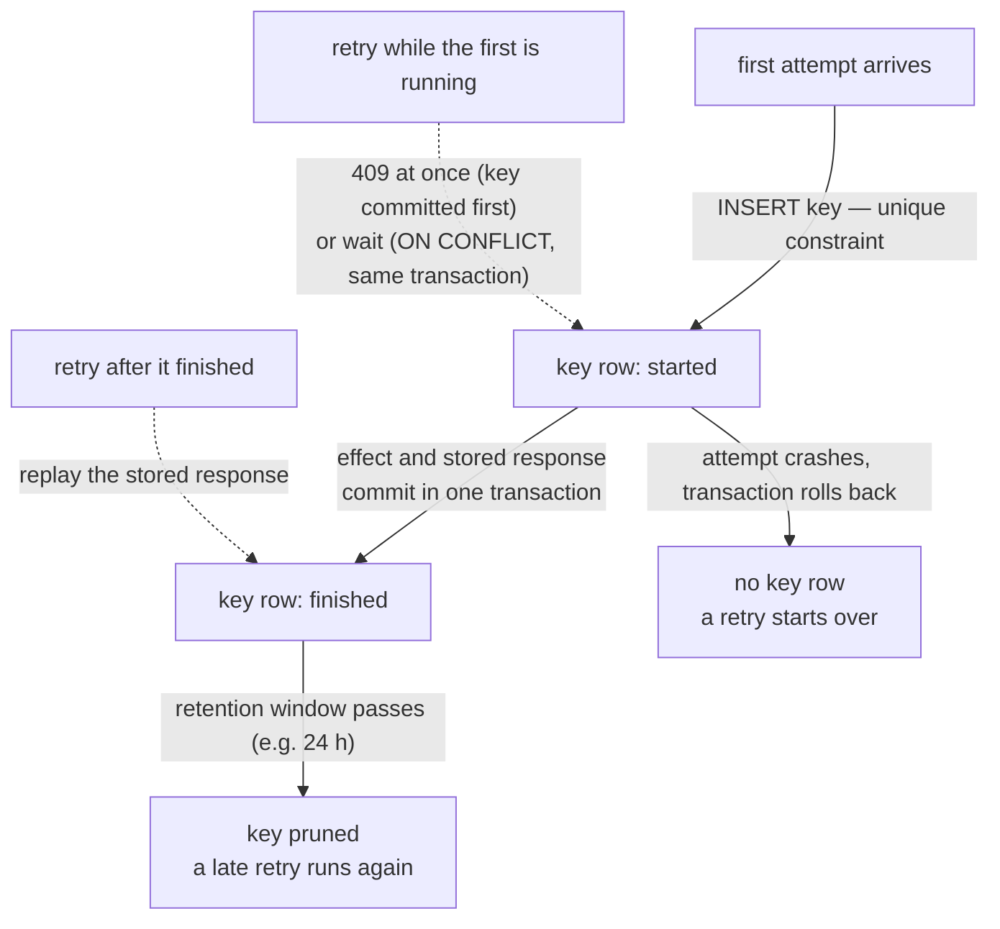
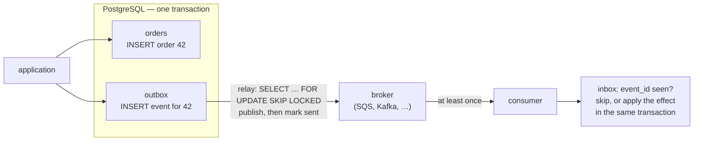

# M03 · Ch2 · §4 — Concurrency patterns: optimistic concurrency, idempotency keys and the transactional outbox

> **Module:** Databases & Storage (from first principles)
> **Chapter:** Transactions, concurrency and consistency — ACID (atomicity, consistency, isolation, durability),
> isolation levels, locking, MVCC (multi-version concurrency control)
> **Section:** Ch2 §3 opened up the database's own machinery: row versions, snapshots, row and table locks, advisory
> locks. Every one of those mechanisms either blocks somebody or aborts somebody. This section is about three
> application-level patterns that keep that machinery off the hot path, and about the one problem no database lock can
> solve: work that crosses the boundary of a single transaction. **Optimistic concurrency** — a version number checked
> in the `UPDATE`, so nothing is locked while a user or a model thinks. **Idempotency keys** — so that a retried request
> (a Lambda retry, a queue redelivery, a double-click) takes effect once. **The transactional outbox** — so that a
> database change and the message announcing it are committed together or not at all, and the **inbox** that makes the
> receiving side safe against the duplicates the outbox produces. Every trace and number below was measured on
> PostgreSQL 18.6 with psycopg 3.3.6; the scripts are committed in `diagrams/04-patterns-data/`.
> **Status:** 🔵 PREPARED 2026-11-09 — body written, awaiting your read and the Q&A.
> **Prerequisites:** **Ch2 §1 §6** (the lost update), **Ch2 §2** (READ COMMITTED's re-check, REPEATABLE READ's
> first-updater-wins and SQLSTATE 40001, the retry loop) and **Ch2 §3 §5** (`FOR UPDATE SKIP LOCKED` and the claim row;
> at-least-once).

**Estimated study time:** 3 hours including the hands-on.

---

## Why this section exists — and how it's pitched

Ch2 §1 to §3 were about one transaction meeting another inside one database. Real failures in the systems you build
are usually about something the database cannot see:

- a user opens an edit form, goes to lunch, and saves over a colleague's change made in the meantime;
- a payment request times out at the client, the client retries, and the customer is charged twice — although every
  single transaction was correct;
- an order is committed, the process is killed before it sends the "order created" message, and the warehouse never
  hears about it; or the message is sent, the commit fails, and the warehouse ships an order that does not exist;
- a consumer receives the same message twice and sends the customer two emails.

None of these is fixed by a stricter isolation level, because none of them happens inside one transaction. The first
spans two HTTP requests. The second spans a network that can lose a reply. The third spans two systems that cannot
share a transaction. The fourth is the third one's unavoidable side effect.

Each has a standard, small answer, and each answer is a few lines of SQL plus a rule about where the transaction
boundary goes. What makes them worth a section is that each also has a plausible-looking wrong version that passes
every test you are likely to write, and fails only under concurrency or a crash. So every pattern below is shown with
its wrong version, and both are measured under the conditions that break the wrong one.

What is worth keeping is in §6's checklist and in three sentences: **check the version you read in the `WHERE` clause
of the write, and treat zero rows as a conflict; record the idempotency key before, and in the same transaction as, the
effect it protects; never write to two systems in one step — write to the database, and let a relay deliver at least
once to consumers that deduplicate.**

---

## 1. Optimistic concurrency: check the version you read

<details>
<summary><b>Vocabulary for this section</b> — terms, abbreviations and symbols used below (click to expand)</summary>

**Abbreviations**

| Short | Stands for | Meaning |
|---|---|---|
| **CAS** | compare-and-set (compare-and-swap) | "write the new value only if the current value is still the one I read" — the hardware instruction and the general pattern |
| **ETag** | entity tag | an HTTP response header naming the version of a resource, e.g. `ETag: "7"` |
| **ORM** | object-relational mapper | a library that maps rows to objects (SQLAlchemy, Django ORM, Hibernate, Active Record) |
| **RC / RR** | READ COMMITTED / REPEATABLE READ | the two PostgreSQL isolation levels used here (Ch2 §2) |
| **SQLSTATE 40001** | `serialization_failure` | the error REPEATABLE READ and SERIALIZABLE raise when a transaction must be retried |
| **p50 / p99** | 50th / 99th percentile | the latency half / 99% of operations finish within |

**Symbols used in the formulas**

| Symbol | Reads as | Meaning |
|---|---|---|
| $c$ | "c" | number of clients writing concurrently (16 in Table 3) |
| $n$ | "n" | number of rows the clients pick from, each equally likely |
| $1 - (1 - 1/n)^{c - 1}$ | "one minus, one minus one over n, to the power c minus one" | the chance that at least one of the other $c - 1$ clients is working on your row |

**Terms**

| Term | Definition |
|---|---|
| **Read-modify-write** | read a value, compute a new one in the application, write it back — three steps, with a gap between read and write |
| **Lost update** | two read-modify-writes interleave and the second write overwrites the first without having seen it (Ch2 §1 §6) |
| **Think time** | the gap between the read and the write: application code, a model call, or a human looking at a form |
| **Pessimistic concurrency** | lock the row when reading (`SELECT … FOR UPDATE`) so nobody else can change it before you write |
| **Version column** | an integer incremented by every update; the value read is the "version" the writer claims to be changing |
| **Conflict** | the version check found the row changed since it was read; the writer updated 0 rows |
| **Contention** | how often concurrent operations want the same row; here set by how many rows the clients pick from |
| **`xmin`** | the system column holding the ID of the transaction that created this row version (Ch2 §3 §1) |
| **Precondition** | an HTTP request header (`If-Match`, `If-Unmodified-Since`) that makes the request apply only if the resource is in a stated state |
| **412 Precondition Failed** | the HTTP status for "your `If-Match` did not match; nothing was changed" |
| **428 Precondition Required** | the HTTP status for "this endpoint requires `If-Match`, and you did not send one" |
| **Starvation** | an operation that keeps losing conflicts and retrying while others succeed (seen in Ch2 §1 §11) |

</details>

A read-modify-write has a gap in the middle. Ch2 §1 §6 measured what happens when two of them overlap with no
protection: the second write overwrites the first. There are exactly three ways to close the gap, and every concurrency
pattern in practice is one of them.

1. **Remove the gap.** If the new value can be computed by the database from the old one, write it as one statement:
   `UPDATE account SET balance = balance + 100 WHERE id = 7`. The row lock taken by the `UPDATE` covers the read and the
   write, because they are the same statement. This is always the best answer when it is available.
2. **Lock the gap (pessimistic).** `BEGIN; SELECT … FOR UPDATE;` think; `UPDATE …; COMMIT`. Nobody else can change the
   row while you think, because they wait on your row lock.
3. **Check the gap (optimistic).** Read the row and its version without locking anything. Think. Then write with the
   version you read as a condition:

```sql
-- read: no lock, no transaction held open
SELECT id, body, version FROM doc WHERE id = 1;            -- say version = 7

-- think for as long as you like

-- write: only if nobody changed the row since we read it
UPDATE doc SET body = %(new_body)s, version = version + 1
WHERE  id = 1 AND version = 7;
-- 1 row  -> saved
-- 0 rows -> someone else saved first: re-read, and either retry or show the user the conflict
```

That is the whole mechanism: a compare-and-set, written as a `WHERE` clause. The version is not a lock and nothing
waits on it — until the write itself, where something interesting happens.

### What the database does with the version check

The check looks like an ordinary condition, so it is fair to ask what makes it safe. Two writers read version 0,
then both run the same `UPDATE … WHERE version = 0`. Traced with two sessions (`occ_trace.py`):

**Table 1** — two writers race to update the same row with the same version check, at each isolation level (PostgreSQL 18.6; `occ-trace-out.txt`).

| Step | READ COMMITTED | REPEATABLE READ |
|---|---|---|
| A and B both read the row | version 0 | version 0 |
| A: `UPDATE … WHERE version = 0`, not yet committed | 1 row | 1 row |
| B: the same `UPDATE` | **waits** on A's row lock | **waits** on A's row lock |
| A commits (after 1 s) | B wakes, re-reads the row's **new** version (1), finds `version = 0` false, updates **0 rows** | B wakes and gets **`ERROR 40001`** — could not serialize access due to concurrent update |
| final row | A's change, version 1 | A's change, version 1 |

Two things to take from Table 1.

- **The check is safe because of the row lock under it, not in spite of it.** Optimistic concurrency is "optimistic"
  about the think time, not about the write: the `UPDATE` still takes a row lock, and the second writer still waits for
  the first to commit. What it avoids is holding a lock *during the think time*. At READ COMMITTED, the second writer's
  re-check after waiting is Ch2 §2 §2's "re-evaluate the `WHERE` clause on the newest version": that is what turns the
  version condition into a real compare-and-set rather than a check against a stale snapshot.
- **The loser's signal depends on the isolation level.** At READ COMMITTED you get a row count of 0; at REPEATABLE READ
  you get an exception. Code that only checks the row count works at the default level and turns into an unhandled
  `40001` the day somebody raises the level — so handle both, in the same retry path.

### The case it was invented for: someone thinking for minutes

A content-management form, a pricing approval, an agent that reads a record, calls a model for 30 seconds and writes
the result back: the think time is long, and in the meantime other, short requests need the same row. `occ_trace.py`
holds an "edit" for 5 seconds while another request decrements a stock count on the same row:

**Table 2** — a 5-second edit and a short request on the same row: which one waits (PostgreSQL 18.6; `occ-trace-out.txt`).

| Editor holds the row by… | The short stock update waited | The editor's save |
|---|---|---|
| `SELECT … FOR UPDATE`, then 5 s, then `UPDATE` (pessimistic) | **4.82 s** | saved |
| reading the version, committing, 5 s, then `UPDATE … WHERE version = v` (optimistic) | **0.011 s** | 0 rows — conflict reported, nothing overwritten |

Pessimistic locking makes the short request pay for the long one's think time, and for a human that can be the length
of a lunch break — with a connection and an open transaction pinned the whole time (Ch2 §1 §7, Ch2 §3 §2). Optimistic
concurrency makes the long operation pay instead: it finds out at save time that the row moved, and has to merge,
retry or ask. That is the right trade whenever the long side is a human or a slow external call, which is why
optimistic concurrency is the standard for anything that spans **more than one request**: a form load and its submit
are two HTTP requests, often on two different servers, and there is no transaction that could span them anyway.

### Under contention: when optimism stops paying

The trade reverses when conflicts are common. `occ_bench.py` ran 16 clients, each doing 300 read-think-write increments
with 2 ms of think time, on 1 to 4,096 rows (fewer rows = more clients wanting the same row), with each of the three
fixes plus no protection:

**Table 3** — 16 clients × 300 read-then-write increments, 2 ms think time, by how many rows they pick from (PostgreSQL 18.6, READ COMMITTED; medians of 3 runs; `occ-bench.csv`). "One statement" is fix 1, `balance = balance + 1`.

| Rows | No protection: updates lost | One statement: updates/s | Pessimistic: updates/s · p99 | Optimistic: updates/s · p99 | Optimistic: retries per update |
|---|---|---|---|---|---|
| 1 | **4,500 of 4,800 (94%)** | 2,934 | 346 · 163 ms | **168 · 1,684 ms** | **13.2** |
| 16 | 2,200 (46%) | 2,384 | 2,680 · 18 ms | 505 · 725 ms | 0.79 |
| 64 | 760 (16%) | 2,992 | 2,545 · 13 ms | 2,397 · 24 ms | 0.19 |
| 4,096 | 16 (0.3%) | 3,179 | 2,536 · 7.9 ms | **3,138 · 6.1 ms** | 0.003 |

![Three panels against the number of rows the 16 clients pick from, on a log scale from 1 to 4,096. Panel (a), throughput: the one-statement update stays between about 2,400 and 4,900 updates per second throughout; no protection rises from about 600 at one row to about 3,000; pessimistic locking climbs from about 350 at one row to about 2,500; optimistic climbs from under 200 at one and four rows to about 3,100 at 4,096 rows, crossing above pessimistic between 64 and 256 rows; the bands show large run-to-run spread for optimistic at high contention. Panel (b): with no protection, lost updates fall from 94 percent at one row to well under 1 percent at 4,096 rows. Panel (c): optimistic retries per committed update fall from about 13 at one row to near zero, and optimistic p99 latency falls from about 1.7 seconds to 6 milliseconds, while pessimistic p99 falls from about 160 to 8 milliseconds.](diagrams/04-patterns-fig1.svg)

**Figure 1** — read-then-write under contention: throughput (a), what no protection loses (b), and what optimism costs
(c). "One statement" = `UPDATE … SET balance = balance + 1`, no read; "pessimistic" = `SELECT … FOR UPDATE`, think,
`UPDATE`, in one transaction; "optimistic" = read with version, think, `UPDATE … WHERE version = v`, re-read and retry on
0 rows; "no protection" = read, think, `UPDATE … SET balance = <value read + 1>`.

Reading Table 3 and Figure 1 row by row:

- **No protection loses updates in proportion to contention**, from 94% on one hot row to 0.3% on 4,096 rows. The 0.3%
  is the dangerous number: it is too rare to show up in a test and frequent enough to corrupt a ledger.
- **On one hot row, optimistic is the worst of the correct options.** Every client reads, thinks for 2 ms and tries to
  write; one wins, fifteen lose and start again. That was 13 retries per committed update, half the throughput of
  locking, and a p99 of 1.7 s against locking's 163 ms. It was also erratic — 96 to 368 updates per second across three
  runs — because who loses is a matter of timing. This is Ch2 §1 §11's starvation, and it gets worse as think time
  grows, because a longer gap means more writers land inside it.
- **On thousands of rows, optimistic is the best of the correct options.** Conflicts all but disappear (15 retries in
  4,800 updates), and it does less work than locking: two statements in autocommit against locking's four (`BEGIN`,
  `SELECT … FOR UPDATE`, `UPDATE`, `COMMIT`), each a network round trip. It was within 2% of the one-statement update;
  locking was 20% slower with a higher p99.
- **The crossover sat between 64 and 256 rows** for 16 clients and 2 ms of think time. A rough guide is the chance
  that another writer touches your row while you think. With $c$ concurrent writers each busy with one of $n$ equally
  likely rows, the chance that at least one of the other $c - 1$ is on yours is $1 - (1 - 1/n)^{c - 1}$, which is
  about $(c - 1)/n$ when $n$ is large — 0.21 at $n = 64$ and $c = 16$, close to the 0.19 retries per update measured.
  Optimism pays while that number is well below 1; at $n = 16$ it is already 0.62.
- **When fix 1 is available, use it.** The one-statement update lost nothing and was fastest or near-fastest at every
  contention level, because it holds the row lock for microseconds and never retries. Patterns 2 and 3 are for changes
  the database cannot compute itself: a new document body, a status decided by a model, a merge of two JSON objects.

### What to use as the version

**Table 4** — candidate version tokens, and what goes wrong with each (the `xmin` rows measured in `occ-trace-out.txt`).

| Version token | Works? | What to know |
|---|---|---|
| **An integer `version` column, `version = version + 1` on every write** | yes — the default choice | every write path must increment it, including bulk `UPDATE`s and admin scripts; a trigger (`BEFORE UPDATE … NEW.version := OLD.version + 1`) enforces that |
| **`updated_at` timestamp** | risky | `now()` is the *transaction start* time, so two writes in one transaction share it, and a clock that steps backwards (or a value truncated to milliseconds by a client library) can make a newer row look the same as an older one; use `clock_timestamp()` and full precision if you must |
| **The system column `xmin`** | yes, with limits | free, always maintained: a no-op `UPDATE … SET body = body` changed it, `SELECT … FOR UPDATE` did not, and two updates in one transaction left one value. But it is renumbered when rows are copied (a dump and restore, a logical copy, `CREATE TABLE AS`) and it wraps around, so never store it beyond a short edit session. Npgsql (.NET) and Entity Framework Core use it this way |
| **A hash of the row's content** | yes, for HTTP | the natural `ETag`; detects any change, but costs a hash per read, and an update that restores the old content looks unchanged (usually fine) |

### Over HTTP: `ETag` and `If-Match`

A web API cannot hand its client a database row lock, so optimistic concurrency is the only option across requests,
and HTTP has had it built in since 1999. The server sends the version as an `ETag`; the client sends it back in
`If-Match`; the server turns it into the `WHERE` clause:

```http
GET /docs/1                      →  200 OK
                                    ETag: "7"
                                    {"body": "draft"}

PUT /docs/1                      →  204 No Content          (version was still 7; now 8)
If-Match: "7"
{"body": "final"}

PUT /docs/1                      →  412 Precondition Failed  (someone else saved: version is 8)
If-Match: "7"

PUT /docs/1                      →  428 Precondition Required  (the server insists on If-Match)
```

`If-Match` uses strong comparison (RFC 9110 §13.1.1), so a weak tag (`W/"7"`) never matches it. 428 comes from
RFC 6585 §3, and exists so that a server can refuse the "blind" write that would reintroduce the lost update. The W3C
(World Wide Web Consortium) wrote the problem up in 1999 as *Detecting the Lost Update Problem Using Unreserved
Checkout* — unreserved checkout being their name for optimistic concurrency.

The same compare-and-set appears across the stack, under different names — worth recognising, because the failure
modes carry over:

- **Object-relational mappers (ORMs):** SQLAlchemy's `version_id_col` raises `StaleDataError` when the `UPDATE` matches 0 rows; Ruby on Rails' Active
  Record uses a `lock_version` column and raises `ActiveRecord::StaleObjectError`; JPA (the Java Persistence API) uses a
  `@Version` field and `OptimisticLockException`. Django has no built-in equivalent.
- **Key-value stores:** DynamoDB's conditional write (`ConditionExpression: version = :v`) fails with
  `ConditionalCheckFailedException`; Redis uses `WATCH` … `MULTI` … `EXEC`, where `EXEC` returns nothing if a watched key
  changed.
- **Kubernetes:** every object carries `metadata.resourceVersion`; an update sent with a stale one gets `409 Conflict`,
  and controllers are written as read-modify-retry loops around exactly that.

---

## 2. Idempotency keys: a retried request takes effect once

<details>
<summary><b>Vocabulary for this section</b> — terms and abbreviations used below (click to expand)</summary>

**Abbreviations**

| Short | Stands for | Meaning |
|---|---|---|
| **UUID** | universally unique identifier | a 128-bit random (v4) or time-ordered (v7) identifier a client can generate without asking a server |
| **SQS** | Simple Queue Service | AWS's (Amazon Web Services') managed message queue; standard queues deliver at least once |
| **FIFO** | first in, first out | an SQS queue type with ordering and a 5-minute deduplication window |
| **IETF** | Internet Engineering Task Force | the body that publishes HTTP standards (RFCs) and drafts |
| **RFC** | Request for Comments | a published internet standard, e.g. RFC 9110 (HTTP semantics) |
| **409 / 422** | HTTP Conflict / Unprocessable Content | the statuses the IETF draft assigns to "same key still in progress" and "same key, different request" |

**Terms**

| Term | Definition |
|---|---|
| **Idempotent** | performing it twice has the same effect as performing it once |
| **Idempotency key** | a unique value the client generates once per logical operation and sends with every attempt of it |
| **Retry** | sending the same request again because no answer arrived — which does not mean the first attempt failed |
| **Timeout** | the client stops waiting; the server usually keeps working and may well succeed |
| **At-least-once delivery** | every message or request arrives, possibly more than once (SQS standard queues, Lambda async retries) |
| **Natural key** | a business identifier that is already unique (an order number, an invoice ID) and can serve as the idempotency key |
| **Upsert** | insert, or update if the row exists: `INSERT … ON CONFLICT … DO UPDATE` |
| **`ON CONFLICT DO NOTHING`** | insert unless a unique constraint would be violated, in which case insert nothing and report 0 rows |
| **Speculative insertion** | how PostgreSQL implements `ON CONFLICT`: insert, and if a concurrent transaction holds the same key uncommitted, wait for it to finish first |
| **Replay** | answering a repeated request with the stored response of the first attempt instead of doing the work again |
| **Request fingerprint** | a hash of the request body, stored with the key, to detect a key reused for a different request |
| **Recovery point** | Stripe's term for a recorded step inside a multi-step request, so that a retry can resume after the last completed step |

</details>

### Where the second request comes from

A request can arrive twice without anyone doing anything wrong. The common sources, in roughly the order you will meet
them:

- **A client timeout.** The client gives up waiting and retries; the server never learns the client gave up and
  finishes the first attempt anyway. Every HTTP client library, every AWS SDK (the default "standard" retry mode makes
  3 attempts) and every API gateway works this way.
- **AWS Lambda asynchronous invocation** retries a failed function twice by default, one and then two minutes apart —
  and the AWS documentation adds that even a function that *succeeds* may receive the same event more than once,
  because the internal queue is eventually consistent.
- **Queue redelivery.** An Amazon SQS (Simple Queue Service) standard queue delivers at least once; a message whose consumer does not delete it within
  the visibility timeout is delivered again — and the consumer may have done the work and crashed before the delete.
  Ch2 §3 §5's claim row has the same property.
- **People.** A double-click, a browser back-and-resubmit, a mobile app that resends when the network drops.

The dangerous case is the first one, because it is invisible: the retry is correct client behaviour, every transaction
on the server is correct, and the customer is still charged twice.

### The first answer: make the operation naturally idempotent

Some operations are idempotent by construction. HTTP's `PUT` and `DELETE` are defined as idempotent (RFC 9110
§9.2.2), `POST` is not, and the difference is the shape of the operation, not the verb:

- **Set an absolute value, not a relative one.** `SET status = 'shipped'` is idempotent; `SET stock = stock - 1` is not.
- **Upsert on a natural key.** If the request carries an identifier that is already unique — an order number generated
  by the client, a message ID from the queue, an invoice number from an upstream system — a unique constraint on it
  turns the second insert into a no-op: `INSERT … ON CONFLICT (order_no) DO NOTHING`. That is an idempotency key that
  happens to exist already, and it is the cheapest one.

When the operation is inherently "do something once more" — charge a card, send an email, create a new object — there
is no natural key, and the client has to supply one.

### The idempotency key: what the server stores

The client generates a random key (a version-4 universally unique identifier, UUID) **once per logical operation**, before the first attempt, and sends the
same key with every retry, conventionally in an `Idempotency-Key` header. Stripe made the pattern famous; the IETF (Internet Engineering Task Force) is
standardising the header (draft-ietf-httpapi-idempotency-key-header, revision 08 of 2026-10-22), which recommends 400
for a missing key, **422** for a key reused with a different request, and **409** for a retry that arrives while the
first attempt is still running.

The server needs one table:

```sql
CREATE TABLE idempotency_key (
    key          text        NOT NULL,
    caller       text        NOT NULL,                 -- keys are unique per client account, not globally
    request_hash bytea       NOT NULL,                 -- fingerprint of the request body
    status       text        NOT NULL DEFAULT 'started',   -- 'started' | 'finished'
    locked_at    timestamptz NOT NULL DEFAULT now(),   -- when the current attempt began
    response     jsonb,                                -- status code + body to replay
    created_at   timestamptz NOT NULL DEFAULT now(),
    PRIMARY KEY (caller, key)
);
```

The unique constraint is the whole mechanism. Everything else is about **when** the key row is written relative to the
effect, and that is exactly where the plausible wrong version lives.

### Four designs, measured

`idem_bench.py` built a payment endpoint four ways and drove it with a client that behaves the way real ones do: 500
payments from 8 client threads; the provider call inside the request takes an exponentially distributed time with a
mean of 80 ms (so about 15% of calls exceed 150 ms); the client waits 150 ms, then retries the same payment with the same
key, up to 5 attempts 50 ms apart. The server — 40 worker threads, each with its own connection, standing in for
Lambda invocations — does not know a client has given up and always finishes.

- **no key** — `BEGIN`; provider call; `INSERT charge`; `COMMIT`.
- **check-first** — `SELECT` the key; if it is there, replay; otherwise charge and commit, *then* insert the key with the
  response. This is the version most people write first.
- **key-in-txn** — `BEGIN`; `INSERT` the key `ON CONFLICT DO NOTHING`; if 0 rows, read and replay the stored response;
  otherwise provider call, `INSERT charge`, store the response; `COMMIT`. Key and charge commit together.
- **key-first** — transaction 1: insert the key as `started` and commit; on conflict, replay if `finished`, answer **409**
  if `started`. Transaction 2: provider call, `INSERT charge`, mark the key `finished` with the response; commit. This is
  Stripe's published design (Brandur Leach, *Implementing Stripe-like Idempotency Keys in Postgres*, 2017), without its
  multi-step recovery points.

**Table 5** — 500 payments through a client that retries after a 150 ms timeout, four server designs (PostgreSQL 18.6; medians of 3 runs; `idem-bench.csv`). "Replayed" = the client got the stored response of an earlier attempt. "Gave up" = all 5 attempts timed out or got 409.

| Design | Requests sent | Charges | **Extra charges** | Client: fresh / replayed / 409s / gave up |
|---|---|---|---|---|
| no key | 592 | 592 | **92** | 500 / 0 / 0 / 0 |
| check-first | 586 | 548 | **48** | 462 / 38 / 0 / 0 |
| key-in-txn | 589 | 500 | **0** | 423 / 77 / 0 / 0 |
| key-first (409 while in progress) | 663 | 500 | **0** | 419 / 74 / 101 / **7** |


**Figure 2** — duplicate charges (a) and what the client saw (b) for the four designs of Table 5. "Check key, charge,
save key" = check-first; "key inserted first, same transaction" = key-in-txn; "key committed first, 409 while in
progress" = key-first.

What each row shows:

- **No key: 92 extra charges in 500 payments**, 18%, from about 15% slow provider calls. Every one of the 592 requests
  succeeded on the server. The client saw 500 clean successes and has no idea.
- **Check-first halves the damage and does not remove it.** The check works for a retry that arrives *after* the first
  attempt has saved its key — 38 replays. It fails for a retry that arrives while the first attempt is still running:
  the key is not there yet, so the retry charges too. And the client's retry arrives precisely *because* the first
  attempt is slow, so "while the first attempt is still running" is the common case, not the corner case. This is the
  same check-then-act race as Ch2 §2's write skew, between a request and its own retry.
- **Key-in-txn: zero duplicates.** The retry's `INSERT` of the key collides with the first attempt's **uncommitted** key
  — and PostgreSQL makes it wait for the first transaction to finish (Table 6). When the first attempt commits, the
  retry's insert does nothing, and it replays the stored response. Because the key and the charge are in one
  transaction, a crash of the first attempt removes both, and the retry starts from scratch.
- **Key-first: zero duplicates, and a different contract.** The key is committed before the work starts, so a retry
  sees `started` immediately and gets 409 without waiting; 101 such replies. The client must treat 409 as "retry later",
  and **7 payments ran out of attempts while still in progress — charged, with the client told nothing.** A client of a
  409-style API needs a longer retry horizon, or a way to ask for the result later.

### Two identical requests at the same instant

Table 5's retries are spaced 150 ms apart. A double-click, or two Lambda deliveries of one event, can be simultaneous.
`idem_bench.py race` released two identical requests through a barrier, 500 times per design:

**Table 6** — two identical requests released at the same instant, 500 pairs per design (PostgreSQL 18.6; `idem-race-out.txt`).

| Design | Charges for 500 pairs | Extra charges | What the second request got | Time the non-charging request took |
|---|---|---|---|---|
| no key | 1,000 | **500** | charged again | — |
| check-first | 1,000 | **500** | charged again — both checks ran before either key was saved | — |
| key-in-txn | 500 | **0** | the stored response (replay) | **median 55.6 ms**, max 530 ms — it waited for the first |
| key-first | 500 | **0** | 409, in progress | **median 1.7 ms**, max 8 ms — answered at once |

The key-in-txn row is the behaviour of `INSERT … ON CONFLICT` worth remembering: **a second inserter of a key that is
held by an uncommitted transaction waits for that transaction**, and only then decides whether there was a conflict.
That is what makes it correct — it cannot decide "no conflict" while the first transaction might still commit — and it
means the duplicate request holds a connection and a server worker for the whole duration of the first one. The 409
design answers at once and frees both, at the price of pushing the waiting onto the client.

<!-- DIAGRAM:START -->


<details>
<summary>Diagram source (Mermaid)</summary>



</details>
<!-- DIAGRAM:END -->

**Figure 3** — the lifecycle of an idempotency key row in the designs that commit the key with the effect.

### Side effects outside the database

Table 5's charge was a row in the same database, so it could commit atomically with the key. A real payment calls a
card network, an email provider or another team's API, and that call cannot be rolled back. Three rules cover it:

1. **Pass an idempotency key downstream.** Stripe accepts `Idempotency-Key`; so do most payment and messaging APIs.
   Derive the downstream key from your own (`<your key>:charge`) so that your retry, after a crash in the middle, makes
   the same downstream call with the same key and gets the same result instead of a second charge. Without that, there
   is no correct design — only a choice of which way it fails.
2. **Record progress in steps.** Stripe's design stores a *recovery point* in the key row after each external call
   (`started` → `charge_created` → `finished`), each step in its own transaction, so a retry resumes after the last
   completed step rather than repeating it. That is the full version of Figure 3.
3. **Let a stuck `started` key be taken over, but only after a lease.** If the attempt that owns a key dies (a Lambda
   timeout, a killed container), the key would stay `started` forever. Record `locked_at`, and let a retry claim the key
   once it is older than the longest possible attempt — the same lease-and-fence idea as Ch2 §3 §5's reaper. AWS
   Lambda Powertools' idempotency utility does exactly this: it raises `IdempotencyAlreadyInProgressError` while a
   record is in progress, and if the function registers its context, treats an in-progress record past the
   invocation's deadline as expired.

### The details that make it production-grade

- **Scope the key to the caller.** Two customers will eventually send the same key; make the primary key
  `(caller, key)`.
- **Fingerprint the request.** Store a hash of the body; a retry with the same key and a different body is a client
  bug, and the answer is 422, not a replay of an unrelated response. Stripe compares the parameters and errors on a
  mismatch.
- **Decide which responses to store.** Stripe stores the first response once the endpoint has started executing,
  **including 500 errors**, so a retry gets the same 500 rather than a second attempt with unknown side effects. A
  request rejected before it did anything (failed validation, a 409) is not stored, and can be retried.
- **Choose the retention window from the longest retry horizon, not from a round number.** Stripe prunes keys after at
  least 24 hours; Powertools' default is one hour. But an SQS message can be retained for up to 14 days and redriven from
  a dead-letter queue days later — if the key has been pruned by then, the redrive runs the effect again.
- **Do not confuse it with queue deduplication.** An SQS FIFO (first in, first out) queue's `MessageDeduplicationId` suppresses a duplicate
  *send* within a 5-minute window. It does not make the *consumer* idempotent: a consumer that crashes before deleting
  the message still gets it again. Only the consumer's own record of what it has done covers that (§4).

---

## 3. The transactional outbox: the change and the message, committed together

<details>
<summary><b>Vocabulary for this section</b> — terms and abbreviations used below (click to expand)</summary>

**Abbreviations**

| Short | Stands for | Meaning |
|---|---|---|
| **CDC** | change data capture | reading a database's committed changes from its log and streaming them elsewhere |
| **WAL** | write-ahead log | PostgreSQL's log of every change, written before the data pages; logical decoding reads it |
| **SQS** | Simple Queue Service | AWS's managed message queue |

**Terms**

| Term | Definition |
|---|---|
| **Dual write** | writing the same fact to two systems (a database and a broker) in two separate steps, with no transaction spanning both |
| **Broker** | the system that carries messages to consumers: SQS, Kafka, RabbitMQ, Redis Streams, an email provider |
| **Lost message** | the change committed, but the message was never sent |
| **Phantom message** | the message was sent, but the change it announces never committed |
| **Outbox table** | a table the application writes messages into, in the same transaction as the change they describe |
| **Relay** | the process that reads unsent outbox rows, publishes them to the broker and marks them sent (also "message relay", "outbox poller") |
| **High-water mark** | "the largest ID I have processed"; a relay that polls `WHERE id > last_seen` |
| **Logical decoding** | PostgreSQL's facility for turning WAL records into a stream of row changes in commit order |
| **Replication slot** | a server-side cursor into the WAL that remembers how far a consumer has read; the server keeps all WAL after it |
| **`test_decoding`** | the example output plugin shipped with PostgreSQL, which prints decoded changes as text |
| **Debezium** | an open-source CDC platform that reads logical decoding and publishes to Kafka; it ships an outbox event router |
| **`pg_logical_emit_message`** | a function that writes a message straight into the WAL, decoded in order with the transaction, without a table row |
| **Aggregate** | the entity a sequence of events belongs to (here one order); consumers usually need its events in order |

</details>

### The dual-write problem

An order is placed. The database must record it, and the warehouse must be told, through a broker. The obvious code
writes one, then the other:

```python
with conn.transaction():
    conn.execute("INSERT INTO orders …")
broker.publish({"type": "order_created", "order_id": 42})     # a different system, a different "transaction"
```

There is no ordering of those two writes that is safe. Commit first and publish second, and a crash between them —
the process is killed, the Lambda times out, the broker is briefly unreachable — leaves an order nobody downstream knows
about. Publish first and commit second, and a crash, or a commit that fails, leaves a message about an order that does
not exist. A commit can fail for many reasons: a deferred constraint, a serialization failure (Ch2 §2), a lost
connection after the `COMMIT` was sent. `outbox_bench.py crash` placed 2,000 orders each way, with the process
"crashing" at the dangerous point 1% of the time and 2% of orders failing a deferred constraint at `COMMIT`:

**Table 7** — 2,000 orders, 1% process crashes and 2% failing commits, three ways to "save and announce" (PostgreSQL 18.6; the broker is a second database reached on its own connection; `outbox-crash.csv`).

| Design | Orders committed | Messages published | **Lost** | **Phantom** | Duplicate deliveries | Duplicate effects at a naive consumer | … at a consumer with an inbox |
|---|---|---|---|---|---|---|---|
| commit, then publish | 1,953 | 1,938 | **15** | 0 | 0 | 0 | 0 |
| publish, then commit | 1,938 | 2,000 | 0 | **62** | 0 | 0 | 0 |
| outbox + relay | 1,938 | 2,038 | **0** | **0** | 100 | 100 | **0** |


**Figure 4** — what each way of "write the database, tell the broker" loses or duplicates (Table 7). "Lost" = order
committed with no message; "phantom" = message for an order that never committed; "inbox" = the consumer records each
message's ID in the same transaction as its effect and skips IDs it has seen (§4).

- **Commit, then publish: 15 lost**, one per crash. Every crash after a commit is a lost message, and nothing will ever
  notice.
- **Publish, then commit: 62 phantoms** — the 15 crashes plus the 47 orders whose commit failed after their message had
  gone out. The commit failures are the part people forget: they do not need a crash at all.
- **Outbox: nothing lost and nothing invented, and 100 duplicates.** The duplicates came from 2 relay crashes, each
  after publishing a batch of 50 and before marking it sent. That is the trade the outbox makes, on purpose: it turns
  "lost or phantom" into "possibly duplicated", and duplicates are the one failure a consumer can repair (§4).

You cannot fix the first two by retrying harder or by ordering the code more carefully. Fixing them needs one
transaction spanning the database and the broker — two-phase commit — which SQS, most Kafka clients and every email or
HTTP API do not offer. So the outbox does not try; it moves the second write into the first system.

### The pattern

```sql
CREATE TABLE outbox (
    id           bigserial   PRIMARY KEY,
    event_id     uuid        NOT NULL DEFAULT gen_random_uuid(),   -- the consumer deduplicates on this
    aggregate_id bigint      NOT NULL,                             -- e.g. the order id; used for ordering
    type         text        NOT NULL,
    payload      jsonb       NOT NULL,
    created_at   timestamptz NOT NULL DEFAULT now(),
    sent_at      timestamptz
);
CREATE INDEX outbox_unsent ON outbox (id) WHERE sent_at IS NULL;  -- the relay's query stays small

-- the application: one transaction, two inserts
BEGIN;
INSERT INTO orders (id, …) VALUES (42, …);
INSERT INTO outbox (aggregate_id, type, payload) VALUES (42, 'order_created', '{"order_id": 42, …}');
COMMIT;

-- the relay, in a loop: claim a batch, publish it, mark it sent
BEGIN;
SELECT id, event_id, aggregate_id, type, payload
FROM   outbox WHERE sent_at IS NULL
ORDER  BY id LIMIT 100
FOR UPDATE SKIP LOCKED;
-- publish every row to the broker, with event_id as the message ID
UPDATE outbox SET sent_at = now() WHERE id = ANY(%(ids)s);
COMMIT;
```

<!-- DIAGRAM:START -->


<details>
<summary>Diagram source (Mermaid)</summary>



</details>
<!-- DIAGRAM:END -->

**Figure 5** — the transactional outbox and the consumer's inbox. Only the application's transaction is atomic; the
relay and the broker deliver at least once, and the inbox turns that into one effect per event.

The relay's query is Ch2 §3 §5's job-queue claim, unchanged: an outbox *is* a job queue whose job is "publish this
row". Everything measured there applies — `SKIP LOCKED` lets several relays share the work, a partial index keeps the
query proportional to the unsent rows, and the delivery guarantee is at least once, because a relay that publishes and
dies before its `UPDATE` commits will publish the batch again. That is exactly where Table 7's 100 duplicates came from.

### The relay bug that loses messages silently: polling by high-water mark

A tempting relay keeps no `sent_at` column at all. It remembers the largest `id` it has published and polls for
anything larger:

```sql
SELECT * FROM outbox WHERE id > %(last_seen)s ORDER BY id;     -- then last_seen := max(id)
```

It looks right, because `bigserial` ids increase. But ids are handed out when the row is **inserted**, and the row
becomes visible when its transaction **commits**, and those happen in different orders. A transaction that takes id
1,001 and commits after a transaction that took 1,002 is invisible when the relay reads 1,002 and moves its high-water
mark past it; 1,001 is never read. `outbox_bench.py hwm` ran 8 writers whose transactions stay open 0–20 ms after the
insert, with both kinds of relay polling every 5 ms:

**Table 8** — 4,000 outbox events committed by 8 concurrent writers; how many each relay ever delivered (PostgreSQL 18.6; 3 runs; `outbox-hwm-out.txt`).

| Relay | Delivered | **Never delivered** |
|---|---|---|
| `WHERE id > last_seen ORDER BY id` (high-water mark) | 1,936 · 1,961 · 1,956 | **2,064 · 2,039 · 2,044** |
| `WHERE sent_at IS NULL … FOR UPDATE SKIP LOCKED` | 4,000 · 4,000 · 4,000 | **0 · 0 · 0** |

Half of all events, silently. The number depends on how long transactions stay open, but it is never zero once there
is more than one writer, and nothing in a test with one writer would show it. This is the MVCC picture of Ch2 §3 §2 at
the application level: "the largest id I can see" is not "everything below it has committed", because a snapshot can
contain in-progress transactions with smaller ids. A relay that must work by position needs a position that *is* in
commit order — which is exactly what the write-ahead log (WAL) offers, below.

### Ordering, and why more relays reorder events

Two questions decide how a polling relay should be run: how many events it can publish, and whether the events of one
order arrive in the order they were written. `outbox_bench.py relay` pre-loaded 20,000 events — five per order,
numbered 1 to 5 — and drained them with 1 to 8 relay threads claiming batches of 1, 10 or 100 rows with `FOR UPDATE SKIP
LOCKED`, publishing each batch to the broker database and marking it sent:

![Two panels against the number of relay threads, 1, 2, 4 and 8. Panel (a), events published per second on a log scale: batches of one event stay between about 270 and 1,100 per second; batches of ten reach 4,500 to 8,400; batches of a hundred reach about 20,000 to 28,000 at every thread count. Panel (b), events that reached the broker after a later event of the same order: with batches of one, zero for one thread, about one for two threads, about 800 for four threads and about 2,100 for eight threads; with batches of ten and a hundred, between zero and seven at every thread count.](diagrams/04-patterns-fig6.svg)

**Figure 6** — a polling outbox relay draining 20,000 events: throughput (a) and per-order reordering (b), by number of
relay threads and batch size (PostgreSQL 18.6; medians of 3 runs; `outbox-relay.csv`). "Batch" = rows claimed by one
`SELECT … LIMIT n FOR UPDATE SKIP LOCKED`, published, and marked sent in one relay transaction; "reordered" = an event
that reached the broker after a later event of the same order.

- **Batch size matters far more than thread count.** One thread publishing one event per transaction managed a median
  of 271 events a second (240 to 899 across runs); with batches of 100 the same thread did about 19,500. Every batch
  costs the same fixed overhead — a claim, a publish, a mark-sent, and a commit with a WAL flush on each side — so the
  overhead per event falls with the batch size. Adding threads helped single-event batches (1,117 a second with 8) and
  did almost nothing at a batch of 100 (20,000 to 28,000).
- **One relay preserves order; several do not.** With one thread, zero events out of order. With four or eight threads
  publishing one event at a time, 742 to 2,294 events reached the broker after a later event of the same order —
  up to 14% of the 16,000 that could be. Two relays each hold a different event of the same order, and whichever
  finishes first publishes first.
- **Batching "fixed" the ordering here only by luck.** An order's five events had adjacent ids, so a batch of 10 or 100
  usually carried all of them together, and fewer than 8 per run were reordered. In production an order's events are
  written minutes apart, interleaved with thousands of others, and land in different batches. Retries reorder too: a
  relay that crashes after publishing re-publishes a batch after newer ones have gone out (Table 7).

If consumers need per-order order, either run **one** relay, or partition the work by aggregate (relay $k$ handles
orders whose id hashes to $k$, and publishes them to a broker that keeps per-key order, such as a Kafka partition or an
SQS FIFO message group) — and in both cases make consumers tolerate the occasional stale event by checking a version
number (§5).

### The alternative relay: read the WAL (change data capture)

Instead of polling the table, a relay can read the outbox inserts from the write-ahead log through **logical
decoding**. PostgreSQL decodes committed transactions in **commit order**, which removes the high-water-mark problem,
and it never sees an aborted one. `outbox_bench.py cdc` created a replication slot with the `test_decoding` plugin and
committed three transactions:

```text
xid 680816: BEGIN 680816
xid 680816: table public.orders: INSERT: id[integer]:1 ok[boolean]:true
xid 680816: table public.outbox: INSERT: id[bigint]:1 event_id[uuid]:'00000000-…-000000000001' order_id[integer]:1 …
xid 680816: COMMIT 680816
xid 680817: BEGIN 680817
xid 680817: table public.orders: INSERT: id[integer]:2 ok[boolean]:true
xid 680817: message: transactional: 1 prefix: order-events, sz: 31 content:{"order": 2, "type": "created"}
xid 680817: COMMIT 680817
```

The third transaction (order 3, whose commit failed its deferred constraint) does not appear. The second shows a
variant that needs no outbox table at all: `pg_logical_emit_message(true, prefix, content)` writes a message into the
WAL that is decoded inside its transaction, so nothing has to be deleted or vacuumed afterwards. In production nobody
reads `test_decoding` by hand: **Debezium** reads the slot (with the `pgoutput` plugin), and its *outbox event router*
turns outbox inserts into Kafka messages keyed by aggregate.

The cost is operational, and it is easy to underestimate. **A replication slot makes the server keep every WAL segment
its consumer has not confirmed.** With the slot idle, 100,000 more outbox inserts left **22 MB of WAL retained** and
growing; `max_slot_wal_keep_size` defaulted to `-1`, which means no limit. A change data capture (CDC) connector that stops for a weekend fills
the disk and stops the database. Set `max_slot_wal_keep_size` (the slot is invalidated instead), consider PostgreSQL 18's
`idle_replication_slot_timeout`, and alert on retained WAL per slot.

**Table 9** — polling relay vs. log-reading relay.

| | Polling relay (`SKIP LOCKED`) | Log-reading relay (logical decoding, Debezium) |
|---|---|---|
| Moving parts | your code and one table | a replication slot, a connector, usually Kafka |
| Latency | the polling interval (tens of ms to seconds) | sub-second, push-driven |
| Order | `id` order within a relay; reordered across relays and retries | commit order, per slot |
| Load on the database | one index scan per poll, plus a dead row per sent event to vacuum | reading WAL that is written anyway; no extra writes with `pg_logical_emit_message` |
| Main failure mode | polling by high-water mark (Table 8); outbox table bloat | an idle slot retaining WAL until the disk is full |
| Delivery | at least once | at least once (the connector re-sends after a restart from its last confirmed position) |
| Good default for | most applications, up to thousands of events per second | high volume, many consumers, an existing Kafka platform |

**Housekeeping either way:** delete sent rows (or partition the outbox by day and drop old partitions), because a
table that only ever grows makes every poll slower and every vacuum longer.

---

## 4. The consumer's half: at-least-once delivery and the inbox

<details>
<summary><b>Vocabulary for this section</b> — terms and abbreviations used below (click to expand)</summary>

**Terms**

| Term | Definition |
|---|---|
| **At-most-once** | a message is delivered once or not at all (acknowledge before processing; a crash loses it) |
| **At-least-once** | a message is delivered once or more (acknowledge after processing; a crash re-delivers it) |
| **Exactly-once delivery** | not achievable over an unreliable network between independent systems |
| **Effectively once** | at-least-once delivery plus idempotent processing: the *effect* happens once |
| **Inbox table** | a table of message IDs the consumer has processed, written in the same transaction as the effect |
| **Deduplication window** | how long a seen message ID is remembered; a duplicate older than the window is processed again |

</details>

Table 7's outbox delivered 100 messages twice, and a consumer that simply applied every message produced 100 duplicate
effects. That is not a defect of the outbox; it is what at-least-once means, and it is the only delivery guarantee
anything in this section can give. The receiving side has three choices, and only one of them is safe:

- **Acknowledge, then process** — at most once: a crash after the acknowledgement loses the message.
- **Process, then acknowledge** — at least once: a crash after processing and before the acknowledgement re-delivers it.
- **Process idempotently, then acknowledge** — effectively once: the re-delivery arrives and does nothing.

When the consumer's effect is a database write, the idempotency is one more table, written in the same transaction as
the effect — the mirror image of the producer's outbox:

```sql
CREATE TABLE inbox (event_id uuid PRIMARY KEY, received_at timestamptz NOT NULL DEFAULT now());

BEGIN;
INSERT INTO inbox (event_id) VALUES (%(event_id)s) ON CONFLICT DO NOTHING;
-- 0 rows: already processed → COMMIT and acknowledge, nothing else
-- 1 row:  apply the effect here, in the same transaction
COMMIT;
-- then acknowledge (delete the SQS message, commit the Kafka offset)
```

Table 7's last column is this pattern: the same 2,038 deliveries, **zero duplicate effects**. It is §2's key-in-txn
design with the message ID as the idempotency key, and its weak points are the same: the effect must be inside the
transaction (or carry the event ID to its own downstream idempotency key), and the inbox must remember IDs for longer
than the longest re-delivery horizon.

Two claims to read carefully when a product promises more:

- **Kafka's "exactly-once semantics"** is real and narrow: a transactional producer and consumers reading with
  `isolation.level=read_committed` make a read-process-write loop *within Kafka* atomic. The moment the effect is a
  database write, an email or an HTTP call, you are back to at-least-once plus an idempotent consumer.
- **SQS FIFO deduplication** drops a duplicate *send* within 5 minutes. A consumer that processes a message and crashes
  before deleting it gets the message again regardless.

The rule that falls out of §2, §3 and this section is the same one stated three ways: **exactly-once delivery is not on
offer; exactly-once effect is, and it is built from at-least-once delivery and a unique constraint on the receiving
side.**

---

## 5. Choosing: which pattern for which problem

<details>
<summary><b>Vocabulary for this section</b> — terms used below (click to expand)</summary>

**Terms**

| Term | Definition |
|---|---|
| **Hot row** | a row many concurrent operations want to change (a global counter, a popular product's stock) |
| **Think time** | the gap between reading a row and writing it back (§1) |
| **Natural key** | a business identifier that is already unique and can make an insert idempotent (§2) |
| **Outbox / inbox** | the producer's and the consumer's tables that make a database change and a message agree (§3, §4) |

</details>

The three patterns answer three different questions, and a real feature usually needs more than one: a checkout
endpoint takes an idempotency key (the client may retry), updates stock with a one-statement `UPDATE` (a hot row),
writes an `order_created` event to the outbox (the warehouse must hear), and the warehouse consumes it through an inbox.

**Table 10** — which pattern answers which question.

| The question | Answer | Avoid |
|---|---|---|
| Can the database compute the new value? (`+ 1`, `- qty WHERE qty >= %s`) | **one statement** — always first choice | any read-then-write |
| Is the gap between read and write long (a human, a model call, two HTTP requests)? | **optimistic**: version column, `If-Match`, 412 | `FOR UPDATE` held across think time (Table 2) |
| Is the gap short and the row hot? | **pessimistic**: `FOR UPDATE` in one short transaction | optimistic retry storms (Table 3, 1 row) |
| Can the same request arrive twice? | **idempotency key** recorded in the same transaction as the effect, or a natural-key upsert | check-then-act (Table 5) |
| Must another system hear about a committed change? | **transactional outbox** + relay (`SKIP LOCKED`, or CDC) | dual write (Table 7); high-water-mark relays (Table 8) |
| Will you receive messages more than once? | yes — **inbox** (message ID + unique constraint, in the effect's transaction) | trusting "exactly once" claims |
| Do events for one entity have to stay in order? | one relay, or per-aggregate partitioning; **version numbers in the event** so consumers can ignore stale ones | parallel relays with a global queue (§3) |

The last row's remedy is worth a sentence, because it reuses §1: if each event carries the aggregate's version, a
consumer can apply an event only when its version is newer than the one it holds (`UPDATE … WHERE version <
%(event_version)s`), and an out-of-order or duplicated event becomes a no-op. That is optimistic concurrency on the
consuming side, and it makes ordering a performance property instead of a correctness one.

---

## 6. Failure modes — the patterns checklist

<details>
<summary><b>Vocabulary for this section</b> — terms used below (click to expand)</summary>

**Terms**

| Term | Definition |
|---|---|
| **Version check** | `UPDATE … WHERE id = %s AND version = %s`, with 0 rows treated as a conflict (§1) |
| **Idempotency key** | a client-generated value sent with every attempt of one logical operation (§2) |
| **Relay** | the process that publishes outbox rows and marks them sent (§3) |
| **Replication slot** | a server-side WAL position kept for a log consumer; it retains WAL until read (§3) |
| **Inbox** | the consumer's table of processed message IDs (§4) |

</details>

- **"Last save wins" — a user's edit silently overwrote a colleague's.** No version check across the form's two
  requests. Add a version column and `If-Match`; return 412 (§1).
- **The version check "never fires" in tests and fires all the time in production.** The code checks the row count but
  the transaction runs at REPEATABLE READ, so the loser gets `40001`, not 0 rows — handle both (Table 1).
- **An optimistic retry loop pins the CPU and the p99 explodes on one popular row.** Optimism on a hot row (Table 3, 1
  row: 13 retries per update). Use a one-statement update or a short `FOR UPDATE`, and cap the retries.
- **A bulk script bypassed the version.** An `UPDATE` that does not increment `version` makes the next optimistic writer
  overwrite it. Increment in a trigger (Table 4).
- **Customers charged twice after timeouts, with every transaction correct.** No idempotency key, or the key checked
  before and saved after the effect (Table 5).
- **Duplicate requests pile up holding connections.** `INSERT … ON CONFLICT` makes the duplicate wait for the first
  attempt (Table 6); for long operations, commit the key first and answer 409.
- **A payment stuck "in progress" forever.** The attempt that owned the key died; there is no lease on `started` keys
  (§2).
- **A redriven dead-letter message was processed twice.** The idempotency or inbox retention window was shorter than
  the queue's retention (§2, §4).
- **Orders the warehouse never heard of, or shipments for orders that do not exist.** A dual write (Table 7). Use an
  outbox.
- **The relay "occasionally" misses events, only under load.** It polls by high-water mark; ids are not in commit order
  (Table 8). Use `sent_at IS NULL … SKIP LOCKED`, or read the WAL.
- **Events for one order arrive out of order.** Several relays, or a retried batch (§3). Put the aggregate version in the
  event and have consumers ignore stale versions (§5).
- **The database ran out of disk on a quiet weekend.** A CDC connector stopped and its replication slot retained WAL
  without limit (§3). Set `max_slot_wal_keep_size` and alert on retained WAL.
- **Every poll gets slower over the months.** Sent outbox rows are never deleted (§3).
- **Two emails for one event.** The consumer is not idempotent; add an inbox in the effect's transaction (§4).

---

## 7. Check your understanding

1. Name the three ways to close the gap in a read-modify-write, and say which one you should try first and why.
2. In Table 1, B's `UPDATE … WHERE version = 0` waited for A, then updated 0 rows. B's snapshot was taken before A
   committed. Why did it not update the row it could "see" with version 0?
3. Your service runs at READ COMMITTED and its optimistic update checks `rowcount == 0`. A colleague moves the service
   to REPEATABLE READ. What breaks, and what should the code do?
4. Table 3's optimistic version ran 13 retries per committed update on one row but 0.003 on 4,096 rows. Explain both
   numbers, and estimate whether 50 concurrent writers on 10,000 rows is a good fit for optimism.
5. A team uses `updated_at` (set to `now()`) as the version token in `If-Match`. Give two ways this can let a lost update
   through.
6. Why is HTTP `PUT /orders/42/status {"status": "shipped"}` safe to retry while `POST /orders/42/refunds {"amount":
   10}` is not? How do you make the second one safe?
7. In Table 5, check-first removed only about half of the duplicate charges. Why exactly that half, and why is the
   remaining half the common case rather than a corner case?
8. In the key-in-txn design, two identical requests arrive at the same instant. Describe what each one experiences, step
   by step, and say what resource the second one holds while it waits.
9. Your endpoint calls an external payment provider. Why can you no longer get zero duplicates by putting the key and
   the effect in one database transaction, and what do you do instead?
10. Stripe prunes idempotency keys after 24 hours. Your consumer reads from an SQS queue with 14-day retention and a
    dead-letter queue that operators redrive by hand. What retention should your inbox have?
11. Explain why "commit, then publish" loses messages and "publish, then commit" invents them, using Table 7's numbers.
    Why were there 62 phantoms from only 15 crashes?
12. The outbox design in Table 7 produced 100 duplicate deliveries. Where did they come from, and why is that an
    acceptable outcome when lost messages are not?
13. A relay polls `SELECT * FROM outbox WHERE id > :last_seen ORDER BY id` and advances `last_seen`. With one writer it
    never misses an event; with eight it missed half (Table 8). Explain the mechanism in terms of when an id is assigned
    and when a row becomes visible.
14. You switch to a Debezium relay reading a logical replication slot. Name one problem it solves compared with
    polling, and one new way it can take your database down.
15. Kafka advertises exactly-once semantics. Your consumer reads an event from Kafka and inserts a row into PostgreSQL.
    Is the insert exactly-once? What do you add?

<details>
<summary>Answers</summary>

1. **Remove it (one statement), lock it (pessimistic, `FOR UPDATE`), or check it (optimistic, a version in the `WHERE`
   clause)** (§1). Try one statement first: it holds the row lock only for the statement, never retries, and was the
   fastest correct option at every contention level in Table 3. Use the others only when the new value has to be
   computed outside the database.
2. **Because at READ COMMITTED an `UPDATE` that waits on a row lock re-reads the newest committed version and
   re-evaluates its `WHERE` clause on it** (§1, Table 1; Ch2 §2 §2). The newest version had `version = 1`, so the
   condition was false and 0 rows were updated. The snapshot decides which rows the statement *finds*; the re-check
   decides whether it still *changes* them.
3. **The loser gets SQLSTATE 40001 instead of 0 rows, and code that only checks the row count now fails with an
   unhandled exception** (Table 1). Treat 40001 like a conflict: roll back, re-read in a new transaction, and retry or
   report — the same path as `rowcount == 0`.
4. **On one row, all 16 clients compete for the same row during each other's think time, so nearly every attempt
   collides; on 4,096 rows a collision needs two clients on the same row at the same moment** (§1, Table 3). The rough
   conflict chance is $1 - (1 - 1/n)^{c-1}$; for $c = 50$ and $n = 10{,}000$ it is about $49/10{,}000 \approx 0.005$, so
   optimism fits well — provided access really is spread out and not concentrated on a few hot rows.
5. **Two writes in one transaction share the same `now()` (transaction start time), and a clock step or a client that
   truncates timestamps to milliseconds can make two different versions compare equal** (Table 4). In either case a
   stale `If-Match` matches the current row and the write goes through. Use an integer version column.
6. **Setting an absolute status twice leaves the same state; adding a refund twice refunds twice** (§2). Make the second
   safe with an idempotency key from the client (stored with the refund, unique per caller), or by having the client
   choose the refund's ID and upserting on it — a natural key.
7. **It catches retries that arrive after the first attempt saved its key, and misses retries that arrive while the
   first attempt is still running** (§2, Table 5). A client retries *because* the first attempt was slow, so a retry
   that overlaps the first attempt is the normal case. The key must be claimed before the effect, not recorded after it.
8. **The first inserts the key and proceeds; the second's `INSERT … ON CONFLICT DO NOTHING` finds the first's
   uncommitted key and waits for that transaction to finish; when the first commits, the second's insert does nothing
   and it reads and replays the stored response** (§2, Table 6). While waiting, the second holds a database connection, a
   server worker and an open transaction for as long as the first attempt takes. If the first had rolled back, the
   second's insert would have succeeded and it would have done the work itself.
9. **The provider call cannot be rolled back, so a crash after the call and before your commit leaves a charge your
   database does not know about; your retry would call again** (§2). Pass an idempotency key downstream (derived from
   yours, so the retry sends the same one), record progress after each external step (Stripe's recovery points), and
   put a lease on `started` keys so a dead attempt can be taken over.
10. **Longer than the longest time a message can come back — at least the 14-day retention plus however long a message
    can sit in the dead-letter queue before a redrive** (§2, §4). An inbox that forgets after 24 hours will process a
    redriven message a second time. Inbox rows are small; keep them for weeks, or partition and drop by age.
11. **Commit-then-publish: each crash between the commit and the publish leaves a committed order with no message — 15
    crashes, 15 lost. Publish-then-commit: each crash after the publish and each failed commit leaves a message for an
    order that does not exist — 15 crashes plus 47 commits that failed their deferred constraint = 62 phantoms** (§3,
    Table 7). A commit can fail without any crash, which is why the second design is worse than it looks.
12. **Two relay crashes, each after publishing a batch of 50 and before marking it sent, so each batch was published
    again** (§3). A duplicate can be repaired by the consumer (an inbox, §4); a lost message cannot be recovered by
    anyone, because nobody knows it existed, and a phantom message cannot be un-sent.
13. **An id is assigned when the row is inserted, but the row becomes visible when its transaction commits, and
    concurrent transactions commit in a different order from the one they took ids in** (§3, Table 8). A relay that sees
    id 1,002 (committed) while 1,001 is still in progress moves its high-water mark past 1,001, and never asks for it
    again. With one writer, ids and commits are in the same order, so the bug is invisible.
14. **It reads in commit order and never sees aborted transactions, so the high-water-mark problem disappears; but its
    replication slot makes the server retain all unread WAL, and a stopped connector can fill the disk** (§3; 22 MB
    after 100,000 inserts, with no limit by default). Set `max_slot_wal_keep_size` and alert on retained WAL.
15. **No — Kafka's exactly-once covers reads and writes within Kafka; a database write is outside it, so a crash
    between the insert and the offset commit re-delivers the event** (§4). Add an inbox: insert the event ID with
    `ON CONFLICT DO NOTHING` in the same transaction as the row, and skip the effect when it was already there.

</details>

---

## 8. Optional: get your hands dirty (60 min)

Everything here runs against a throwaway container. The scripts are in `diagrams/04-patterns-data/`, need `pip
install 'psycopg[binary]'`, and take a DSN (data source name: the connection string) as their first argument.

```sh
docker run -d --name patterns-pg -p 55434:5432 -e POSTGRES_PASSWORD=pw postgres:18 -c wal_level=logical
export DSN=postgresql://postgres:pw@localhost:55434/postgres
```

**1. Watch the version check wait.** In two `psql` windows, create `doc (id int primary key, body text, version int)`
with one row. Both windows: `BEGIN; SELECT version FROM doc;`. Window 1: `UPDATE doc SET body='a', version=version+1
WHERE id=1 AND version=0;`. Window 2: the same with `body='b'` — it hangs. Commit window 1 and read window 2's row
count. Repeat with `BEGIN ISOLATION LEVEL REPEATABLE READ` in both.

**2. Find your crossover.** Run `python occ_bench.py $DSN` with `THINK_S = 0.02` (a slow model call instead of 2 ms of
code). Does the optimistic/pessimistic crossover move to more rows or fewer, and why?

**3. Break check-first by hand.** Two windows. Window 1: `BEGIN; INSERT INTO idem_key (key) VALUES ('k1');` (do not
commit). Window 2: `INSERT INTO idem_key (key) VALUES ('k1') ON CONFLICT DO NOTHING;` — it waits. Now `ROLLBACK` window
1: what does window 2 report? Then repeat with `COMMIT`.

**4. Lose events with a high-water mark.** Window 1: `BEGIN; INSERT INTO outbox …;` (keep it open). Window 2: insert and
commit another row. Window 3: `SELECT max(id) FROM outbox;` — that is the high-water mark a relay would advance to. Now
commit window 1 and look at its id.

**5. Watch a slot hold WAL.** `SELECT pg_create_logical_replication_slot('s', 'test_decoding');`, insert 100,000 rows,
then `SELECT slot_name, pg_size_pretty(pg_wal_lsn_diff(pg_current_wal_lsn(), restart_lsn)) FROM pg_replication_slots;`.
Read the changes with `SELECT * FROM pg_logical_slot_get_changes('s', NULL, 10);`, check the number again, and drop the
slot.

When you are done: `docker rm -f patterns-pg`.

---

## Key terms (English · 大陆 简体 · 台灣 繁體)

| English | 大陆 (简体) | 台灣 (繁體) | Note |
|---|---|---|---|
| Optimistic concurrency control | 乐观并发控制 | 樂觀並行控制 | ⚠ 并发 ↔ **並行** |
| Pessimistic locking | 悲观锁 | 悲觀鎖定 | ⚠ 锁 ↔ **鎖定** |
| Lost update | 丢失更新 | 遺失更新 | ⚠ 丢失 ↔ **遺失** |
| Version number | 版本号 | 版本號碼 | |
| Compare-and-set | 比较并交换 | 比較並交換 | |
| Conflict | 冲突 | 衝突 | |
| Idempotent / idempotency | 幂等 / 幂等性 | 冪等 / 冪等性 | |
| Idempotency key | 幂等键 | 冪等金鑰 / 冪等鍵 | ⚠ 键 ↔ **金鑰** (when "key" means a token) |
| Retry | 重试 | 重試 | |
| Timeout | 超时 | 逾時 | ⚠ 超时 ↔ **逾時** |
| Duplicate charge | 重复扣款 | 重複扣款 | |
| Transactional outbox | 事务性发件箱 | 交易式寄件匣 | ⚠ 事务 ↔ **交易**; 发件箱 ↔ **寄件匣** |
| Inbox | 收件箱 | 收件匣 | ⚠ 箱 ↔ **匣** |
| Dual write | 双写 | 雙重寫入 | |
| Message broker | 消息代理 / 消息中间件 | 訊息代理程式 | ⚠ 消息 ↔ **訊息** |
| At-least-once delivery | 至少一次投递 | 至少一次傳遞 | ⚠ 投递 ↔ **傳遞** |
| Exactly-once | 恰好一次 / 精确一次 | 恰好一次 | |
| Change data capture | 变更数据捕获 | 異動資料擷取 | ⚠ 变更数据 ↔ **異動資料**; 捕获 ↔ **擷取** |
| Write-ahead log | 预写日志 | 預寫日誌 | ⚠ 日志 ↔ **日誌** |
| Replication slot | 复制槽 | 複寫槽 | ⚠ 复制 ↔ **複寫** |
| Logical decoding | 逻辑解码 | 邏輯解碼 | |

---

## References

- PostgreSQL 18 documentation — *`INSERT`*, the `ON CONFLICT` clause (including how a concurrent uncommitted insert of
  the same key is waited for) — <https://www.postgresql.org/docs/18/sql-insert.html> · *Transaction Isolation*
  (READ COMMITTED's re-check of the `WHERE` clause on the updated row; REPEATABLE READ's serialization failure) —
  <https://www.postgresql.org/docs/18/transaction-iso.html> · *Sequence functions* (`nextval` is never rolled back: a
  value is handed out when it is called, not when its transaction commits) — <https://www.postgresql.org/docs/18/functions-sequence.html>
- PostgreSQL 18 documentation — *Logical Decoding* — <https://www.postgresql.org/docs/18/logicaldecoding.html> ·
  *test_decoding* — <https://www.postgresql.org/docs/18/test-decoding.html> · *Replication* settings
  (`max_slot_wal_keep_size`, `idle_replication_slot_timeout`) —
  <https://www.postgresql.org/docs/18/runtime-config-replication.html>
- R. Fielding, M. Nottingham, J. Reschke — *RFC 9110: HTTP Semantics* (2022) — RFC 9110 §8.8.3 (`ETag`), RFC 9110 §9.2.2
  (idempotent methods), RFC 9110 §13.1.1 (`If-Match`), RFC 9110 §15.5.13 (412 Precondition Failed) — <https://www.rfc-editor.org/rfc/rfc9110.html> ·
  M. Nottingham, R. Fielding — *RFC 6585* (2012), RFC 6585 §3 (428 Precondition Required) —
  <https://www.rfc-editor.org/rfc/rfc6585.html>
- W3C — *Editing the Web: Detecting the Lost Update Problem Using Unreserved Checkout* (1999) —
  <https://www.w3.org/1999/04/Editing/>
- IETF HTTPAPI working group — *The Idempotency-Key HTTP Header Field*, draft-ietf-httpapi-idempotency-key-header-08
  (2026-10-22) — <https://datatracker.ietf.org/doc/draft-ietf-httpapi-idempotency-key-header/>
- Stripe — *Idempotent requests* (API reference: key length, 24-hour pruning, parameter comparison, saved 500s) —
  <https://docs.stripe.com/api/idempotent_requests> · B. Leach — *Designing robust and predictable APIs with
  idempotency* (Stripe blog, 2017) — <https://stripe.com/blog/idempotency> · B. Leach — *Implementing Stripe-like
  Idempotency Keys in Postgres* (2017; atomic phases and recovery points) — <https://brandur.org/idempotency-keys>
- AWS — *How Lambda handles errors and retries with asynchronous invocation* —
  <https://docs.aws.amazon.com/lambda/latest/dg/invocation-async-error-handling.html> · *Using the message
  deduplication ID in Amazon SQS* — <https://docs.aws.amazon.com/AWSSimpleQueueService/latest/SQSDeveloperGuide/using-messagededuplicationid-property.html>
  · *Powertools for AWS Lambda (Python): Idempotency* —
  <https://docs.aws.amazon.com/powertools/python/latest/utilities/idempotency/> · *DynamoDB condition expressions* —
  <https://docs.aws.amazon.com/amazondynamodb/latest/developerguide/Expressions.ConditionExpressions.html>
- C. Richardson — *Pattern: Transactional outbox* (microservices.io) —
  <https://microservices.io/patterns/data/transactional-outbox.html> · Debezium — *Outbox Event Router* —
  <https://debezium.io/documentation/reference/stable/transformations/outbox-event-router.html>
- N. Narkhede — *Exactly-once Semantics are Possible: Here's How Kafka Does it* (Confluent, 2017) —
  <https://www.confluent.io/blog/exactly-once-semantics-are-possible-heres-how-apache-kafka-does-it/>
- SQLAlchemy 2.0 — *Configuring a Version Counter* — <https://docs.sqlalchemy.org/en/20/orm/versioning.html> · Ruby on
  Rails — *ActiveRecord::Locking::Optimistic* — <https://api.rubyonrails.org/classes/ActiveRecord/Locking/Optimistic.html>
- M. Kleppmann — *Designing Data-Intensive Applications* (O'Reilly, 2017), chapter 11, *Stream Processing* (change data
  capture, idempotence, "exactly once" as effectively-once) and chapter 12 (end-to-end request IDs)

### What's next

**M03 Ch3 — Graph, document and key-value databases.** This closes Ch2. Everything in it assumed one relational
database that can put several writes in one transaction — and this section's patterns were about what to do at the
edges where that stops being true. Ch3 leaves the relational model: how document stores, key-value stores and graph
databases lay out their data, what each one makes cheap and what it makes impossible, and what they offer instead of
multi-row transactions — which is often exactly the conditional write of §1 and the idempotent consumer of §4.
