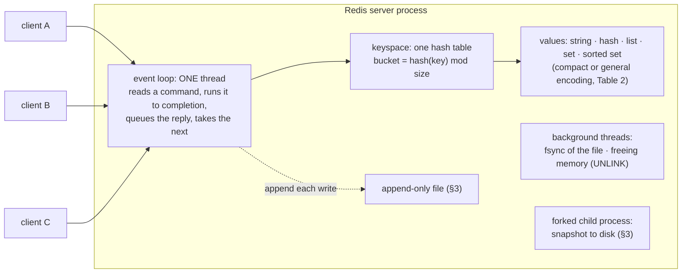
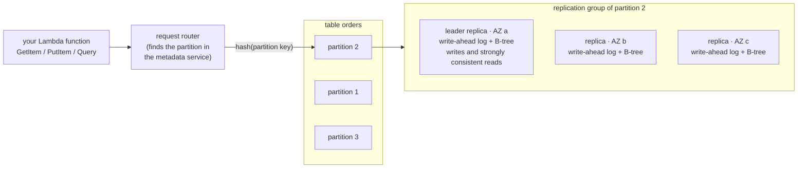

# M03 · Ch3 · §1 — Key-value stores: Redis and DynamoDB

> **Module:** Databases & Storage (from first principles)
> **Chapter:** Graph, document and key-value databases — their data models and internal design, when each beats a
> relational database, and the CAP (consistency, availability, partition tolerance) trade-off
> **Section:** Ch1 and Ch2 were one relational database: tables, a planner that answers any question you can write in
> SQL, and transactions over any rows you like. This section removes almost all of that and keeps one operation: give
> me the value stored under this key. **Redis** keeps every key in a hash table in memory, served by one thread.
> **DynamoDB** hashes the key to pick a partition, keeps each partition as a B-tree on three replicas, and bills you per
> item read. Both are very fast and very predictable for the questions they were designed for, and both make other
> questions expensive or impossible. The section measures both sides: lookups, what one slow command does to a
> single-threaded server, what is lost when Redis is killed, hot partitions, what a query costs when the table was not
> designed for it, lost updates and their fixes, and TTL (time to live) expiry. Redis 8.10, DynamoDB Local 3.3.2 and
> PostgreSQL 18.6 ran on one laptop; the scripts are committed in `diagrams/01-kv-data/`. AWS (Amazon Web Services)
> limits and prices were checked against the AWS documentation and the AWS Price List API on 2026-11-19.
> **Status:** ✅ finalized 2026-11-19 (body prepared 2026-11-19). Your three questions are answered in §12: how
> Firestore compares with DynamoDB (Table 14), what Table 13's last row meant (the row now says "keep PostgreSQL"), and
> where Redis or DynamoDB earn their place when PostgreSQL already works (Tables 15 and 16).
> **Prerequisites:** **Ch1 §4** (B-tree indexes), **Ch2 §1** (durability, `fsync`, acknowledged commits lost in a
> crash) and **Ch2 §4 §1–§2** (the version check, idempotency keys).

**Estimated study time:** 3 hours including the hands-on.

---

## Why this section exists — and how it's pitched

"Should this go in Redis?" and "should this be DynamoDB?" are questions you meet on almost every serverless design.
Lambda functions open database connections badly (M02 Ch4 §2), DynamoDB needs none, and Redis is the first thing
people reach for when something is slow. The usual answers are slogans: "Redis is fast because it's in memory",
"DynamoDB scales infinitely", "NoSQL has no schema". Each is half true, and the false half is where production
incidents come from.

The pitch is the same as Ch2: every claim below was measured, and every slogan is replaced by a number with a unit.
Some results will surprise you. From a Python client on the same machine, a Redis `GET` and a PostgreSQL primary-key
`SELECT` took **the same 48 µs** (Figure 2). Redis's real advantage is elsewhere: it spent about **one tenth of the
server CPU per lookup**. A DynamoDB table designed for two questions answered a third by **reading all 10,000 items
to return 122** (Table 8). And with the default Redis settings, killing the process **lost every one of 100,000
acknowledged writes** (Table 4).

What is worth keeping is in §9's checklist and in three sentences: **a key-value store makes the questions you
designed the key for cheap and every other question expensive, so list the questions before you design the key;
it gives up multi-row transactions, so you use conditional writes and server-side operations on one item instead;
and its speed and durability are settings, not properties — check which ones you are running.**

---

## 1. The key-value model: one question, asked very fast

<details>
<summary><b>Vocabulary for this section</b> — terms and abbreviations used below (click to expand)</summary>

**Abbreviations**

| Short | Stands for | Meaning |
|---|---|---|
| **KV** | key-value | a store whose only built-in lookup is "the value under this key" |
| **RAM** | random-access memory | main memory; lost when the process or machine stops |
| **SQL** | Structured Query Language | the relational query language (Ch1) |
| **TTL** | time to live | how long a key or item exists before the store deletes it |
| **AWS** | Amazon Web Services | Amazon's cloud; DynamoDB and ElastiCache are AWS services |

**Terms**

| Term | Definition |
|---|---|
| **Key** | the identifier you look a value up by; in Redis a byte string, in DynamoDB the primary key (partition key, optionally plus sort key) |
| **Value** | what is stored under the key; Redis: one of several data types (§2); DynamoDB: an *item*, a set of named attributes |
| **Opaque value** | a value the store does not look inside, so it cannot search or index by its contents |
| **Item** | DynamoDB's word for a record: a primary key plus up to 400 KB of attributes |
| **Partition key** | the part of a DynamoDB primary key that is hashed to choose where the item is stored (§4) |
| **Sort key** | the optional second part of a DynamoDB primary key; items with the same partition key are kept sorted by it |
| **Secondary index** | an extra structure that lets you look items up by something other than their key — the thing a KV store gives you few of |

</details>

A relational database stores rows and lets you ask any question about them in SQL; the planner decides how (Ch1 §3).
A key-value store stores values under keys and lets you ask one question: *what is under this key?* Everything else
in this section follows from that trade.

**Table 1** — the same "look up one thing by its identifier" in three systems.

| | Redis | DynamoDB | PostgreSQL table used as a KV store |
|---|---|---|---|
| Write | `SET user:42 '{…}'` | `PutItem` with key `{"PK": "USER#42"}` | `INSERT … ON CONFLICT (k) DO UPDATE` |
| Read | `GET user:42` | `GetItem` with the same key | `SELECT v FROM kv WHERE k = 'user:42'` |
| Where the data lives | RAM, in one process; optionally logged to disk (§3) | disk (solid-state drive), on three replicas in three data centres (§4) | disk pages, cached in RAM (Ch1 §4) |
| Structure under the lookup | a hash table (§2) | a hash of the partition key picks a partition; a B-tree inside it (§4) | a B-tree index on `k` (Ch1 §4) |
| Other questions you can ask | almost none: no query language over values; a few per-type operations (§2) | a range of sort keys within one partition key; secondary indexes you define in advance (§5) | anything SQL can express |
| Multi-key transactions | `MULTI`/`EXEC` (no rollback), Lua scripts, one server only (§6) | `TransactWriteItems`, up to 100 items (§6) | any rows, any isolation level (Ch2) |
| You pay for | memory (the server size) | each item read or written, by size (§4, §8) | the server size |

Two different things are called "key-value store", and Table 1 holds one of each. **Redis** is a *data-structure
server*: the value can be a string, a hash, a list, a set or a sorted set, and the server runs operations on it
(`INCR`, `LPUSH`, `ZADD`) so you do not have to read, modify and write back. **DynamoDB** is a *partitioned database*:
the value is a document-like item, the key decides which machine stores it, and the design goal is that a lookup
costs the same whether the table holds a thousand items or a trillion. They are both "key-value" because the key is
the only way in, but they are used for different jobs (§8).

---

## 2. Redis inside: a hash table in memory, served by one thread

<details>
<summary><b>Vocabulary for this section</b> — terms and abbreviations used below (click to expand)</summary>

**Abbreviations**

| Short | Stands for | Meaning |
|---|---|---|
| **I/O** | input/output | here, reading requests from and writing replies to network sockets |
| **CPU** | central processing unit | the processor; "CPU time" = time a core spent running this process |
| **p50 / p99** | 50th / 99th percentile | the latency half / 99% of operations finish within |
| **µs** | microsecond | one millionth of a second |
| **SDS** | simple dynamic string | Redis's string type: a length header plus the bytes |
| **RTT** | round-trip time | the time for a request to reach the server and its reply to come back |

**Terms**

| Term | Definition |
|---|---|
| **Hash table** | an array of buckets; a key's hash picks the bucket, so a lookup costs the same however many keys there are |
| **Chaining** | keys whose hashes land in the same bucket are kept in a short linked list in that bucket |
| **Incremental rehashing** | when the table must grow, Redis builds a second, larger table and moves a few buckets at a time during later operations, so no single command pays for moving everything |
| **Event loop** | one thread that waits for any socket to become ready (`epoll`, M01 Ch4 §2), then runs that client's command to completion |
| **Pipelining** | sending many commands without waiting for each reply, then reading all the replies |
| **Encoding** | the internal data structure Redis uses for a value; it switches from a compact one to a general one as the value grows |
| **Listpack** | a compact encoding: all elements packed one after another in a single block of memory, searched linearly |
| **Skip list** | a sorted linked list with extra "express lane" pointers, giving ordered access in $O(\log n)$ |
| **`KEYS` / `SCAN`** | list all key names in one command / page through them a batch per command with a cursor |
| **`UNLINK`** | delete a key now but free its memory in a background thread |

**Symbols**

| Symbol | Reads as | Meaning |
|---|---|---|
| $O(1)$ | "order one" | cost that does not grow with the number of keys |
| $O(n)$ | "order n" | cost proportional to the number of elements $n$ |
| $O(\log n)$ | "order log n" | cost growing with the logarithm of $n$, as in a B-tree or skip list |

</details>

### The structure under `GET`

Redis keeps the whole keyspace in one **hash table**: an array of buckets whose size is a power of two. `GET user:42`
hashes the key, takes the hash modulo the array size to pick a bucket, and walks that bucket's short chain comparing
keys. The cost is $O(1)$, independent of how many keys there are. When the number of keys reaches the number of
buckets, Redis allocates a table twice the size and **rehashes incrementally**: each later command moves a few
buckets across, and a timer moves more when the server is idle, so the cost of growing is spread over many commands.
Lookups during that time check both tables.

That is the whole read path. There is no page cache, no buffer pool, no planner, no MVCC (multi-version concurrency
control) snapshot, no lock. Compare Ch1 §4's B-tree lookup: three or four page visits through the tree, each page
possibly a disk read, then a heap page.

Every command is run by **one thread**. That thread runs an event loop: wait for any client socket to have a complete
command, run it to completion, queue the reply, repeat. Because only one command runs at a time, every command is
**atomic** with no locks at all: `INCR` cannot interleave with another `INCR`. Redis 6 added optional I/O threads,
which read and write sockets in parallel, but command execution is still one thread.

<!-- DIAGRAM:START -->


<details>
<summary>Diagram source (Mermaid)</summary>



</details>
<!-- DIAGRAM:END -->

**Figure 1** — the Redis server. One thread executes every command against one in-memory hash table; disk work is
pushed to background threads or a forked child so it does not block that thread.

The value under a key can be one of several types, and each type has a compact encoding for small values and a
general one for large values. This is the data structure your command actually runs on:

**Table 2** — the structure under each Redis type, read back with `OBJECT ENCODING` for a 3-element and a 1,000-element value (Redis 8.10.3, default thresholds; `encoding-out.txt`).

| Type | Small value | Large value | Switches at (default) | What the large encoding gives you |
|---|---|---|---|---|
| string | `int` (a number), `embstr` (short) | `raw` | 44 bytes | an SDS: length + bytes; `GET`/`SET` $O(1)$ |
| hash | `listpack` | `hashtable` | 512 fields or a 64-byte value | field lookup $O(1)$ — a hash table inside the key |
| set | `intset` (all integers) or `listpack` | `hashtable` | 512 integers / 128 members | membership test $O(1)$ |
| sorted set | `listpack` | `skiplist` (plus a hash table) | 128 members | score lookup $O(1)$, rank and range $O(\log n)$ |
| list | `listpack` | `quicklist` (a linked list of listpacks) | 8 KB (`list-max-listpack-size -2`); 1,000 small numbers still fit, so the measured large list stayed `listpack` | push and pop at either end $O(1)$; index $O(n)$ |

The compact encodings scan linearly, which is faster than a hash table for a handful of elements and uses a fraction of
the memory. That is why one hash per user (`HSET user:42 name … email …`) often costs less memory than one key per
field.

### Measured: Redis against a PostgreSQL primary-key lookup

`lookup_bench.py` loaded the same 100,000 keys with 100-byte values into Redis and into a PostgreSQL table with a
primary key, then looked up random keys from Python.

![Two panels. Panel (a), lookups per second from Python clients on a log scale: one client one at a time, Redis 20 thousand and PostgreSQL 21 thousand; one client in batches of 100, Redis 195 thousand and PostgreSQL 58 thousand; 4 clients, Redis 45 thousand and PostgreSQL 52 thousand; 16 clients, Redis 115 thousand and PostgreSQL 121 thousand. Panel (b), server CPU time per lookup on a log scale: Redis with pipelines of 16, 0.4 microseconds; Redis without pipelining, 3.8; PostgreSQL with 16 clients, 37.3; PostgreSQL with 50 clients, 48.3.](diagrams/01-kv-fig2.svg)

**Figure 2** — one key, one value: (a) the rate a Python application achieves, and (b) the server CPU time each lookup
costs, measured with the C benchmark tools `redis-benchmark` and `pgbench -S` (`lookup-bench.csv`,
`server-ceiling-out.txt`). "Batches of 100" = 100 lookups sent before reading any reply (a Redis pipeline;
psycopg's pipeline mode).

Reading Figure 2:

- **One lookup at a time, the two are identical**: 20,238 vs 20,561 lookups/s, p50 48 µs for both, p99 77 µs vs 69 µs.
  A lookup from an application is one network round trip plus client-library work; the server's part is a few
  microseconds of it. If your PostgreSQL primary-key lookups are already this fast, putting Redis in front of them
  does not make them faster. It adds a second round trip on a miss and a cache to keep correct (M03 Ch4 covers caching).
- **With 4 or 16 clients, still level** (45k vs 52k, 115k vs 121k). The Python clients were the bottleneck.
- **Batching is where Redis pulls ahead**: 195,000 vs 58,000 lookups/s. A pipelined `GET` costs Redis almost nothing,
  so 100 of them cost little more than one round trip. PostgreSQL still parses, plans and executes each statement.
- **Panel (b) is the real difference.** Without pipelining Redis spent **3.8 µs of CPU per lookup** on one core;
  PostgreSQL spent **37 µs** per lookup spread over many cores, about ten times as much. With pipelining Redis
  dropped to 0.4 µs. One Redis core served 258,000 unpipelined lookups/s; PostgreSQL needed 16 client connections and
  about ten of the laptop's 22 cores (105 CPU-seconds in 10 s) to serve 283,000. So Redis's advantage is **lookups per unit of hardware**, which
  becomes a lower bill (§8) or headroom on a hot path, not lower latency for a single caller.

**Table 3** — what one key-value pair costs in storage, for 1,000,000 keys of up to 9 bytes with 100-byte values (`footprint-out.txt`).

| Store | Bytes per pair | Where |
|---|---|---|
| Redis, no TTL | 158 | RAM — all of it, always |
| Redis, TTL on every key | 180 | RAM (the expiry time is a second hash-table entry) |
| PostgreSQL, heap + primary-key index | 195 | disk; cached in RAM only as far as memory allows |

The overheads are similar: about 50–85 bytes per pair on top of the 109 bytes of payload. The difference is where they
live. Redis has to hold **every** key in RAM, all the time. A 50 GB dataset needs a server with more than 50 GB of
memory, and memory is the most expensive part of a server. PostgreSQL keeps the hot pages in memory and the rest on
disk.

### The price of one thread: a slow command stops everyone

One thread that runs each command to completion means **one slow command delays every other client**. That is the
same as Ch2 §3's lock queue, but with no lock: the "lock" is the thread itself. `block_bench.py` had one client
`GET` every millisecond while another client ran a command:


**Figure 3** — the slowest `GET` another client saw while one command ran, median of 3 runs (`block-bench-out.txt`).
`KEYS *` returns every key name in one reply; a `SCAN` loop returns them 1,000 per command; `DEL` frees a 1M-field
hash immediately; `UNLINK` frees it in a background thread.

- **`KEYS *` over 1,000,000 keys stalled every other client for up to 119.5 ms**, a thousand normal `GET`s. The
  command took 646 ms end to end, most of it sending a 1M-element reply. On a production instance with 50 million
  keys it is seconds. The `SCAN` loop read the same names in more total time (952 ms) but in 1,000 short commands,
  and other clients slipped in between: worst case 2.6 ms.
- **Deleting a big value is a big command.** `DEL` of a hash with 1,000,000 fields took 67 ms, during which nobody else
  was served. `UNLINK` removed the key from the keyspace at once and freed the memory on a background thread: 1.2 ms.
  The same applies when a big key expires or is evicted; the `lazyfree-lazy-*` settings (all `no` by default in this
  image) move that work to the background thread too.

The general rule: **in Redis, every command's cost is paid by every client.** Avoid $O(n)$ commands on large values
in production (`KEYS`, `HGETALL` on a huge hash, `SMEMBERS`, `LRANGE 0 -1`, `DEL` of a big key), keep values small,
and find the offenders with `SLOWLOG GET` and `redis-cli --bigkeys`.

---

## 3. Redis durability: what is on disk when the process dies

<details>
<summary><b>Vocabulary for this section</b> — terms and abbreviations used below (click to expand)</summary>

**Abbreviations**

| Short | Stands for | Meaning |
|---|---|---|
| **RDB** | Redis Database (file) | a point-in-time snapshot of the whole dataset, written by a forked child process |
| **AOF** | append-only file | a log of every write command, replayed at startup |
| **OS** | operating system | here, the Linux kernel and its page cache |
| **SIGKILL** | signal "kill" | `kill -9`: the process stops at once, with no chance to clean up |

**Terms**

| Term | Definition |
|---|---|
| **Acknowledged write** | a write whose reply ("OK") reached the client, so the application believes it is saved |
| **`write()`** | the system call that hands bytes to the kernel; they sit in the page cache, not yet on disk |
| **`fsync()`** | the system call that waits until the bytes are on the disk itself (Ch2 §1 §3) |
| **`appendfsync`** | Redis's setting for when it calls `fsync` on the AOF: `always`, `everysec` (default) or `no` |
| **Page cache** | the kernel's memory copy of file data; it survives a process crash but not a kernel crash or power cut |
| **`fork()`** | create a child process sharing the parent's memory copy-on-write; Redis uses it to snapshot without stopping |
| **In-doubt write** | a write that reached the log but whose reply never reached the client (Ch2 §1 §4) |

</details>

Redis is a memory store first, and it has two independent ways to put data on disk:

- **RDB snapshots.** Every so often Redis forks; the child writes the whole dataset to `dump.rdb` while the parent
  keeps serving. The default rule in this image is `save 3600 1 300 100 60 10000`: snapshot after an hour if at least 1
  key changed, after 5 minutes if 100 did, after 1 minute if 10,000 did. Anything written since the last snapshot is
  only in memory.
- **The AOF.** With `appendonly yes`, each write command is appended to a log, the same idea as PostgreSQL's WAL
  (write-ahead log, Ch2 §1 §3). Redis `write()`s the new log entries to the kernel before it sends the replies. When
  it calls `fsync()` depends on `appendfsync`: before replying (`always`), once a second on a background thread
  (`everysec`, the default once AOF is on), or never, leaving it to the kernel (`no`).

`durability_bench.py` ran 8 writers against a fresh container for each setting, killed the Redis process with
`SIGKILL` after 6 seconds while they were writing, restarted it and counted which acknowledged writes came back:

**Table 4** — acknowledged writes lost when the Redis process is killed, 3 runs per setting (Redis 8.10.3; `durability-out.txt`).

| Setting | Acknowledged before the kill | Lost after restart | Writes/s, 8 clients |
|---|---|---|---|
| no persistence (`save ""`, AOF off) — a pure cache | 100,859 · 100,067 · 100,022 | **all** | 16,600 |
| the image's default: RDB snapshots only | 100,346 · 100,242 · 100,006 | **all** (no snapshot rule had fired in 6 s) | 16,600 |
| AOF, `appendfsync no` | 99,675 · 99,216 · 99,092 | 0 | 16,400 |
| AOF, `appendfsync everysec` | 99,065 · 100,207 · 97,149 | 0 | 16,400 |
| AOF, `appendfsync always` | 42,808 · 42,714 · 42,686 | 0 — and **4 more** writes present than were acknowledged, each run | **7,100** |

What Table 4 shows, and what it does not:

- **The default configuration of the official image lost everything.** With RDB only, the durability of a write is
  "whenever the next snapshot happens", which here was never. Run Redis with its defaults, write session data or a job
  queue into it, restart the container, and you get an empty server. Managed services set their own defaults, so check
  what your provider runs: managed services often lean on replicas and failover rather than on the disk.
- **Any AOF setting survived a process kill with nothing lost.** This is the same thing Ch2 §1 found for PostgreSQL:
  `SIGKILL` kills the process, not the machine. Redis had `write()`n each command to the kernel before replying, and
  the kernel's page cache survived and reached the disk later. What separates `always` from `everysec` and `no` is
  **a kernel crash or a power cut**, which this laptop experiment did not reproduce. The Redis documentation bounds
  that loss at about one second of writes for `everysec`, and the kernel's write-back interval (typically 30 s) for
  `no`.
- **`always` costs throughput** because every batch of replies waits for an `fsync`: 7,100 writes/s against about
  16,400. The other rows were limited by the Python clients, so the true gap is larger. Like PostgreSQL's group
  commit, Redis `fsync`s once for all the writes that arrived in one pass of the event loop, so more clients do not
  mean proportionally more `fsync`s.
- **The 4 extra writes are in-doubt writes**, one per client thread that was waiting: logged and `fsync`ed, then the
  process died before the reply went out. The client saw an error and does not know the write happened. Ch2 §1 found
  the same 2–3 per crash in PostgreSQL. The remedy is the same too: make the write idempotent (Ch2 §4 §2).

Replication does not change this picture as much as people expect. A Redis replica receives writes asynchronously,
after the primary has already replied, so a failover can lose the last writes the replica had not received. `WAIT`
makes a client wait until $N$ replicas have received a write, but it does not make the replicas `fsync`. Redis is
built to be a fast copy of data whose durable home is elsewhere, or for data you can afford to lose a second of:
caches, sessions, rate-limit counters, leaderboards. When it has to be the system of record, run AOF with `everysec`
or `always`, take RDB snapshots for backups, and accept the throughput in Table 4.

---

## 4. DynamoDB inside: partitions, replicas and capacity units

<details>
<summary><b>Vocabulary for this section</b> — terms and abbreviations used below (click to expand)</summary>

**Abbreviations**

| Short | Stands for | Meaning |
|---|---|---|
| **AZ** | Availability Zone | one of the separate data centres in an AWS region |
| **RCU / WCU** | read / write capacity unit | the unit DynamoDB measures and bills reads and writes in (provisioned mode) |
| **RRU / WRU** | read / write request unit | the same units in on-demand mode |
| **MD5** | Message Digest 5 | a hash function; used here only to spread keys, not for security |
| **SSD** | solid-state drive | flash storage |
| **KB / MB** | kilobyte / megabyte | DynamoDB uses binary units: 1 KB = 1,024 bytes |

**Symbols**

| Symbol | Reads as | Meaning |
|---|---|---|
| $s$ | "s" | the item's size in KB |
| $\lceil x \rceil$ | "ceiling of x" | $x$ rounded up to the next whole number |
| $P$ | "P" | the number of partitions a table is split into |
| $f_{\max}$ | "f max" | the share of all requests that land on the busiest partition |
| $R_{\max}$ | "R max" | the highest table-wide request rate before the busiest partition hits its limit |

**Terms**

| Term | Definition |
|---|---|
| **Partition** | one slice of a table's key range, stored on its own group of servers; up to 10 GB |
| **Replication group** | the three copies of one partition, one per Availability Zone |
| **Leader** | the one replica of a partition that accepts writes and strongly consistent reads |
| **Multi-Paxos** | the consensus protocol the replicas use to elect a leader and agree on writes |
| **Request router** | the front-end server that receives your API call and forwards it to the right partition |
| **Strongly consistent read** | a read served by the leader, so it sees every acknowledged write |
| **Eventually consistent read** | a read any replica may serve, so it can miss a write from the last moments; costs half |
| **Hot partition** | a partition that receives a disproportionate share of the requests |
| **Adaptive capacity** | DynamoDB's automatic re-balancing that gives a hot partition more of the table's capacity and can isolate a hot item on its own partition |
| **Write sharding** | adding a suffix to a hot partition key so its writes spread over several key values |

</details>

### How an item is stored

Everything here is from the 2022 paper in which the DynamoDB team described the service's design (References), plus the
AWS documentation. A table is split into **partitions**, each holding a contiguous range of the *hashed* partition
key. Your item's partition key goes through an internal hash function; the hash picks the partition, and inside the
partition the items are kept in key order, sort key included. Each partition has **three replicas in three
Availability Zones**. They use Multi-Paxos to elect a **leader**. Each replica stores a write-ahead log and a **B-tree**
of the items, the same pair of structures as PostgreSQL (Ch1 §4, Ch2 §1).

<!-- DIAGRAM:START -->


<details>
<summary>Diagram source (Mermaid)</summary>



</details>
<!-- DIAGRAM:END -->

**Figure 4** — how DynamoDB finds and stores an item (after Elhemali et al., 2022). Writes and strongly consistent
reads go to the partition's leader, and a write is acknowledged once two of the three replicas have logged it;
an eventually consistent read can be served by any replica.

Three consequences follow, and the rest of the section is about them:

1. **A lookup by key is the same cost at any size.** The router hashes the key, goes to one partition, walks one
   B-tree. A table with a trillion items is just more partitions.
2. **The partition key decides where the load goes.** Each partition has a fixed throughput ceiling, so a key that
   receives a large share of traffic is a bottleneck no amount of table capacity removes (below).
3. **Anything that is not "this key" or "this range of sort keys under one partition key" has to visit every
   partition.** That is a `Scan`, and you pay for every item it reads (§5).

### The limits, from the AWS documentation

**Table 5** — DynamoDB limits that shape a design (AWS documentation, *Constraints*, *Quotas* and *Burst and adaptive capacity*, checked 2026-11-19).

| Limit | Value | Why it matters |
|---|---|---|
| Item size | 400 KB, attribute names included | large blobs go to S3 (Simple Storage Service), with a pointer in the item |
| One partition | 3,000 read units/s and 1,000 write units/s; 10 GB of data | the ceiling for one hot key (below) |
| Partition key value / sort key value | 2,048 bytes / 1,024 bytes | |
| `Query` / `Scan` page | 1 MB of items read per call, then you follow `LastEvaluatedKey` | big results take many calls |
| `BatchGetItem` / `BatchWriteItem` | 100 items / 25 items per call | |
| Transaction | 100 unique items, 4 MB; no item twice; one account and region | §6 |
| Global secondary indexes | 20 per table (default quota) | §5 |
| Default table throughput quota | 40,000 read and 40,000 write units/s per table | adjustable |
| TTL deletion | "typically within a few days" after expiry, without consuming write capacity | §7 |

### What a read or a write costs

DynamoDB measures work in **capacity units**. One read unit reads up to 4 KB strongly consistently. An eventually
consistent read costs half. One write unit writes up to 1 KB. A transactional read or write costs double. So for an
item of $s$ KB:

$$\text{read units} = 0.5 \times \left\lceil \frac{s}{4} \right\rceil \quad \text{eventually consistent,} \qquad \text{read units} = \left\lceil \frac{s}{4} \right\rceil \quad \text{strongly consistent}$$

$$\text{write units} = \lceil s \rceil$$

DynamoDB Local reproduces this accounting: `ReturnConsumedCapacity` returns the units AWS would bill.

**Table 6** — capacity units reported by DynamoDB Local (`capacity_probe.py`, `capacity-out.txt`).

| Operation | Units |
|---|---|
| `PutItem`, 500-byte / 1,000-byte / 1,500-byte / 5,000-byte value | 1 / 1 / 2 / 5 write units |
| `GetItem` of the 5 KB item, eventually / strongly consistent | 1 / 2 read units |
| `GetItem` of a key that does not exist | 0.5 read units — you pay to find nothing |
| `Scan` of 4 items totalling 8 KB | 1 read unit |
| `PutItem` of a 401 KB item | rejected: "Item size has exceeded the maximum allowed size" |
| `TransactWriteItems` with 101 items | rejected: at most 100 |
| `TransactWriteItems`, 2 small items | Local reported 2 write units; **AWS bills 4** (2 per item, per the documentation) — one place Local is not faithful |

The unit of cost is **items read**, not results returned: a `Query` or `Scan` with a filter pays for every item it
reads before the filter drops it (§5).

### Hot partitions: when the key, not the table, is the limit

A partition serves at most 1,000 write units and 3,000 read units per second. If a fraction $f_{\max}$ of all
requests lands on the busiest partition, the whole table saturates when that partition does:

$$R_{\max} = \frac{1000}{f_{\max}} \quad \text{write units per second}$$

DynamoDB Local has no partitions, so `partition_sim.py` simulated them: 2,000,000 writes from five key designs, each
key hashed onto $P$ partitions.

![Log-log line chart of the highest table write rate against the number of partitions, 1 to 128. One million equally busy customers: rises in proportion, to about 123,000 at 128 partitions. Today's date plus a suffix 0 to 99: rises to about 20,000 and levels off from 64 partitions. One million customers with Zipf popularity: rises slowly to about 4,900 at 64 and 7,900 at 128. Today's date plus a suffix 0 to 9: levels off at about 5,000 from 32 partitions. Today's date as the key: flat at 1,000 at every partition count.](diagrams/01-kv-fig5.svg)

**Figure 5** — the table-wide write rate at which the busiest partition reaches 1,000 write units/s, for five
partition-key designs (simulation, `partition-sim.csv`). "Zipf 1.1" = a popularity distribution where the $k$-th most
popular customer gets traffic proportional to $1/k^{1.1}$; the top customer alone sends 12.4% of all writes.

- **Today's date as the partition key: 1,000 writes/s, whatever the table's size.** Every write of the day goes to one
  key, so to one partition. This is the classic mistake in time-series and event tables (`PK = "2026-11-19"`).
  Adaptive capacity can move a hot item onto a partition of its own, but the AWS documentation is explicit that one
  item's key still gets at most 1,000 write units/s.
- **Write sharding** (`"2026-11-19#0"` … `"#9"`) spreads the key over 10 values. That raised the ceiling to about 5,000,
  not 10,000. With 10 values hashed onto many partitions, two of them landed on the same partition, so the busiest
  partition got 20% of the writes. A hundred suffixes reached 20,000. The price: a reader who wants "all of today" must
  now query 10 or 100 keys and merge them.
- **Real popularity is skewed.** A million customers with Zipf popularity stopped at about 4,900 at 64 partitions,
  because the busiest customer alone is 12.4% of the traffic, and $1000 / 0.124 \approx 8{,}000$ is a hard ceiling for
  that one key. Only the uniform case scales with the partition count.

The design rule is to choose a partition key with **many values, each receiving a small share of the traffic**:
a customer ID, an order ID, a device ID. And check that the busiest single value stays well under 1,000 writes/s, or
3,000 reads/s.

---

## 5. Access-pattern-first design: write the questions down before the key

<details>
<summary><b>Vocabulary for this section</b> — terms and abbreviations used below (click to expand)</summary>

**Abbreviations**

| Short | Stands for | Meaning |
|---|---|---|
| **GSI** | global secondary index | a second copy of a table's items, keyed by different attributes, kept up to date by DynamoDB asynchronously |
| **LSI** | local secondary index | an alternative sort key within the same partition key; must be defined when the table is created |
| **PK / SK** | partition key / sort key | here also the literal attribute names in a single-table design |
| **N+1** | "one plus N" | one query to find N things, then one more query per thing |

**Terms**

| Term | Definition |
|---|---|
| **Access pattern** | one question the application asks, stated with its inputs and outputs: "a customer's orders in a date range" |
| **Item collection** | all items sharing one partition key value, stored together in sort-key order |
| **Single-table design** | putting several entity types (customers, orders, …) in one table, with prefixed keys, so a related group can be read with one `Query` |
| **`Query`** | read the items under one partition key, optionally a range of sort keys |
| **`Scan`** | read every item in the table (or index), page by page |
| **Filter expression** | a condition applied *after* items are read; it reduces what is returned, not what is paid for |
| **Projection** | which attributes a GSI copies from the table |

</details>

In a relational database you design the tables from the data (Ch1 §2) and the planner answers whatever questions come
later. In DynamoDB you design the keys from the **questions**. Only "this partition key" and "this range of sort keys"
are cheap, so every question the application will ask has to become one of those, either on the table or on a GSI.

A common layout for a shop, in one table:

**Table 7** — a single-table layout: the partition key groups a customer with their orders, and the sort key orders them by date.

| PK | SK | Other attributes | Answers |
|---|---|---|---|
| `CUST#c042` | `PROFILE` | name, tier, email | the customer |
| `CUST#c042` | `ORDER#2026-06-03#o04217` | status, amount, items | one order |
| `CUST#c042` | `ORDER#2026-06-19#o04231` | … | `Query PK = CUST#c042 AND SK BETWEEN ORDER#2026-06-01 AND ORDER#2026-06-30` = a customer's June orders |
| GSI `by_status`: status | order date | (projected copy) | every `OPEN` order, by date |

`access_bench.py` built this table with 10,000 orders (200 customers × 50 orders, about 300 bytes each) and a GSI on
status, then asked eight questions of it, and the same questions of a PostgreSQL table with the primary key
`(customer_id, order_date, order_id)`:

**Table 8** — eight questions asked of a DynamoDB table designed for two of them, and of PostgreSQL (DynamoDB Local 3.3.2, PostgreSQL 18.6; `access-out.txt`). "Items read" = what DynamoDB billed for; PostgreSQL "buffers" = 8 KB pages touched.

| Question | DynamoDB: how | Requests | Items read | Items returned | Read units | PostgreSQL plan | PostgreSQL buffers |
|---|---|---|---|---|---|---|---|
| 1. one order, by its full key | `GetItem` | 1 | 1 | 1 | 0.5 | Index Scan | 3 |
| 2. customer c042's orders in June | `Query` on PK + SK range | 1 | 5 | 5 | 0.5 | Index Scan | 7 |
| 3. c042's orders over 900 | `Query` on PK + filter on amount | 1 | **50** | 10 | 2.0 | Index Scan + filter | 27 |
| 4a. every OPEN order, no index | `Scan` + filter | 3 | **10,000** | 456 | **375.5** | Seq Scan | 358 |
| 4b. every OPEN order, GSI | `Query` on the GSI | 1 | 456 | 456 | 17.0 | (same plan as 4a) | |
| 5. the 10 largest orders | `Scan`, sort in the client | 3 | **10,000** | 10,000 | 375.5 | Seq Scan + top-10 sort | 358 |
| 6. June orders of the 20 gold customers | 20 `Query` calls (no join) | **20** | 88 | 88 | 10.0 | Nested Loop join | 104 |
| 7. orders with amount 500–510 | `Scan` + filter | 3 | **10,000** | 122 | 375.5 | Seq Scan | 358 |

Reading Table 8 by the shape of the question:

- **Questions 1 and 2 are what the key was designed for.** One request, items read = items returned, half a read unit.
  This is DynamoDB at its best, and it stays at this cost at any table size.
- **Question 3: a filter is not an index.** The `Query` read all 50 of c042's orders and returned 10. You pay for 50.
  It is cheap only because one customer's orders are few.
- **Questions 4a, 5 and 7: anything else is a `Scan`.** Each read all 10,000 items (three 1 MB pages, 375.5 read units)
  to return 456, 10 or 122. On a 10-million-item table each would read 10 million items and cost about 1,000 times as
  much, every time it runs. PostgreSQL also scanned the whole table, but that is its planner's choice for 10,000 rows;
  one `CREATE INDEX` would change it, with no change to the query.
- **Question 4b: the GSI made question 4 a design-time question.** 456 items read for 456 returned, 17 read units.
  But the GSI had to exist before the question was asked, and every write to the table now also writes the index: the
  10,000-item load consumed **20,000 write units** (`access-out.txt`), double the table alone.
- **Question 6: there are no joins.** The application has to know the 20 gold customers (from somewhere else) and send
  20 queries: the N+1 pattern, made mandatory. The single-table design exists to avoid this for the relationships you
  know in advance, by storing related items under the same partition key.

So the workflow for a DynamoDB table is the reverse of Ch1's:

1. **List every access pattern** with its inputs, outputs and expected rate: "get order by ID", "a customer's orders by
   date, newest first", "open orders, oldest first, for the warehouse screen".
2. **Choose the partition key and sort key** so the most frequent patterns are a `GetItem` or a `Query` on one
   partition key, and so the traffic spreads over many key values (§4).
3. **Add a GSI** for each remaining pattern that must be fast, accepting the extra write cost and that a GSI is only
   eventually consistent.
4. **Send everything else elsewhere**: analytics and ad-hoc questions go to a copy of the data that can answer them
   (an export to S3 queried with Athena, or a relational replica), not to `Scan`.

The cost of this approach is **change**. A new question is a new GSI (with a backfill of the whole table) or a
redesign. A relational schema absorbs new questions with a new index or none at all. That trade is the core of §8.

---

## 6. Without multi-row transactions: conditional writes and server-side updates

<details>
<summary><b>Vocabulary for this section</b> — terms and abbreviations used below (click to expand)</summary>

**Abbreviations**

| Short | Stands for | Meaning |
|---|---|---|
| **CAS** | compare-and-set | "write the new value only if the current value is still the one I read" (Ch2 §4 §1) |
| **ACID** | atomicity, consistency, isolation, durability | the transaction guarantees of Ch2 §1 |

**Terms**

| Term | Definition |
|---|---|
| **Lost update** | two read-modify-writes interleave and the second overwrites the first without having seen it (Ch2 §1) |
| **Condition expression** | a DynamoDB check evaluated atomically with the write; if false, nothing is written and `ConditionalCheckFailedException` is returned |
| **`WATCH` / `MULTI` / `EXEC`** | Redis optimistic transaction: watch keys, queue commands, run them only if no watched key changed (else `EXEC` returns nil) |
| **Atomic server-side update** | an operation the server applies to the current value itself: Redis `INCR`, DynamoDB `UpdateItem … ADD`/`SET n = n + :x` |
| **Lua script** | a small program Redis runs to completion as one command, so it is atomic |
| **DynamoDB Streams** | an ordered log of item changes per partition, readable by a Lambda function (the outbox's job, built in) |
| **Think time** | the gap between reading a value and writing it back (Ch2 §4 §1) |

</details>

A relational transaction can lock and change any rows you like (Ch2). A key-value store's unit of atomicity is
**one key** (Redis) or **one item** (DynamoDB). Ch2 §4's lost update comes straight back the moment code reads a
value, changes it in the application and writes it back. `counter_bench.py` re-ran Ch2 §4 Table 3's single-row case on
both stores: 16 threads, each incrementing one counter 300 times with a 2 ms think time between read and write.

**Table 9** — 16 threads × 300 increments of one counter, by method, 3 runs (Redis 8.10.3, DynamoDB Local 3.3.2; `counter-bench.csv`).

| Store | Method | Final value (of 4,800) | Lost | Retries per increment | Time |
|---|---|---|---|---|---|
| Redis | `GET`, think, `SET` | 317 · 316 · 317 | **93%** | — | 0.8 s |
| Redis | `WATCH` / `GET` / `MULTI` / `SET` / `EXEC`, retry | 4,800 | 0 | 12.8–13.0 | 13.0 s |
| Redis | `INCR` | 4,800 | 0 | — | **0.3 s** |
| DynamoDB | `GetItem`, think, `PutItem` | 454 · 466 · 448 | **91%** | — | 8.1 s |
| DynamoDB | `PutItem` with `ConditionExpression: version = :v`, retry | 4,800 | 0 | 7.0 | 67.6 s |
| DynamoDB | `UpdateItem` `ADD n :one` | 4,800 | 0 | — | **4.1 s** |

The numbers repeat Ch2 §4 almost exactly: 94% lost there with no protection on one PostgreSQL row, 93% and 91% here;
13.2 optimistic retries per update there, 7–13 here. The store changed; the race did not.

- **No protection loses almost everything**, and nothing reports it.
- **The conditional write is Ch2 §4's version check, moved into the store.** DynamoDB evaluates the condition and the
  write atomically on the partition leader; the losing writer gets `ConditionalCheckFailedException`, re-reads and
  retries. `WATCH` does the same in Redis. Both are correct, and both pay with retries on a hot key, exactly as
  Table 3 of Ch2 §4 did. Note that a failed conditional write **still consumes write units** (AWS documentation),
  so on DynamoDB the retries are billed.
- **The best answer is not to read at all.** `INCR` and `UpdateItem ADD` send the change, and the server applies it
  to whatever the current value is. No race, no retries, fastest in the table. This is Ch2 §4's "one statement"
  (`balance = balance + 1`) again, and it covers more than counters: Redis has `HINCRBY`, `LPUSH`, `SADD`, `ZINCRBY`,
  `SET … NX`, and a Lua script when one key's update needs logic; DynamoDB has `SET`/`ADD`/`REMOVE`/`list_append` with
  conditions in one `UpdateItem`.

What replaces the rest of Ch2's toolbox:

**Table 10** — Ch2's patterns, translated to the two key-value stores.

| Need | Relational (Ch2) | DynamoDB | Redis |
|---|---|---|---|
| change a value safely | one-statement `UPDATE`; version check (Ch2 §4 §1) | `UpdateItem` expression; `ConditionExpression` on a version attribute | `INCR`-family; `WATCH`/`MULTI`; Lua script |
| create only if absent (unique key, idempotency key) | `INSERT … ON CONFLICT DO NOTHING` (Ch2 §4 §2) | `PutItem` with `attribute_not_exists(PK)` | `SET key value NX EX 86400` |
| change several items all-or-nothing | a transaction over any rows | `TransactWriteItems`: up to 100 items, 4 MB, double the write units | `MULTI`/`EXEC`: all run, but **no rollback** if one command fails; keys must be on one server (cluster: one hash slot) |
| a uniqueness rule across items (one email per account) | a unique index | a second item keyed by the email, written in the same transaction with `attribute_not_exists` | `SET email:<x> NX` before creating the account |
| tell another system about a change | transactional outbox (Ch2 §4 §3) | **DynamoDB Streams**: every committed change, in order per item, to a Lambda function | no built-in log of changes you can rely on; write to a Redis Stream in the same `MULTI`, or use a database instead |

Two cautions on that table. `MULTI`/`EXEC` is not a relational transaction: if the third of five commands fails (wrong
type, say), the other four still apply. And a DynamoDB transaction is limited to one region; on a multi-region global
table, other regions can see half of a transaction while it replicates (AWS documentation).

---

## 7. TTL: letting the store delete things for you

<details>
<summary><b>Vocabulary for this section</b> — terms and abbreviations used below (click to expand)</summary>

**Abbreviations**

| Short | Stands for | Meaning |
|---|---|---|
| **TTL** | time to live | a per-key (Redis) or per-item (DynamoDB) expiry time |

**Terms**

| Term | Definition |
|---|---|
| **Passive (lazy) expiry** | an expired key is deleted when someone tries to read it |
| **Active expiry** | a background cycle samples keys that have a TTL and deletes the expired ones, whether or not anyone reads them |
| **`hz`** | how many times per second Redis runs its background tasks, including active expiry (default 10) |
| **Eviction** | deleting keys to stay under a memory limit (`maxmemory` + a policy such as `allkeys-lru`), different from expiry |
| **Epoch seconds** | a timestamp as seconds since 1970-01-01 UTC; DynamoDB's TTL attribute must be a number in this form |

</details>

Both stores can delete data at a time you set: `SET session:abc … EX 1800` in Redis, a number attribute holding an
expiry time (epoch seconds) with TTL enabled on the table in DynamoDB. They implement it very differently, and the
difference changes how you can use it.

Redis expires keys two ways. **Passively**: a read of an expired key deletes it and returns nil. **Actively**: a
background cycle samples keys that have a TTL and deletes the expired ones, so keys nobody reads are still reclaimed.
`ttl_bench.py` wrote 1,000,000 keys with a 10-second TTL (plus 100,000 without one) and never read them:


**Figure 6** — 1,000,000 keys with a 10 s TTL, never read, being reclaimed by Redis's active expiry, at the default
`hz 10` and at `hz 100` (`ttl-bench.csv`). The red band is the period in which their TTLs ran out.

The last key's TTL ran out at about 17.8 s, and by 19.2 s every expired key was gone, memory falling from 144.7 MB to
12.2 MB. Raising `hz` ten-fold barely mattered, because Redis's expiry cycle adapts its effort to how many sampled keys
turn out to be expired. And a `GET` of an expired key never returns a value, whether or not it had been reclaimed yet.

DynamoDB's TTL is a different kind of feature:

**Table 11** — TTL in the two stores (Redis measured, `ttl-bench.csv`; DynamoDB from the AWS documentation, checked 2026-11-19).

| | Redis | DynamoDB |
|---|---|---|
| When an expired key/item disappears | within about 1.4 s of expiry here, unread | "typically within a few days" |
| Can a read return an expired value? | no | **yes**, until the background process deletes it; filter it out yourself (`expires_at > :now`) |
| Cost of the deletion | CPU on the one thread | free: no write capacity consumed |
| Use it for | sessions, locks with a lease, rate-limit windows, caches | storage clean-up: old events, idempotency records, audit data you only keep for $N$ days |
| Don't use it for | — | anything where "expired" must mean "gone now", such as a lock or a session check |

The DynamoDB pattern is therefore: store `expires_at`, enable TTL on it for the clean-up, and put
`expires_at > :now` in every read where expiry matters. Powertools for AWS Lambda's idempotency utility does exactly
this with its idempotency records.

---

## 8. Choosing: when a key-value store beats a relational database, and when it doesn't

<details>
<summary><b>Vocabulary for this section</b> — terms and abbreviations used below (click to expand)</summary>

**Abbreviations**

| Short | Stands for | Meaning |
|---|---|---|
| **RDS** | Relational Database Service | AWS's managed PostgreSQL / MySQL |
| **USD** | United States dollar | prices below are AWS list prices in USD |
| **RRU / WRU** | read / write request unit | DynamoDB on-demand billing units (§4) |
| **ElastiCache** | — (AWS product name) | AWS's managed Redis / Valkey / Memcached |
| **Valkey** | — (project name) | the open-source fork of Redis started in 2024 after Redis changed its licence; ElastiCache offers it at a lower price |

**Terms**

| Term | Definition |
|---|---|
| **On-demand mode** | DynamoDB billing per request unit, with no capacity planning |
| **Node-hour** | one ElastiCache server running for one hour, billed whatever its load |
| **System of record** | the store whose copy of the data is the authoritative one; others are derived from it |
| **Cache** | a fast copy of data whose system of record is elsewhere, allowed to be missing or slightly stale |

</details>

Cost is part of the choice, and the two price very differently: DynamoDB per request, ElastiCache per server-hour,
RDS per server-hour. Here is a steady workload of small items (up to 1 KB) at Singapore list prices, for 30 days
(2,592,000 seconds):

**Table 12** — monthly cost of the same workload, Singapore (ap-southeast-1) on-demand list prices from the AWS Price List API (DynamoDB offer published 2026-11-11, ElastiCache 2026-11-18; `prices-out.txt`).

| Workload, items up to 1 KB | DynamoDB on-demand (0.1425 USD per million read units, 0.71 per million write units) | ElastiCache, `cache.t4g.small` Redis (0.048 USD/hour), primary + 1 replica |
|---|---|---|
| 100 reads/s (eventually consistent) + 20 writes/s | $129.6\text{M} \times 0.1425 + 51.8\text{M} \times 0.71 \approx$ **55 USD** | $2 \times 720 \times 0.048 \approx$ **69 USD** |
| the same, strongly consistent reads | $259.2\text{M} \times 0.1425 + 51.8\text{M} \times 0.71 \approx$ **74 USD** | 69 USD |
| 1,000 reads/s + 200 writes/s | about **553 USD** | **69 USD** (a small node serves this easily; Figure 2) |
| no traffic at all | **0 USD** (plus storage: 25 GB free, then 0.285 USD per GB-month) | **69 USD** |

DynamoDB is cheapest when traffic is low or spiky, and it scales to zero. A Redis node is cheapest when traffic is high
and steady. And if you already run RDS, a primary-key lookup on it costs nothing extra and, from an application, is as
fast as Redis (Figure 2).

The decision, as a table:

**Table 13** — which store for which job.

| The job | Use | Why (and the evidence) |
|---|---|---|
| Data with relationships, questions you can't list in advance, reports | **relational** (RDS PostgreSQL) | a planner answers new questions; DynamoDB scans for them (Table 8) |
| Money, inventory, anything needing multi-row invariants | **relational** | transactions over any rows (Ch2); KV atomicity is one item, or 100 with care (Table 10) |
| A lookup by ID at very high or very spiky rates, where the access patterns are known and stable | **DynamoDB** | same cost at any size, scales to zero, no connections for Lambda to exhaust (§4, Table 12) |
| Serverless functions that would otherwise open a database connection each | **DynamoDB** | HTTP API, no connection pool (M02 Ch4 §2) |
| Idempotency keys, deduplication records, per-user settings, session state that must survive | **DynamoDB** (with TTL for clean-up) | conditional put + TTL (Tables 10 and 11) |
| A cache in front of a slower system, rate limiting, leaderboards, short-lived locks with a lease, pub/sub | **Redis** | server-side operations, sub-millisecond, cheap per operation (Figure 2, Table 9) |
| The only copy of data you can't lose | **not Redis with defaults** | default image lost every acknowledged write on a kill (Table 4) |
| A hot lookup that is already a primary-key `SELECT` | **keep PostgreSQL** (add no new store) | same 48 µs from the application (Figure 2a); a cache in front adds a second round trip on a miss and data to keep correct. It pays only if you batch lookups (195,000 vs 58,000/s) or the database's CPU is the limit (3.8 vs 37 µs per lookup, Figure 2b) |

Most real systems use more than one. A common serverless shape is PostgreSQL as the system of record, DynamoDB for
the high-rate, simply-keyed data that Lambda functions touch on every request (sessions, idempotency records, the
stored chunks of a streamed answer), and Redis only where its data structures earn their keep. In M02 Ch4 §2 the
conclusion was that Redis helps a streaming design as a **log** of chunks (a list or stream per answer, appended and
read by position), not as a cache. Table 2 is why: that is a `list` or `stream` doing $O(1)$ appends, which no cache
could do.

---

## 9. Failure modes — the key-value checklist

<details>
<summary><b>Vocabulary for this section</b> — terms used below (click to expand)</summary>

**Terms**

| Term | Definition |
|---|---|
| **Hot key / hot partition** | one key or partition receiving a disproportionate share of requests (§4) |
| **Scan** | reading every item of a DynamoDB table or index (§5) |
| **AOF / RDB** | Redis's command log / snapshot file (§3) |
| **Big key** | a Redis key whose value has very many elements or bytes, so commands on it are slow (§2) |
| **Conditional write** | a write that only applies if a condition on the current item holds (§6) |

</details>

- **Redis restarted and came back empty.** It ran with the image's defaults: RDB snapshots only, none taken yet. Turn
  on AOF if the data matters, or treat it as a cache that may be empty (Table 4).
- **Every Redis client stalled for hundreds of milliseconds.** One $O(n)$ command: `KEYS *`, `HGETALL`/`SMEMBERS` on a
  huge value, `DEL` of a big key, or a big key expiring. Use `SCAN`, `UNLINK`, `lazyfree-*`, and look in `SLOWLOG`
  (Figure 3).
- **Redis memory full; writes refused or keys evicted.** Everything lives in RAM (Table 3). Set `maxmemory` and an
  eviction policy deliberately, and give keys TTLs if they are a cache.
- **A Redis failover lost the last second of writes.** Replication is asynchronous (§3). Design for it, or don't use
  Redis as the system of record.
- **`MULTI`/`EXEC` "rolled back" only part of the work.** It has no rollback (Table 10). Use a Lua script that checks
  first, or a database.
- **DynamoDB throttles at 1,000 writes/s while the table has capacity for 40,000.** A hot partition key, often a date or
  a constant (Figure 5). Choose a key with many values, or shard the hot one.
- **The DynamoDB bill grew with the table, not with the traffic.** Some code path uses `Scan` or a `Query` with a
  filter that discards most of what it reads (Table 8). Add a GSI for that pattern, or move it to an analytics copy.
- **A new feature needs a question the table can't answer.** Access patterns were not listed up front (§5). Add a
  GSI (backfill) or keep the relational database for that data.
- **A GSI query returned a stale value.** GSIs are eventually consistent; read the table by key when you need the
  latest (§5).
- **Counters drift low under load.** Read-modify-write in the application (Table 9). Use `INCR` / `UpdateItem ADD`, or a
  conditional write with a version.
- **"Expired" sessions still validate.** DynamoDB TTL deletes "within a few days"; filter on `expires_at` in every read
  (Table 11).
- **Tested on DynamoDB Local, throttled in production.** Local has no partitions and no throttling, and it under-reports
  transaction costs (Table 6). Load-test the key design against the real service, or at least against §4's arithmetic.

---

## 10. Check your understanding

1. A colleague says "Redis is faster than PostgreSQL because it's in memory, so we should cache our primary-key lookups
   in it." Using Figure 2, say what is right and wrong in that sentence, and when the cache would help.
2. Why is every Redis command atomic without any locks, and what is the price of that design? Give one command that
   pays the price and its replacement.
3. Table 2 shows a 3-field hash stored as a `listpack` and a 1,000-field hash as a `hashtable`. Why not always use the
   hash table?
4. Your team runs the official Redis image with default settings for user sessions. The container is redeployed. What
   happens, and what one setting would change it? Would `appendfsync always` protect against more than
   `everysec` in that redeploy? Against what?
5. In Table 4, `appendfsync always` recovered 4 writes that were never acknowledged. Where did they come from, and what
   should the application do about them?
6. An events table uses `PK = event_date`, `SK = event_id`. Writes are 3,000 per second. What happens, and what are two
   ways to fix it? What does each fix cost the reader?
7. Compute the read units for: a strongly consistent `GetItem` of a 9 KB item; an eventually consistent `GetItem` of a
   key that does not exist; a `Query` that reads 50 items of 300 bytes each and returns 10 after a filter.
8. In Table 8, why did question 3 read 50 items to return 10, and when would that become a problem? What would you
   change?
9. Two Lambda invocations increment `likes` on the same DynamoDB item: each does `GetItem`, adds 1, and `PutItem`. Name
   the anomaly and give two correct alternatives, saying which you would choose and why.
10. You need "create the account only if no account with this email exists" in DynamoDB. How, given that the account's
    partition key is the account ID?
11. A rate limiter allows 100 requests per user per minute. Would you build it in Redis or DynamoDB? Sketch the
    commands.
12. A product manager wants a daily report of revenue per product category from the orders table in Table 7. What do
    you tell them?

<details>
<summary>Answers</summary>

1. **The lookups would not get faster; the server would get cheaper.** One lookup at a time, Redis and PostgreSQL both
   took 48 µs (p50) from Python, because a lookup from an application is mostly the network round trip and client
   work (Figure 2a). "In memory" matters for server CPU: 3.8 µs vs 37 µs per lookup (Figure 2b). A cache helps when the
   database is the bottleneck (CPU or connections), when the cached value is expensive to compute (a join, an
   aggregate, a model call) rather than a primary-key read, or when many lookups can be pipelined. It costs a second
   round trip on a miss and an invalidation problem (§2).
2. **One thread runs each command to completion, so no two commands ever interleave** (§2, Figure 1). The price is that
   a slow command delays everyone: `KEYS *` over 1M keys stalled another client 119.5 ms (Figure 3). Replace it with a
   `SCAN` loop (worst stall 2.6 ms); replace `DEL` of a big key with `UNLINK` (1.5 ms).
3. **For a few elements a linear scan of one packed block is faster and smaller than a hash table**: no per-element
   pointers or bucket array, and it fits in a cache line or two. Its cost is $O(n)$ per lookup, so past a threshold
   (512 fields or a 64-byte value for hashes, Table 2) Redis converts to a hash table with $O(1)$ lookups.
4. **The sessions are gone.** The default is RDB snapshots only, and a fresh container has no snapshot of recent writes
   (Table 4: all 100,000 lost). `appendonly yes` makes Redis log every write. On a process kill or redeploy,
   `everysec` and `always` both lost nothing in Table 4, because the kernel survived and wrote the data. `always`
   protects additionally against a **kernel crash or power loss**, where `everysec` can lose about a second of writes.
   Note too that a redeploy that replaces the container's disk loses everything unless the data directory is on a
   volume.
5. **They are in-doubt writes**: written and `fsync`ed to the AOF, but the process died before the "OK" reached the
   client (§3). The client got an error for a write that happened. Make the write idempotent (a `SET` of a value is;
   an `INCR` is not), or record a request ID with it, as in Ch2 §4 §2.
6. **All writes for one day go to one partition key, so one partition, capped at 1,000 write units/s**: two thirds of
   the writes are throttled (Figure 5, the flat line). Fix 1: write-shard the key (`2026-11-19#0`…`#N`); the reader
   must query all $N$ shards and merge. Fix 2: make the partition key something with many values (event source, user
   ID) and put the date in the sort key; the reader can no longer get "all of a day" with one query and needs a GSI or a
   per-source query. Size $N$ for the hottest day: with hashing collisions, 10 shards gave about 5,000 writes/s, not
   10,000.
7. **3, 0.5 and 2 read units.** 9 KB rounds up to 12 KB = 3 × 4 KB, strongly consistent = 3 units. A missing key still
   costs the minimum, 0.5 (Table 6). The `Query` reads 50 × 300 bytes =
   15,000 bytes, rounded up to 16 KB = 4 units × 0.5 (eventually consistent) = 2 units; the filter does not reduce it
   (Table 8, question 3).
8. **A filter expression is applied after the items are read**, so the `Query` paid for all 50 of the customer's orders
   to return the 10 over 900. It becomes a problem when the item collection is large (a customer with 100,000 orders) or
   the query is frequent. Fixes: put the attribute into a key (a GSI with `customer` as partition key and `amount` as
   sort key), or accept it if collections stay small (§5).
9. **A lost update** (Table 9: 91% of increments lost with 16 writers). Alternatives: `UpdateItem` with `ADD likes :one`
   (or `SET likes = likes + :one`), which reads nothing and cannot lose an increment; or `GetItem` + `PutItem` with
   `ConditionExpression: version = :v` and a retry loop. Choose `ADD`: no retries, half the requests, and it stays
   correct on a hot item, where the conditional write needed 7 retries per increment (and failed conditional writes are
   still billed).
10. **Write a second item keyed by the email, in the same transaction, with `attribute_not_exists`.**
    `TransactWriteItems`: `Put` the account item (`PK = ACCOUNT#<id>`) with `attribute_not_exists(PK)`, and `Put` a
    uniqueness item (`PK = EMAIL#<email>`) with `attribute_not_exists(PK)`. If either condition fails, neither item is
    written. It costs double write units (§6, Table 10).
11. **Redis is the natural fit**: per-request, high rate, short-lived, and losing a second of counts is harmless. A
    fixed window: `INCR rl:<user>:<minute>` then, if the result is 1, `EXPIRE rl:<user>:<minute> 60` (or both in one
    `MULTI` or Lua script); reject when the value exceeds 100. DynamoDB works too (`UpdateItem ADD` with a condition
    `count < :limit`, TTL for clean-up), but each request is billed and TTL clean-up is lazy, so you must compare the
    window yourself.
12. **Not from that table.** "Revenue per category per day" is a `Scan` of every order every day (Table 8, questions
    5 and 7), the category may not even be in the order item, and there are no joins or `GROUP BY`. Feed the data to
    something built for the question: DynamoDB Streams or an export to S3, queried with Athena, or a relational
    database (§5 step 4).

</details>

---

## 11. Optional: get your hands dirty (60 min)

Everything runs against throwaway containers. The scripts are in `diagrams/01-kv-data/` and need
`pip install redis boto3 'psycopg[binary]'`.

```sh
docker run -d --name kv-redis -p 56379:6379 redis:8
docker run -d --name kv-ddb -p 58000:8000 amazon/dynamodb-local -jar DynamoDBLocal.jar -inMemory
docker exec -it kv-redis redis-cli
```

**1. Watch encodings switch.** In `redis-cli`: `HSET h f1 1`, `OBJECT ENCODING h`. Add fields in a loop
(`EVAL "for i=1,600 do redis.call('HSET', KEYS[1], 'f'..i, i) end" 1 h`) and check again. Compare `MEMORY USAGE h`
before and after.

**2. Stall a server.** In one terminal: `redis-cli --latency` (it pings continuously and prints min/avg/max). In
another, load a million keys (`redis-cli DEBUG POPULATE 1000000`) and run `KEYS *` (redirect the output to
`/dev/null`). Watch the max latency. Then try `redis-cli --scan > /dev/null`.

**3. Lose your data.** `SET k v`, `docker restart kv-redis`, `GET k`. Then `CONFIG SET appendonly yes`, wait a second,
`SET k v`, `docker kill -s KILL kv-redis`, `docker start kv-redis`, `GET k`.

**4. Pay for a filter.** Run `python access_bench.py http://localhost:58000 <DSN>`, where the DSN (data source name) is a PostgreSQL connection string, and change question 3's
customer to one with more orders, or add 100,000 orders to one customer. Watch items read and read units grow while
items returned stays small.

**5. Fix a lost update.** In `counter_bench.py`, change `THINK` to 0.02 (a 20 ms model call between read and write).
How do the retries per increment for the conditional write change, and the time? Does `ADD` care?

When you are done: `docker rm -f kv-redis kv-ddb`.

---

## 12. Applied — captured from our session Q&A

*(The session, 2026-11-19. Three questions: is Firestore similar to DynamoDB; what Table 13's last row, then worded
"probably nothing new", meant; and, since PostgreSQL has been enough in every project so far, where Redis or DynamoDB
would actually be needed. Firestore facts are from Google's Firestore documentation, checked 2026-11-19; two claims
made in the chat were corrected against it before they went in here, and are marked below.)*

### 12a. Firestore and DynamoDB: the same job, different data models

**Firestore** is Google Cloud's (and Firebase's) serverless NoSQL database. In **role** it is DynamoDB's counterpart:
fully managed, reached over HTTP (HyperText Transfer Protocol) or gRPC (Google's remote procedure call framework) with
no connection pool, billed per operation, and scaling to zero. A team on Google Cloud reaches for it where an AWS team
reaches for DynamoDB.

In **data model** it is a different kind of store. DynamoDB does not look inside an item except through the keys and
indexes you designed (§5). Firestore is a **document store**, the subject of Ch3 §2: it reads the fields inside each
document and, in its Standard edition, indexes every field automatically.

**Table 14** — Firestore (Standard edition, Native mode) against DynamoDB (Firestore facts from Google's documentation in References, checked 2026-11-19).

| | DynamoDB | Firestore |
|---|---|---|
| Data model | table → item, found by partition key, optionally plus sort key | collection → document → subcollections: a tree of paths such as `users/42/orders/7` |
| Largest record | 400 KB | 1 MiB (mebibyte, 1,048,576 bytes) |
| Indexes | only those you design: the primary key and GSIs (global secondary indexes) | every field gets a single-field index automatically; you add composite indexes for queries that filter or sort on several fields |
| A question the indexes don't cover | runs as a `Scan`, billed for every item read (Table 8) | **Standard edition:** the query is rejected with an error that links to "create this index". **Enterprise edition:** indexes are optional and the query runs as a full collection scan, like DynamoDB |
| Consistency | eventually consistent reads by default; strongly consistent reads cost twice as much | strongly consistent |
| Multi-record transactions | `TransactWriteItems`, up to 100 items (Table 10) | multi-document transactions, limited by time (270 s) and request size (10 MiB) rather than a document count |
| Server-side increment (§6) | `UpdateItem … ADD` | `FieldValue.increment()` |
| Change feed | DynamoDB Streams to a Lambda function | triggers to Cloud Functions, **plus real-time listeners** that push each change to subscribed clients |
| Who connects | back-end code with IAM (Identity and Access Management) credentials | back ends, and also mobile and web clients directly, guarded by Security Rules, with an offline cache on the device |
| Billing unit | read and write units, sized in KB (Table 6) | per document read, written or deleted, whatever its size up to 1 MiB |
| TTL | deletes "within a few days" (Table 11) | deletes "typically within 24 hours", not guaranteed; expired documents still appear in queries until then |

What carries over from this section:

- **The cost rule is the same.** A query costs what it returns, not what the table holds, as long as an index serves
  it. The Standard edition enforces this by refusing a query that has no index. DynamoDB lets the query run and bills
  the scan (§5).
- **Hot spots exist in both (§4).** Firestore splits busy key ranges automatically, but it can only split down to one
  document. Google names sequential document IDs and a single heavily-updated document as the causes, and gives the
  fix: spread the writes over several documents (a sharded counter). For a new collection it recommends the
  "500/50/5" ramp: start at 500 operations per second, then add 50% every 5 minutes.
- **There are still no joins.** Firestore's automatic indexes relax §5's "write the questions down first", but the
  documents are still shaped around how the app reads them.

*Corrected from the chat:* (1) "Google recommends about 1 sustained write per second per document" is not in the
current documentation. Google says the maximum rate depends on the workload and that contention, latency and errors
rise with it. (2) "A query with no index is rejected" holds for the **Standard** edition only. **Enterprise** edition
databases create no indexes by default and scan instead. Firestore Enterprise also offers a MongoDB-compatible mode
(documents up to 16 MiB), which links this question to Ch3 §2.

### 12b. What "keep PostgreSQL" in Table 13 means

The row was worded "probably nothing new", where "new" meant a new piece of infrastructure, not a new idea. If the hot
lookup is already a primary-key `SELECT`, **do not add Redis or DynamoDB for it.** Figure 2a measured the two from
Python: 20,238 against 20,561 lookups per second, p50 (median) 48 µs for both. From the application, a lookup is a
network round trip plus client-library work, and the server's few microseconds are a small part of it. A cache in
front costs a second round trip on every miss and a copy you have to keep correct when the row changes.

"Probably" covered the three cases where Redis does pay, all from §2:

- **You can batch.** Pipelined, Redis served 195,000 lookups per second against PostgreSQL's 58,000.
- **Database CPU is the limit.** Redis spent 3.8 µs of server CPU per lookup and PostgreSQL 37 µs (Figure 2b). When
  the database runs out of headroom, moving hot lookups to a cache relieves it, and the saving shows on the bill.
- **The "lookup" is not really a primary-key `SELECT`.** If it is a join, an aggregate, a remote API call or an LLM
  call, the thing you cache costs far more than 48 µs, and a cache hit saves all of it.

The row now says this directly.

### 12c. When PostgreSQL alone stops being enough

PostgreSQL alone has been enough in every project so far, and for most applications that is the right answer. Each
added store is another system to deploy, back up, monitor and keep consistent with the others. Teams usually add Redis
or DynamoDB because PostgreSQL hit a specific limit, not because they chose NoSQL up front. These are the jobs where
that happens, with public examples.

**Table 15** — jobs where Redis earns its place.

| Job | Public example | Why PostgreSQL is awkward for it |
|---|---|---|
| API rate limiting | Stripe's engineering post *Scaling your API with rate limiters* (token buckets in Redis) | every request updates a counter: in PostgreSQL that is a row update and a WAL (write-ahead log) record per request, with lock contention on popular keys. Redis does `INCR` plus `EXPIRE` in microseconds (§6, §7) |
| Job queues | Sidekiq (Ruby), BullMQ (Node.js) and Celery's most common broker are all built on Redis | workers take jobs thousands of times a second. PostgreSQL can do it with `SELECT … FOR UPDATE SKIP LOCKED` (Ch2 §3), at the cost of row churn and `VACUUM` load |
| Cache for an expensive result | Stack Overflow's architecture write-ups describe Redis as its shared cache tier | worth it when the cached thing is expensive: a rendered page, an aggregate, an LLM response. Not for a 48 µs primary-key read (§12b) |
| Leaderboards and rankings | game leaderboards, "trending" lists | a sorted set gives the top N, or one member's rank, in $O(\log n)$. SQL ranks with `ORDER BY` over the table, or a materialised view you keep refreshing |
| Short-lived locks with a lease | "only one worker processes this document", released automatically if the worker dies | `SET key value NX PX 30000` (§6). A PostgreSQL advisory lock (Ch2 §3) belongs to a connection, which fits serverless code poorly |
| Streaming LLM output to clients | M02 Ch4 §2: chunks appended to a list or stream per answer, readers resume by position | appends and tail reads at token rate across many concurrent answers (Table 2) |

**Table 16** — jobs where DynamoDB earns its place.

| Job | Public example | Why PostgreSQL is awkward for it |
|---|---|---|
| Lambda functions at high concurrency | AWS's own serverless reference architectures | 1,000 concurrent invocations can mean 1,000 database connections. PostgreSQL needs RDS Proxy (a managed connection pooler) to survive that; DynamoDB has no connections (M02 Ch4 §2) |
| Idempotency records | Powertools for AWS Lambda's idempotency utility (References) | a conditional put, "insert only if this request ID is new", plus TTL clean-up: one call, no migration, no purge job (Tables 10 and 11) |
| Shopping carts, session state | the Dynamo paper (2007) was written for Amazon's shopping cart | always read by user ID, never joined, and must stay available at peak |
| Very spiky traffic | sale days, ticket releases | on-demand mode needs no capacity planning, and the bill falls back with the traffic (Table 12) |
| Chat and agent memory | LangChain ships both `DynamoDBChatMessageHistory` and `RedisChatMessageHistory` | the only question is "messages for session X, in order": one partition key plus one sort key (§5) |

**Signs that a PostgreSQL-only design has hit one of these limits:**

1. **"Too many connections"** errors from Lambda or other serverless code. Try RDS Proxy first, then DynamoDB for the
   hot path.
2. **A table that is all counters or short-lived rows** (rate limits, presence, locks) dominates your write load and
   `VACUUM` time. Move it to Redis.
3. **The same expensive query or LLM call** runs again and again with identical inputs. Cache it in Redis with a TTL
   or a clear invalidation rule.
4. **You are writing a job queue on top of a table.** Use a Redis-backed queue or a managed queue such as Amazon SQS
   (Simple Queue Service).
5. **Database CPU is saturated by simple key lookups** (Figure 2b). A cache, or a read replica (Ch3 §4), takes them
   off the primary.

If none of these is happening, using PostgreSQL alone is not a gap in the architecture. It is the simpler choice and
the correct one.

---

## Key terms (English · 大陆 简体 · 台灣 繁體)

| English | 大陆 (简体) | 台灣 (繁體) | Note |
|---|---|---|---|
| Key-value store | 键值存储 | 鍵值儲存 | ⚠ 存储 ↔ **儲存** |
| Hash table | 哈希表 / 散列表 | 雜湊表 | ⚠ 哈希 ↔ **雜湊** |
| Single-threaded | 单线程 | 單執行緒 | ⚠ 线程 ↔ **執行緒** |
| Event loop | 事件循环 | 事件迴圈 | ⚠ 循环 ↔ **迴圈** |
| Pipelining | 管道 / 流水线 | 管線化 | ⚠ |
| Persistence | 持久化 | 持久化 / 永續性 | |
| Snapshot | 快照 | 快照 | |
| Append-only file | 追加文件 / AOF 日志 | 僅附加檔案 | ⚠ 文件 ↔ **檔案** |
| Cache | 缓存 | 快取 | ⚠ |
| Eviction | 淘汰 / 驱逐 | 逐出 | ⚠ |
| Time to live (TTL) | 生存时间 / 过期时间 | 存留時間 | ⚠ AWS 台灣 uses 存留時間 |
| Partition key | 分区键 | 分割區索引鍵 | ⚠ 分区 ↔ **分割區**; 键 ↔ **索引鍵** |
| Sort key | 排序键 | 排序索引鍵 | |
| Hot partition | 热分区 | 熱分割區 | |
| Global secondary index | 全局二级索引 | 全域次要索引 | ⚠ 全局 ↔ **全域**; 二级 ↔ **次要** |
| Capacity unit | 容量单位 | 容量單位 | |
| Strongly / eventually consistent read | 强一致性读取 / 最终一致性读取 | 強一致性讀取 / 最終一致性讀取 | |
| Conditional write | 条件写入 | 條件式寫入 | |
| Access pattern | 访问模式 | 存取模式 | ⚠ 访问 ↔ **存取** |
| Single-table design | 单表设计 | 單一資料表設計 | ⚠ 表 ↔ **資料表** |
| Write sharding | 写分片 | 寫入分片 | |

---

## References

- M. Elhemali et al. — *Amazon DynamoDB: A Scalable, Predictably Performant, and Fully Managed NoSQL Database
  Service* (USENIX Annual Technical Conference, ATC 2022) — partitions, Multi-Paxos replication groups, write-ahead log + B-tree per replica, request
  routers and the metadata service — <https://www.usenix.org/conference/atc22/presentation/elhemali>
- G. DeCandia et al. — *Dynamo: Amazon's Highly Available Key-value Store* (ACM Symposium on Operating Systems Principles, SOSP 2007) — the predecessor design
  (consistent hashing, sloppy quorums); DynamoDB took the name and the data model, not the architecture —
  <https://www.allthingsdistributed.com/files/amazon-dynamo-sosp2007.pdf>
- AWS — DynamoDB Developer Guide: *Constraints* — <https://docs.aws.amazon.com/amazondynamodb/latest/developerguide/Constraints.html>
  · *Quotas* — <https://docs.aws.amazon.com/amazondynamodb/latest/developerguide/ServiceQuotas.html> · *Read and write
  operations* (capacity accounting, conditional writes consume capacity) —
  <https://docs.aws.amazon.com/amazondynamodb/latest/developerguide/read-write-operations.html> · *Burst and adaptive
  capacity* (3,000 / 1,000 per partition, isolating hot items) —
  <https://docs.aws.amazon.com/amazondynamodb/latest/developerguide/burst-adaptive-capacity.html> · *Using time to live*
  — <https://docs.aws.amazon.com/amazondynamodb/latest/developerguide/TTL.html> · *Condition expressions* —
  <https://docs.aws.amazon.com/amazondynamodb/latest/developerguide/Expressions.ConditionExpressions.html> — all checked
  2026-11-19
- AWS — *Best practices for designing and using partition keys effectively* (write sharding) —
  <https://docs.aws.amazon.com/amazondynamodb/latest/developerguide/bp-partition-key-design.html> · *DynamoDB local*
  — <https://docs.aws.amazon.com/amazondynamodb/latest/developerguide/DynamoDBLocal.html> · AWS Price List bulk API
  offer index (used for Table 12) — <https://pricing.us-east-1.amazonaws.com/offers/v1.0/aws/index.json>
- A. DeBrie — *The DynamoDB Book* (2020) — access-pattern-first and single-table design · R. Houlihan — *Amazon
  DynamoDB deep dive: advanced design patterns* (AWS re:Invent 2018, DAT401)
- Redis documentation — *Persistence* (RDB, AOF, `appendfsync`) —
  <https://redis.io/docs/latest/operate/oss_and_stack/management/persistence/> · *EXPIRE* (passive and active expiry)
  — <https://redis.io/docs/latest/commands/expire/> · *Transactions* (`MULTI`/`EXEC`/`WATCH`, no rollback) —
  <https://redis.io/docs/latest/develop/interact/transactions/> · *Latency diagnosis* (slow commands, `KEYS`, big keys)
  — <https://redis.io/docs/latest/operate/oss_and_stack/management/optimization/latency/>
- Powertools for AWS Lambda (Python) — *Idempotency* (DynamoDB conditional put + TTL) —
  <https://docs.aws.amazon.com/powertools/python/latest/utilities/idempotency/>
- Google — Firestore documentation, used for §12a (Table 14), all checked 2026-11-19: *Usage and limits* —
  <https://firebase.google.com/docs/firestore/quotas> · *Manage data retention with TTL policies* —
  <https://firebase.google.com/docs/firestore/ttl> · *Understand reads and writes at scale* (hot spots, the 500/50/5
  ramp) — <https://firebase.google.com/docs/firestore/understand-reads-writes-scale> · *Editions overview* (Standard
  vs Enterprise, optional indexes) — <https://firebase.google.com/docs/firestore/editions> · *Transactions and batched
  writes* — <https://firebase.google.com/docs/firestore/manage-data/transactions>
- P. Tarjan (Stripe) — *Scaling your API with rate limiters* (2017), used in Table 15 — <https://stripe.com/blog/rate-limiters>
  · N. Craver — *Stack Overflow: The Architecture — 2016 Edition* (Redis as the shared cache) —
  <https://nickcraver.com/blog/2016/02/17/stack-overflow-the-architecture-2016-edition/>
- M. Kleppmann — *Designing Data-Intensive Applications* (O'Reilly, 2017), chapter 3 (hash indexes, LSM-trees — log-structured merge trees — and
  B-trees) and chapter 6 (partitioning, skew and hot spots)

### What's next

**M03 Ch3 §2 — Document stores: MongoDB and PostgreSQL JSONB (binary JSON).** A key-value store does not look inside the value. A
document store does: the value is a JSON (JavaScript Object Notation) document, and the database can index and query
fields inside it. That buys back some of the questions §5 lost, and it raises the question of what a document store
does that a `jsonb` column in PostgreSQL does not. Then §3 takes graph databases, and §4 the thing this section kept
deferring: how data is spread over many machines, and what the CAP and PACELC (if partitioned: availability or consistency; else: latency or consistency) trade-offs say
about it.
