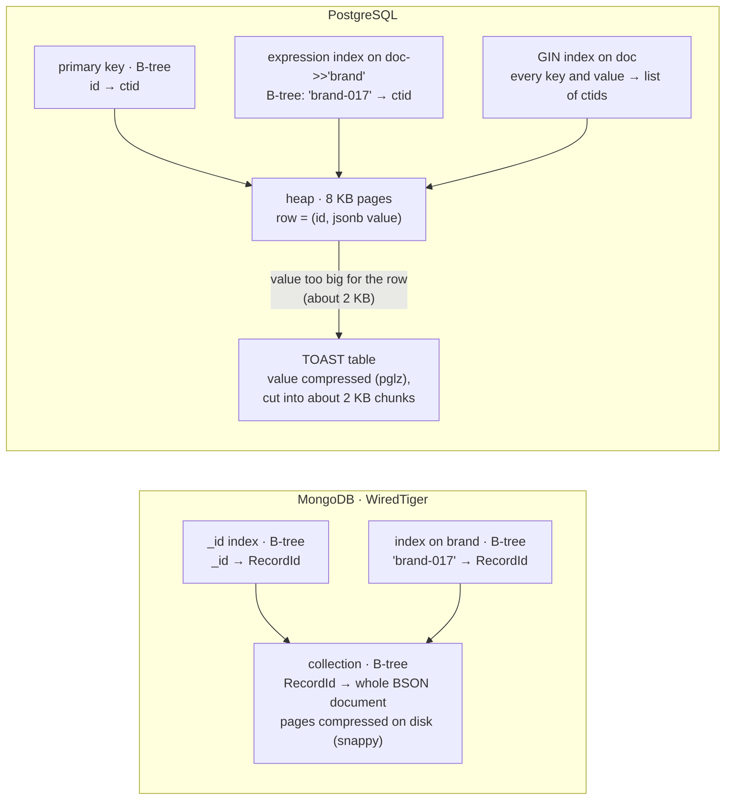

# M03 · Ch3 · §2 — Document stores: MongoDB and PostgreSQL JSONB

> **Module:** Databases & Storage (from first principles)
> **Chapter:** Graph, document and key-value databases — their data models and internal design, when each beats a
> relational database, and the CAP (consistency, availability, partition tolerance) trade-off
> **Section:** Ch3 §1's key-value stores never look inside the value. A **document store** does: the value is a JSON
> (JavaScript Object Notation) document, and the database can index and query any field inside it, including fields in
> nested objects and arrays. **MongoDB** is the best-known document database. **PostgreSQL** can hold the same documents
> in a `jsonb` column and index them too. This section asks the question you will actually face: what does MongoDB do
> that a `jsonb` column does not, and what does each make expensive? It measures storage size, what one small update
> costs as documents grow, five queries and the plans each store chose, embedding against referencing, schema drift, and
> a contended multi-document transaction. MongoDB 8.2.12 and PostgreSQL 18.6 ran on one laptop; the scripts are
> committed in `diagrams/02-doc-data/`.
> **Status:** 🔵 PREPARED 2026-11-19 — body written, awaiting your read and the Q&A.
> **Prerequisites:** **Ch1 §2** (normalization), **Ch1 §4** (B-tree indexes), **Ch2 §3** (MVCC — multi-version concurrency control — and row locks) and
> **Ch3 §1** (access-pattern-first design, single-item atomicity).

**Estimated study time:** 3 hours including the hands-on.

---

## Why this section exists — and how it's pitched

At the end of Ch3 §1 you said PostgreSQL has been enough for every project so far. For document stores that position is
stronger than for key-value stores, because PostgreSQL *is* a document store too: `jsonb` has been in it since 9.4
(2014). So the useful question is not "SQL or NoSQL?" but **"MongoDB, a `jsonb` column, or plain columns?"**, and the
answer depends on mechanics you can measure.

The measurements give three results that the usual arguments miss:

- **MongoDB stored the same catalogue in 3.5× less disk** (235 against 820 bytes per item), because WiredTiger
  compresses whole pages and PostgreSQL leaves values under about 2 KB uncompressed. "Documents are bigger in
  PostgreSQL" is true, and it is about compression, not the data model.
- **Changing one counter in a 256 KB document wrote about 120 KB of WAL (write-ahead log) in PostgreSQL**, because
  `jsonb` is rewritten whole. MongoDB's journal recorded a 512-byte change, but **its data files still rewrote the whole
  document** at the next checkpoint (about 198 KB per update). Neither store edits a document in place. The fix is the
  same in both: keep a hot, changing field out of a big document.
- **"Schemaless" means "the schema is checked by whoever reads the data."** With 1% of prices stored as strings,
  MongoDB answered "how many cost more than 100?" with 4,924 instead of 5,034, and raised no error.

The pitch is the same as §1: inside each system first, then the trade-offs, then a choosing table and the failure modes.

---

## 1. The document model: store the aggregate, not the rows

<details>
<summary><b>Vocabulary for this section</b> — terms and abbreviations (click to expand)</summary>

**Abbreviations**

| Short | Stands for | Meaning |
|---|---|---|
| **JSON** | JavaScript Object Notation | text format of objects `{}`, arrays `[]`, strings, numbers, booleans and `null` |
| **BSON** | Binary JSON | MongoDB's binary encoding of a document; adds types JSON lacks (dates, 64-bit integers, decimals, binary) |
| **jsonb** | JSON binary | PostgreSQL's binary, parsed JSON type; `json` is the text type |
| **ORM** | object-relational mapper | library that maps objects in code to rows in tables (SQLAlchemy, Prisma) |
| **KV** | key-value | Ch3 §1's model: one value per key, opaque to the store |

**Terms**

| Term | Definition |
|---|---|
| **Document** | one self-contained record, a tree of fields, nested objects and arrays, stored and fetched as a unit |
| **Collection** | MongoDB's group of documents, the counterpart of a table; it does not require the documents to share fields |
| **Aggregate** | a cluster of data that is read and changed together, such as an order with its line items (term from domain-driven design) |
| **Embedding** | putting related data inside the parent document (items inside the order) |
| **Referencing** | storing related data separately and keeping the other's id, as a foreign key does |
| **Schema-on-write** | the database checks the shape of data when it is written (relational tables) |
| **Schema-on-read** | the database accepts any shape; code that reads the data must cope with whatever is there |
| **Impedance mismatch** | the friction of mapping nested objects in code to flat rows in tables |

</details>

Ch1 split an order into an `orders` row and ten `order_items` rows, and the query planner joined them back together
when asked. A document store keeps the order as it is used:

```json
{ "_id": 42, "customer": 1077, "status": "paid",
  "items": [ { "product": 311, "qty": 2, "price": 19.90 },
             { "product": 508, "qty": 1, "price": 4.50 } ] }
```

That one choice has three consequences, and the rest of the section measures each:

- **Reading the aggregate is one lookup.** The question the document was shaped for needs no join (§4).
- **The database must understand the inside of the value**, or it would be a key-value store. A document store indexes
  and queries fields such as `items.product` or `attrs.color` (§3). This is the step up from Ch3 §1.
- **Nothing forces two documents to have the same shape.** That is convenient when the data is genuinely varied
  (product attributes, event payloads, the outputs of large language model [LLM] tool calls) and dangerous when it is not (§5).

**Table 1** — the three models side by side.

| | Key-value (Ch3 §1) | Document | Relational (Ch1) |
|---|---|---|---|
| Unit stored | opaque value under a key | a tree of fields, read and written as a unit | rows of fixed columns |
| Questions it answers well | "value for this key" | "this aggregate", and any field you indexed | any question you can write in SQL (Structured Query Language) |
| Joins | none | limited (`$lookup` in MongoDB) | the planner's main job |
| Schema | none | optional, checked by readers unless you add validation | declared and enforced |
| Atomic unit without a transaction | one key or item | **one document**, however many fields it changes | one row; any rows inside a transaction |
| Typical products | Redis, DynamoDB | MongoDB, Firestore, Couchbase; PostgreSQL `jsonb` | PostgreSQL, MySQL, SQL Server |

The **impedance mismatch** is the original argument for documents: application code holds nested objects, and an ORM
flattening them into rows (and the N+1 queries that follow) is friction. A document maps one-to-one to the object.
That is a real convenience. It is also only a storage decision, so the rest of this section asks what it costs.

Two families of product sell this model. **MongoDB** (and its API-compatible clones: Amazon DocumentDB, Azure Cosmos DB
for MongoDB, Firestore with MongoDB compatibility) is a database built around documents. **PostgreSQL `jsonb`** is a
column type in a relational database: documents beside ordinary columns, with joins, constraints and transactions
still available. The comparison in this section is between those two.

---

## 2. Storage inside: BSON in WiredTiger, `jsonb` in a heap with TOAST

<details>
<summary><b>Vocabulary for this section</b> — terms and abbreviations (click to expand)</summary>

**Abbreviations**

| Short | Stands for | Meaning |
|---|---|---|
| **WAL** | write-ahead log | PostgreSQL's log: every change is written here and flushed before the commit is acknowledged (Ch2 §1) |
| **TOAST** | The Oversized-Attribute Storage Technique | PostgreSQL's mechanism for values too large for an 8 KB page: compress, then store out of line in chunks |
| **pglz** | PostgreSQL LZ | PostgreSQL's built-in compression algorithm, the default for TOAST (`lz4` is the alternative) |
| **GIN** | generalized inverted index | PostgreSQL index from each key, value or array element to the rows containing it (§3) |
| **ctid** | current tuple id | a row version's physical address in PostgreSQL: page number and slot |
| **MiB / KB** | mebibyte / kilobyte | 1 MiB = 1,048,576 bytes; KB here = 1,024 bytes |

**Terms**

| Term | Definition |
|---|---|
| **WiredTiger** | MongoDB's storage engine since 3.2: B-trees, page compression, snapshots, a journal |
| **RecordId** | WiredTiger's internal key for a document in a collection; every index points to it |
| **Journal** | MongoDB's write-ahead log: changes are appended and flushed so a crash can replay them |
| **Checkpoint** | the point at which the database writes changed pages from memory to the data files (MongoDB every 60 s by default; PostgreSQL every 5 min or when the WAL grows) |
| **Block compression** | compressing each page as it is written to disk (WiredTiger: snappy by default) |
| **Heap** | PostgreSQL's table storage: unordered 8 KB pages of row versions |
| **Out-of-line** | stored in a separate TOAST table, with only a pointer in the row |
| **Copy-on-write** | changing data by writing a new version rather than overwriting the old one in place |

</details>

<!-- DIAGRAM:START -->


<details>
<summary>Diagram source (Mermaid)</summary>



</details>
<!-- DIAGRAM:END -->

**Figure 1** — where a document lives. In MongoDB the collection is itself a B-tree from RecordId to the whole BSON
document, and every index points at the RecordId. In PostgreSQL the document is one `jsonb` value in a heap row; every
index points at the row's ctid, and a value too large for the row moves to the TOAST table.

### What one document weighs

`load_footprint.py` loaded the same 500,000 catalogue items, about 640 bytes of JSON each, into MongoDB and into three
PostgreSQL tables.

**Table 2** — storage per item before secondary indexes (`footprint-out.txt`).

| Stored as | Bytes per item | What the number is |
|---|---|---|
| JSON text, compact | 636 | the input, for reference |
| MongoDB BSON, uncompressed | 671 | each field name repeated in every document, plus type bytes and lengths |
| **MongoDB on disk** | **235** (+ 27 for the `_id` index) | the same BSON after WiredTiger's page compression (snappy) |
| PostgreSQL `json` column | 688 (value 640) | the text, verbatim, plus a 24-byte row header |
| **PostgreSQL `jsonb` column** | **820** (value 749) | parsed binary, keys sorted, with an offset table so a field can be found without parsing the text |
| PostgreSQL plain columns | 550 | field names live once, in the catalog, not in every row |

Three things to read off it:

- **`jsonb` is larger than the text it came from** (749 against 640 bytes). It is a parsed structure with offsets for
  fast field access, not a compressed one. It also drops duplicate keys and whitespace, and does not keep key order.
- **MongoDB's 3.5× advantage is compression, not BSON.** BSON is about the same size as `jsonb`. WiredTiger compresses
  every page it writes; PostgreSQL compresses a value only when its row would exceed about 2 KB (the TOAST threshold),
  and none of these 750-byte values got there. Repetitive documents (the same field names in every one) compress well.
- **Plain columns are smaller than either document form** because field names are not stored per row. For data with a
  stable shape, columns are the compact format.

### What one small update costs

A document is stored as a unit. What happens when you change one field of a large one? `update_bench.py` incremented a
counter field in documents of 1 KB, 16 KB and 256 KB and counted the bytes each store wrote: to its log at commit, and
to its data files at the next checkpoint.

![Two bar charts on a log scale, bytes written per update. Panel (a), log written at commit: MongoDB 512 bytes at all three document sizes; PostgreSQL jsonb_set 512 bytes, 9.2 kilobytes and 120 kilobytes for 1, 16 and 256 kilobyte documents; PostgreSQL counter in its own column 507, 249 and 249 bytes. Panel (b), data files written at the next checkpoint: MongoDB 1.2 kilobytes, 6.8 kilobytes and 198 kilobytes; PostgreSQL jsonb_set 344 bytes, 11 kilobytes and 116 kilobytes; PostgreSQL own column 344, 16 and 16 bytes.](diagrams/02-doc-fig2.svg)

**Figure 2** — bytes written to change one counter, by document size: (a) at commit, to MongoDB's journal or PostgreSQL's
WAL; (b) to the data files at a checkpoint forced after 2,000 updates (`update-bench.csv`; 500 documents per size, so
each was updated about 4 times per checkpoint).

Reading Figure 2:

- **PostgreSQL rewrites the whole `jsonb` value on every update.** `jsonb_set` builds a new value, MVCC (multi-version
  concurrency control, Ch2 §3) writes a new row version, and a TOASTed value is compressed and written again in full:
  9.2 KB of WAL for a 16 KB document and 120 KB for a 256 KB one, to change a number.
- **MongoDB's journal records only the change**: 512 bytes at every size. This is why MongoDB is often described as
  "updating in place". It is not. Panel (b) shows its data files still received about the whole document per update
  (198 KB at 256 KB), because WiredTiger is copy-on-write: a changed document is written out again at the checkpoint
  (plus bookkeeping for older versions). The cost moved from commit time to checkpoint time; it did not go away.
- **The fix is to move the hot field out of the big document.** With the counter in its own column beside the `jsonb`,
  PostgreSQL wrote 249 bytes of WAL and 16 bytes of data files per update at 256 KB, because an unchanged TOAST value is
  not copied: the new row version reuses the pointer. In MongoDB the equivalent is a separate small document for the
  counter.

So **large documents with a frequently changing field are expensive in both stores**. That is the first modelling rule
of §4, and it comes from storage, not from taste.

---

## 3. Indexes inside documents

<details>
<summary><b>Vocabulary for this section</b> — terms, abbreviations and symbols (click to expand)</summary>

**Abbreviations**

| Short | Stands for | Meaning |
|---|---|---|
| **GIN** | generalized inverted index | PostgreSQL index that maps each element (a key, a value, an array member) to the list of rows containing it |
| **IXSCAN / COLLSCAN** | index scan / collection scan | MongoDB plan stages: walk an index, or read every document |
| **FETCH** | — | MongoDB plan stage that loads the document an index entry points to |
| **p50 / p99** | 50th / 99th percentile | the median latency, and the latency 99% of calls beat |
| **ms / µs** | millisecond / microsecond | thousandth / millionth of a second |

**Symbols used in the formulas**

| Symbol | Reads as | Meaning |
|---|---|---|
| $O(\log n)$ | "order log n" | cost grows with the logarithm of the number of entries: a B-tree lookup |

**Terms**

| Term | Definition |
|---|---|
| **Multikey index** | a MongoDB index on an array field: one index entry per array element |
| **Compound index** | an index on several fields in a fixed order; serves queries on a prefix of them (Ch1 §4) |
| **Expression index** | a PostgreSQL B-tree on the result of an expression, such as `doc->>'brand'` |
| **Containment `@>`** | PostgreSQL operator: "the left `jsonb` contains the right one", e.g. `doc @> '{"brand":"x"}'` |
| **`->` / `->>`** | PostgreSQL operators: get a field as `jsonb` / get it as text |
| **`jsonb_ops` / `jsonb_path_ops`** | the two GIN operator classes for `jsonb`: the first indexes keys and values separately and supports key-exists queries; the second indexes hashes of paths to values, is smaller, and supports only containment and JSON path matches |
| **JSON path** | a query language for paths inside JSON (`$.price ? (@ > 100)`), standardized in SQL:2016 |
| **Bitmap heap scan** | PostgreSQL plan: collect matching row addresses from one or more indexes into a bitmap, then read those pages once |

</details>

Both stores index fields inside documents; they do it differently, and the difference decides which questions are cheap.

**Table 3** — the index kinds for documents.

| Need | MongoDB | PostgreSQL `jsonb` |
|---|---|---|
| one field, equality or range | single-field index on `brand` or `price` | B-tree **expression index** on `(doc->>'brand')`, or on `((doc->>'price')::numeric)` for numeric ranges |
| several fields together | compound index `{brand: 1, "attrs.color": 1}` | B-tree on several expressions |
| "array contains x" | the same single-field syntax: on an array it becomes a **multikey** index, one entry per element | GIN index; query with `@>` |
| "any field equals x", fields not known in advance | wildcard index (`$**`) | **GIN on the whole column**: every key and value is indexed |
| range inside the document via a GIN index | — | **not possible**: GIN answers containment and equality, not `<` or `>` |

The two GIN classes are an important choice: `jsonb_ops` (the default) also answers "does this key exist?" (`?`), while
`jsonb_path_ops` answers only containment and JSON path matches and is smaller.

**Table 4** — index sizes for the 500,000-item catalogue (`footprint-out.txt`).

| Index | MongoDB | PostgreSQL |
|---|---|---|
| primary key / `_id` | 13.0 MB | 10.7 MB |
| `brand` | 3.1 MB | 3.5 MB (expression) |
| `brand` + colour | 4.8 MB | 3.4 MB (expression) |
| `price` | 4.5 MB | 10.8 MB (expression on `numeric`) |
| `tags` (3–6 per item) | 12.5 MB multikey | 5.3 MB GIN on a `text[]` column |
| **every field** | — | **118.7 MB** GIN `jsonb_path_ops` · **150.1 MB** GIN `jsonb_ops` |

Targeted indexes are 3–13 MB each in both stores; MongoDB's are often smaller because WiredTiger compresses index keys
by prefix. The "index everything" GIN index is **10× to 50× larger** than any targeted one, and about a third of the
heap data itself (about 400 MB). That is the price of not having to choose your questions in advance, and it is also paid on every
write: each insert adds an entry per key and value.

### Five questions, measured

`query_bench.py` asked each store five questions about the catalogue, one at a time from Python, and recorded the plan
each chose.


**Figure 3** — p50 latency of five questions, each store using its best available access path (`query-out.txt`). For
the last question MongoDB has no index and scans the collection, PostgreSQL `jsonb` is served by the GIN index, and
plain columns are scanned in parallel.

**Table 5** — what each store did (`query-out.txt`; "examined" = keys and documents MongoDB read; "buffers" = 8 KB pages PostgreSQL touched).

| Question (matches) | MongoDB plan · examined | PostgreSQL `jsonb` plan · buffers | Plain columns |
|---|---|---|---|
| Q1 one item by id (1) | `EXPRESS_IXSCAN(_id_)` · 1 key, 1 doc · **0.13 ms** | primary key · 4 · **0.05 ms** | 0.06 ms |
| Q2 brand = ? and colour = ? (about 310) | compound index · 349 keys, 349 docs · 1.03 ms | expression index, bitmap scan · 317 · 0.38 ms; GIN `@>` · 371 · 1.01 ms | 0.37 ms |
| Q3 has tags ? and ? (about 1,000) | multikey on **one** tag, then filter · **22,397 docs** · **20.6 ms** | GIN `@>`, both tags intersected in the index · 860 · **2.0 ms** | 1.8 ms |
| Q4 price in a range of 1 (about 1,000) | `price` index · 1,019 docs · 2.48 ms | expression index · 1,018 · 1.10 ms; **JSON path** `@?` · seq scan · 66.6 ms | 1.02 ms |
| Q5 material = ? and size = ?, **no targeted index** (about 16,700) | `COLLSCAN` · 500,000 docs · **118 ms** | GIN `@>` · 14,408 · **19.9 ms**; without it, parallel seq scan · 54.5 ms | parallel seq scan · 37.0 ms |

What it shows:

- **For one-row reads the stores are the same speed, and the gap is fixed overhead.** An empty round trip from Python
  was 84.5 µs to MongoDB and 38.1 µs to PostgreSQL (`roundtrip-out.txt`). Q1's difference is that, not the storage
  engine. As with Redis in Ch3 §1, a single lookup from an application is mostly round trip.
- **Q3: MongoDB used one index for a two-condition array query.** With `$all: [a, b]` it walked the multikey index for
  one tag (22,397 matches) and fetched every document to check the second. PostgreSQL's GIN index holds both tags'
  posting lists and intersected them before touching the table. MongoDB can intersect indexes, but its planner rarely
  chooses to; the reliable fix in MongoDB is to model the question (§4).
- **Q4: a GIN index cannot answer a range.** The JSON path query was correct and readable, and it scanned all 500,000
  rows. A range needs a B-tree on the expression, which then matched the plain column's speed.
- **Q5: the GIN index is PostgreSQL's answer to "questions you didn't plan for".** It served a two-field filter on
  fields nobody had indexed, 6× faster than MongoDB's collection scan and faster than scanning plain columns. This is the
  same idea as Firestore's automatic indexing (Ch3 §1 §12a), paid for with the 119 MB in Table 4.

### The trap that turned 1 ms into 91 ms

The first run of Q4 against the expression index took 84 ms and scanned the table. The query passed Python floats, which
psycopg sends as `float8`; the index is on `(doc->>'price')::numeric`; and PostgreSQL compares `numeric` with `float8`
by converting the column side to `float8`. The expression in the query was then no longer the expression in the index,
so the index could not be used. Casting the parameters (`%s::numeric`) restored a 1.1 ms bitmap scan; the uncast
version is kept in `query-out.txt` as a 91 ms row. **An expression index only matches the exact expression**, types
included. `EXPLAIN` shows it immediately; latency alone only shows "slow".

---

## 4. Modelling: embed or reference

<details>
<summary><b>Vocabulary for this section</b> — terms and abbreviations (click to expand)</summary>

**Abbreviations**

| Short | Stands for | Meaning |
|---|---|---|
| **N+1** | — | one query for a list, then one more query per item in it (Ch1 §3) |
| **MB / MiB** | megabyte / mebibyte | 1 MiB = 1,048,576 bytes, MongoDB's document limit is 16 MiB |

**Terms**

| Term | Definition |
|---|---|
| **`$lookup`** | MongoDB aggregation stage that joins another collection into each document (a left outer join) |
| **`$unwind`** | aggregation stage that turns one document with an array of n elements into n documents |
| **Aggregation pipeline** | MongoDB's query language for multi-step processing: a list of stages (`$match`, `$group`, `$lookup`, …) |
| **Unbounded array** | an array that grows without limit (comments on a post, events of a device) |
| **Denormalization** | storing a copy of data in more than one place so a read needs no join; the copies must then be kept in step |
| **Subset pattern** | embed only the most-used part of a large related set (the latest 10 reviews), keep the rest in its own collection |

</details>

In a document store the central design decision is not the key, as in DynamoDB, but **what goes inside what**.
`embed_bench.py` stored 50,000 orders of 10 line items four ways and asked two questions: one the embedded design was
shaped for, and one it was not.

**Table 6** — embed or reference: p50 latency, median of 3 runs, and storage including indexes (`embed-out.txt`).

| Layout | A: one order with its items | B: total quantity sold of one product | Storage |
|---|---|---|---|
| MongoDB, items embedded | **0.134 ms** (one `find_one`) | 1.82 ms (multikey index, `$unwind`, `$group`) | **12.6 MB** |
| MongoDB, items referenced, two queries | 0.313 ms | 0.67 ms (`order_items`, `$group`) | 32.1 MB |
| MongoDB, items referenced, `$lookup` | 0.252 ms | — | 32.1 MB |
| PostgreSQL, two tables (Ch1's design) | **0.055 ms** (`JOIN`) | **0.19 ms** (`SUM` on an index) | 36.8 MB |
| PostgreSQL, items in a `jsonb` array | 0.059 ms (one row) | 1.25 ms (GIN `@>`, `jsonb_array_elements`) | 51.2 MB |

Reading Table 6:

- **In MongoDB, embedding halved the time of question A** against two queries, and saved 60% of the space: field names
  and the order id are not repeated in 500,000 separate item documents.
- **The same embedding made question B 2.7× slower** than the referenced layout. A question across all orders has to
  find the orders, unpack each array and filter the elements again. Embedding is an index on one access pattern, in the
  same sense as DynamoDB's key design (Ch3 §1 §5).
- **In PostgreSQL the normalized join was as fast as the single `jsonb` row for question A** (0.055 against 0.059 ms)
  and 6.6× faster for B. A primary-key join of 10 rows costs very little; "joins are slow" is a statement about large,
  unindexed joins, not about this.

### The rules of thumb, and where they come from

MongoDB's own guidance boils down to "data that is accessed together should be stored together", with limits. Each limit
traces back to a measurement in this section:

**Table 7** — when to embed and when to reference.

| Embed when | Reference when | Why (evidence) |
|---|---|---|
| the child is read with the parent nearly every time | the child is often read on its own, or across parents | question A against question B (Table 6) |
| the child set is small and bounded (an order's items, an address) | the set grows without limit (comments, events, log lines) | a document is rewritten whole on change (Figure 2); MongoDB rejects documents over **16 MiB** |
| the child changes with the parent, or rarely | the child changes often and independently (stock levels, counters) | a hot field in a big document multiplies write bytes (Figure 2) |
| the child belongs to one parent | the child is shared (a product in many orders) | an embedded copy of shared data must be updated everywhere it was copied |

The **subset pattern** is the usual compromise for large or growing child sets: embed the part the main page shows (the
latest 10 reviews), and keep the full set in its own collection.

The **unbounded array** is the classic MongoDB failure. A post with its comments embedded works at 50 comments. At
50,000, every new comment rewrites a multi-megabyte document, every read of the post transfers all of them, and
eventually the insert fails at the 16 MiB limit. The design was right for the first month of data, so the bug arrives
in production.

---

## 5. "Schemaless": the schema moves into every reader

<details>
<summary><b>Vocabulary for this section</b> — terms and abbreviations (click to expand)</summary>

**Abbreviations**

| Short | Stands for | Meaning |
|---|---|---|
| **DDL** | data definition language | SQL statements that change the schema: `CREATE`, `ALTER`, `DROP` |

**Terms**

| Term | Definition |
|---|---|
| **Schema drift** | documents in one collection gradually acquiring different shapes: renamed fields, changed types, missing fields |
| **`$jsonSchema`** | MongoDB's validator: a JSON Schema the collection checks documents against |
| **`validationLevel`** | MongoDB setting: `strict` checks every insert and update; `moderate` skips updates to documents that were already invalid |
| **`validationAction`** | MongoDB setting: `error` rejects an invalid write; `warn` accepts it and logs it |
| **Type bracketing** | MongoDB rule that a comparison such as `$gt: 100` matches only values of the same type family, so a string never satisfies it |
| **`CHECK` constraint** | a SQL rule evaluated for every row written (Ch1 §1) |
| **`NOT VALID`** | PostgreSQL option: add a constraint that checks new rows only, and validate old rows later with `VALIDATE CONSTRAINT` |
| **Schema version field** | a field such as `schema_version: 3` in every document, so readers and migrations know which shape they hold |

</details>

A document store does not stop you writing `"price": "19.99"` beside `"price": 19.99`. That is presented as
flexibility, and in one sense it is: you can deploy code with a new field without a migration. But the schema has not
disappeared. It now lives in every piece of code that reads the data, and each of them handles a wrong shape in its own
way.

`schema_drift.py` built 10,000 products in which a few writers got the price wrong (100 as strings, 50 missing, 50
spelt `Price`) and asked "how many products cost more than 100?". The true answer is 5,034.

**Table 8** — the same question over drifted data, then schema enforcement (`drift-out.txt`).

| Store and query | Result | What happened |
|---|---|---|
| MongoDB `{price: {$gt: 100}}` | **4,924** | strings never compare greater than a number (type bracketing); missing and misspelt fields don't match. **No error** |
| PostgreSQL `(doc->>'price')::numeric > 100` | 4,974 | `->>` returns text, so the strings cast and count; missing and misspelt fields are `NULL` and don't count. No error |
| PostgreSQL `(doc->'price')::numeric > 100` | **error**: cannot cast jsonb string to type numeric | `->` keeps the JSON type, and the cast fails loudly on the first string |
| PostgreSQL JSON path `$.price ? (@ > 100)` | 4,924 | the same answer as MongoDB, for the same reason |
| MongoDB `collMod` with a `$jsonSchema` validator (`strict`, `error`) | new string price **rejected**; the 200 existing bad documents **kept** | the validator applies to writes from now on, and does not check existing data |
| MongoDB: update the name of an existing bad document | **rejected** | `strict` validates the whole document on every update, so old bad documents block unrelated changes until fixed |
| PostgreSQL `ADD CONSTRAINT … CHECK (jsonb_typeof(doc->'price') = 'number' …)` | **refused**: violated by some row | a constraint must hold for existing rows before it is added |
| PostgreSQL the same `… NOT VALID` | added; a new string price is rejected | checks new rows only; `VALIDATE CONSTRAINT` fails until the old rows are fixed |

Three queries over the same data gave three answers, and the two quiet ones are the dangerous ones. A report built on
either would be wrong by 1–2% with nothing in any log.

**Drift happens through ordinary work**: two services writing the same collection, a front end that sends form values
as strings, a field renamed in code but not in the old documents, a library upgrade that changes how dates serialize.
The defences are the same in both stores:

1. **Validate on write.** A `$jsonSchema` validator in MongoDB, a `CHECK` constraint (or plain typed columns) in
   PostgreSQL, and a schema in the application (Pydantic, Zod) as the first line. All three are cheap compared with a
   wrong report.
2. **Version the shape.** Put `schema_version` in every document and migrate old versions explicitly, either in a batch
   job or on read ("lazy migration"), so readers know which shape they hold.
3. **When adding validation to existing data, find the violators first.** MongoDB's `{$nor: [validator]}` query and
   PostgreSQL's `NOT VALID` then `VALIDATE CONSTRAINT` both exist for this step.

"No migrations" therefore means the migration happens later, in every reader, and in production. That trade is worth it
for data that is genuinely varied, and rarely for data that is not.

---

## 6. Atomicity and transactions

<details>
<summary><b>Vocabulary for this section</b> — terms and abbreviations (click to expand)</summary>

**Abbreviations**

| Short | Stands for | Meaning |
|---|---|---|
| **MVCC** | multi-version concurrency control | readers see a snapshot of row or document versions instead of blocking on writers (Ch2 §3) |
| **ACID** | atomicity, consistency, isolation, durability | the guarantees of a transaction (Ch2 §1) |

**Terms**

| Term | Definition |
|---|---|
| **Single-document atomicity** | MongoDB guarantees that one update to one document is applied entirely or not at all, however many fields it changes |
| **Multi-document transaction** | MongoDB transaction across several documents or collections, available since 4.0 (replica sets) and 4.2 (sharded clusters) |
| **Replica set** | a group of MongoDB servers holding the same data: one primary takes writes, the others follow its oplog |
| **Oplog** | operations log: the replica set's ordered log of changes that secondaries replay |
| **Write concern** | how many replicas must confirm a write before it is acknowledged: `w: 1` (the primary) or `w: "majority"` (the default since 5.0) |
| **Read concern** | what a read may see: `local` (whatever this node has), `majority` (only majority-confirmed data), `snapshot` (in a transaction) |
| **WriteConflict** | MongoDB error when two transactions change the same document; the later one aborts at once |
| **`TransientTransactionError`** | the label MongoDB attaches to errors that mean "retry the whole transaction" |
| **`with_transaction`** | the driver's callback API: runs your function in a transaction and retries it on transient errors |

</details>

Ch3 §1's key-value stores were atomic for one key or item. A document store is atomic for **one document**, and that is
more useful than it sounds: one `update_one` can change ten fields, push to an array and increment a counter, all or
nothing. Embedding is therefore also a consistency tool. Data that must change together can be put in one document and
needs no transaction.

When the data spans documents, MongoDB has had multi-document transactions since 4.0. They behave differently from
PostgreSQL's in one important way: **a write conflict aborts the transaction immediately instead of waiting**.
PostgreSQL's `UPDATE` waits for the other transaction's row lock and then continues (Ch2 §3).

`txn_bench.py` ran 8 threads making 300 transfers each between 10 accounts: subtract from one, add to another.

**Table 9** — 2,400 contended transfers, 3 runs (`txn-out.txt`).

| Method | Transfers per second (3 runs) | Retries per transfer | Total of all balances afterwards |
|---|---|---|---|
| MongoDB multi-document transaction, `with_transaction` | 794 · 804 · 796 | **0.54 · 0.42 · 0.42** | 10,000 ✓ |
| MongoDB, all balances in one document, one `update_one` with two `$inc` | 1,991 · 1,590 · 1,713 | 0 | 10,000 ✓ |
| PostgreSQL transaction, two `UPDATE`s, rows locked in id order | 749 · 778 · 786 | 0 (waits instead) | 10,000 ✓ |

- **All three kept the invariant.** MongoDB transactions are real ACID transactions; the old claim that "MongoDB
  can't do transactions" has been out of date since 2018.
- **About half of MongoDB's transfers ran more than once.** The driver's `with_transaction` retried them silently. That
  is correct only if everything inside the callback is safe to repeat. An email sent or an external API called inside it
  is repeated too: the idempotency rule of Ch2 §4 §2 applies to the transaction body.
- **Putting the data that changes together in one document removed the problem**: no transaction, no conflict, about
  twice the rate. That is the document model's own answer, and it only works when the data really belongs together.

The production limits to know (MongoDB documentation):

- A transaction may run for at most **60 seconds** by default (`transactionLifetimeLimitSeconds`), and MongoDB's
  best-practice guidance is to modify **no more than about 1,000 documents** per transaction and to batch larger jobs.
  Transactions are meant for small multi-document changes.
- **Durability is a replica-set setting.** The default write concern since MongoDB 5.0 is `majority`: a write is
  acknowledged once a majority of the replica set has it in its journal. Code that sets `w: 1` for speed can lose
  acknowledged writes when the primary fails over, the same class of loss as Redis's defaults in Ch3 §1 §3.
- **Reads have a matching setting.** A read with the default `local` read concern can see data that is later rolled
  back after a failover; `majority` cannot. Ch3 §4 covers why replicated systems force this choice.

---

## 7. Choosing: MongoDB, a `jsonb` column, or plain columns

<details>
<summary><b>Vocabulary for this section</b> — terms and abbreviations (click to expand)</summary>

**Abbreviations**

| Short | Stands for | Meaning |
|---|---|---|
| **RDS** | Relational Database Service | AWS's managed PostgreSQL and other relational databases |
| **SSPL** | Server Side Public License | MongoDB's licence since 2018; not an open-source licence by the OSI's (Open Source Initiative) definition |
| **API** | application programming interface | here, the wire protocol and query language a client speaks |

**Terms**

| Term | Definition |
|---|---|
| **MongoDB Atlas** | MongoDB's own managed cloud service, on AWS, GCP (Google Cloud Platform) or Azure |
| **Amazon DocumentDB** | AWS's document database that speaks the MongoDB API; a separate engine, not MongoDB's code |
| **Sharding** | splitting one collection or table across several servers by a key (Ch3 §4) |
| **Hybrid table** | a relational table with typed columns for the stable, queried fields and a `jsonb` column for the varied rest |

</details>

Your default, given everything above, is PostgreSQL. The useful question is which of the three layouts to use, and
when MongoDB is worth a second system.

**Table 10** — which layout for which data.

| The data | Use | Why (evidence) |
|---|---|---|
| Stable shape, queried by many fields, related to other data | **plain columns** | smallest (Table 2), typed, constrained, joinable; every index is a B-tree you choose |
| Mostly stable, plus a varied part: product attributes, user settings, event payloads, LLM tool outputs, API responses you keep | **hybrid**: columns for what you filter, join and sort on, plus a `jsonb` column for the rest | the varied part needs no migration; a GIN index answers ad-hoc questions on it (Q5) |
| Whole documents you store and fetch by id, rarely query inside | `jsonb` (or `json` if you must keep the exact text) | one row, primary-key speed (Q1) |
| Large documents with a field that changes often | move the hot field to its own column or document | Figure 2 |
| A document-shaped application at large scale: high write volume, data bigger than one server, a team fluent in MongoDB's model | **MongoDB** (Atlas, or self-managed) | compression (Table 2), cheap small updates at commit (Figure 2a), built-in sharding and replica sets (Ch3 §4), a document-native driver |
| A mobile or web app that syncs to clients | **Firestore** (Ch3 §1 §12a) | real-time listeners and offline sync are the product |

What MongoDB gives you that a `jsonb` column does not, from this section's evidence:

1. **Smaller storage** for repetitive documents, from page compression (3.5× here).
2. **Cheaper commits for small changes to large documents** (512 bytes of journal against 120 KB of WAL), though the
   data files still pay at checkpoint.
3. **Sharding and failover built in.** Spreading one collection across machines is a configuration step in MongoDB; in
   PostgreSQL it needs an extension such as Citus or application-level partitioning. This is the strongest reason, and
   it matters only when one server is not enough. Ch3 §4 covers it.
4. **A query language and driver shaped like the data**, which some teams are faster in.

What a `jsonb` column gives you that MongoDB does not:

1. **Joins, constraints and foreign keys** beside the documents, in the same transaction.
2. **GIN indexes that answer unplanned containment questions** (Q5) and intersect conditions inside the index (Q3).
3. **One system**: one backup, one set of credentials, one thing to monitor and upgrade.

Public examples of both directions: **The Guardian** moved its content platform from MongoDB to PostgreSQL with `jsonb`
in 2018 because running MongoDB themselves had become the problem: upgrading and operating its management tooling
took specialist time, and they wanted a managed database (Amazon RDS). They kept the documents as documents, in `jsonb`.
**Discord** started its message store on MongoDB and moved it in 2017 to Cassandra when the data outgrew one replica set
(and later, in 2023, to ScyllaDB). The first moved for operations, the second for scale, and neither moved because
documents were the wrong model.

---

## 8. Failure modes — the document-store checklist

<details>
<summary><b>Vocabulary for this section</b> — terms and abbreviations (click to expand)</summary>

**Abbreviations**

| Short | Stands for | Meaning |
|---|---|---|
| **GIN** | generalized inverted index | PostgreSQL's index of every element of a `jsonb` value or array (§3) |
| **WAL** | write-ahead log | PostgreSQL's commit log (§2) |

**Terms**

| Term | Definition |
|---|---|
| **Collection scan** | MongoDB reading every document because no index serves the query |
| **Write amplification** | bytes written to disk divided by bytes the application changed |
| **Silent retry** | a driver re-running a transaction or write for you after a transient error |

</details>

- **The document grows without limit.** An embedded array of comments, events or messages makes every update rewrite
  and every read transfer the whole history, and eventually hits 16 MiB. Watch the largest documents, not the average;
  store growing sets in their own collection.
- **A small counter in a big document.** Every increment writes the whole document's worth of bytes (Figure 2). Move hot
  fields out.
- **A wrong answer, not an error, from drifted data.** Mixed types and renamed fields drop out of queries silently
  (Table 8). Validate on write, version the shape, and count the violators before you trust a report.
- **An index that exists and is not used.** An expression index with a different type in the query (the 91 ms trap), a
  range on a GIN-only field, a MongoDB `$all` that uses one array element's index. Read the plan (`EXPLAIN`,
  `.explain("executionStats")`) for every query that matters; look at documents examined against documents returned.
- **The "index everything" bill.** A GIN index on a whole `jsonb` column was the size of the data (Table 4) and slows
  every write. Use it when ad-hoc questions are the point; otherwise index the fields you query.
- **Transaction bodies that are not safe to repeat.** MongoDB retries transactions on conflicts (Table 9). Keep side
  effects out of the callback, or make them idempotent (Ch2 §4 §2).
- **`w: 1` for speed.** Acknowledged writes can be lost on failover. Keep the default `majority` unless losing them is
  acceptable.
- **A second database you didn't need.** If the documents live beside relational data and fit one server, a `jsonb`
  column gives you the document model without a second backup, monitoring and security surface.

---

## 9. Check your understanding

1. Table 2 shows MongoDB storing the catalogue in 235 bytes per item and PostgreSQL `jsonb` in 820. A colleague
   concludes "BSON is a more compact format than `jsonb`". What is right and wrong in that, and what would change the
   PostgreSQL number?
2. In Figure 2, MongoDB's journal wrote 512 bytes per update at every document size. Why is "MongoDB updates documents
   in place" still wrong? What does panel (b) show?
3. A product page stores a `view_count` inside a 40 KB product document and increments it on every page view. What does
   that cost in each store, and what would you change?
4. Why did Q3 (two tags) take 20 ms in MongoDB and 2 ms in PostgreSQL, when both had an index on tags? What would you
   do in MongoDB?
5. You have a GIN `jsonb_path_ops` index on `doc`. Which of these can it serve: `doc @> '{"brand":"x"}'`;
   `doc->>'brand' = 'x'`; `doc ? 'discount'`; `(doc->>'price')::numeric < 10`? For each it cannot, what index would?
6. A query `WHERE (doc->>'price')::numeric > %s` is slow although an index exists on exactly that expression. What is
   the likely cause, and how do you confirm it in one command?
7. An app stores blog posts with comments embedded. It worked for a year; now some page loads are slow and one insert
   failed. Explain both symptoms and the redesign.
8. In Table 6, embedding made question A faster and question B slower in MongoDB. Relate this to DynamoDB's
   access-pattern-first design in Ch3 §1 §5.
9. A dashboard shows "orders over 100 dollars" from a MongoDB collection where some older documents store `total` as a
   string. What does the dashboard show, and what three things would you put in place?
10. Why did about half of MongoDB's transfers in Table 9 run twice, while PostgreSQL's ran once? What must be true of
    code inside `with_transaction`?
11. Your team proposes MongoDB for a new service whose data is users, teams, projects and permissions, on one server,
    beside an existing PostgreSQL database. What would you ask, and what would you propose?
12. Name one situation where you would choose MongoDB over a `jsonb` column, and say which measurement or mechanism in
    this section supports it.

<details>
<summary>Answers</summary>

1. **Wrong on the cause, right on the result.** Uncompressed, BSON (671 bytes) and `jsonb` (749) are about the same
   size; both repeat every field name in every document. The 3.5× gap is WiredTiger's page compression. PostgreSQL
   compresses a value only when its row would exceed about 2 KB (TOAST), and these values were 750 bytes. Plain columns
   (550 bytes, no field names per row) or compression at the file-system level would shrink the PostgreSQL number. See
   §2, Table 2.
2. **The journal records the change, but the data files still get the whole document.** WiredTiger is copy-on-write: a
   changed document is written out again at the next checkpoint. Panel (b) shows about 198 KB of data-file writes per
   update for a 256 KB document. The cost moved from commit to checkpoint (§2, Figure 2).
3. **In PostgreSQL, each view rewrites the 40 KB `jsonb`** (TOASTed, so compressed and written again) and puts a
   matching amount in the WAL. **In MongoDB, the journal entry is small but the data files rewrite the document** at
   checkpoint, and many views of a popular product all land on one document. Move the counter to its own column (16
   bytes per update in Figure 2) or its own small document; at high rates, count in Redis and write totals periodically
   (Ch3 §1).
4. **MongoDB's plan used the multikey index for one tag only** (22,397 matches) and fetched every one of those documents
   to test the second tag. PostgreSQL's GIN index intersected both tags' posting lists inside the index and touched 860
   pages. In MongoDB: make the more selective tag lead (if you know it), or store a combined field for frequent tag
   pairs, or accept the cost if the query is rare (§3, Table 5).
5. **Only the first.** `@>` is what `jsonb_path_ops` serves. `doc->>'brand' = 'x'` needs a B-tree expression index on
   `(doc->>'brand')` (or rewrite it as `@>`). `doc ? 'discount'` (key exists) needs the default `jsonb_ops` GIN class.
   The range needs a B-tree on `((doc->>'price')::numeric)`; GIN never answers ranges (§3, Table 3).
6. **The parameter's type does not match the index expression.** A float parameter makes PostgreSQL compare as
   `float8`, so the indexed `numeric` expression is no longer the same expression. `EXPLAIN` shows `Seq Scan` instead of
   an index scan; casting the parameter (`%s::numeric`) fixes it (§3, "The trap that turned 1 ms into 91 ms").
7. **Unbounded array.** Popular posts now carry thousands of comments: every page load transfers all of them, and every
   new comment rewrites the whole multi-megabyte document. The failed insert hit MongoDB's 16 MiB document limit.
   Redesign: comments in their own collection indexed by `(post_id, created_at)`, and optionally the latest 10 embedded
   in the post (subset pattern) (§4, Table 7).
8. **Embedding is a physical layout chosen for one access pattern**, exactly like DynamoDB's partition and sort key.
   Question A was the pattern the layout served; question B cut across it and paid for unpacking every array. In both
   systems you design the layout from the questions, and a new question can be expensive (§4; Ch3 §1 §5).
9. **It undercounts, with no error.** String totals never compare greater than a number (type bracketing), so those
   orders are missing. Put in place: a `$jsonSchema` validator for new writes (and application-side validation), a
   migration that finds violators with `{$nor: [validator]}` and fixes them, and a `schema_version` field so readers know
   the shape (§5, Table 8).
10. **MongoDB aborts a conflicting transaction immediately** (WriteConflict), and `with_transaction` re-runs the
    callback; PostgreSQL's second `UPDATE` waits for the first transaction's row lock and then proceeds, so nothing is
    retried. Everything in the callback must be safe to run more than once: no emails or external calls, or make them
    idempotent (§6, Table 9; Ch2 §4 §2).
11. **Ask what MongoDB gives this service that PostgreSQL does not.** Users, teams, projects and permissions are
    relational data with many-to-many links and integrity rules, on one server: joins, foreign keys and transactions are
    the requirements. Propose tables in the existing PostgreSQL, with a `jsonb` column for any genuinely varied part
    (settings, preferences). Revisit only if a measured limit appears (§7, Table 10).
12. **A defensible case: a large, write-heavy, document-shaped dataset that will outgrow one server**, such as device
    telemetry documents or a content store with many varied types. Supported by built-in sharding (§7; Ch3 §4),
    compression (Table 2) and small journal writes (Figure 2a). Another: a team already fluent in MongoDB with no
    relational data to join. Weak cases: "we don't want migrations" (§5) and "joins are slow" (Table 6).

</details>

---

## 10. Optional: get your hands dirty (60 min)

Start both servers (the same images and settings as the measurements):

```bash
docker run -d --name doc-mongo -p 57017:27017 mongo:8.2 --replSet rs0 --bind_ip_all --wiredTigerCacheSizeGB 1
docker run -d --name doc-pg -p 55433:5432 -e POSTGRES_PASSWORD=pg postgres:18 -c shared_buffers=1GB -c max_wal_size=8GB
sleep 5 && docker exec doc-mongo mongosh --quiet --eval 'rs.initiate({_id:"rs0",members:[{_id:0,host:"localhost:27017"}]})'
python -m venv .venv && .venv/bin/pip install pymongo psycopg[binary] matplotlib
cd diagrams/02-doc-data && ../../.venv/bin/python load_footprint.py      # about 1 minute
```

**1. Read the plans yourself.** In `mongosh` (`docker exec -it doc-mongo mongosh bench`), run
`db.products.find({tags: {$all: ["tag-001", "tag-002"]}}).explain("executionStats")` and find `totalDocsExamined`. In
`psql`, run `EXPLAIN (ANALYZE, BUFFERS) SELECT count(*) FROM p_jsonb WHERE doc @> '{"tags":["tag-001","tag-002"]}';`.
Which one touched the table less, and why?

**2. Break and fix the expression index.** Run `EXPLAIN SELECT id FROM p_jsonb WHERE (doc->>'price')::numeric >= 10.5::float8;`
and then the same with `10.5::numeric`. Compare the plans.

**3. Drop the GIN index and ask Q5 again.** `DROP INDEX j_gin_path, j_gin_ops;` then
`EXPLAIN ANALYZE SELECT count(*) FROM p_jsonb WHERE doc @> '{"attrs":{"material":"wood","size":"XL"}}';`. Now create
`j_gin_path` again and time a 10,000-row insert with and without it.

**4. Grow a document.** Run `update_bench.py` with a 1 MB size added to `SIZES`. Does MongoDB's journal stay at 512
bytes? What happens to PostgreSQL's WAL?

**5. Watch drift.** In `schema_drift.py`, change the validator's `validationLevel` to `moderate` and run it again. What
changes for the update of an existing bad document?

When you are done: `docker rm -f doc-mongo doc-pg`.

---

## Key terms (English · 大陆 简体 · 台灣 繁體)

| English | 大陆 (简体) | 台灣 (繁體) | Note |
|---|---|---|---|
| Document store / document database | 文档数据库 | 文件資料庫 | ⚠ 文档 ↔ **文件**; 数据库 ↔ **資料庫** |
| Collection | 集合 | 集合 | |
| Document | 文档 | 文件 | ⚠ |
| Embedding | 内嵌 / 嵌入 | 內嵌 / 嵌入 | |
| Reference | 引用 | 參照 / 引用 | |
| Schema | 模式 / 架构 | 綱要 / 結構描述 | ⚠ 模式 ↔ **綱要** |
| Schemaless | 无模式 | 無綱要 | ⚠ |
| Schema drift | 模式漂移 | 綱要漂移 | ⚠ |
| Validation | 校验 / 验证 | 驗證 | |
| Inverted index | 倒排索引 | 反向索引 / 倒排索引 | ⚠ |
| Multikey index | 多键索引 | 多鍵索引 | |
| Expression index | 表达式索引 | 運算式索引 | ⚠ 表达式 ↔ **運算式** |
| Compression | 压缩 | 壓縮 | |
| Storage engine | 存储引擎 | 儲存引擎 | ⚠ 存储 ↔ **儲存** |
| Write amplification | 写放大 | 寫入放大 | |
| Replica set | 副本集 | 複本集 | ⚠ 副本 ↔ **複本** |
| Write concern | 写关注 | 寫入關注 | |
| Transaction | 事务 | 交易 / 異動 | ⚠ 事务 ↔ **交易** |
| Sharding | 分片 | 分片 / 分割 | |
| Aggregation pipeline | 聚合管道 | 彙總管線 | ⚠ 聚合 ↔ **彙總**; 管道 ↔ **管線** |

---

## References

- MongoDB documentation — *Data modeling* (embedding and references, "data that is accessed together should be stored
  together") — <https://www.mongodb.com/docs/manual/data-modeling/> · *Multikey indexes* —
  <https://www.mongodb.com/docs/manual/core/indexes/index-types/index-multikey/> · *Schema validation* —
  <https://www.mongodb.com/docs/manual/core/schema-validation/> · *Transactions* and *Production considerations*
  (60-second lifetime) — <https://www.mongodb.com/docs/manual/core/transactions/>
  · <https://www.mongodb.com/docs/manual/core/transactions-production-consideration/> · MongoDB blog, *Multi-document
  ACID transactions* (the 1,000-documents guideline) —
  <https://www.mongodb.com/blog/post/mongodb-multi-document-acid-transactions-general-availability> · *Default MongoDB read concerns /
  write concerns* — <https://www.mongodb.com/docs/manual/reference/mongodb-defaults/> · *BSON types* (comparison order,
  type bracketing) — <https://www.mongodb.com/docs/manual/reference/bson-type-comparison-order/> · *Limits and
  thresholds* (16 MiB documents) — <https://www.mongodb.com/docs/manual/reference/limits/> · *WiredTiger storage
  engine* (compression, checkpoints, journal) — <https://www.mongodb.com/docs/manual/core/wiredtiger/> — all checked
  2026-11-19
- PostgreSQL 18 documentation — *JSON types* (`json` vs `jsonb`, containment, `jsonb` indexing,
  `jsonb_ops`/`jsonb_path_ops`) — <https://www.postgresql.org/docs/18/datatype-json.html> · *JSON functions and
  operators* (`->`, `->>`, JSON path) — <https://www.postgresql.org/docs/18/functions-json.html> · *TOAST* —
  <https://www.postgresql.org/docs/18/storage-toast.html> · *GIN indexes* —
  <https://www.postgresql.org/docs/18/gin.html> · *ALTER TABLE* (`NOT VALID`, `VALIDATE CONSTRAINT`) —
  <https://www.postgresql.org/docs/18/sql-altertable.html>
- The Guardian — *Bye bye Mongo, Hello Postgres* (2018) —
  <https://www.theguardian.com/info/2018/nov/30/bye-bye-mongo-hello-postgres> · InfoQ's summary —
  <https://www.infoq.com/news/2019/01/guardian-mongodb-postgresql>
- Discord — *How Discord stores billions of messages* (2017) —
  <https://discord.com/blog/how-discord-stores-billions-of-messages> · *How Discord stores trillions of messages*
  (2023) — <https://discord.com/blog/how-discord-stores-trillions-of-messages>
- Jepsen — *MongoDB 4.2.6* (2020), an independent test of MongoDB transactions and read/write concerns —
  <https://jepsen.io/analyses/mongodb-4.2.6>
- M. Kleppmann — *Designing Data-Intensive Applications* (O'Reilly, 2017), chapter 2 (the document model, schema-on-read,
  data locality) and chapter 4 (schema evolution)

### What's next

**M03 Ch3 §3 — Graph databases.** Documents make one aggregate cheap and anything across aggregates harder; relational
tables make any join possible. A graph database makes one kind of question cheap that both of them find hard: following
relationships many steps deep ("friends of friends who bought this"). §3 compares a graph store's index-free adjacency
with PostgreSQL's recursive CTEs (common table expressions) on the same graph, and then §4 takes the question this
chapter keeps deferring: what happens when the data is spread over many machines.
