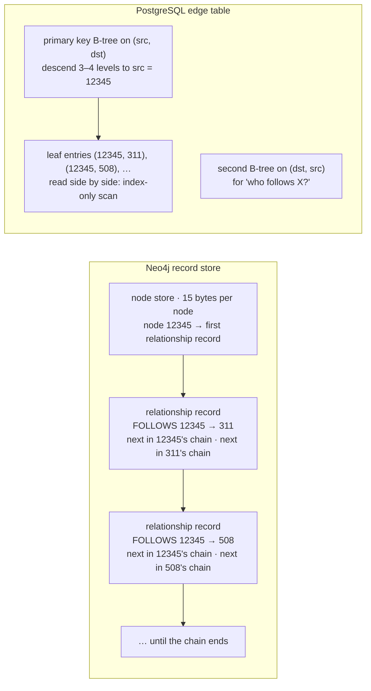

# M03 · Ch3 · §3 — Graph databases: Neo4j and PostgreSQL recursive queries

> **Module:** Databases & Storage (from first principles) > **Chapter:** Graph, document and key-value databases —
their data models and internal design, when each beats a > relational database, and the CAP (consistency,
availability, partition tolerance) trade-off > **Section:** A **graph database** stores relationships as first-class
records and is built to follow them many steps > deep: "who can this user reach in four hops?", "what is the shortest
chain between these two accounts?". **Neo4j** is > the best-known one. PostgreSQL can hold the same graph as an edge
table and walk it with a recursive query. This > section asks the question you will actually face: when does a graph
database beat an edge table, by how much, and > why? It measures storage, k-hop reach at depths 1 to 6, shortest
paths, accounts with very many followers, and > whole-graph questions on one graph of 1,000,000 users and 9,973,434
follow edges. Neo4j 2026.10.2 Community and > PostgreSQL 18.6 ran on one laptop; the scripts are committed in
`diagrams/03-graph-data/`. > **Status:** 🔵 PREPARED 2026-11-20 — body written, awaiting your read and the Q&A. >
**Prerequisites:** **Ch1 §3** (query plans, nested loop and hash joins), **Ch1 §4** (B-tree indexes), **Ch3 §1** >
(access-pattern-first design) and **Ch3 §2** (the "MongoDB, a `jsonb` column, or plain columns?" framing).

**Estimated study time:** 3 hours including the hands-on.

---

## Why this section exists — and how it's pitched

§1 and §2 ended in the same place: for most applications PostgreSQL already does the job, and a second store has to
earn its place with a measured limit. Graph databases are sold on the strongest claim of the three: that a relational
database *cannot* follow relationships many steps deep at reasonable speed, because every step is a join, and a graph
database can, because every step is a pointer. That claim has a real mechanism behind it. The measurements here show
how big the effect is, and which other effects are bigger:

- **On deep traversals Neo4j was faster, by a small factor, not by orders of magnitude.** Counting everyone a user can
  reach in six hops (about 360,000 users) took 245 ms in Neo4j and 380 ms in a PostgreSQL recursive query. At one to
  three hops PostgreSQL was faster, because each Neo4j call has a fixed cost of about 0.3 ms. The size of the answer
  dominated both: each extra hop multiplied the work by six to ten.
- **The algorithm mattered more than the storage.** Neo4j found a shortest path between two random users (median
  length 7) in 1.5 ms. PostgreSQL running the same algorithm, a search from both ends at once, took 9.8 ms. PostgreSQL
  searching from one end only took 2.7 seconds, because it had to explore most of the graph first.
- **The same graph as two arrays inside the application answered the six-hop question in 60 ms**, 4× faster than
  Neo4j, in 46 MB of memory. For analysis rather than serving, a graph library may beat both databases.

The pitch is the same as §1 and §2: inside each system first, then measurements, then a choosing table and the
failure modes.

---

## 1. The property graph model

<details>
<summary><b>Vocabulary for this section</b> — terms and abbreviations (click to expand)</summary>

**Abbreviations**

| Short | Stands for | Meaning |
|---|---|---|
| **GQL** | Graph Query Language | the ISO (International Organization for Standardization) standard query language for property graphs, ISO/IEC 39075:2024; Cypher is its main ancestor |
| **SQL/PGQ** | SQL Property Graph Queries | part 16 of the SQL standard (2023): declare a graph over existing tables and query it with `GRAPH_TABLE (… MATCH …)` |
| **RDF** | Resource Description Framework | the W3C (World Wide Web Consortium) graph model of subject–predicate–object triples, queried with SPARQL |
| **SPARQL** | SPARQL Protocol and RDF Query Language | the query language for RDF triple stores |
| **CTE** | common table expression | a named subquery in `WITH`; a *recursive* CTE can refer to itself (§3) |
| **ISO/IEC** | International Organization for Standardization / International Electrotechnical Commission | the joint body that publishes the SQL and GQL standards |

**Terms**

| Term | Definition |
|---|---|
| **Node** (vertex) | one entity in the graph, such as a user |
| **Relationship** (edge) | a typed, directed connection between two nodes, such as `FOLLOWS`; in a property graph it can carry properties |
| **Label** | a tag that groups nodes, such as `:User`; the counterpart of a table name |
| **Property** | a key-value pair on a node or relationship, such as `city: 7` |
| **Property graph** | the model used by Neo4j, GQL and SQL/PGQ: nodes and relationships, both with labels or types and properties |
| **Hop** | one step along one relationship |
| **k-hop neighbourhood** | every node reachable in at most $k$ hops from a starting node |
| **Traversal** | walking the graph from a starting node along relationships |
| **Cypher** | Neo4j's query language; patterns are drawn in ASCII, `(a)-[:FOLLOWS]->(b)` |
| **Edge table** | the relational form of a graph: one row per relationship, `(src, dst)` |
| **Adjacency list** | for each node, the list of its neighbours |

</details>

A graph database stores two kinds of record. A **node** is an entity: a user, a product, a document. A
**relationship** connects two nodes, has a type and a direction, and can carry properties of its own. Neo4j writes a
query as a picture of the pattern you want:

```cypher
// who does user 12345 follow, and who do they follow?
MATCH (me:User {id: 12345})-[:FOLLOWS]->(friend)-[:FOLLOWS]->(fof)
RETURN count(DISTINCT fof)
```

The same data in PostgreSQL is two tables, and the same question is a self-join:

```sql
CREATE TABLE users   (id bigint PRIMARY KEY, city int, age int);
CREATE TABLE follows (src bigint, dst bigint, PRIMARY KEY (src, dst));   -- one row per edge
CREATE INDEX ON follows (dst, src);                                      -- for "who follows X?"

SELECT count(DISTINCT f2.dst)
FROM follows f1 JOIN follows f2 ON f2.src = f1.dst
WHERE f1.src = 12345;
```

**Nothing about the data model is out of reach for SQL.** Two hops is one join; the question is what happens at six
hops, at "any number of hops", and on a shortest path, where the number of joins is not known when the query is
written. Those are the questions a graph database is built for.

**Table 1** — the question shapes, and which model they suit.

| Question shape | Example | Fits |
|---|---|---|
| Fixed depth, 1–2 hops | "who do I follow?", "orders of this customer" | any database; this is an ordinary join |
| Variable depth | "everyone within 4 hops", "all parts inside this assembly", "every manager above this employee" | graph database, or a recursive CTE |
| Path between two nodes | "how is A connected to B?", "shortest route" | graph database (it ships the algorithm) |
| Pattern matching | "accounts that share a device and a card with a flagged account" | graph database; SQL needs many self-joins |
| Whole-graph computation | PageRank, communities, centrality | a graph *algorithm* library, in memory (§6) |
| Aggregates over properties | "average age per city" | relational; the graph structure is not involved (§6) |

**Two graph models exist.** The **property graph** (Neo4j, Amazon Neptune's openCypher and Gremlin interfaces,
Memgraph, Apache AGE) is the one used for application data. **RDF** stores facts as subject–predicate–object triples
and is used for linked open data and ontologies (Wikidata, biomedical knowledge bases). This section covers property
graphs only.

**The query language is now standardized twice.** **GQL** (ISO/IEC 39075:2024) is a standalone graph query language,
largely Cypher. **SQL/PGQ** (ISO/IEC 9075-16:2023) lets a relational database declare a graph over its own tables and
query it with the same `MATCH` patterns inside `GRAPH_TABLE (…)`. Support for SQL/PGQ was committed to PostgreSQL's
development tree in March 2026; **the released PostgreSQL 19.0 does not have it** — `CREATE PROPERTY GRAPH` was a
syntax error in the `postgres:19` image tested on 2026-11-20. In PostgreSQL today, graph queries are written with
recursive CTEs, procedural code, or the Apache AGE extension (§7).

---

## 2. Storage inside: index-free adjacency against an edge table with two B-trees

<details>
<summary><b>Vocabulary for this section</b> — terms, abbreviations and symbols (click to expand)</summary>

**Abbreviations**

| Short | Stands for | Meaning |
|---|---|---|
| **ID** | identifier | here, a record's number in its store file |
| **MiB / MB** | mebibyte / megabyte | 1 MiB = 1,048,576 bytes; MB here = 1,000,000 bytes |
| **CSR** | compressed sparse row | a graph as two arrays: every node's neighbours stored contiguously, plus each node's start offset (§3) |

**Symbols used in the formulas**

| Symbol | Reads as | Meaning |
|---|---|---|
| $n$ | "n" | number of nodes (users), 1,000,000 here |
| $m$ | "m" | number of relationships (edges), 9,973,434 here |
| $d$ | "d" | a node's degree: how many relationships it has |
| $O(\log m)$ | "order log m" | cost that grows with the logarithm of the edge count: one B-tree descent |
| $O(d)$ | "order d" | cost proportional to the node's own degree, independent of the graph's size |

**Terms**

| Term | Definition |
|---|---|
| **Index-free adjacency** | each node record points directly at its relationships, and each relationship at its next one, so following an edge needs no index lookup |
| **Record store** | Neo4j's storage: fixed-size records in separate files for nodes, relationships and properties; a record's ID is its position in the file |
| **Relationship chain** | the linked list of one node's relationships; each relationship record sits in two chains, one for each end |
| **Dense node** | a node with many relationships; Neo4j groups its relationships by type and direction so a traversal can skip the irrelevant ones |
| **Index-only scan** | a PostgreSQL plan that answers from the index without visiting the table (Ch1 §4) |
| **Page cache** | Neo4j's in-memory cache of store-file pages (the counterpart of PostgreSQL's shared buffers) |

</details>

The difference between a graph database and an edge table is how the database finds a node's relationships.

<!-- DIAGRAM:START -->


<details>
<summary>Diagram source (Mermaid)</summary>



</details>
<!-- DIAGRAM:END -->

**Figure 1** — how each store finds user 12345's relationships. Neo4j starts at the node record and follows pointers
from one relationship record to the next; every pointer is a record number, so finding a record is arithmetic, not a
search. PostgreSQL descends a B-tree to the first entry for 12345 and reads the following entries, which sit next to
each other in the index. It needs a second B-tree to answer the reverse direction; Neo4j's relationship records sit in
both ends' chains.

So the cost of one hop differs in kind:

- **Neo4j: about $O(d)$.** Reach the node record by its ID (arithmetic), then follow the chain of its $d$
  relationships. The size of the whole graph does not appear. This is what **index-free adjacency** means.
- **PostgreSQL: about $O(\log m + d)$.** Descend the B-tree (3 to 4 pages for 10 million edges) to the first entry,
  then read $d$ entries side by side. The $\log m$ part grows slowly and its upper pages are always cached.

On paper that is the whole argument for a graph database. In practice the B-tree descent is a few cached page reads,
and the neighbours themselves are read the same way in both systems, so the expected difference is a constant factor,
not a different curve. §3 measures it.

**Table 2** — storage for the same graph (`footprint-out.txt`, `neo4j-store-out.txt`).

| | Neo4j 2026.10.2 (`record-aligned` format) | PostgreSQL 18.6 |
|---|---|---|
| Users | node store 15.0 MB (15 bytes per node) + property store 67.1 MB | `users`: 42.2 MiB of rows + primary key 21.4 MiB |
| Follow edges, stored once | relationship store 402.7 MB (about 40 bytes per edge as allocated) | `follows`: 421.2 MiB of rows (about 44 bytes each) |
| Out-edges by user | (the relationship chains above) | primary key `(src, dst)` 300.0 MiB |
| In-edges by user | (the same records: each sits in both ends' chains) | index `(dst, src)` 300.0 MiB |
| Lookup of a user by `id` | index 27.7 MB | (the primary key above) |
| **Total** | **514 MB** | **1,085 MiB (1,138 MB)** |

Two things to read off it:

- **PostgreSQL stores every edge three times**: once in the table and once in each of the two indexes a traversal
  needs. The table itself is never read by a traversal, because both indexes cover `(src, dst)`. PostgreSQL has no
  index-organized tables, so the table copy cannot be dropped; this is the normal shape.
- **Neo4j stores each edge once**, in a fixed-size record linked into both ends' chains. Its store was half the size.
  The import took 7 seconds for 10 million edges; PostgreSQL's `COPY` plus the two indexes took 7.3.

Two details matter later. A Neo4j node with many relationships (more than 50 by default) is a **dense node**: its
relationships are grouped by type and direction, and the group records keep counts, so "how many followers does X
have?" does not walk the chain (§6). And the graph only fits Neo4j's model this well because a `FOLLOWS` relationship
has no properties here; each property on a relationship is another record in the property store.

---

## 3. Traversal, measured: k-hop reach

<details>
<summary><b>Vocabulary for this section</b> — terms, abbreviations and symbols (click to expand)</summary>

**Abbreviations**

| Short | Stands for | Meaning |
|---|---|---|
| **CTE** | common table expression | a named subquery in `WITH`; `WITH RECURSIVE` lets it refer to itself |
| **BFS** | breadth-first search | explore all nodes 1 hop away, then all 2 hops away, and so on, remembering which were already seen |
| **PL/pgSQL** | Procedural Language/PostgreSQL | PostgreSQL's built-in language for functions with loops and variables |
| **CSR** | compressed sparse row | the graph as two arrays (see Terms) |
| **p50 / p99** | 50th / 99th percentile | the median latency, and the latency 99% of calls beat |
| **ms / µs** | millisecond / microsecond | thousandth / millionth of a second |

**Symbols used in the formulas**

| Symbol | Reads as | Meaning |
|---|---|---|
| $k$ | "k" | the number of hops in the question |
| $\bar{d}$ | "d-bar" | average out-degree: follows per user, about 10 here |

**Terms**

| Term | Definition |
|---|---|
| **Anchor / recursive term** | the two halves of a recursive CTE: the starting rows, and the query that produces the next rows from the previous ones |
| **Working table** | PostgreSQL's buffer of the rows the previous iteration produced; each iteration joins only those |
| **`UNION` vs `UNION ALL`** | in a recursive CTE, `UNION` discards rows identical to any row already produced; `UNION ALL` keeps every row |
| **Visited set** | the nodes a search has already reached, so it does not expand them twice |
| **Path enumeration** | producing one result row per distinct path, rather than one per distinct node |
| **Pruning BFS** | Neo4j's plan for a variable-length pattern whose result only needs distinct end nodes: it does not expand a node it has already reached |
| **db hits** | Neo4j's work counter: storage operations a query performed |
| **Buffers (shared hit)** | PostgreSQL's work counter: 8 KB pages a query touched in its cache |
| **CSR** | two arrays: `col` holds every node's neighbours back to back, `indptr[u]` is where node $u$'s neighbours start |

</details>

**The test graph** (`common.py`, `graph-out.txt`): 1,000,000 users, each following about 10 others ($\bar{d}$ = 9.97,
at most 28). Half of each user's follows go to a popular account chosen with heavily skewed weights, half to a random
user in the same city. The result looks like a social network: the median user has 7 followers, the 99th percentile
47, and the most-followed account 151,514.

**The question:** how many distinct users can user $X$ reach in at most $k$ hops along follows? It was asked for 20
random users and $k$ from 1 to 6, in five ways (`reach_bench.py`):

- **Neo4j**: `MATCH (a:User {id: $id})-[:FOLLOWS*1..k]->(b) WHERE b <> a RETURN count(DISTINCT b)`.
- **PostgreSQL, recursive CTE**, the standard SQL way:

  ```sql
  WITH RECURSIVE r(id, d) AS (
      SELECT 12345::bigint, 0                                   -- anchor: the start, at depth 0
    UNION                                                       -- drop rows already produced
      SELECT f.dst, r.d + 1                                     -- recursive term: one more hop
      FROM r JOIN follows f ON f.src = r.id
      WHERE r.d < 6
  ) SELECT count(DISTINCT id) - 1 FROM r;
  ```

- **PostgreSQL, PL/pgSQL BFS** (`pg_functions.sql`): a loop, one level per iteration, with the visited set in a
  temporary table.
- **Path enumeration** in both (Neo4j `count(b)` without `DISTINCT`; the CTE with `UNION ALL`), to show what not
  deduplicating costs.
- **CSR in the application**: the whole graph as two numpy arrays in the Python process, and a BFS over them.


**Figure 2** — k-hop reach from 20 random users: (a) how many distinct users the answer contains; (b) p50 latency of
each method (`reach-bench.csv`). All methods returned identical counts.

**Table 3** — three depths: p50 over 20 starts; work counters for one start (`reach-out.txt`).

| Hops | Users reached | Neo4j p50 · db hits | PostgreSQL CTE p50 · rows produced · buffers | PL/pgSQL BFS p50 | CSR p50 |
|---|---|---|---|---|---|
| 3 | 918 | 0.91 ms · 1,574 | 0.55 ms · 812 · 283 | 3.9 ms | 0.37 ms |
| 5 | 62,064 | 30 ms · 134,986 | 46 ms · 57,131 · 23,256 | 116 ms | 7.2 ms |
| 6 | 359,596 | 245 ms | 380 ms | 819 ms | 60 ms |

Reading Figure 2 and Table 3:

- **The size of the answer decides the cost.** Every method's line in panel (b) has the shape of panel (a): each hop
  multiplied the users reached by 6 to 10, and the time by about the same. Six hops from an ordinary user touched more
  than a third of the whole graph. "Friends of friends of friends of …" stops being a lookup and becomes a scan of the
  graph somewhere around four hops on a network shaped like this one.
- **Neo4j's advantage appears only where the work is large, and it is about 1.5×.** At one to three hops PostgreSQL's
  recursive CTE was faster, because a Neo4j call carries a fixed cost: an empty `RETURN 1` took 0.34 ms against 0.041
  ms for PostgreSQL's `SELECT 1` (`reach-out.txt`). At five and six hops, where hundreds of thousands of edges are
  followed, index-free adjacency paid off: 30 against 46 ms, 245 against 380 ms. That is the measured size of the
  "pointer instead of join" claim on a graph whose indexes fit in memory.
- **Both stores used the same algorithm, BFS.** Neo4j's plan was `VarLengthExpand(Pruning,BFS,All)`: because the query
  asked only for distinct end nodes, the planner switched from enumerating paths to a breadth-first search that skips
  nodes already reached. PostgreSQL's CTE expanded level by level through the working table, probing the `(src, dst)`
  index once per node (`Index Only Scan … loops=7142` at five hops).
- **The CSR arrays were 4× faster than Neo4j at six hops**, in 46 MB (`indptr` 7.6 MiB, `col` 38.0 MiB). No database
  stores a graph more compactly than "every node's neighbours, contiguous". If the graph fits in memory and the
  question is analysis rather than many concurrent users, a graph library over arrays (NetworkX for convenience,
  igraph, graph-tool or `scipy.sparse.csgraph` for speed) is the fast option (§6).

### Why the recursive CTE dedupes per level, not globally

The CTE's `UNION` throws away a row only if the *same row* was produced before. The row is `(id, d)`, so a user
reached at depth 2 and again at depth 4 is two different rows and gets expanded twice. The CTE cannot hold a visited
set across depths: in PostgreSQL the recursive term sees only the previous iteration's rows (the working table), and
referring to the CTE a second time, for example in `NOT EXISTS (SELECT 1 FROM r …)`, is rejected with *recursive
reference to query "r" must not appear within a subquery*. On this graph that cost little (the profiled start
produced 57,131 `(id, depth)` rows at five hops, about one per user reached, because few users are reached at two
different depths), but on a dense, clustered graph the same user is reached at many depths and the work multiplies.
Drop the depth column and `UNION` becomes a true visited set, but then the query cannot stop at $k$ hops; it returns
everything reachable.

Path enumeration (`UNION ALL`, or Cypher without `DISTINCT`) produced 1,030,513 rows at six hops for 359,596 users:
2.9× the rows and about 1.45× the time (`reach-out.txt`). The gap is small here because this graph has few closed
triangles, so paths rarely reconverge. It is not small on a clustered graph; §5 gives the arithmetic.

### The trap that turned one second into 49 minutes

The PL/pgSQL BFS is the obvious way to give PostgreSQL a real visited set: a loop, a temporary table of seen users,
one `INSERT … SELECT` per level. Its first version ran six hops in 0.8 s, and at seven hops one call was **still
running after 49 minutes** when it was stopped. The cause was one step of the loop:

```sql
INSERT INTO bfs_next
  SELECT DISTINCT f.dst FROM bfs_frontier fr JOIN follows f ON f.src = fr.id
  WHERE NOT EXISTS (SELECT 1 FROM bfs_seen s WHERE s.id = f.dst);
```

At depth 7 the frontier held 288,987 users and the visited set 348,006. The planner estimated that the anti-join of
all 10 million edges against the visited set would leave **1 row**, so it put it on the outer side of a nested loop
and scanned the whole frontier once per row. It produced millions of rows, each rescanning 288,987 frontier rows.
Re-analyzing the temporary tables did not change the estimate. Forcing the order fixed it: expand the frontier first
in a `MATERIALIZED` CTE, then remove visited users. Seven hops then took 4.5 s, and eight hops 7.4 s
(`pg_functions.sql`). This is Ch1 §3's lesson in a new place: **a hand-written graph search in SQL is only as good as
the planner's estimates for a temporary table whose size changes 10× per iteration**, and those estimates are poor.
A graph database's traversal operator has no such estimate to get wrong.

---

## 4. Shortest paths: the algorithm matters more than the store

<details>
<summary><b>Vocabulary for this section</b> — terms and abbreviations (click to expand)</summary>

**Abbreviations**

| Short | Stands for | Meaning |
|---|---|---|
| **BFS** | breadth-first search | level-by-level search with a visited set (§3) |
| **CTE** | common table expression | `WITH RECURSIVE` query (§3) |
| **PL/pgSQL** | Procedural Language/PostgreSQL | PostgreSQL's procedural function language |

**Terms**

| Term | Definition |
|---|---|
| **Shortest path** | the path with the fewest hops between two nodes (unweighted here) |
| **Bidirectional BFS** | search forward from the start and backward from the target at the same time, always expanding the smaller frontier, and stop when they meet |
| **Frontier** | the nodes reached at the latest level, to be expanded next |
| **`SHORTEST 1`** | GQL / Cypher path selector: return one shortest path per start and end pair |
| **`ShortestPath` / `StatefulShortestPath`** | Neo4j plan operators for shortest-path queries (the first is the one this section's plan used); between two known nodes they search from both ends |

</details>

The question: what is the length of the shortest chain of follows from user $A$ to user $B$? Thirty random pairs, all
connected; the median shortest path was 7 hops, the range 5 to 8 (`path-out.txt`).

**Table 4** — shortest path between two random users (`path_bench.py`, `path-out.txt`).

| Method | p50 | p99 | What it does |
|---|---|---|---|
| Neo4j `MATCH p = SHORTEST 1 (a)-[:FOLLOWS]->+(b) RETURN length(p)` | **1.5 ms** | 3.4 ms | bidirectional BFS inside the engine; 5,063 db hits for the profiled pair |
| PostgreSQL PL/pgSQL, bidirectional BFS (`bibfs_path_len`) | **9.8 ms** | 21.9 ms | the same algorithm, one SQL statement per level |
| PostgreSQL PL/pgSQL, BFS from $A$ only (`bfs_path_len`) | **2,671 ms** | 6,709 ms | expands from one end until it reaches $B$ |
| PostgreSQL recursive CTE, depth limit set to the known answer | 2,840 ms (median of 5 pairs) | — | cannot stop when it finds $B$; expands to the depth limit |

What it shows:

- **Searching from both ends is what makes shortest paths cheap.** From one end, a 7-hop path means expanding 6 levels
  of a frontier that grows 6–10× per level: most of the graph (Figure 2a). From both ends, each side goes about 3 to 4
  levels and the two frontiers meet in the middle: a few thousand users per side instead of hundreds of thousands.
  That changed PostgreSQL's time by 270×, without changing the storage.
- **With the same algorithm, Neo4j was 7× faster.** That gap is the per-statement cost of running BFS as a loop of
  SQL statements (each level is an `INSERT … SELECT` with its own planning and a temporary table) against one operator
  that keeps its frontier in memory. It is real, and it is a property of running graph algorithms *inside* the
  database engine, not of the record format.
- **The recursive CTE is the wrong tool for this question.** It has no way to stop when it reaches $B$: it expands
  every path to the depth limit and then filters. Even with the depth limit set to the known answer, it was as slow
  as the one-directional search.

Neo4j's documentation describes its shortest-path operator between two bound nodes as a bidirectional breadth-first
search. The profiled plan here used the `ShortestPath` operator and 5,063 db hits, against the hundreds of thousands
of users a one-directional search visits. When the pattern has predicates that can only be checked on a whole path,
Neo4j may have to fall back to exhaustive search, which can be as slow as path enumeration; `PROFILE` shows which one
ran.

---

## 5. Supernodes and path explosion

<details>
<summary><b>Vocabulary for this section</b> — terms (click to expand)</summary>

**Terms**

| Term | Definition |
|---|---|
| **Supernode** | a node with a very large number of relationships (here, the account with 151,514 followers); any traversal that passes through it fans out to all of them |
| **Fan-out** | the number of rows one step produces per input row |
| **Co-followers** | other users who follow at least one account I follow; the first step of "people like you" recommendations |
| **Path explosion** | the number of distinct paths growing much faster than the number of distinct nodes, because many paths lead to the same nodes |
| **Trail / walk** | a trail never reuses a relationship (Cypher's default for variable-length patterns); a walk may (a `UNION ALL` CTE produces walks) |

</details>

The reach question in §3 followed edges *outwards*, and everyone follows at most 28 accounts, so the fan-out per hop
was bounded. Real graph questions often go the other way, and then a few nodes dominate.

**Table 5** — two question shapes that pass through popular accounts (`shape_bench.py`, `shape-out.txt`).

| Question | Start users | Answer (median) | Neo4j p50 | PostgreSQL p50 |
|---|---|---|---|---|
| **Co-followers**, start follows only accounts with at most 1,000 followers | 20 | 187 users | 0.82 ms | 0.21 ms |
| **Co-followers**, start follows the top account (151,514 followers) | 20 | 160,164 users | 52 ms · 213,178 db hits | 18 ms |
| Reach in 3 hops **along** follows (§3, for comparison) | 20 | 918 users | 0.91 ms | 0.55 ms |
| Reach in 3 hops **ignoring direction** | 1 | 320,106 users; 558,811 trails | 272 ms (one run, distinct) | 135 ms (one run, all walks) |

What it shows:

- **Following one popular account multiplied the answer by 850 and the time by 60 to 90, in both stores.** The
  co-follower query goes out one hop and then *in* one hop, and the in-hop of a celebrity is its 151,514 followers.
  This is a property of the data, not of the engine: no storage layout makes 151,514 rows cheap to produce. Neo4j
  walked the dense node's relationships (213,178 db hits); PostgreSQL read the `(dst, src)` index range for that
  account and aggregated with a hash. PostgreSQL was faster here, because the work was one long index range plus a
  `DISTINCT`, which is what a relational engine is built for.
- **Ignoring direction, three hops from an ordinary user reached 32% of the graph.** Along follows, three hops reached
  918 users. Without direction, the second hop already reaches some popular account (anyone near you follows one), and
  the third hop fans out to all of its followers. Social graphs have a small diameter because of these hubs, and any
  traversal that can step *into* a hub inherits it.
- **Paths outnumbered users by only 1.7× here.** This graph has few triangles: the people you follow rarely follow
  each other. Path explosion needs reconverging paths. In a group of 50 accounts that all follow each other, one
  member has 49 one-hop paths, $49 \times 48 = 2{,}352$ two-hop trails and $49 \times 48 \times 47 = 110{,}544$
  three-hop trails, all ending on the same 49 people. Each hop multiplies the paths by the group size while the
  distinct answer stays at 49. Real graphs with dense clusters (co-authorship, a company's org chart plus its project
  teams, fraud rings) behave like that locally, so ask for distinct end nodes (§3) unless you really need every path.

**How supernodes are handled in practice.** Cap the fan-out at the hub (sample at most $N$ of its followers), skip it
(exclude accounts above a degree threshold from "people you may know"), or precompute (keep a follower count as a
property and never expand the hub at query time). It is the same problem as Ch3 §1's hot partition: one key that
receives a disproportionate share of the work.

---

## 6. Whole-graph questions and graph algorithms

<details>
<summary><b>Vocabulary for this section</b> — terms and abbreviations (click to expand)</summary>

**Abbreviations**

| Short | Stands for | Meaning |
|---|---|---|
| **OLTP** | online transaction processing | many small, concurrent queries, each touching little data |
| **OLAP** | online analytical processing | few large queries over much of the data |
| **GDS** | Graph Data Science | Neo4j's library of graph algorithms (PageRank, community detection, similarity), run on an in-memory projection of the graph |

**Terms**

| Term | Definition |
|---|---|
| **Graph algorithm** | a computation over the whole graph's structure, such as PageRank (importance), connected components or community detection |
| **PageRank** | a score for each node from how many nodes link to it and how important those are; the original Google ranking |
| **Projection** | a copy of (part of) the graph in a compact in-memory layout, built for running algorithms |
| **Degree** | number of relationships of a node; in-degree counts incoming ones (followers) |
| **Parallel sequential scan** | PostgreSQL reading a table with several worker processes at once (Ch1 §3) |

</details>

A graph database is organized around following relationships from a starting point. Questions that have no starting
point, which read every node or every edge, go through the same machinery, and the relational engine is built for
them.

**Table 6** — questions over the whole graph (`shape-out.txt`).

| Question | Neo4j p50 | PostgreSQL p50 | What each did |
|---|---|---|---|
| Average age per city: read one property of all 1,000,000 users | 200 ms | **35 ms** | Neo4j: scan the `:User` label, read each node's property records; PostgreSQL: parallel scan of a 42 MiB table |
| Ten most-followed users | 1,735 ms | 1,616 ms | Neo4j: compute the in-degree of every node (from group counts on dense nodes, by walking the chain on the rest); PostgreSQL: group 10 million rows of `follows` by `dst` |
| Count all follow edges | **0.7 ms** | 86 ms | Neo4j: read the count it keeps per relationship type; PostgreSQL: scan the table (under MVCC — multi-version concurrency control, Ch2 §3 — each transaction may see a different count, so it keeps none) |

Three different results for three reasons:

- **Scanning properties favours the relational engine** (5.8× here). A table stores a row's columns together and scans
  in parallel; Neo4j reaches each property through the node's property chain, on one thread per query.
- **"Most-followed" cost about the same in both**, because both had to look at all 10 million edges in some form. In a
  real application neither would compute it at query time: keep a `followers_count` column or property, update it on
  each follow, and the question becomes an index lookup in either store.
- **Neo4j answers some global counts from metadata.** It maintains counts per label and per relationship type, so
  `count(r)` over all `FOLLOWS` costs nothing. This is a convenience for dashboards, not a general advantage: it only
  works for counts with no condition.

**Graph algorithms are a separate job.** PageRank, community detection and centrality read the whole graph many times.
Neo4j's answer is the Graph Data Science library, which first copies the graph into an in-memory projection, a compact
array layout much like the CSR arrays of §3, and runs the algorithm there. The same is true of every serious graph
analytics tool: NetworkX, igraph, graph-tool, Spark GraphFrames. So for **analysis** the storage engine is not where
the work happens; export the edges (from either database), build arrays, run the algorithm. For **serving** many
users' traversal queries concurrently, a database is still the right home.

---

## 7. Choosing: an edge table, a graph database, or arrays in memory

<details>
<summary><b>Vocabulary for this section</b> — terms and abbreviations (click to expand)</summary>

**Abbreviations**

| Short | Stands for | Meaning |
|---|---|---|
| **AGE** | A Graph Extension | Apache AGE, a PostgreSQL extension that adds openCypher queries over graphs stored in PostgreSQL tables |
| **TAO** | The Associations and Objects | Facebook's system that serves its social graph, on top of sharded MySQL |
| **RAG** | retrieval-augmented generation | giving a large language model (LLM) retrieved documents as context (M13 Ch2) |
| **LLM** | large language model | a model such as Claude or GPT |
| **GPL** | GNU General Public License | the open-source licence of Neo4j Community Edition (version 3) |
| **RDS** | Relational Database Service | AWS's managed PostgreSQL and other relational databases |

**Terms**

| Term | Definition |
|---|---|
| **Amazon Neptune** | AWS's managed graph database; queried with openCypher, Gremlin or SPARQL |
| **openCypher** | the open specification of the Cypher language, implemented by several databases |
| **Gremlin** | the Apache TinkerPop graph traversal language, written as a chain of steps |
| **GraphRAG** | RAG that first extracts entities and relationships from documents into a graph, then retrieves over that graph |
| **Knowledge graph** | a graph of entities and the facts relating them |
| **Closure table** | a relational pattern that stores every ancestor–descendant pair of a tree, so "all descendants" is one indexed lookup |
| **`ltree`** | a PostgreSQL extension storing a tree path (`top.science.physics`) in one column, indexable |

</details>

Your default, as in §1 and §2, is PostgreSQL. The useful question is which shape the graph questions have.

**Table 7** — which tool for which graph workload.

| The workload | Use | Why (evidence) |
|---|---|---|
| Relationships queried 1–2 hops deep: followers, friends, "orders of this customer" | **edge table** in PostgreSQL with both indexes | a join; PostgreSQL was faster at 1–3 hops (Figure 2) |
| Trees and hierarchies: categories, org charts, comment threads, bill of materials | **edge table + recursive CTE**, or `ltree` / a closure table if reads dominate | depth is small and there are no cycles; the CTE's weaknesses (§3) do not apply |
| Deep or unbounded traversal and shortest paths, served to many users | **graph database** (Neo4j, Amazon Neptune, Memgraph) | bidirectional BFS in the engine: 1.5 ms against 9.8 ms hand-written (Table 4); pruning BFS without planner traps (§3) |
| Pattern matching across many relationship types: fraud rings, network and access-permission analysis, supply chains | **graph database** | the query is a picture of the pattern; the SQL is a long chain of self-joins |
| Whole-graph analytics: PageRank, communities, similarity | **arrays in memory** (NetworkX, igraph, `scipy.sparse.csgraph`), or Neo4j GDS if the data already lives in Neo4j | every serious tool copies the graph into arrays first (§6); CSR beat Neo4j 4× (Figure 2) |
| Graph queries in PostgreSQL without a second system | **Apache AGE** (openCypher inside PostgreSQL), or SQL/PGQ when your PostgreSQL version ships it | still edge tables underneath: the convenience of Cypher, not index-free adjacency |
| A knowledge graph for RAG | start with **tables or files**; add a graph database when traversal queries are the product | the extraction step, not storage, is the hard part (below) |

**What a graph database gives you that an edge table does not**, from this section's evidence:

1. **Graph algorithms in the engine**: shortest paths and pruning BFS as single operators, with no planner estimates
   to go wrong (Table 4, §3's 49-minute trap).
2. **A query language shaped like the question.** A six-hop pattern with conditions on each step is one line of
   Cypher.
3. **A constant-factor speed-up on traversals that touch much of the graph** (about 1.5× here), and half the
   storage (Table 2).

**What an edge table gives you that a graph database does not:**

1. **Everything else in the same database**: users, orders and permissions in the same transactions, joins and
   constraints as the edges.
2. **Fast scans over properties** (Table 6) and a lower fixed cost per query (0.041 against 0.34 ms).
3. **One system** to back up, secure and operate. Neo4j Community Edition (GPL v3) is a single server; clustering and
   online backup are in the commercial Enterprise Edition or the managed Aura service.

**Public examples.** **Facebook's social graph**, perhaps the largest graph served online, is stored in **sharded
MySQL**. Its serving system TAO (2013) is a graph-aware cache with a nodes-and-edges API in front of one table of
objects and one table of associations per shard. The graph model sits in the API and the cache, not the storage
engine. Fraud detection and identity resolution in banking, and network and information technology (IT) dependency
analysis, are the commonly cited production uses of Neo4j and Neptune: workloads built on multi-hop pattern queries.
**GraphRAG** systems extract entities and relationships from documents with an LLM and retrieve over the resulting
graph; Microsoft's open-source GraphRAG writes its graph to Parquet files and runs community detection in memory. A
graph database becomes useful there only when the application issues traversal queries against the graph at serving
time.

---

## 8. Failure modes — the graph checklist

<details>
<summary><b>Vocabulary for this section</b> — terms and abbreviations (click to expand)</summary>

**Abbreviations**

| Short | Stands for | Meaning |
|---|---|---|
| **CTE** | common table expression | `WITH RECURSIVE` query (§3) |
| **BFS** | breadth-first search | level-by-level search with a visited set (§3) |

**Terms**

| Term | Definition |
|---|---|
| **Unbounded pattern** | a variable-length pattern with no upper limit on hops, such as `-[:FOLLOWS*]->` |
| **Cycle** | a path that returns to a node it has already visited |
| **Supernode** | a node with very many relationships (§5) |

</details>

- **The answer is most of the graph.** Six hops from an ordinary user reached 36% of all users (Figure 2a). Put an
  upper bound on every variable-length pattern, and decide what a "reasonable" depth is from the graph's degree, not
  from the product requirement.
- **Counting paths when you meant nodes.** Cypher without `DISTINCT`, or a CTE with `UNION ALL`, enumerates paths; on
  a clustered graph where paths reconverge, that grows by about the group size per hop (§5). Ask for distinct end
  nodes, and check the plan says `Pruning`.
- **A cycle that never ends.** A recursive CTE with `UNION ALL` and no depth limit loops forever on a cyclic graph.
  Use a depth limit, `UNION` on the node alone, or PostgreSQL's `CYCLE` clause.
- **Counting the start node.** `(a)-[*1..k]->(b)` can end at `a` itself through a cycle; this section's first run was
  off by one for exactly that reason. Add `WHERE b <> a`.
- **A supernode in the middle of a traversal.** Following one celebrity turned a 187-user answer into 160,164 (§5), in
  both stores.
  Know your top degrees; cap or sample at the supernode, or model the relationship differently (Ch3 §1's hot partition
  in another form).
- **A hand-written BFS at the mercy of the planner.** Temporary tables that grow 10× per iteration get bad estimates;
  one turned a 1-second search into 49 minutes (§3). Force the join order or move the loop out of SQL.
- **Searching from one end.** A shortest path from one end explores most of the graph; from both ends, a few thousand
  nodes (Table 4).
- **A second database for 1–2 hop questions.** If the graph questions are joins, the edge table is faster and is
  already in your transactions (Figure 2, Table 7).

---

## 9. Check your understanding

1. In Table 2 PostgreSQL used 1,085 MiB for a graph that Neo4j stored in 514 MB. Where does PostgreSQL's extra space
   go, and why does a traversal never read the `follows` table itself?
2. Explain "index-free adjacency" in one sentence, and give the cost of one hop in each store in terms of $d$ and $m$.
   Why was the measured difference a factor of 1.2 to 1.6 and not more?
3. At $k$ = 1 to 3, PostgreSQL's recursive CTE was faster than Neo4j. Give the reason, with the number that shows it.
4. At five hops the reach was 62,064 users; at six, 359,596. Using Figure 2, estimate what seven hops would return and
   what it would cost in Neo4j. What does that imply for a feature that shows "people within 7 hops"?
5. A colleague writes the k-hop reach as a recursive CTE with `UNION ALL` and gets the right answer by wrapping it in
   `count(DISTINCT id)`. What is wrong with that, and on what kind of graph does it become a serious problem?
6. Why can a recursive CTE not keep a global visited set while also stopping at depth $k$? What are the two ways
   around it in PostgreSQL?
7. A PL/pgSQL BFS runs in under a second at six hops and does not finish at seven. Without looking at §3, what would
   you check first, and what command would show it?
8. Table 4: the same bidirectional BFS took 1.5 ms in Neo4j and 9.8 ms in PostgreSQL, and one-directional BFS in
   PostgreSQL took 2.7 s. Which gap is caused by storage, which by algorithm, and which by where the algorithm runs?
9. A "people you may know" feature counts co-followers: users who follow at least one account I follow. Why does its
   latency depend on whom I follow, and what would you change? (Use Table 5.)
10. A product team wants Neo4j for user → team → project permissions, two hops deep, beside an existing PostgreSQL
    database. What would you ask, and what would you propose?
11. Name one workload where you would choose a graph database over an edge table, and say which measurement or
    mechanism in this section supports it.
12. You are building GraphRAG over 50,000 internal documents. Which parts of the pipeline need a graph database, if
    any? Where would you store the graph first?

<details>
<summary>Answers</summary>

1. **In two extra copies of every edge.** PostgreSQL keeps the `follows` table (421 MiB) plus a B-tree on `(src, dst)`
   for out-edges and one on `(dst, src)` for in-edges (300 MiB each). Both indexes contain both columns, so a
   traversal is answered by index-only scans and never visits the table. Neo4j stores each edge once, in a fixed-size
   record linked into both ends' chains (§2, Table 2).
2. **Each node points directly at its relationships, so following an edge needs no index search.** One hop costs about
   $O(d)$ in Neo4j and $O(\log m + d)$ in PostgreSQL. The $\log m$ part is 3 to 4 B-tree pages whose upper levels are
   always cached, and the $d$ neighbours are read sequentially in both systems, so the difference is a constant
   factor: about 1.5× at five and six hops (§2, §3).
3. **Fixed cost per call.** An empty query took 0.34 ms in Neo4j and 0.041 ms in PostgreSQL. At one to three hops the
   traversal itself costs less than that difference, so PostgreSQL's 0.08–0.55 ms beat Neo4j's 0.40–0.91 ms (§3,
   Figure 2).
4. **About 900,000 users, most of the graph, and over a second.** Each hop multiplied the answer by about 6 at the
   fifth and sixth hops and the time by about 8; the answer is capped at 1,000,000 users, and PostgreSQL's BFS reached
   897,650 at seven hops for one start (§3). A "within 7 hops" feature means "almost everyone" on a social graph, at
   whole-graph cost per request. Cap the depth at 2 or 3, or precompute.
5. **It enumerates every path, then deduplicates.** The answer is right, but the work is proportional to the number
   of paths, not users. On this graph that was 2.9× the rows at six hops; on a clustered graph, where paths
   reconverge, it multiplies by roughly the cluster size per hop (§3, §5). Use `UNION` on `(id, depth)` with a depth
   limit, or a BFS with a visited set.
6. **The recursive term can only see the previous iteration's rows.** A global visited set would need to read all
   rows produced so far, which SQL does not allow. Carrying the depth column makes "same user, different depth" a new
   row. Ways around it: a CTE that dedupes on the node alone and has no depth limit (full reachability), or a
   procedural BFS with a visited table (PL/pgSQL, or a loop in the application) (§3).
7. **The plan of the expansion step at the failing depth.** Run `EXPLAIN` on the step's `SELECT` against the temporary
   tables as they are at that depth and look for a tiny row estimate on a large input feeding a nested loop. The fix
   is to force the order: expand in a `MATERIALIZED` CTE, then filter (§3, the 49-minute trap).
8. **None of the three is storage alone.** One-directional (2.7 s) against bidirectional (9.8 ms) in PostgreSQL is
   the *algorithm*: 270×. PostgreSQL's 9.8 ms against Neo4j's 1.5 ms with the same algorithm is mainly *where it
   runs*: one SQL statement with planning and temporary tables per level, against an in-memory operator; index-free
   adjacency contributes a part of that 7× at most (§4, Table 4).
9. **Because a popular account's followers are all co-followers.** Following only small accounts gave 187 co-followers
   in 0.2–0.8 ms; following the top account gave 160,164 in 18–52 ms. Exclude or sample accounts above a follower
   threshold, cap the fan-out per account, or precompute the candidates offline (§5, Table 5).
10. **Ask what Neo4j gives a two-hop question.** Two hops is one join, and PostgreSQL was faster at 1–3 hops
    (Figure 2); permissions also need to be in the same transactions as the users and projects they protect. Propose
    tables in the existing PostgreSQL with both indexes on the membership tables, and a recursive CTE if teams nest
    (§7, Table 7).
11. **A defensible case: shortest paths or deep pattern queries served to many users**, such as "how is this account
    connected to known fraud?" within 6 hops on every transaction. Supported by Table 4 (bidirectional BFS in the
    engine, 1.5 ms against 9.8 ms hand-written and 2.7 s naive) and §3's planner trap, which a graph engine cannot
    fall into. A weak case: "we have relationships" (every database does) (§7).
12. **Probably none at first.** The expensive part of GraphRAG is extracting entities and relationships with an LLM;
    community detection and summarization run in memory over arrays. Store the extracted nodes and edges as tables
    (or Parquet files, as Microsoft's GraphRAG does), and add a graph database only if the application issues
    multi-hop traversal queries at serving time (§6, §7).

</details>

---

## 10. Optional: get your hands dirty (60 min)

Generate the graph and start both servers (the same images and settings as the measurements):

```bash
python -m venv .venv && .venv/bin/pip install neo4j psycopg[binary] numpy matplotlib
cd diagrams/03-graph-data && GRAPH_DATA_DIR=/tmp/graph-csv ../../.venv/bin/python common.py   # about 15 s
docker volume create graph-neo4j-data
docker run --rm -v graph-neo4j-data:/data -v /tmp/graph-csv:/import:ro neo4j:community \
  neo4j-admin database import full neo4j --id-type=integer \
  --nodes=User=/import/users.csv --relationships=FOLLOWS=/import/follows.csv
docker run -d --name graph-neo4j -p 57687:7687 -p 57474:7474 -v graph-neo4j-data:/data -e NEO4J_AUTH=none \
  -e NEO4J_server_memory_pagecache_size=1G -e NEO4J_server_memory_heap_max__size=1G neo4j:community
docker run -d --name graph-pg -p 55434:5432 -e POSTGRES_PASSWORD=pg -v /tmp/graph-csv:/import:ro \
  postgres:18 -c shared_buffers=1GB -c max_wal_size=8GB
sleep 20 && ../../.venv/bin/python load_footprint.py
docker exec -i graph-pg psql -U postgres < pg_functions.sql
```

Neo4j Browser is at <http://localhost:57474> (no password).

**1. Read both plans.** In Neo4j Browser run
`PROFILE MATCH (a:User {id: 12345})-[:FOLLOWS*1..4]->(b) WHERE b <> a RETURN count(DISTINCT b)`, then the same with
`count(b)`. Which operator changed, and how many db hits did each use? In `psql`, run the §3 CTE under
`EXPLAIN (ANALYZE, BUFFERS)` and find the `loops=` count on the index scan.

**2. Find the supernode yourself.** In Cypher:
`MATCH (u:User) RETURN u.id, COUNT { (u)<-[:FOLLOWS]-() } AS followers ORDER BY followers DESC LIMIT 5`. Then ask the
co-follower question of §5 for a user who follows the top account, with and without `PROFILE`.

**3. Break the BFS.** In `pg_functions.sql`, replace the `MATERIALIZED` step in `bfs_reach` with the one-join version
quoted in §3, reload, and run `SELECT bfs_reach(12345, 7)` with `SET statement_timeout = '60s'`. Then run
`EXPLAIN` on that statement against tables at depth 7 (the loop in §3) and find the 1-row estimate.

**4. Shortest path both ways.** Time `SELECT bfs_path_len(1, 2, 12)` and `SELECT bibfs_path_len(1, 2, 12)`; then in
Cypher `PROFILE MATCH p = SHORTEST 1 (a:User {id: 1})-[:FOLLOWS]->+(b:User {id: 2}) RETURN length(p)`.

**5. Arrays.** Run `reach_bench.py`'s `csr_arrays()` in a Python shell and time `csr_reach(indptr, col, 12345, 6)`.
Then try `scipy.sparse.csgraph.breadth_first_order` on the same arrays.

When you are done: `docker rm -f graph-neo4j graph-pg && docker volume rm graph-neo4j-data`.

---

## Key terms (English · 大陆 简体 · 台灣 繁體)

| English | 大陆 (简体) | 台灣 (繁體) | Note |
|---|---|---|---|
| Graph database | 图数据库 | 圖形資料庫 / 圖資料庫 | ⚠ 数据库 ↔ **資料庫** |
| Node / vertex | 节点 / 顶点 | 節點 / 頂點 | |
| Edge / relationship | 边 / 关系 | 邊 / 關係 | |
| Property graph | 属性图 | 屬性圖 | |
| Label | 标签 | 標籤 | |
| Adjacency list | 邻接表 | 鄰接串列 | ⚠ 表 ↔ **串列** |
| Index-free adjacency | 免索引邻接 | 免索引鄰接 | |
| Traversal | 遍历 | 走訪 / 遍歷 | ⚠ 遍历 ↔ **走訪** |
| Breadth-first search | 广度优先搜索 | 廣度優先搜尋 | ⚠ 搜索 ↔ **搜尋** |
| Shortest path | 最短路径 | 最短路徑 | |
| Recursive query | 递归查询 | 遞迴查詢 | ⚠ 递归 ↔ **遞迴** |
| Common table expression | 公用表表达式 | 通用資料表運算式 | ⚠ |
| Supernode | 超级节点 | 超級節點 | |
| Path explosion | 路径爆炸 | 路徑爆炸 | |
| Degree (of a node) | 度 | 度 / 分支度 | |
| Knowledge graph | 知识图谱 | 知識圖譜 | |
| Cardinality estimate | 基数估计 | 基數估計 | |

---

## References

- Neo4j documentation — *Cypher manual: shortest paths* (`SHORTEST`, path selectors) —
  <https://neo4j.com/docs/cypher-manual/current/patterns/shortest-paths/> · *Operators in detail*
  (`VarLengthExpand(Pruning)`, `StatefulShortestPath`, bidirectional BFS) —
  <https://neo4j.com/docs/cypher-manual/current/planning-and-tuning/operators/operators-detail/> ·
  *neo4j-admin database import* — <https://neo4j.com/docs/operations-manual/current/import/> — checked 2026-11-20
- I. Robinson, J. Webber, E. Eifrem — *Graph Databases*, 2nd ed. (O'Reilly, 2015), chapter 6 ("Graph Database
  Internals": index-free adjacency, the record stores) — free from Neo4j at <https://neo4j.com/books/graph-databases/>
- PostgreSQL 18 documentation — *WITH queries: recursive queries, search order and cycle detection* —
  <https://www.postgresql.org/docs/18/queries-with.html>
- SQL/PGQ in PostgreSQL — H. Lubaczewski, *Waiting for PostgreSQL 19 – SQL Property Graph Queries* (the March 2026
  commit) — <https://www.depesz.com/2026/07/31/waiting-for-postgresql-19-sql-property-graph-queries-sql-pgq/>;
  absence from the 19.0 release tested on the `postgres:19` image, 2026-11-20
- ISO/IEC 39075:2024 *Information technology — Database languages — GQL* — <https://www.iso.org/standard/76120.html>
- N. Bronson et al. — *TAO: Facebook's Distributed Data Store for the Social Graph* (USENIX ATC 2013) —
  <https://www.usenix.org/conference/atc13/technical-sessions/presentation/bronson>
- Apache AGE — <https://age.apache.org/> · Azure Database for PostgreSQL, *Apache AGE* —
  <https://learn.microsoft.com/en-us/azure/postgresql/azure-ai/generative-ai-age-overview>
- Microsoft GraphRAG — <https://microsoft.github.io/graphrag/>
- M. Kleppmann — *Designing Data-Intensive Applications* (O'Reilly, 2017), chapter 2 (graph-like data models,
  property graphs, Cypher, triple stores, recursive SQL)

### What's next

**M03 Ch3 §4 — Distribution: replication, partitioning, CAP and PACELC.** Every measurement in §1 to §3 ran on one
machine. §1's DynamoDB, §2's MongoDB sharding and Facebook's sharded MySQL all exist because one machine eventually is
not enough, and a graph is the hardest data to split: any partition cuts edges, and a traversal that crosses machines
pays a network round trip per hop. §4 covers how data is copied (replication) and split (partitioning) across
machines, and what the CAP and PACELC (if partitioned: availability or consistency; else: latency or consistency)
trade-offs say about the guarantees you keep.
