# E07 · §4 — The Cash Flow Statement: The One That Is Hardest to Pose

> **Subject:** Economy & Finance *(hobby track)*
> **Module:** E07 — Accounting & Reading Financial Statements
> **Section:** the **fourth section of E07**, and the one that resolves the tension the first three set up. §1
> established accrual and showed nine profitable years at Netflix, five of them burning cash. §2 took apart
> the ladder that produces the profit figure. §3 showed the state that profit moves between. This section is
> the third statement: **where the cash actually went**, why the gap between profit and cash is a *question*
> rather than a verdict, where the classification boundaries are softer than they look, what "free cash flow"
> means given that **no standard defines it**, and why this is the statement to open first when something
> about a company feels wrong.
> **Status:** 🔵 **PREPARED 2026-10-14** — body drafted, awaiting your read; **§10 Applied** will be added once
> you have driven the session Q&A. Math in LaTeX, quantitative relationships drawn as real computed figures
> (all four from filed accounts), key terms glossed in 中文 (大陆/台灣), per
> [`../../../agent-docs/authoring-conventions.md`](../../../agent-docs/authoring-conventions.md).

**Estimated study time:** 1.5–2 hours including reflection.
**Prerequisites:** **E07 §3 §5.1** above all — the cash conversion cycle, because the middle of this statement
*is* that cycle expressed as a year's movement — plus **§1 §5** on accrual and the four devices, and **§3
§1.1** on a state being posable. From §2, the habit of asking where a number lives and whether it is audited;
this section adds *and who defined it*.

---

## Why this section exists (for *you*)

There is a slogan — **"profit is an opinion, cash is a fact"** — and it is half right in a way that makes it
more dangerous than if it were simply wrong.

The true half: this is **the only one of the three statements with no accruals in it**. Every line is money
that actually moved. §3 showed how easily a *state* can be posed; a statement covering 365 consecutive days is
much harder to arrange, and that is a real structural advantage.

The false half is everything else. **Which section a cash movement is reported in is a choice**, sometimes an
explicit accounting-policy choice; **what counts as "free" cash flow is defined by nobody**; and a company can
move cash from the operating section into the investing section by capitalising spending instead of expensing
it, with no cash changing at all.

> **So the organising instruction for this section: the cash flow statement is the hardest of the three to
> pose, and it is not impossible to pose.** Read it for the **gap** between profit and cash — which is a
> question with a small number of answers — and for **where the cash came from**, which is usually the most
> honest sentence in the whole annual report.

Four things this section establishes.

**One — the gap between profit and cash is readable, and the middle of this statement is §3's balance sheet,
differenced.** NVIDIA earned **120,067 million** in FY2026 and generated **102,718** of operating cash. The
non-cash adjustments net to roughly nothing; **the entire gap is working capital**, and almost all of that is
receivables and inventory — which is exactly the **+133 day** cash conversion cycle you met in §3 §5.1, now
seen from the other side.

**Two — "free cash flow" is not an accounting term.** It appears in no standard and on no audited statement.
The usual formula is operating cash flow minus capital expenditure, and §4 shows that the choice of what else
to subtract moves the number by tens of billions at a single company.

**Three — the current capital-expenditure cycle is visible here and nowhere else.** Oracle's capital
expenditure was **11.9%** of its operating cash flow in FY2020 and **174.1%** in FY2026. Nothing in its income
statement says this, because the spending is an asset, not an expense (§1 §5.3). Its free cash flow is
**minus 23.7 billion**.

**Four — the financing section states the company's capital allocation policy in plain numbers.** Oracle paid
a **5.8 billion dollar dividend** in a year when it generated 32.0 billion and spent 55.7 billion on capital
expenditure. The money came from **46.1 billion of new senior notes and term loans**. That is not an
accusation; it is the filing's own arithmetic, and it is the kind of sentence only this statement produces.

---

## 1. What this statement is, and the one thing it cannot do

<b>Vocabulary for this section</b> — terms and abbreviations (click to expand)

**Abbreviations**

| Short | Stands for | Meaning |
|---|---|---|
| **IAS 7** | International Accounting Standard 7 | *Statement of Cash Flows* — the IFRS rulebook for this statement |
| **ASC 230** | Accounting Standards Codification Topic 230 | the US GAAP equivalent of IAS 7 |
| **OCF** | operating cash flow | net cash provided by operating activities |
| **FCF** | free cash flow | **not a defined term** — see §4 |
| **D&A** | depreciation and amortisation | the allocation charges added back in the operating section |
| **SBC** | share-based compensation | the non-cash pay expense of E07 §2 §5.3 |
| **capex** | capital expenditure | cash spent acquiring long-lived assets |

**Terms**

| Term | Definition |
|---|---|
| **Direct method** | presenting operating cash flow as actual receipts and payments. Permitted, encouraged, almost never used |
| **Indirect method** | starting at net income and removing everything that was not cash. What you will nearly always see |
| **Operating activities** | the cash consequences of the transactions that produce net income |
| **Investing activities** | acquiring and disposing of long-lived assets and investments |
| **Financing activities** | transactions with providers of capital — debt and equity holders |
| **Non-cash adjustment** | an item in the income statement that moved no money, added back or taken out |
| **Working capital movement** | the period-on-period change in receivables, inventory and payables (E07 §3 §5.1) |
| **Reconciliation** | the bridge from net income to operating cash flow — the middle of the statement |

### 1.1 It is a reconciliation of one line on two balance sheets

The structural fact first, because everything else follows from it.

> **This statement explains the change in the cash line between two balance sheets.** Opening cash, plus
> operating, plus investing, plus financing, plus the effect of exchange rates, equals closing cash. That is
> the whole statement, and it is an **identity** in the same sense as E07 §1 §2.3's accounting equation.

Which means, as with the income statement in §2, the *total* was already computable from the two balance
sheets. **The statement exists to attribute it**, and the attribution is the content.

**And this is the only statement with no accruals in it.** The income statement answers "what did we earn",
which requires judgements about periods. This one answers "what moved", which does not. That is the real
basis of the slogan — and §3 of this section is about how much room remains inside it anyway.

### 1.2 Hard to pose, not impossible

E07 §3 §1.1 showed Lehman moving roughly 50 billion dollars off a *balance sheet* by choosing the date. Try
that here and it fails: a statement covering 365 days cannot be fixed by arranging one of them.

But three things remain available, and all three are legal:

- **Classification.** Moving a payment from operating to investing or financing changes operating cash flow
  without changing cash (§3).
- **Timing within the year.** Paying suppliers in the first week of the new year rather than the last week of
  the old one shifts cash between two annual statements. This is bounded — you can do it once, and the
  following year inherits the problem — but it is real, and it is why §5 asks for **five years cumulative**.
- **Capitalising rather than expensing.** The same money leaves the building; one treatment puts it in
  operating and the other in investing, and the second produces a higher operating cash flow and a higher
  profit (E07 §1 §5.3, WorldCom).

So the honest version of the slogan: **cash is a fact; which box the fact goes in is a decision.**

### 1.3 The three sections, and the question each answers

**Table 1** — the three sections, and the question each one answers.

| Section | Contains | The question it answers |
|---|---|---|
| **Operating** | net income, adjusted for non-cash items and working capital movements | *Does the business itself generate money?* |
| **Investing** | capital expenditure, acquisitions, purchases and sales of securities | *What is being built or bought, and what is being sold?* |
| **Financing** | debt raised and repaid, shares issued and bought back, dividends paid | *Who funded it, and what was returned to whom?* |

The reading order matters and is not the printed order. **Start with operating**, because a business that
does not generate cash is a different kind of object from one that does. Then go to **financing**, because it
states the capital allocation policy in numbers. Investing is usually the least surprising of the three —
except, as §5 and Figure 3 show, right now.

### 1.4 Direct and indirect, and why you will never see the useful one

**IAS 7 encourages the direct method** — present operating cash flow as what it is, a list of receipts from
customers and payments to suppliers and employees. It is obviously more informative.

**Almost nobody uses it.** Companies use the **indirect method**: start at net income and strip out everything
that was not cash. The stated reason is cost; the unstated one is that the direct method would disclose
receipts and payments a company would rather not break out.

The consequence for you is specific and worth holding on to:

> **The middle of this statement is not a list of cash movements. It is a list of REASONS NET INCOME WAS NOT
> CASH.** Every line is a correction to an accrual. That is why it looks like a pile of arbitrary adjustments
> on first reading, and why it stops looking that way the moment you recognise that **the working-capital
> lines are the period-on-period change in §3's balance sheet**: receivables up means cash not yet collected,
> so it is a subtraction. Nothing more complicated is going on.

---

## 2. The gap between profit and cash

<b>Vocabulary for this section</b> — the bridge, line by line (click to expand)

**Abbreviations**

| Short | Stands for | Meaning |
|---|---|---|
| **D&A** | depreciation and amortisation | allocation of past spending; added back because no money moves |
| **SBC** | share-based compensation | pay settled in shares; added back for the same reason |
| **DSO / DIO / DPO** | days sales / inventory / payable outstanding | the components of §3 §5.1's cash conversion cycle |

**Terms**

| Term | Definition |
|---|---|
| **Non-cash adjustment** | an income-statement item that moved no cash: D&A, SBC, impairments, deferred tax, unrealised gains |
| **Deferred tax movement** | the difference between the tax charged and the tax paid |
| **Unrealised gain** | a fair-value increase on an asset not sold. Profit, no cash — so **subtracted** here |
| **Working capital movement** | cash tied up in, or released from, receivables, inventory and payables |
| **Earnings quality** | the degree to which reported profit is converted into cash over time |
| **Cash conversion** | operating cash flow divided by net income |

### 2.1 The bridge, and what each kind of line means

The reconciliation has exactly two kinds of line below net income, and telling them apart is most of the
skill.

**Non-cash adjustments** correct for items the income statement charged or credited where no money moved.
Depreciation and amortisation are the big ones, and they are **added back** — which is why a capital-heavy
company's operating cash flow routinely exceeds its profit. Share-based compensation is added back for the
same reason. Unrealised gains are **subtracted**, because they raised profit without raising cash.

**Working capital movements** correct for the *timing* of money that will move. Receivables rising means you
sold and have not been paid: subtract. Inventory rising means you bought and have not sold: subtract.
Payables rising means you bought and have not paid: add.

> **And here is the weld back to §3.** Those three lines are the year's change in the three balance-sheet
> lines behind the cash conversion cycle. **A company with a long cycle will show working capital consuming
> cash every year that it grows.** The cycle is the stock; this is the flow. Same fact, two statements.

### 2.2 NVIDIA FY2026, where the gap runs the surprising way

Most companies report operating cash flow *above* net income, because depreciation is added back. NVIDIA, in
the most profitable year any company has ever had, reported it **below**.

![A waterfall chart reconciling NVIDIA's fiscal 2026 net income of 120.1 billion US dollars to operating cash flow of 102.7 billion. The non-cash adjustments are stock-based compensation plus 6.4, depreciation and amortisation plus 2.8, gains on securities minus 8.9, deferred income taxes minus 1.4 and other minus 0.3, netting to minus 1.4 billion. The working capital movements are accounts receivable minus 15.4, inventories minus 11.3, prepaid and other assets plus 0.6, accounts payable plus 3.1, accrued liabilities plus 5.3 and other long-term liabilities plus 1.8, netting to minus 15.9 billion, which is substantially the whole of the gap.](diagrams/04-the-cash-flow-statement-fig2.svg)

**Figure 2** — NVIDIA FY2026: the non-cash adjustments nearly cancel, and working capital accounts for the gap.

**Table 2** — the same reconciliation in filed figures. NVIDIA FY2026, year ended 25 January 2026. USD millions.

| | | |
|---|---|---|
| **Net income** | | **120,067** |
| Stock-based compensation | +6,386 | |
| Depreciation and amortisation | +2,843 | |
| Gains on equity securities | −8,918 | |
| Deferred income taxes | −1,424 | |
| Other non-cash | −287 | |
| **Non-cash adjustments, net** | | **−1,400** |
| Accounts receivable | −15,399 | |
| Inventories | −11,324 | |
| Prepaid and other assets | +577 | |
| Accounts payable | +3,096 | |
| Accrued liabilities | +5,257 | |
| Other long-term liabilities | +1,844 | |
| **Working capital movement, net** | | **−15,949** |
| **Operating cash flow** | | **102,718** |

Three readings.

**The non-cash adjustments nearly cancel.** Share-based compensation and depreciation add 9,229; unrealised
gains on equity stakes take out 8,918. **NVIDIA's depreciation is 2,843 against revenue of 215,938** — it is a
fabless designer (§3 §2.2) and owns almost no property, so the add-back that drives most companies' operating
cash flow above their profit barely exists here.

**Working capital is the whole of the gap** — and **receivables plus inventory alone consume 26,723**. In a
year when revenue roughly tripled, the business had to fund the goods and the credit before collecting. This
is growth consuming cash, which is the first of E07 §1 §5's three explanations, and it is not a defect.

**The honest summary is a ratio: NVIDIA converted 0.86 dollars of operating cash per dollar of profit.** Not
alarming on its own; it would be alarming if it persisted while growth stopped, because then the explanation
*growth consumes working capital* would no longer be available.

### 2.3 The three explanations, and how to tell them apart

E07 §1 §5 gave the rule and this section can now sharpen it. A persistent gap between profit and cash has
three explanations, and **they are distinguished by what else is true**, not by the gap itself.

**Table 3** — the three explanations for a profit-to-cash gap, and what distinguishes them.

| Explanation | What else is true | Where to check |
|---|---|---|
| **Growth consuming working capital** | revenue is rising fast; receivables and inventory rise roughly in step | the working-capital lines, against revenue growth |
| **A deteriorating business** | revenue is flat or falling while receivables or inventory keep rising | the same lines — **the direction of revenue is the discriminator** |
| **Earnings management** | the gap survives several years, and the balance-sheet line that absorbs it keeps growing | five years cumulative (§5.1), plus the allowance and provision notes |

> **The discriminator is almost always revenue direction plus persistence.** NVIDIA tripling while working
> capital absorbs 16 billion is explanation one. The same pattern at a company with flat revenue is
> explanation two, and the same pattern for five consecutive years is explanation three regardless of what
> revenue is doing.

---

## 3. Where the classification lines are soft

<b>Vocabulary for this section</b> — the boundaries and the policy choices (click to expand)

**Abbreviations**

| Short | Stands for | Meaning |
|---|---|---|
| **IAS 7** | — | the IFRS cash flow standard, which offers choices US GAAP does not |
| **ASU** | Accounting Standards Update | an amendment to US GAAP issued by the FASB |

**Terms**

| Term | Definition |
|---|---|
| **Capitalise** | record spending as an asset rather than an expense — moving it from operating to investing |
| **Capitalised development cost** | development spending recognised as an intangible asset. **Permitted under IFRS, largely prohibited under US GAAP** |
| **Capitalised interest** | borrowing cost added to the cost of an asset under construction rather than expensed |
| **Reverse factoring** | *supply chain finance* — a bank pays the supplier early and the company pays the bank later |
| **Finance lease** | a lease whose principal repayments are reported in **financing**, not operating |

### 3.1 The choice IFRS gives and US GAAP does not

**Under IAS 7, interest paid may be classified as operating OR as financing**, and dividends received and paid
have similar latitude. The policy must be applied consistently and disclosed. **Under US GAAP, interest paid
is operating**, with narrow exceptions.

The consequence is a genuine comparability break, and it runs in the direction you would expect:

> A heavily indebted IFRS filer that classifies interest paid as **financing** reports **higher operating cash
> flow** than an identical US filer, with the same cash, the same debt and the same business. If you are
> comparing a European or Singapore issuer to a US one on operating cash flow, **find the policy note before
> you believe the comparison.**

This is the §2 lesson in a new place: the number means what the policy says it means, and the policy is in the
notes.

### 3.2 Capitalise, and the money moves sections

This is the largest single lever, and E07 §1 §5.3 already named it as the mechanism behind WorldCom. Here is
what it does to *this* statement.

Spend 1,000 on engineers. **Expense it** and it reduces profit by 1,000 and sits inside operating cash flow as
a payment. **Capitalise it** and profit is unchanged this year, an asset of 1,000 appears, and **the payment is
reported in investing instead.**

**Operating cash flow rises by 1,000 and no cash moved differently.**

Three places this is live and legal:

- **Development costs.** IFRS *requires* capitalisation once technical feasibility and intent are
  demonstrated (IAS 38); **US GAAP largely prohibits it** outside software for internal use. So an IFRS
  software company and a US one with identical spending report different operating cash flow.
- **Capitalised interest** on assets under construction — which, in the current capital-expenditure cycle
  (§5.2), is not a small number.
- **Content and film costs**, where the capitalise-or-expense boundary is the whole of the accounting.

**The defence is simple and is §4's subject: look at operating cash flow minus capital expenditure.**
Capitalising moves a payment from one side of that subtraction to the other and leaves the result unchanged.
This is the single best reason to care about free cash flow at all.

### 3.3 Reverse factoring, which moves a payable into debt

A newer and less familiar one, and it has already brought down a large company.

In **supply chain finance**, a bank pays the company's suppliers early, at a discount, and the company pays
the bank later. From the supplier's side it is factoring. From the company's side, **a trade payable has
quietly become a borrowing** — but if it is still presented as a payable, extending the payment term shows up
as **operating cash inflow** rather than as debt raised in financing.

> **Carillion**, a UK construction group, collapsed in 2018. It ran an "early payment facility" under which
> suppliers who wanted to be paid before its standard terms were paid by a bank, for a fee — and the facility
> was not separately disclosed, so analysts could not size it. A UK parliamentary inquiry afterwards put
> roughly a third of its debt to banks in this form. **Greensill Capital**, which built a business arranging
> exactly these facilities, failed in 2021. **Both standard-setters then moved within a year of each other**:
> the FASB's **ASU 2022-04**, effective 2023, and the IASB's **amendments to IAS 7 and IFRS 7**, issued May
> 2023 and effective 2024, now require the terms of supplier finance programmes and the amount outstanding to
> be disclosed.

Which gives you a check: **at a company with unusually long payment days (§3 §5.1), look for a supplier
finance note.** A cash conversion cycle improved by stretching suppliers through a bank is improved by
borrowing, and the borrowing is the part that was hard to see.

### 3.4 So the ceiling on this statement, stated plainly

**Operating cash flow is harder to manipulate than profit and is not hard to manipulate.** What makes it
harder is that the three levers above are all **boundary** decisions — which section, which year, which label
— rather than estimates, and boundaries leave traces that estimates do not: a capitalised cost becomes an
asset that must be amortised; a stretched payable becomes a payable that cannot stretch twice.

**The traces all show up in the same two places: the cumulative five-year picture (§5.1), and the balance
sheet you learned to read in §3.**

---

## 4. "Free cash flow" — the number nobody defines

<b>Vocabulary for this section</b> — the definitions and what each excludes (click to expand)

**Terms**

| Term | Definition |
|---|---|
| **Free cash flow** | **not defined by any accounting standard.** Conventionally operating cash flow less capital expenditure |
| **Maintenance capex** | the share of capital expenditure needed to keep the existing business running. **Never disclosed separately** |
| **Growth capex** | the discretionary remainder. Also never disclosed |
| **Owner earnings** | Buffett's term: operating cash flow less the capital expenditure required to maintain competitive position |
| **Unlevered free cash flow** | free cash flow before interest — used in valuation, and a different number again |

### 4.1 Why it exists, and why nobody agrees

Operating cash flow alone overstates what a business produces, because a company that does not replace its
assets stops existing. So the universal instinct is to subtract capital expenditure. That subtraction is the
only part everybody agrees on.

**Table 4** — Microsoft FY2026, and the four places people draw the line. USD millions.

| Measure | Calculation | Amount |
|---|---|---|
| Operating cash flow | as reported | **182,935** |
| **Free cash flow**, as usually quoted | less capital expenditure of 115,948 | **66,987** |
| …less share-based compensation | less 12,405 | 54,582 |
| …less acquisitions and intangibles | less 1,743 | 52,839 |
| …less dividends and buybacks | less 26,445 and 22,271 | **4,123** |

**The same company, the same year, four defensible numbers between 4.1 and 183.0 billion.** None is wrong;
each answers a different question. The one labelled "free cash flow" in a press release is the second, and
whether the third is more honest is the §2 §5.3 argument about share-based compensation arriving in a new
venue — and the answer there applies here: **do not argue it, size it.** At Microsoft it is 18.5% of free cash
flow; at a company where it is 2%, the argument is not worth having.

### 4.2 The subtraction nobody can make

The deeper problem is that the standard definition subtracts **all** capital expenditure, when what you want
to subtract is **maintenance** capital expenditure — the part required to stand still.

> **No company discloses the split, and no standard requires it.** A business spending heavily to grow looks
> identical, on this measure, to one spending heavily to stand still. Depreciation is a rough proxy for
> maintenance — it is, after all, the accountant's estimate of consumption — so **capital expenditure
> compared to depreciation** is the usable approximation: well above 1 suggests growth, persistently below 1
> suggests an asset base being run down.

This is the same instruction E07 §2 §5.1 gave about EBITDA, arriving from the other direction, and it is
the ceiling on free cash flow as a method: **it is a good defence against the classification games of §3 and
a poor measure of how much money a business actually throws off.**

---

## 5. Reading it — and the capital expenditure cycle that is happening now

<b>Vocabulary for this section</b> — the checks, in order (click to expand)

**Symbols used in the formulas**

| Symbol | Reads as | Meaning |
|---|---|---|
| $\text{OCF}$ | operating cash flow | net cash provided by operating activities |
| $\text{NI}$ | net income | the bottom line of E07 §2 |
| $\text{Capex}$ | capital expenditure | cash paid to acquire long-lived assets |

**Terms**

| Term | Definition |
|---|---|
| **Cash conversion** | $\text{OCF} \div \text{NI}$, best read cumulatively over five years |
| **Reinvestment rate** | capital expenditure as a share of operating cash flow |
| **Self-funding** | whether investing and distributions together are covered by operating cash flow |
| **Capital allocation** | what management does with the cash: reinvest, acquire, repay debt, distribute |

### 5.1 The first check: five years, cumulative

A single year's gap between profit and cash proves nothing — §1.2's timing lever works for one year at a time.
So the first thing to do with this statement is to **ignore the current year and add up five.**

$$\text{Cash conversion} = \frac{\sum_{5\text{ years}} \text{OCF}}{\sum_{5\text{ years}} \text{NI}}$$

Cumulatively, accruals reverse. Receivables that were recognised get collected or written off; capitalised
costs get amortised; a stretched payable snaps back. **A ratio near or above 1 over five years means the
accruals were broadly honest. A ratio persistently below 1 while the business is not growing is the single
most reliable warning sign in financial statement analysis**, and it is the pattern that preceded most
well-known accounting failures.

### 5.2 The second check: what is being spent, and whether it is covered

Here is the current state of three numbers that used to be uninteresting.

**Figure 1** — three numbers for the same year at six companies, and they do not agree.

**Table 5** — the same six, from each company's most recent Form 10-K. USD millions, and the two ratios.

| | Net income | Operating cash flow | Capital expenditure | **Free cash flow** | OCF ÷ NI | FCF ÷ NI |
|---|---|---|---|---|---|---|
| Oracle FY2026 | 17,087 | 31,977 | 55,663 | **−23,686** | 1.87 | **−1.39** |
| Microsoft FY2026 | 133,749 | 182,935 | 115,948 | 66,987 | 1.37 | 0.50 |
| NVIDIA FY2026 | 120,067 | 102,718 | 6,042 | 96,676 | **0.86** | 0.81 |
| Apple FY2025 | 112,010 | 111,482 | 12,715 | 98,767 | 1.00 | 0.88 |
| Costco FY2026 | 9,226 | 15,817 | 6,435 | 9,382 | 1.71 | 1.02 |
| Salesforce FY2026 | 7,457 | 14,996 | 594 | 14,402 | 2.01 | 1.93 |

Read the last two columns against each other and the structure of each business falls out. **Salesforce
converts 2.01 dollars of operating cash per dollar of profit and keeps nearly all of it** — software, almost
no capital expenditure, and a large depreciation-and-amortisation add-back from past acquisitions.
**Microsoft converts 1.37 and keeps 0.50**, because more than half of its operating cash is now going back
into the ground. And **Oracle converts 1.87 and keeps minus 1.39.**

That last one deserves its own picture, because it is not an anomaly but a trend with a date on it.

**Figure 3** — capital expenditure as a share of operating cash flow, FY2020 to FY2026.

**Table 6** — the same series, in filed figures. USD millions, and capital expenditure as a per cent of operating cash flow.

| | FY2020 | FY2021 | FY2022 | FY2023 | FY2024 | FY2025 | FY2026 |
|---|---|---|---|---|---|---|---|
| Oracle — operating cash flow | 13,139 | 15,887 | 9,539 | 17,165 | 18,673 | 20,821 | 31,977 |
| Oracle — capital expenditure | 1,564 | 2,135 | 4,511 | 8,695 | 6,866 | 21,215 | 55,663 |
| **Oracle — capex ÷ OCF** | **11.9%** | 13.4% | 47.3% | 50.7% | 36.8% | **101.9%** | **174.1%** |
| Microsoft — operating cash flow | 60,675 | 76,740 | 89,035 | 87,582 | 118,548 | 136,162 | 182,935 |
| Microsoft — capital expenditure | 15,441 | 20,622 | 23,886 | 28,107 | 44,477 | 64,551 | 115,948 |
| **Microsoft — capex ÷ OCF** | **25.4%** | 26.9% | 26.8% | 32.1% | 37.5% | 47.4% | **63.4%** |

**Oracle's capital expenditure rose thirty-six-fold in six years** and crossed the line in FY2025 where the
business stops funding its own investment. **None of this appears in either company's income statement**,
because capital expenditure is not an expense — it becomes one slowly, as depreciation, over the following
decade. This is E07 §1 §5.3's capitalise-or-expense lever operating entirely legitimately, and it is the
clearest single reason the cash flow statement exists.

It is also the balance-sheet story of §3 arriving as a flow: Oracle's property, plant and equipment went from
43,522 to **99,957** in one year, and its debt principal to **130,105** (§3, Figure 4 and Table 6).

### 5.3 The third check: where did the cash actually come from?

The financing section is the shortest and most direct statement a company makes about itself.

![A two-panel figure for Oracle fiscal 2026 listing sources and uses of cash. Sources total 93.7 billion US dollars: operating cash flow 32.0, senior notes and term loans issued 46.1, mandatory convertible preferred stock 5.0, sales and maturities of securities 5.8, short-term financing for capital expenditure 3.3, and common stock issued 1.4. Uses total 73.3 billion: capital expenditure 55.7, debt and commercial paper repaid 9.2, dividends paid 5.8, securities purchased and acquisitions 2.0, and buybacks, tax withholding and other 0.5.](diagrams/04-the-cash-flow-statement-fig4.svg)

**Figure 4** — Oracle FY2026: sources and uses of cash, from the face of the filed statement.

**Table 7** — Oracle, year ended 31 May 2026, as filed. USD millions.

| Sources | | Uses | |
|---|---|---|---|
| Operating cash flow | 31,977 | Capital expenditure | 55,663 |
| Senior notes and term loans issued | **46,093** | Debt and commercial paper repaid | 9,227 |
| Mandatory convertible preferred stock | 4,954 | **Dividends paid** | **5,787** |
| Sales and maturities of securities | 5,848 | Securities purchased and acquisitions | 2,039 |
| Short-term financing for capital expenditure | 3,345 | Buybacks, tax withholding and other | 543 |
| Common stock issued | 1,449 | | |
| **Total sources** | **93,666** | **Total uses** | **73,259** |

Sources less uses, plus 96 of exchange rate effect, is the **20,503 increase in cash** the statement reports.
And the sentence that falls out of it is one no other statement could produce:

> **Oracle generated 32.0 billion from operations, spent 55.7 billion on capital expenditure, and paid a
> 5.8 billion dividend anyway. The gap was funded by 46.1 billion of new senior notes and term loans.**

**None of that is an accusation.** It may be exactly the right decision: a company that believes it is in a
land-grab for compute capacity should borrow to build, and shareholders who were promised a dividend get one.
But it is a **choice with a consequence**, and the consequence is §3's Figure 4 — 130 billion of debt
principal, 90 billion of it beyond year five. **Read the financing section and the maturity ladder together
or neither makes sense.**

### 5.4 The order to read it in

1. **Operating cash flow against net income, five years cumulative** (§5.1). If that ratio is below 1 and the
   business is not growing, stop and find out why before reading anything else.
2. **The reconciliation**, to see *which* kind of line explains the gap — non-cash, or working capital (§2.1).
3. **Capital expenditure against operating cash flow, and against depreciation** (§4.2, §5.2). The first says
   whether the business funds its own investment; the second says whether it is growing or standing still.
4. **The financing section** (§5.3). What was raised, what was returned, and whether the two are consistent
   with the first three answers.

---

## 6. Singapore and the region *(local lens)*

<b>Vocabulary for this section</b> — local practice and the REIT measure (click to expand)

**Abbreviations**

| Short | Stands for | Meaning |
|---|---|---|
| **SFRS(I) 1-7** | — | Singapore's cash flow standard — IAS 7 verbatim |
| **DPU** | distribution per unit | the amount a REIT pays per unit, the headline number for its investors |
| **S-REIT** | Singapore real estate investment trust | E07 §3 §6 |

**Terms**

| Term | Definition |
|---|---|
| **Distributable income** | a REIT's own measure of what it can pay out — **not defined by any accounting standard** |
| **Income available for distribution** | the usual statement heading for the same thing, reconciled from profit in the notes |

Three things, and the third is the one with money attached.

**The standard is the same, and the interest classification choice is live here.** SFRS(I) 1-7 is IAS 7
verbatim, which means §3.1's choice applies: a Singapore issuer may classify interest paid as **operating or
financing**, and a US issuer may not. For a leveraged SGX-listed company this is a real difference in reported
operating cash flow against a US comparable. **Read the accounting policy note first**; it is usually one
sentence and it changes the comparison.

**Half-yearly reporting halves your observations.** As E07 §2 §6 noted, most SGX issuers report twice a year
under the risk-based regime introduced in 2020. §5.1's five-year cumulative test is unaffected — it works on
annual figures — but a deteriorating working-capital position has longer to develop before anyone outside the
company sees it.

**And a REIT's headline number is neither profit nor operating cash flow.** Distributions are paid out of
**distributable income**, a measure defined in the trust deed rather than by any standard, reconciled from
accounting profit in the notes. The reconciliation typically strips out **fair value revaluation gains on
investment property** — which, as §3 §6 explained, are in profit and are not cash — and adds back various
non-cash items. So for an S-REIT there are **three** numbers in play: profit (which includes revaluations),
operating cash flow (which does not), and distributable income (which is a third thing, defined privately).

> **The check that follows is specific and worth having.** Compare **distributions actually paid** to
> **operating cash flow** over several years. A trust distributing more than it generates in cash is funding
> distributions from borrowing or asset sales — which is Oracle's dividend in §5.3, at a vehicle whose entire
> purpose is the distribution. The leverage limit of E07 §3 §6 is what eventually stops it.

---

## 7. The one-page mental model

```mermaid
flowchart TD
  WHAT["THE ONLY STATEMENT WITH NO ACCRUALS IN IT — AND IT IS STILL NOT A FACT-MACHINE (§1)<br/>it explains the change in ONE LINE between two balance sheets, so the total was already computable: the statement exists to ATTRIBUTE it<br/>HARD TO POSE, NOT IMPOSSIBLE: 365 days cannot be fixed by arranging one of them, but CLASSIFICATION, TIMING and CAPITALISING all remain, and all three are legal<br/>so the honest slogan is: CASH IS A FACT; WHICH BOX THE FACT GOES IN IS A DECISION<br/>read it OPERATING → FINANCING → INVESTING, not in printed order<br/>IAS 7 encourages the DIRECT method and almost nobody uses it, so the middle of the statement is NOT a list of cash movements — it is A LIST OF REASONS NET INCOME WAS NOT CASH"]

  GAP["THE GAP BETWEEN PROFIT AND CASH IS A QUESTION, NOT A VERDICT (§2)<br/>two kinds of line below net income: NON-CASH ADJUSTMENTS (D&A, SBC, unrealised gains) and WORKING CAPITAL MOVEMENTS<br/>and the working-capital lines ARE the year's change in E07 §3's receivables, inventory and payables — the cash conversion cycle is the STOCK, this is the FLOW<br/>NVIDIA FY2026: net income 120,067 → operating cash flow 102,718, and the NON-CASH ADJUSTMENTS NET TO −1,400, so WORKING CAPITAL IS THE WHOLE GAP<br/>receivables and inventory alone take 26,723; depreciation is only 2,843 because it is FABLESS and owns almost nothing (E07 §3 §2.2)<br/>THREE EXPLANATIONS for a persistent gap, distinguished by WHAT ELSE IS TRUE: growth consuming working capital / a deteriorating business / earnings management<br/>the discriminators are REVENUE DIRECTION and PERSISTENCE — the gap itself tells you nothing"]

  SOFT["WHERE THE CLASSIFICATION LINES ARE SOFT (§3)<br/>IAS 7 lets interest paid sit in OPERATING OR FINANCING; US GAAP forces operating — so a leveraged IFRS filer reports HIGHER OCF than an identical US one<br/>CAPITALISE INSTEAD OF EXPENSE and the same payment moves from operating to investing: OCF RISES AND NO CASH MOVED DIFFERENTLY<br/>live in development costs (IFRS requires it, US GAAP largely forbids it), capitalised interest, and content costs<br/>REVERSE FACTORING turns a trade payable into a BORROWING while still presenting it as a payable — Carillion collapsed in 2018, Greensill failed in 2021, and ASU 2022-04 now forces disclosure<br/>CEILING: OCF is harder to manipulate than profit and is NOT hard to manipulate — but these are BOUNDARY decisions, not estimates, and boundaries leave traces"]

  FCF["'FREE CASH FLOW' IS DEFINED BY NOBODY (§4)<br/>it is in no standard and on no audited statement; the only agreed part is subtracting capital expenditure<br/>MICROSOFT FY2026, four defensible numbers for one year: OCF 182,935 / less capex = 66,987 / less SBC = 54,582 / less acquisitions = 52,839 / less distributions = 4,123<br/>the SBC argument of E07 §2 §5.3 arrives again, and the answer is the same: DO NOT ARGUE IT, SIZE IT — 18.5% of free cash flow at Microsoft<br/>and the subtraction nobody can make: you want MAINTENANCE capex, no company discloses the split, so use CAPEX vs DEPRECIATION as the proxy<br/>so FCF is a GOOD DEFENCE against §3's classification games and a POOR MEASURE of what a business throws off"]

  READ["THE ORDER TO READ IT IN (§5)<br/>1. OCF ÷ NET INCOME, FIVE YEARS CUMULATIVE — accruals reverse over five years, so a ratio persistently below 1 at a business that is NOT GROWING is the most reliable warning sign there is<br/>2. THE RECONCILIATION, to see which KIND of line explains the gap<br/>3. CAPEX vs OCF and CAPEX vs DEPRECIATION — does the business fund its own investment, and is it growing or standing still?<br/>ORACLE: capex was 11.9% of OCF in FY2020 and 174.1% in FY2026, a 36x rise, crossing 100% in FY2025 — AND NONE OF IT IS IN THE INCOME STATEMENT, because capex is not an expense<br/>4. THE FINANCING SECTION, which states capital allocation in plain numbers: Oracle generated 32.0bn, spent 55.7bn on capex, PAID A 5.8bn DIVIDEND ANYWAY, and funded the gap with 46.1bn OF NEW SENIOR NOTES<br/>not an accusation — a CHOICE WITH A CONSEQUENCE, and the consequence is E07 §3 Figure 4's 130bn maturity ladder"]

  SG["SINGAPORE (§6)<br/>SFRS(I) 1-7 is IAS 7 verbatim, so THE INTEREST CLASSIFICATION CHOICE IS LIVE HERE and a leveraged SGX issuer is not comparable to a US one on OCF without reading the policy note<br/>half-yearly reporting halves the observations, so a deteriorating working-capital position has longer to develop unseen<br/>AND A REIT'S HEADLINE NUMBER IS NEITHER PROFIT NOR OPERATING CASH FLOW: distributions come out of DISTRIBUTABLE INCOME, defined in the TRUST DEED and not by any standard<br/>it strips out fair-value revaluation gains (in profit, not cash) and adds back other non-cash items — so THREE numbers are in play, and only one of them is audited against a standard<br/>CHECK: compare DISTRIBUTIONS PAID to OPERATING CASH FLOW over several years — paying more than you generate is Oracle's dividend at a vehicle whose entire purpose is the distribution"]

  WHAT --> GAP
  WHAT --> SOFT
  GAP --> READ
  SOFT --> FCF
  FCF --> READ
  READ --> SG
  SOFT --> SG
```

<!-- DIAGRAM:START -->

Diagram source (Mermaid)

<!-- DIAGRAM:END -->

**Figure 5** — the one-page mental model for E07 §4: one identity, and four checks in order.

---

## 8. Check your understanding

1. A company reports net income of 500 and operating cash flow of 900. Give the two kinds of line that could
   explain the gap, and say which one you would want to see it in.
2. NVIDIA's operating cash flow was below its net income in FY2026, at a 55.6% net margin. Explain how, and
   say what would have to be true for the same pattern to be a warning instead.
3. A software company capitalises 1,000 of development cost instead of expensing it. State the effect on
   profit, on operating cash flow, on investing cash flow, and on free cash flow.
4. An IFRS filer and a US filer have identical operations, identical debt and identical cash movements. Give
   a reason their reported operating cash flow could differ by the full amount of their interest bill.
5. A company's days payable outstanding has risen from 60 to 110 over three years and its operating cash
   flow has improved correspondingly. Name the disclosure you would look for before believing the
   improvement, and say what it would mean if it existed.
6. Microsoft's FY2026 "free cash flow" can be stated as 66,987 or as 4,123. Give the calculation for each and
   say what question each one answers.
7. Why is capital expenditure compared to depreciation more informative than capital expenditure alone?
   What does a ratio persistently below 1 suggest?
8. Oracle's capital expenditure was 174% of its operating cash flow in FY2026. Explain why nothing in its
   income statement reflects this, and say when it will start to.
9. Oracle paid a 5.8 billion dividend in a year of negative free cash flow. Describe, without using the word
   "wrong", what this commits the company to, and name the other disclosure you would read alongside it.
10. Why does §5.1 insist on five years cumulative rather than the current year? Name the specific
    manipulation the five-year test defeats and the one it does not.
11. A Singapore REIT reports profit of 400 million, operating cash flow of 180 million, and distributions of
    220 million. Explain all three numbers and say what you would check next.
12. Rank these four by how hard each is for management to influence in a single year, hardest first: revenue,
    net income, operating cash flow, free cash flow. Justify the ranking.

<b>Answers</b> (open only after you have tried all twelve)

1. **Non-cash adjustments** — depreciation and amortisation, share-based compensation, impairments — and
   **working capital movements** (§2.1). You would rather see it in the first: depreciation added back is
   structural and repeats, whereas a working-capital release is a one-off that cannot repeat indefinitely
   (you can collect your receivables once). A gap explained by **falling** receivables at a company with
   falling revenue is not good news at all.
2. Two things. NVIDIA is **fabless**, so its depreciation is tiny — 2,843 against revenue of 215,938 (E07 §3
   §2.2) — and the add-back that normally pushes operating cash flow above profit barely exists. And
   **working capital consumed 15,949**, of which receivables and inventory were 26,723, because revenue was
   growing extremely fast (§2.2). It would be a warning **if revenue stopped growing and the pattern
   persisted**, because the explanation *growth consumes working capital* would no longer be available
   (§2.3).
3. **Profit: higher**, by 1,000 less any amortisation charged this year. **Operating cash flow: higher by
   1,000**, because the payment is reported in investing. **Investing cash outflow: higher by 1,000.**
   **Free cash flow: unchanged** — which is the whole argument for looking at it (§3.2, §4.1). The same money
   left the building in every case.
4. **IAS 7 permits interest paid to be classified as operating or financing; US GAAP requires operating**
   (§3.1). The IFRS filer choosing financing reports higher operating cash flow by its entire interest bill.
   The policy is disclosed in the notes and must be applied consistently.
5. A **supplier finance / reverse factoring note** — required under **ASU 2022-04** from 2023 in the US and
   under the **IAS 7 and IFRS 7 amendments** from 2024 under IFRS (§3.3). If one
   exists, the improvement is **borrowing, not operating performance**: a bank is paying the suppliers and
   the company is paying the bank, so a trade payable has become a financing arrangement while still being
   presented as a payable. Carillion collapsed in 2018 with exactly this undisclosed.
6. **182,935 − 115,948 = 66,987** answers *how much cash is left after keeping the business running* — the
   conventional definition. Subtracting share-based compensation (12,405), acquisitions (1,743) and then
   dividends and buybacks (26,445 + 22,271) gives **4,123**, which answers *how much was genuinely
   discretionary after everything management actually committed to* (§4.1). Neither is wrong; the label
   "free cash flow" in a press release means the first.
7. Because the standard definition subtracts **all** capital expenditure when what you want is
   **maintenance** capital expenditure, and **no company discloses the split** (§4.2). Depreciation is the
   accountant's estimate of consumption, so it is a usable proxy for the maintenance portion. A ratio
   persistently **below 1** suggests the asset base is being **run down** — the business is consuming more
   than it replaces, which flatters free cash flow now and arrives as a bill later.
8. Because **capital expenditure is not an expense** (E07 §1 §5.3). Cash leaves, an asset appears, and the
   income statement is untouched. **It starts to appear as depreciation**, spread over the assets' useful
   lives — so the FY2026 spending arrives in the income statement across roughly the next decade, and
   Oracle's depreciation charge will rise substantially in the years ahead. This is the clearest single
   reason this statement exists.
9. It commits the company to **funding the dividend from borrowing for as long as free cash flow is
   negative**, and therefore to the refinancing risk that goes with it. The other disclosure is the **debt
   maturity ladder** (E07 §3 §3.3, Figure 4): 130,105 of principal, 90,250 of it beyond year five. Read
   together they say the strategy is coherent but leveraged; read apart, neither makes sense (§5.3).
10. Because accruals **reverse** over several years — receivables get collected or written off, capitalised
    costs get amortised, a stretched payable cannot stretch twice (§5.1). It defeats **timing**
    manipulations: paying suppliers a week late shifts cash between two annual statements and nets to zero
    across five. It does **not** defeat **classification**, which is a policy applied consistently every
    year — interest in financing is in financing for all five years. For that you need the policy note
    (§3.1).
11. **Profit of 400** includes **fair value revaluation gains on investment property**, which are real under
    IAS 40 and are not cash (E07 §3 §6). **Operating cash flow of 180** excludes them, and is closer to what
    the properties actually produced. **Distributions of 220** are paid out of **distributable income**, a
    measure defined in the trust deed and not by any standard (§6). The trust is distributing **40 million
    more than it generated in cash**. Check next: **the reconciliation from profit to distributable income**
    in the notes, the same comparison over several years, and **aggregate leverage against the 50% limit**
    (E07 §3 §6), which is what eventually stops it.
12. **Revenue, operating cash flow, free cash flow, net income** — hardest to easiest. **Revenue** is
    constrained by IFRS 15's five steps and is the most scrutinised line in any audit (E07 §2 §2). **Operating
    cash flow** is next: the levers are real but are boundary decisions that leave traces (§3.4). **Free cash
    flow** is *more* manipulable than operating cash flow despite sounding stricter, because **nobody defines
    it** — you can change it by changing the definition (§4.1). And **net income** is the most manipulable of
    the four, because it is the output of the largest number of estimates (E07 §1 §5, §3 §2.3). If you ranked
    net income hardest, you have the common intuition exactly backwards, which is the point of the question.

---

## 9. Optional: take one apart yourself (25–30 minutes)

1. **Run the five-year test.** Pull ten years of `NetIncomeLoss` and
   `NetCashProvidedByUsedInOperatingActivities` for any company, sum each over the most recent five years,
   and compute the ratio (§5.1). Then do it for the five years before that. A company whose ratio has fallen
   between the two windows is the one to investigate.
2. **Read the bridge.** Take the most recent year's reconciliation and split every line into **non-cash** or
   **working capital** (§2.1), exactly as Table 2 does. Add each group. Which one explains the gap? Then
   check the working-capital lines against the balance sheet: they should be the year-on-year change in the
   same accounts (E07 §3 §5.1).
3. **Find the policy.** For a non-US filer, find where **interest paid** is classified and what the
   accounting-policy note says (§3.1). Then recompute operating cash flow under the other convention and see
   how much it moves.
4. **Chart the reinvestment rate.** Compute capital expenditure as a share of operating cash flow for seven
   years, as Table 6 does for Oracle and Microsoft. Then compute capital expenditure against depreciation for
   the same years (§4.2). The two series together say whether the company funds its own growth and whether it
   is growing at all.
5. **Build the sources and uses.** Reproduce Table 7 for your company: every source of cash on one side,
   every use on the other, and check that the difference equals the reported change in cash. ⚠ Do not take
   the three section subtotals — **itemise**, because the subtotals are what hide the sentence you are
   looking for.
6. **Look for the supplier finance note.** For any company with days payable outstanding above about 90
   (E07 §3 §5.1), search the filing for *supplier finance*, *supply chain finance* or *early payment*
   (§3.3). Note whether the programme is sized, and what the trend is.

⚠ **XBRL reminder, in its cash-flow form.** Everything in this statement is a **duration** fact and must be
filtered to 330–400 days; the opening and closing cash balances are **instants**. And beware that
`PaymentsToAcquirePropertyPlantAndEquipment` is **abandoned by several large filers** — NVIDIA and Amazon
both tag capital expenditure differently — so a series that stops in 2012 means the tag changed, not that
spending stopped. Read the face of the statement to confirm which line you want (E07 §1 §9, §2 §9, §3 §9).

---

## Key terms — English · 中文（中国大陆 / 台灣）

The cash flow statement's vocabulary is where 大陆 and 台灣 diverge most sharply in this module, beginning
with the word *cash flow* itself. Genuine differences are marked.

| English | 中国大陆 (简体) | 台灣 (繁體) | Note |
|---|---|---|---|
| Cash flow statement | 现金流量表 | 現金流量表 | script only |
| Cash flow | 现金流量 | 現金流量 | script only |
| Operating activities | 经营活动 | 營業活動 | ⚠⚠ 经营 vs 營業 |
| Investing activities | 投资活动 | 投資活動 | script only |
| Financing activities | 筹资活动 | 籌資活動 | script only |
| Operating cash flow | 经营活动现金流量净额 | 營業活動之淨現金流入 | ⚠⚠ genuinely different constructions |
| Free cash flow | 自由现金流 | 自由現金流量 | ⚠ 流 vs 流量 |
| Direct method | 直接法 | 直接法 | same |
| Indirect method | 间接法 | 間接法 | script only |
| Non-cash item | 非现金项目 | 非現金項目 | script only |
| Depreciation and amortisation | 折旧与摊销 | 折舊及攤銷 | script only |
| Working capital | 营运资金 | 營運資金 | script only |
| Accounts receivable | 应收账款 | 應收帳款 | script only |
| Capital expenditure | 资本性支出 | 資本支出 | ⚠ 资本性 vs 資本 |
| Capitalise | 资本化 | 資本化 | script only |
| Expense (verb) | 费用化 | 費用化 | script only |
| Reverse factoring / supply chain finance | 反向保理 / 供应链金融 | 反向保理 / 供應鏈金融 | script only |
| Dividends paid | 支付的股利 | 已付股利 | ⚠ different constructions |
| Share buyback | 股份回购 | 股票買回 | ⚠⚠ 回购 vs 買回 |
| Proceeds from borrowings | 取得借款收到的现金 | 舉借債務所得價款 | ⚠⚠ genuinely different |
| Repayment of borrowings | 偿还债务支付的现金 | 償還債務本金 | ⚠⚠ genuinely different |
| Net increase in cash | 现金净增加额 | 現金淨增加數 | ⚠ 额 vs 數 |
| Distributable income | 可分配收益 | 可分配盈餘 | ⚠⚠ 收益 vs 盈餘 |
| Distribution per unit | 每单位分派 | 每單位分配 | ⚠ 分派 vs 分配 |
| Earnings quality | 盈余质量 | 盈餘品質 | ⚠⚠ 质量 vs 品質 |

---

## References (optional, for depth)

- **The standard itself:** the IASB's
  [IAS 7 *Statement of Cash Flows*](https://www.ifrs.org/issued-standards/list-of-standards/ias-7-statement-of-cash-flows/)
  — short, and the source of §3.1's interest classification choice.
- **What the classification choice costs:** the IASB's
  [IFRS 18 *Presentation and Disclosure in Financial Statements*](https://www.ifrs.org/issued-standards/list-of-standards/ifrs-18-presentation-and-disclosure-in-financial-statements/)
  — effective 2027, it **removes** the interest and dividend classification options in IAS 7 and fixes the
  starting point of the indirect method at operating profit. §3.1 is about to stop being true.
- **Development costs, which §3.2 turns on:** the IASB's
  [IAS 38 *Intangible Assets*](https://www.ifrs.org/issued-standards/list-of-standards/ias-38-intangible-assets/)
  — the six conditions under which development spending **must** be capitalised under IFRS.
- **The supplier finance disclosure, and why it exists:** the IASB's
  [*Supplier Finance Arrangements* project page](https://www.ifrs.org/projects/completed-projects/2023/supplier-finance-arrangements/)
  — the amendments to IAS 7 and IFRS 7 issued in May 2023, effective from 2024, with the feedback that
  prompted them. The US counterpart is the FASB's ASU 2022-04, effective from 2023. §3.3, and the reason
  both standard-setters moved within a year of each other is Carillion and Greensill.
- **A full free textbook treatment:** OpenStax,
  [*Principles of Financial Accounting*](https://openstax.org/details/books/principles-financial-accounting),
  chapter 16 — the indirect method worked through line by line, with exercises.
- **Where to get the numbers:** the SEC's
  [XBRL `companyconcept` API](https://www.sec.gov/edgar/sec-api-documentation) for US filers, and
  [SGXNet](https://www.sgx.com/securities/company-announcements) for Singapore issuers. Every figure here came
  from the first of those or from the filings themselves.

---

### What's next
🔵 **PREPARED 2026-10-14.** You now have all three statements. You can read the cash flow statement as **an
attribution of the change in one balance-sheet line**, tell a non-cash adjustment from a working-capital
movement and know that the second is §3's cash conversion cycle expressed as a flow, name the three
classification levers that survive the fact that cash is a fact, compute free cash flow while knowing that
nobody defines it, and run the four checks in order — five-year conversion, the reconciliation, reinvestment,
and the financing section that states capital allocation in plain numbers.

Next, **§5 — the notes, and reading for what is not said**: the sections of an annual report that carry the
information the statements compress away, how to read an audit opinion and what a *key audit matter* is
actually telling you, the specific red flags that have preceded real failures, and how to assemble the three
statements plus the notes into a single judgement about a company. It closes the module. Read this one and
bring your questions — **§10 Applied** will be added from that session.
