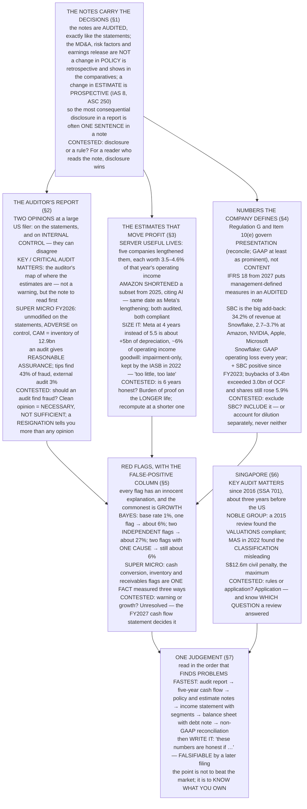

# E07 · §5 — The Notes and the Red Flags: Reading for What Is Not Said

> **Subject:** Economy & Finance *(hobby track)*
> **Module:** E07 — Accounting & Reading Financial Statements
> **Section:** the **fifth and last section of E07**. §1 built the machinery, §2–§4 took the three statements
> one at a time, and every one of them ended at the same place: *the answer is in a note*. This section is the
> notes — where the policy choices and the estimates are written down, what the **auditor's report** actually
> says and what it was never designed to say, the numbers a company **defines for itself**, the **red flags**
> that preceded real failures *and how often each one is wrong*, and how to put all of it together into one
> judgement about a company. It closes the module.
> **Status:** 🔵 **PREPARED 2026-10-27** — body drafted, awaiting your read; **§11 Applied** will be added once
> you have driven the session Q&A. Math in LaTeX, quantitative relationships drawn as real computed figures
> (all four from filed accounts or a cited primary source), key terms glossed in 中文 (大陆/台灣), per
> [`../../../agent-docs/authoring-conventions.md`](../../../agent-docs/authoring-conventions.md).

**Estimated study time:** 2 hours including reflection.
**Prerequisites:** all of E07, and in particular **E07 §4 §2.3** (the three explanations for a profit-to-cash
gap and how they are told apart), **§4 §5.1** (the five-year test), **E07 §2 §5.3** (share-based compensation)
and **E07 §3 §3.3** (the maturity ladder, which is a note).

---

## Why this section exists (for *you*)

Every section of this module has ended by sending you to a note. The interest classification is in the
policy note (E07 §4 §3.1). The maturity ladder is a note (E07 §3 §3.3). Per-product revenue, such as it is,
lives in the segment note (E07 §2 §10b). The supplier finance programme is a note (E07 §4 §3.3). **The
statements are the summary; the notes are where the decisions are recorded.**

> **The organising instruction for this section: read a company's report for the DECISIONS it discloses,
> not for the numbers it reports.** Every number on the face of a statement is the output of a policy and a
> set of estimates. The notes say which policy and which estimates, and — when one changes — by how much
> the change moved the number. That sentence is the most valuable one in the report, and it is usually one
> sentence long.

Four things this section establishes.

**One — a single sentence in a note can move operating income by four per cent.** Microsoft, Alphabet,
Amazon, Oracle and Meta each **lengthened the assumed life of their servers** between 2022 and 2025, and each
disclosed the effect: **between 3.5% and 4.6% of that year's operating income**. Then, from the same date as
Meta's lengthening, **Amazon shortened** a subset of its own, citing artificial intelligence. Both are audited.
Both comply. They cannot both be right about the same equipment.

**Two — the auditor's report is two opinions and a list of what the auditor found hardest.** Super Micro
Computer's auditor resigned in 2024 saying it was unwilling to be associated with management's statements. Its
new auditor now gives a **clean opinion on the statements** and an **adverse opinion on internal control**, and
names inventory — **12.9 billion**, up from 4.7 — as the matter it found hardest. That is the same line that
took the company's operating cash flow to **minus 6.8 billion** on a profit of 2.2.

**Three — "adjusted" profit is a number the company defines for itself.** Snowflake has never reported an
operating profit under GAAP (generally accepted accounting principles); it lost **1,435 million** at the operating line in FY2026. Its share-based compensation
that year was **1,600 million**, so adding back that one item — which almost every "adjusted" measure does —
turns the loss into a profit. Whether that add-back is legitimate is **genuinely contested**, and §4 does not
pretend otherwise.

**Four — every red flag has a false-positive rate, and the flags are not independent.** Inventory growing
faster than sales, receivables growing faster than sales, operating cash flow below profit for five years, an
auditor resigning: Super Micro trips all four at once. Whether that is four pieces of evidence or **one fact —
very fast growth — counted four times** is the question §5 is about.

### How this section is different

E07 §4 §10 recorded a second quiet read in a row and said what would change. Here is the change. **Every
content section ends in a *Contested* box**: a question on which informed people disagree, the strongest case
for each side with a number, what the evidence settles and what it does not, and **where this section comes
down and the condition under which that would be wrong**. The positions are stated so you can disagree with
them. **If you do, that is the most useful thing you can bring to the session.**

---

## 1. Where the information is — and which of it is audited

<b>Vocabulary for this section</b> — the parts of an annual report (click to expand)

**Abbreviations**

| Short | Stands for | Meaning |
|---|---|---|
| **10-K** | — | the US annual report filed with the SEC |
| **SEC** | Securities and Exchange Commission | the US securities regulator |
| **MD&A** | Management's Discussion and Analysis | management's narrative of the results. **Not audited** |
| **IAS 8** | International Accounting Standard 8 | the IFRS rulebook for policies, changes in estimates, and errors |
| **ASC 250** | Accounting Standards Codification Topic 250 | the US GAAP equivalent |
| **IFRS** | International Financial Reporting Standards | the accounting standards used outside the US |
| **GAAP** | generally accepted accounting principles | here, US GAAP |
| **FASB** | Financial Accounting Standards Board | sets US GAAP |
| **ASU** | Accounting Standards Update | an amendment to US GAAP issued by the FASB |
| **IASB** | International Accounting Standards Board | sets IFRS |

**Terms**

| Term | Definition |
|---|---|
| **Notes to the financial statements** | the numbered disclosures after the four statements. **Audited**, as part of the statements |
| **Significant accounting policies** | usually Note 1: which method the company chose wherever a choice exists |
| **Critical accounting estimates** | the judgements with the largest effect on the numbers, listed **in the MD&A**, so not audited as such |
| **Change in accounting estimate** | a revised judgement (a useful life, a provision). Applied **from now on**, never restated backwards |
| **Change in accounting policy** | a different method. Applied **retrospectively**: prior years are restated |
| **Restatement** | correcting a prior period's published numbers because they were wrong |
| **Segment note** | revenue and profit by the business units management uses internally (E07 §2 §10b) |
| **Subsequent event** | something that happened after the year end but before the report was signed |

### 1.1 The report has parts with different standing

E07 §2 §10 drew the line between what is audited and what is not. Here is the whole report on one table,
because the line runs through the middle of it.

**Table 1** — the parts of an annual report, whether each is audited, and what it is for.

| Part | Audited? | What it carries | What E07 used it for |
|---|---|---|---|
| **The four statements** | yes | the numbers, on the face | §2–§4 |
| **The notes** | **yes** | the policies, the estimates, the breakdowns | everything below |
| **Auditor's report** | it *is* the audit | the opinion, and the matters the auditor found hardest | §2 here |
| **MD&A** | **no** — read for consistency only | management's explanation, and the **critical accounting estimates** | E07 §2 §10 |
| **Risk factors** | no | everything that could go wrong, written by lawyers | rarely useful |
| **Earnings release** | **no**, and not part of the 10-K | the headline numbers, including "adjusted" ones | §4 here |

The consequence worth holding on to: **the notes have the same standing as the statements.** A number in
Note 9 is audited exactly as much as the number on the face that it explains. An "adjusted" number in a press
release is audited not at all.

### 1.2 The notes to read, and the question each one answers

There are typically twenty to thirty notes. Most are reference material. These are the ones that change a
judgement.

**Table 2** — the notes that most often change a reading, and where earlier sections needed them.

| Note | The question it answers | Where E07 needed it |
|---|---|---|
| **Significant accounting policies** | which method, wherever there was a choice | interest classification (E07 §4 §3.1) |
| **Changes in accounting estimates** | what was re-judged this year, and **by how much it moved profit** | §3 here |
| **Revenue** (disaggregation, contract balances) | what kind of revenue, and how much is booked ahead of cash | E07 §2 §2 |
| **Segments** | which part of the business earns the money | E07 §2 §10b |
| **Debt** | what is owed, at what rate, **when** | E07 §3 §3.3 |
| **Commitments and contingencies** | obligations not on the balance sheet, and lawsuits | E07 §3 §3 |
| **Supplier finance** | how much of "payables" is really bank borrowing | E07 §4 §3.3 |
| **Related parties** | transactions with insiders and their companies | §5 here |
| **Share-based compensation** | the pay that is not in cash, and the dilution | §4 here |

### 1.3 Why a change in estimate is one sentence long

The mechanics explain why the most consequential disclosure is also the shortest. **A change in accounting
policy is applied retrospectively**: prior years are restated, and the effect is visible in the comparative
columns. **A change in estimate is applied prospectively** (IAS 8, ASC 250): nothing earlier is touched, the
new judgement simply applies from this year on. There is no restated column to compare against.

So the only place you learn the size of the change is **one sentence in the notes**, and sometimes a second in
the MD&A. If you do not read that sentence, the change is invisible: this year's margin simply looks better
than last year's, for reasons the face of the statement does not give.

> ### Contested — disclosure, or a rule?
>
> **The question.** When a practice can mislead (supplier finance, a lengthened useful life), should the
> standard-setter **ban or reclassify it**, or require it to be **disclosed** and leave the reading to you?
>
> **For disclosure.** A rule has to fit every company; a disclosure lets the reader adjust for the one in
> front of them. Both standard-setters chose disclosure for supplier finance after Carillion and Greensill
> (E07 §4 §3.3) — the **FASB's ASU 2022-04** and the **IASB's 2023 amendments to IAS 7 and IFRS 7** — rather
> than forcing the balances into debt.
>
> **For a rule.** Disclosure only protects the reader who reads it. Carillion's early payment facility was
> roughly **a third of its bank debt** by a parliamentary inquiry's estimate, and the practice that hid it was
> legal; a disclosure rule would have made it findable, not found. And the notes are long — the more there
> is, the less any one sentence is read.
>
> **What the evidence settles.** That disclosure works when someone reads it: Carillion's exposure was
> unsizeable precisely because nothing was disclosed. **What it does not settle** is whether readers in
> aggregate do read it — which is an empirical question about markets, not about accounting.
>
> **Where this section comes down.** For *you*, disclosure is the better regime, because you are going to
> read the note — that is what this section is for. **This would be wrong** if the number you needed were not
> disclosed anywhere, which is exactly the case §2's auditor resignation and §5's related-party flag are about.

---

## 2. The auditor's report — what it says, and what it was never built to say

<b>Vocabulary for this section</b> — opinions, matters and the people who find fraud (click to expand)

**Abbreviations**

| Short | Stands for | Meaning |
|---|---|---|
| **ISA** | International Standard on Auditing | the audit standards issued by the IAASB |
| **IAASB** | International Auditing and Assurance Standards Board | sets the ISAs |
| **ISA 701** | — | the ISA requiring **key audit matters** in a listed company's audit report |
| **PCAOB** | Public Company Accounting Oversight Board | the US regulator of auditors of listed companies |
| **AS 3101** | Auditing Standard 3101 | the PCAOB standard for the audit report, including **critical audit matters** |
| **KAM** | key audit matter | ISA term: what the auditor judged most significant in the audit |
| **CAM** | critical audit matter | the US equivalent: material, and involving especially challenging judgement |
| **ICFR** | internal control over financial reporting | the processes that produce the numbers |
| **SOX** | the Sarbanes–Oxley Act of 2002 | section 404 requires management, and for larger filers the auditor, to assess ICFR |
| **ACFE** | Association of Certified Fraud Examiners | publishes the largest survey of fraud cases |
| **BaFin** | Bundesanstalt für Finanzdienstleistungsaufsicht | Germany's financial regulator |
| **EY** | Ernst & Young | one of the four largest audit firms |
| **BDO** | — | an international audit network; Super Micro's auditor since 2024 |
| **8-K** | — | a US filing reporting a material event, such as an auditor change |
| **USD** | United States dollar | — |

**Terms**

| Term | Definition |
|---|---|
| **Reasonable assurance** | high but not absolute confidence. The level an audit promises. **Not a guarantee** |
| **Material misstatement** | an error or omission large enough to change a reader's decision |
| **Unmodified opinion** | "present fairly, in all material respects". The clean opinion. Also called *unqualified* |
| **Qualified opinion** | clean **except for** a specified matter |
| **Adverse opinion** | the statements, or the controls, **do not** present fairly / are not effective |
| **Disclaimer of opinion** | the auditor could not get enough evidence to form an opinion at all |
| **Going concern** | the assumption the company will keep operating for the next twelve months |
| **Material weakness** | a control deficiency serious enough that a material misstatement might not be caught |
| **IT general controls** | access and change controls over the information technology systems that produce the numbers |
| **Occupational fraud** | fraud by an organisation's own people against it. Mostly theft; **financial statement fraud is 5%** of it |
| **Short seller** | an investor who profits if a share price falls, and who therefore publishes the case for it falling |

### 2.1 Two opinions, and the list of hard things

A large US listed company — an accelerated filer, which covers every company in this module — gets an audit
report with **two opinions** in it; smaller companies get only the first.

**Table 3** — what the auditor can say, and how often you will see each.

| Opinion | On the statements, it means | On internal control, it means | How often |
|---|---|---|---|
| **Unmodified** | present fairly, in all material respects | effective | almost always |
| **Qualified** | fairly, *except for* a stated matter | — (not used for ICFR) | rare at listed companies |
| **Adverse** | do not present fairly | **not effective: at least one material weakness** | rare on statements; **less rare on controls** |
| **Disclaimer** | the auditor cannot say | the auditor cannot say | very rare, and alarming |
| *plus:* **going-concern** paragraph | a material uncertainty about surviving twelve months | — | read it whenever it appears |

Then comes the section that has made the audit report worth reading since the late 2010s. **Key audit
matters** (ISA 701, for listed-company audits of periods ending on or after 15 December 2016) and **critical
audit matters** (PCAOB AS 3101, phased in from 2019) are the auditor naming **what it found hardest**: the
accounts where the judgement was most subjective and the work most extensive.

> **The honest way to read a key audit matter:** it is a map of where the *estimates* are, drawn by the one
> party that has seen inside. It is **not** a warning — almost every company has two or three — and the
> auditor says explicitly that it does not modify the opinion. But it tells you which note to read first.

### 2.2 Super Micro Computer: a case that is still open

Here is a report that uses every part of Table 3, and a case whose outcome is **not known**.

**Table 4** — Super Micro Computer, from the short report to the FY2026 audit opinion.

| When | What happened | Source |
|---|---|---|
| **Aug 2024** | a short seller (Hindenburg Research) publishes allegations; the company delays its annual report | public record |
| **Oct 2024** | **EY resigns as auditor**, saying it is unwilling to be associated with the statements management prepared | the company's 8-K |
| **18 Nov 2024** | **BDO** appointed as auditor | FY2026 10-K, Item 14 |
| **Dec 2024** | a special committee of the board reports **no evidence of misconduct** by management or the board, and recommends governance changes | the company's release |
| **FY2025** | several material weaknesses reported in internal control | FY2025 10-K |
| **31 Aug 2026** | BDO: **unmodified opinion on the FY2026 statements; adverse opinion on internal control** (one material weakness remains, in IT general controls); critical audit matters: **valuation of inventories** and **revenue recognition** | FY2026 10-K |

Now put the opinion next to the cash flow statement. **Inventory at 30 June 2026 was 12,896 million, up from
4,680**, and the increase consumed **8,877 million** of operating cash in one year. The auditor's first
critical audit matter is *the valuation of that inventory*. §5 below picks up the cash flow side; the point
here is that **the audit report and the cash flow statement point at the same line**, from two directions,
without either one saying anything is wrong.

### 2.3 What finds fraud

The deepest misunderstanding about audits is what they are *for*. The best data on how fraud is actually
discovered comes from the ACFE's biennial survey of fraud investigators.

**Figure 1** — how fraud was first detected, ACFE 2024: tips find fourteen times as many cases as the external
auditor.

Read it with its caveat, because the caveat is the interesting part. **These are occupational frauds — mostly
employees stealing from their employer.** Financial statement fraud is only **5% of the cases, but it has the
largest median loss, USD 766,000 per case**, and it is the kind *committed by* management rather than against
it — which is precisely the kind an audit, built on management's representations, is worst placed to find.

> ### Contested — should an audit be expected to find fraud?
>
> **The question.** When a fraud passes a clean audit opinion, is that an audit failure, or the public
> expecting something audits were never designed to do?
>
> **It is the public's error.** An audit gives **reasonable assurance** about **material misstatement**, on a
> sample, relying on documents and on management's representations. The audit standards say plainly that
> collusion and forgery can defeat it. Figure 1 is what that design produces: **3% of detections**. Asking an
> audit to be a forensic investigation would multiply its cost, and every company would pay that cost to catch
> the rare one.
>
> **It is an audit failure.** **Wirecard**: EY audited it for about a decade, and in June 2020 the company
> admitted that **1.9 billion euros** of cash it had reported, held in trust accounts in Asia, most likely did
> not exist. Confirming that cash exists is not forensic work; it is the most basic procedure in an audit.
> Journalists at the Financial Times had been publishing the case since 2015 — and in February 2019 **BaFin
> banned short-selling of the shares** and filed a criminal complaint against the reporters. Germany passed an
> audit-reform law in 2021 in response.
>
> **What the evidence settles.** That an audit is not a fraud detector *in general* (Figure 1) — and that
> Wirecard was a failure *even of the narrow job*, since the cash was the asset. **What it does not settle** is
> whether more expensive audits would catch enough extra frauds to be worth it.
>
> **Where this section comes down.** Treat a clean opinion as **necessary, not sufficient**: a company that
> cannot get one is telling you something, and a company that can has told you less than it seems. **The one
> moment the auditor tells you more than the opinion does is when it leaves.** This position would be wrong if
> resignations were routinely about fees and scheduling rather than about the client — and some are, which is
> why §5 puts a false-positive column next to every flag.

---

## 3. The estimates that move the profit

<b>Vocabulary for this section</b> — estimates, lives and the obsolescence argument (click to expand)

**Abbreviations**

| Short | Stands for | Meaning |
|---|---|---|
| **D&A** | depreciation and amortisation | the allocation of past capital spending (E07 §1 §5.2) |
| **GPU** | graphics processing unit | the accelerator chips at the centre of the current capital-expenditure cycle |
| **AI** | artificial intelligence | — |
| **capex** | capital expenditure | cash spent on long-lived assets (E07 §4 §5.2) |

**Terms**

| Term | Definition |
|---|---|
| **Useful life** | the period over which an asset's cost is spread as depreciation. **An estimate, not a fact** |
| **Straight-line depreciation** | cost divided equally over the useful life |
| **Prospective application** | a changed estimate applies from now on; nothing earlier is restated |
| **Physical life** | how long the equipment keeps working |
| **Economic life** | how long it keeps earning enough to be worth running. Can be much shorter |
| **Impairment** | a write-down when an asset's carrying amount exceeds what it can recover |
| **Goodwill impairment** | the same test applied to goodwill (E07 §3 §2.3), which is otherwise never amortised |

### 3.1 Where the estimates are

Every company lists its **critical accounting estimates** in the MD&A — the judgements with the largest effect
on the numbers. The usual list is short and familiar from earlier sections: the **allowance for credit losses**
on receivables, **inventory write-downs** (Super Micro's critical audit matter), **useful lives** of property and
equipment, **goodwill impairment** (E07 §3 §2.3), the **fair value of share-based awards**, **provisions** for
litigation and warranties, and **revenue recognised over time** on long contracts (E07 §2 §2).

The one that matters most right now is the third, because the capital-expenditure cycle of E07 §4 §5.2 has
made it large.

### 3.2 One sentence, four per cent

Lengthen a server's assumed life from four years to six and each year's depreciation on it falls by a third.
No cash moves; the spending already happened (E07 §4 §5.2). Operating income rises. Here is what the companies
building the current cycle disclosed.

![A horizontal bar chart of the disclosed effect of server useful-life changes on operating income, as a share of that year's operating income. Alphabet 2023, servers and network equipment to six years, plus 4.6 per cent or 3.9 billion. Amazon 2024, servers five to six years, plus 4.5 per cent or 3.1 billion. Microsoft fiscal 2023, servers and network four to six years, plus 4.2 per cent or 3.7 billion. Oracle fiscal 2025, five to six years, plus 4.1 per cent or 0.7 billion. Meta 2025, most servers and network to 5.5 years, plus 3.5 per cent or 2.9 billion. Amazon 2025, a subset of servers six to five years, minus 1.8 per cent or 1.4 billion, annotated with Amazon's stated reason, the increased pace of technology development particularly in artificial intelligence and machine learning.](diagrams/05-notes-and-red-flags-fig2.svg)

**Figure 2** — the disclosed effect of one changed estimate, as a share of that year's operating income.

**Table 5** — the same changes as each filing states them. USD millions.

| Company and year | Change | Disclosed effect | That year's operating income | Share |
|---|---|---|---|---|
| Microsoft FY2023 | servers and network, 4 → 6 years | operating income **+3,700** | 88,523 | 4.2% |
| Alphabet 2023 | servers and certain network → 6 years | depreciation **−3,900** | 84,293 | 4.6% |
| Amazon 2024 | servers, 5 → 6 years (after 4 → 5 in 2022) | operating income **+3,100** (anticipated) | 68,593 | 4.5% |
| Oracle FY2025 | servers and network, 5 → 6 years (after 4 → 5 in FY2023) | operating expenses **−733** | 17,678 | 4.1% |
| Meta 2025 | most servers and network → 5.5 years | depreciation **−2,920** | 83,276 | 3.5% |
| **Amazon 2025** | **a subset**, **6 → 5 years** | depreciation **+1,400** | 79,975 | **−1.8%** |

Three readings.

**Each change was disclosed, in the notes, with its effect stated.** This is the system working: nothing was
hidden, and Figure 2 was built entirely from those sentences. A reader of the face of Microsoft's FY2023 income
statement would have seen depreciation *fall* from 12.6 to 11.0 billion in a year of heavy investment and had
no idea why.

**The stated reasons are reasonable.** Microsoft cited "investments in software that increased efficiencies in
how we operate our server and network equipment, as well as advances in technology". Servers last longer than
they used to, and these companies have more data on their own fleets than anyone.

**And then Amazon went the other way**, effective 1 January 2025 — the same date as Meta's lengthening —
because of "the increased pace of technology development, particularly in the area of artificial intelligence
and machine learning". Its previous annual report had already recorded about **920 million** of accelerated
depreciation and related charges, in late 2024, from deciding to retire some servers early.

### 3.3 Sizing the argument

The useful thing to do with a disputed estimate is not to pick a side but to **compute what is at stake**.
Meta disclosed **13.36 billion** of depreciation on servers and network assets in 2025, at a life of 5.5 years.
At a steady rate of investment, straight-line depreciation scales inversely with life, so a four-year life
would raise that charge by a factor of $5.5 / 4 = 1.375$ — about **5 billion a year, or roughly 6% of Meta's
2025 operating income**. *(That is a rough steady-state estimate: with spending still rising, the true effect
is somewhat smaller in any one year.)*

So the honest summary is a range, not a verdict: **the most consequential single estimate in the current
cycle is worth around four to six per cent of operating income at each of these companies**, and it is decided
by management, reviewed by the auditor, and disclosed in one sentence.

**Goodwill** is the other estimate with this shape, and it has its own long-running argument. Under both IFRS
and US GAAP goodwill is **not amortised**; it is tested for impairment, which means its value is whatever
management's forecast of the acquired business supports. Critics call this *too little, too late*: Kraft Heinz
wrote down **15.4 billion** of goodwill and brand value in February 2019, years after the acquisitions that
created it. **In 2022 the IASB considered bringing amortisation back, and decided to keep impairment-only.**

> ### Contested — is a six-year life honest for AI servers?
>
> **The question.** Hyperscalers depreciate servers, including accelerator servers, over five and a half to six
> years. Is that the economic life of the equipment?
>
> **Yes, or close.** Companies have years of failure and utilisation data on their own fleets, which no outsider
> has. Older accelerators keep earning: chips that were frontier hardware several generations ago are still
> rented out and still run inference. Physical life is not the question; **as long as an asset earns more than
> it costs to run, it has economic life.** And the auditor reviewed the evidence.
>
> **No.** Accelerator generations now arrive roughly every year, and each makes the last one cheaper to replace
> than to run at the margin. The economic life of frontier hardware is set by **obsolescence, not wear**. And
> the strongest evidence is a company's own: **Amazon, the largest cloud provider, shortened a subset of its
> server lives in 2025 and said AI was the reason**, from the same date that Meta lengthened its own.
>
> **What the evidence settles.** That the choice is **material** (3.5–4.6% of operating income, Table 5), that
> **audited, compliant companies disagree** about it, and that the disagreement is fully disclosed. **What it
> does not settle** is the right answer, which depends on accelerator rental prices four and five years from
> now — a forecast no filing can contain.
>
> **Where this section comes down.** **The burden of proof sits on the longer life**, because the only company
> to move against the trend moved towards caution and gave a technical reason, and because the cost of being
> wrong is asymmetric: too long a life overstates profit for years and then arrives as an impairment. In
> practice that means **recomputing operating income at a shorter life yourself** before comparing these
> companies. **This position would be wrong** if, two or three years from now, filings show old accelerator
> fleets still earning — falling impairments and few early retirements would be the evidence.

---

## 4. Numbers the company defines for itself

<b>Vocabulary for this section</b> — non-GAAP measures and the rules on them (click to expand)

**Abbreviations**

| Short | Stands for | Meaning |
|---|---|---|
| **Non-GAAP** | — | any measure not defined by the accounting standards: "adjusted", "underlying", "core" |
| **APM** | alternative performance measure | the European term for the same thing |
| **ESMA** | European Securities and Markets Authority | issued the APM guidelines (in force 2016) |
| **MPM** | management-defined performance measure | IFRS 18's term, from 2027: a non-GAAP subtotal disclosed **in an audited note** |
| **IFRS 18** | — | *Presentation and Disclosure in Financial Statements*, effective 1 January 2027 |
| **SBC** | share-based compensation | pay in shares or options, expensed at fair value (E07 §2 §5.3) |
| **EBITDA** | earnings before interest, taxes, depreciation and amortisation | E07 §2 §5.1 |
| **EPS** | earnings per share | net income divided by shares |

**Terms**

| Term | Definition |
|---|---|
| **Regulation G** | the SEC rule (2003): any public non-GAAP measure must be reconciled to the nearest GAAP one |
| **Item 10(e)** | the SEC rule for non-GAAP measures **in filings**: GAAP must be at least as prominent |
| **Reconciliation** | the table bridging the non-GAAP figure back to its GAAP counterpart. Read this, not the headline |
| **Dilution** | the shrinking of each existing share's claim as new shares are issued |
| **Buyback** | the company buying its own shares — the cash cost of offsetting dilution |
| **Diluted share count** | shares outstanding plus those that options and awards would create |

### 4.1 The rule, which is about presentation rather than content

**Nothing prevents a company from defining its own profit measure.** The rules govern only how it is shown: in
the US, **Regulation G** requires a reconciliation to the most comparable GAAP figure whenever a non-GAAP
measure is published, and **Item 10(e)** requires the GAAP figure to be at least as prominent in a filing;
Europe's **ESMA guidelines** say much the same. What goes into the measure is up to management.

That is changing at the edge. **From 2027, IFRS 18 requires *management-defined performance measures* to be
disclosed in a single note, reconciled, and therefore audited.** It does not define the measures; it brings the
company's own definitions inside the audit. US GAAP has no equivalent.

So E07 §4 §4's instruction about free cash flow generalises to every "adjusted" number: **ask who defined it.**
The answer is always the company, and the reconciliation is where you see what it chose to leave out.

### 4.2 The largest adjustment

Most adjusted measures add back some combination of restructuring charges, amortisation of acquired
intangibles, and litigation. The one that is large, recurring and argued about is **share-based compensation**.

![A two-panel figure. The left panel is a horizontal bar chart of share-based compensation as a percentage of revenue in the latest fiscal year: Snowflake fiscal 2026 34.2 per cent, Palantir 2025 15.3, Meta 2025 10.2, Salesforce fiscal 2026 8.5, Alphabet 2025 6.2, Microsoft fiscal 2026 3.7, Apple fiscal 2025 3.1, NVIDIA fiscal 2026 3.0 and Amazon 2025 2.7. The right panel shows Snowflake's GAAP operating income from fiscal 2019 to fiscal 2026, negative every year and reaching minus 1.44 billion in fiscal 2026, beside operating income plus share-based compensation, which is negative through fiscal 2022 and slightly positive from fiscal 2023, reaching plus 0.17 billion in fiscal 2026.](diagrams/05-notes-and-red-flags-fig3.svg)

**Figure 3** — share-based compensation as a share of revenue, and what adding it back does at Snowflake.

**Table 6** — Snowflake, the case the argument turns on. Fiscal years ending 31 January. USD millions.

| | FY2023 | FY2024 | FY2025 | FY2026 |
|---|---|---|---|---|
| Revenue | 2,066 | 2,806 | 3,626 | 4,684 |
| **GAAP operating income** (audited) | −842 | −1,095 | −1,456 | **−1,435** |
| Share-based compensation | 862 | 1,168 | 1,479 | **1,600** |
| Operating income + SBC | +20 | +73 | +23 | **+165** |
| Operating cash flow | 546 | 848 | 960 | 1,222 |
| **Share buybacks** (cash) | 0 | 592 | 1,932 | 874 |
| Diluted weighted shares (millions) | 318.7 | 328.0 | 332.7 | **337.5** |

The two readings of this table are the whole argument. **Add back SBC and Snowflake has been profitable at the
operating line since FY2023.** Or: **over FY2024–FY2026 it spent 3,397 million buying back shares — more than
the 3,030 million of operating cash it generated in those three years — and the diluted share count still rose
5.9%.**

> ### Contested — is excluding share-based compensation legitimate?
>
> **The question.** Should SBC be added back to get a truer picture of operating performance?
>
> **Exclude it.** It is **non-cash** — it appears as an add-back in the cash flow statement for that reason
> (E07 §4 §2.1). Its amount is set by the **share price at grant**, which reflects the market's mood, not this
> year's operations. Its real cost is **dilution**, and dilution is better measured directly, in the share
> count, than by an accounting estimate of option value. Analysts who exclude it are not ignoring it; they are
> moving it from the numerator to the denominator.
>
> **Include it.** It is **pay**. Had Snowflake paid the same people in cash, it would be an expense no one
> would add back, and the company would have reported operating cash flow of roughly **minus 400 million** in
> FY2026 instead of plus 1,222. It is not non-cash in any sense a shareholder cares about: Table 6 shows the
> company **spending more cash on buybacks than its whole operating cash flow** and still failing to stop the
> share count rising.
>
> **What the evidence settles.** That the choice is **immaterial at most large companies and decisive at a
> few**: 2.7–3.7% of revenue at Amazon, NVIDIA, Apple and Microsoft, 34.2% at Snowflake (Figure 3). E07 §2
> §5.3's instruction stands: **do not argue it, size it.** **What it does not settle** is the treatment at the
> companies where it is decisive — which are exactly the ones where the argument is made most loudly.
>
> **Where this section comes down.** **Include it**, for any judgement about whether a business makes money.
> Excluding it is defensible *only* if you then account for the dilution separately, and the common failure is
> doing neither: using adjusted earnings **and** the current share count. **This position would be wrong** for
> a company whose awards are small, stable and fully offset by buybacks funded from surplus cash — in which
> case the two methods give the same answer and the argument is not worth having.

---

## 5. Red flags — and how often each one is wrong

<b>Vocabulary for this section</b> — the flags, and the arithmetic of a warning (click to expand)

**Abbreviations**

| Short | Stands for | Meaning |
|---|---|---|
| **DSO** | days sales outstanding | receivables expressed in days of revenue (E07 §3 §5.1) |
| **DIO** | days inventory outstanding | inventory expressed in days of cost of sales |
| **OCF** | operating cash flow | E07 §4 |
| **NI** | net income | E07 §2 |
| **SBC** | share-based compensation | §4 |
| **EBITDA** | earnings before interest, taxes, depreciation and amortisation | E07 §2 §5.1 |
| **AI** | artificial intelligence | — |
| **GPU** | graphics processing unit | — |

**Symbols used in the formulas**

| Symbol | Reads as | Meaning |
|---|---|---|
| $P(\text{M})$ | "P of M" | the **base rate**: the share of companies with a material misstatement before you look at anything |
| $P(\text{flag} \mid \text{M})$ | "P of flag given M" | how often the flag fires at a company that **does** have a misstatement |
| $P(\text{flag} \mid \text{clean})$ | "P of flag given clean" | how often it fires at one that **does not** — the false-positive rate |
| $P(\text{M} \mid \text{flag})$ | "P of M given flag" | what you actually want: how worried to be **once the flag has fired** |
| $\text{LR}$ | "likelihood ratio" | $P(\text{flag} \mid \text{M}) \div P(\text{flag} \mid \text{clean})$: how much one flag multiplies the odds |

**Terms**

| Term | Definition |
|---|---|
| **Red flag** | a pattern in the filings that has preceded real failures. **A reason to read a note, not a conclusion** |
| **False positive** | the flag fires and nothing is wrong |
| **Base rate** | how common the thing you are looking for is, before any evidence |
| **Bill-and-hold** | recognising a sale while keeping the goods. Legitimate only under narrow conditions |
| **Channel stuffing** | pushing more stock onto distributors than they can sell, to pull revenue forward |
| **Prepay** | a payment received in advance for future delivery. Enron used them to disguise loans |
| **Related party** | a director, a major shareholder, or a company they control |

### 5.1 The flags, with both columns

Every list of red flags in the literature has a column for **the case where it fired correctly**. Here is that
list with the column that is usually missing.

**Table 7** — the red flags that preceded real failures, and where the same flag meant nothing or missed.

| Flag | The mechanism behind it | When it was right | When it was wrong, or missed |
|---|---|---|---|
| **OCF below NI, five years cumulative** (E07 §4 §5.1) | accruals that never turn into cash | the pattern before many well-known failures | **missed Enron**, whose prepays were loans booked as operating cash inflow — the classification lever of E07 §4 §3; **fires on fast growth** (E07 §4 §2.3) |
| **Receivables growing faster than revenue** (DSO rising) | sales recognised but not collected, or not real | **Sunbeam 1997**: bill-and-hold and channel stuffing, later restated | a shift towards customers with longer payment terms |
| **Inventory growing faster than revenue** (DIO rising) | goods not selling, or not valued honestly | the inventory frauds of the textbooks | **a build ahead of orders**: the case for Super Micro, below |
| **Auditor resignation** | the auditor will not sign | **Longtop Financial 2011**: Deloitte resigned citing falsified bank records | resignations over fees or scope; **Super Micro 2024 is unresolved** (§2.2) |
| **Large gap between adjusted and GAAP profit** | the company defining away its costs | **WeWork 2018**: "community-adjusted EBITDA" excluded much of what running the buildings cost | a software company with large SBC — which §4 says is itself contested |
| **A change in estimate that raises profit** | management choosing a kinder assumption | goodwill written down years late (§3.3) | the server-life changes of §3, which may well be right |
| **A short seller's report** | someone with money on the outcome | **Wirecard**: the case was public for five years before the collapse | reports that are wrong, and the fact that every short report is written to move the price |
| **Material related-party transactions** | money moving to insiders on terms nobody negotiated | many emerging-market frauds | ordinary group companies trading with each other |

The pattern in the last column is the lesson: **every flag has an innocent explanation, and the commonest
innocent explanation is growth.**

### 5.2 Super Micro: four flags, or one fact?

![A two-panel figure for Super Micro Computer. The left panel shows net income and operating cash flow for fiscal 2022 to fiscal 2026 in US dollar billions, with revenue annotated above each year: 5.2, 7.1, 15.0, 22.0 and 39.1 billion. Net income is positive every year, rising to 2.2 billion. Operating cash flow is minus 0.4, plus 0.7, minus 2.5, plus 1.7 and minus 6.8 billion. A note gives five-year cumulative net income of plus 5.4 billion and operating cash flow of minus 7.4 billion. The right panel is a waterfall for fiscal 2026 from net income of plus 2.2 billion through inventories minus 8.9 and receivables minus 3.9, with everything else plus 3.8, to operating cash flow of minus 6.8 billion.](diagrams/05-notes-and-red-flags-fig4.svg)

**Figure 4** — Super Micro Computer: five years of profit against cash, and the FY2026 bridge.

Run the flags of Table 7 against the filings, FY2025 to FY2026:

- **Five-year cash conversion:** cumulative operating cash flow of **−7,413 million** against cumulative net
  income of **+5,357**. A ratio below zero.
- **Inventory:** up **175%** (4,680 → 12,896) against revenue up **78%** (21,972 → 39,063).
- **Receivables:** up **178%** (2,204 → 6,125).
- **The auditor:** resigned in 2024; the new one's first critical audit matter is that inventory (§2.2).

Four flags, all firing. Now apply E07 §4 §2.3's discriminators — **revenue direction and persistence**. Revenue
went from 5.2 billion to 39.1 billion in four years. That is explanation one, *growth consuming working
capital*, in its most extreme form: a company assembling AI server racks has to buy the GPUs before it can
ship the racks, and the bigger the order book, the more inventory it carries at the year end.

> **And here is the structural point, which is the reason this case is in the section.** The cash conversion
> flag, the inventory flag and the receivables flag are **not three pieces of evidence**. They are three
> measurements of one fact — **the balance sheet grew much faster than the cash came in** — and very fast
> growth produces all three at once. Counting them separately is counting one observation three times.

### 5.3 The arithmetic of a warning

It is worth doing this once with numbers, because it changes how every flag should be read. *(The rates below
are illustrative, chosen to be plausible; the point is the shape, not the values.)*

Suppose **1%** of listed companies have a material misstatement in a given year, a flag fires at **60%** of
them, and it also fires at **10%** of clean companies. Then, by Bayes' rule:

$$P(\text{M} \mid \text{flag}) = \frac{P(\text{flag} \mid \text{M}) \times P(\text{M})}{P(\text{flag} \mid \text{M}) \times P(\text{M}) + P(\text{flag} \mid \text{clean}) \times P(\text{clean})} = \frac{0.6 \times 0.01}{0.6 \times 0.01 + 0.1 \times 0.99} \approx 0.057$$

**One flag takes you from 1% to about 6%.** Most companies on which the flag fires are fine. That is the base
rate doing its work, and it is why a flag is a reason to read a note and never a conclusion.

Each flag here has a likelihood ratio of $\text{LR} = 0.6 \div 0.1 = 6$. **If two flags are genuinely
independent**, the odds multiply: prior odds of $1/99$ become $36/99$, a probability of about **27%**. That is
worth acting on. **If they are not independent — if one cause, such as growth, produces both — the second flag
adds almost nothing**, and the probability stays near 6%.

**Table 8** — what one, two and "two that are really one" flags are worth, at the illustrative rates above.

| Evidence | Probability of a material misstatement |
|---|---|
| nothing | 1% |
| one flag | about 6% |
| two **independent** flags | about 27% |
| two flags with **one common cause** | still about 6% |

> ### Contested — is Super Micro a warning or a growth story?
>
> **The question.** On the filings alone, should a reader treat Super Micro's FY2026 numbers as a warning?
>
> **A warning.** The flags are not *only* growth. The auditor that resigned **had seen inside**, and resigned
> rather than qualify; the internal-control opinion is still adverse two years later; and the critical audit
> matter is the valuation of the very asset that absorbed the cash. Those are three independent sources, not
> one fact measured three ways. Operating cash flow of **−6.8 billion** in a year of **+2.2 billion** profit is
> extreme by any standard.
>
> **A growth story.** Revenue rose sevenfold in four years. The special committee found no misconduct. The
> new auditor signed a clean opinion on the statements, which means it is satisfied the inventory exists and
> is valued within the rules — that is what an unmodified opinion with that critical audit matter *says*. The
> material weakness is in IT access controls, which is serious but is not a misstatement. **The cash flow
> pattern is exactly what E07 §4 §2.3 predicts for explanation one.**
>
> **What the evidence settles.** That the working-capital flags share a cause (§5.2), so they should be counted
> once. **What it does not settle** is whether the auditor's resignation and the adverse control opinion are
> independent of that cause — and that is the whole question.
>
> **Where this section comes down.** **The case is unresolved, and the filings say what would resolve it.**
> Explanation one predicts that inventory converts to revenue and cash within a year or two; explanation three
> predicts it does not. So the test is **the FY2027 cash flow statement**: if inventory falls and operating cash
> flow turns strongly positive while revenue holds, it was growth. **This position would be wrong** if you
> needed to decide *now*, with money at stake — in which case the defensible move is not to guess but to size
> the position to the uncertainty.

---

## 6. Singapore and the region *(local lens)*

<b>Vocabulary for this section</b> — local regulators and the Noble case (click to expand)

**Abbreviations**

| Short | Stands for | Meaning |
|---|---|---|
| **SGX** | Singapore Exchange | the stock exchange |
| **MAS** | Monetary Authority of Singapore | central bank and financial regulator |
| **ACRA** | Accounting and Corporate Regulatory Authority | regulates companies and public accountants |
| **SSA 701** | Singapore Standard on Auditing 701 | ISA 701 adopted locally: key audit matters |
| **CAD** | Commercial Affairs Department | the Singapore Police Force's white-collar crime unit |
| **PwC** | PricewaterhouseCoopers | one of the four largest audit firms |
| **ISA 701** | International Standard on Auditing 701 | the international standard SSA 701 adopts |
| **IFRS** | International Financial Reporting Standards | the standards SGX issuers report under, via SFRS(I) |
| **IFRS 18** | — | the new presentation standard, effective 2027 |
| **SFRS(I)** | Singapore Financial Reporting Standards (International) | IFRS, adopted word for word |

**Terms**

| Term | Definition |
|---|---|
| **Civil penalty** | a non-criminal financial penalty MAS can impose or seek for market misconduct |
| **Long-term marketing agreement** | in Noble's case, a contract to earn fees on a producer's future sales |
| **Mark-to-market / fair value** | carrying a contract at an estimate of its current value, with changes in profit |
| **Service contract** | a contract whose fees are recognised as the service is performed |

**Key audit matters arrived here first.** Singapore adopted ISA 701 as **SSA 701** for listed-company audits
of periods ending on or after 15 December 2016 — the same date as the international standard and about three
years before the US. **An SGX annual report has carried key audit matters for a decade.** Read them the way §2.1
says: as a map of where the estimates are.

**The interest classification choice is still live** until IFRS 18 removes it in 2027 (E07 §4 §6), and
half-yearly reporting halves the observations for every flag in Table 7 (E07 §2 §6).

**And the local case is Noble Group**, the commodity trader that was once among Asia's largest companies.

- **February 2015:** Iceberg Research, run by a former Noble employee, alleges that Noble's profits rest on
  **fair-value gains on long-term contracts** — fees it expected to earn in future, recognised now.
- **August 2015:** a **PwC review** commissioned by Noble's board finds its valuations **in line with the
  accounting rules and industry practice**, while recommending better governance and valuation methodology.
  Noble's chief executive calls the critic a market manipulator.
- **2017–2018:** Noble takes very large write-downs and goes through a debt restructuring that leaves the old
  shareholders with almost nothing.
- **24 August 2022:** **MAS imposes a civil penalty of 12.6 million Singapore dollars** — the maximum available
  — for misleading statements in Noble's financial statements. The joint MAS, ACRA and CAD investigation found
  that Noble had **classified the marketing agreements as financial instruments rather than service
  contracts**, and so recognised future fees **before the services had been performed**.

> ### Contested — was Noble a failure of the rules, or of their application?
>
> **The question.** A review found the accounting compliant in 2015; the regulator found it misleading in 2022.
> Which was wrong?
>
> **The rules failed.** IFRS lets contracts that meet the definition of a financial instrument be carried at
> fair value, with the gains in profit. That is a **classification** decision (the E07 §4 §3 lever again, on the
> income statement this time) and an outside review could defend it in good faith. If a compliant reading of
> the rules lets a company book a decade of future fees today, the rules permitted the outcome.
>
> **The application failed.** The regulator's finding was not that the rules were bad but that **these
> contracts were not financial instruments** — Noble did not take delivery of the commodities, it earned fees
> for a service. The 2015 review examined whether the **valuations** followed the rules, not whether the
> **classification** was right, and the critic said so at the time.
>
> **What the evidence settles.** That the profit depended on **one classification judgement**, that the
> judgement was challenged **publicly, in detail, seven years before** the penalty, and that a review of the
> valuation did not settle a question about the classification. **What it does not settle** is whether a
> reader in 2015, with only the filings, should have sided with the critic.
>
> **Where this section comes down.** **On the application** — and the general lesson is about which question a
> review answers. A finding that "the valuations comply" is an answer to a narrower question than "is this
> profit real". **This position would be wrong** if the classification had been genuinely ambiguous under the
> standard, in which case the fault lies with how loosely the standard drew the line; the size of the
> penalty, the maximum, suggests the regulator did not see it that way.

---

## 7. Putting it together — one judgement about a company

<b>Vocabulary for this section</b> — the reading procedure (click to expand)

**Abbreviations**

| Short | Stands for | Meaning |
|---|---|---|
| **OCF** | operating cash flow | E07 §4 |
| **KAM / CAM** | key / critical audit matter | §2.1 |
| **SBC** | share-based compensation | §4 |

**Terms**

| Term | Definition |
|---|---|
| **Judgement** | here, a statement of **what would have to be true for these numbers to be honest**, and how you would find out |
| **Stop condition** | a finding serious enough that you stop and resolve it before reading further |
| **Falsifiable** | stated so that a later filing could show it to be wrong |

This is the module's closing procedure. It reads the parts in the order that **finds problems fastest**, not
the order they are printed in, and it ends in a written judgement rather than a score.

**Table 9** — the reading order for an annual report, the question at each step, and when to stop.

| Step | Read | The question | Stop and resolve if |
|---|---|---|---|
| **1** | **the auditor's report** (§2) | is there anything other than two unmodified opinions? what are the key audit matters? has the auditor changed? | any opinion is modified; a going-concern paragraph; a recent resignation |
| **2** | **the cash flow statement, five years** (E07 §4 §5) | does profit become cash? who funded the gap? | cash conversion persistently below 1 and the business is **not** growing |
| **3** | **the policy and estimates notes** (§1.2, §3) | what changed this year, and by how much did it move profit? | a change in estimate that accounts for most of this year's improvement |
| **4** | **the income statement, top down** (E07 §2) **with the segment note** | which part of the business earns the money? | profit growth with no corresponding revenue growth anywhere |
| **5** | **the balance sheet as obligations** (E07 §3) **with the debt note** | what is owed, when, and out of what? | maturities the cash flow cannot meet without refinancing |
| **6** | **the non-GAAP reconciliation** (§4) | what did the company choose to leave out? | the adjustments are larger than the GAAP profit, every year |
| **7** | **write the judgement** | what would have to be true for these numbers to be honest? | — |

Step 7 is the one that makes the rest worth doing. A judgement written as **"what would have to be true"** is
falsifiable: next year's filing can show it to be wrong. *"Super Micro's numbers are honest if the FY2026
inventory converts into revenue and cash within two years"* is a judgement. *"Super Micro looks risky"* is a
mood.

> ### Contested — can an outsider read a company well enough to matter?
>
> **The question.** Everything in this module is public. If the filings contain the warnings, hasn't the market
> already priced them?
>
> **No edge.** Thousands of professionals read the same filings faster, with better tools and more time. A
> public fact in a public document is the textbook case of information already in the price. The people who
> were right about Wirecard and Noble were full-time specialists, and most short sellers who publish are not
> right.
>
> **Real edge, slowly.** The filings contained the case against **Wirecard for five years** (2015–2020) and
> against **Noble for three** before the collapse, and the market price did not reflect it for most of that
> time. Prices are set by the marginal trader, who is often not reading the notes.
>
> **What the evidence settles.** That the warnings **were** in the filings, years early, in both cases. **What
> it does not settle** is how many equally loud warnings, in other companies, turned out to be nothing (§5.3).
>
> **Where this section comes down.** The purpose of reading this way is **not to beat the market. It is to
> know what you own** — to be able to say, of any company you hold, what would have to be true for its numbers
> to be honest, and to notice when a filing says it no longer is. That is goal three of this whole course.
> **This position would be wrong** only if you intend to trade on it, in which case §5.3's arithmetic is the
> part of this section to reread.

---

## 8. The one-page mental model

<!-- DIAGRAM:START -->

Diagram source (Mermaid)

<!-- DIAGRAM:END -->

**Figure 5** — the one-page mental model for E07 §5: where the decisions are written down, and how to read
them in order.

---

## 9. Check your understanding

1. A company's operating margin rose from 30% to 33% this year. Name the note you would read before believing
   the improvement, and say why the face of the statements could not tell you.
2. What is the difference between a change in accounting policy and a change in accounting estimate, and why
   does the difference decide how visible the change is?
3. An audit report contains an unmodified opinion on the statements and an adverse opinion on internal
   control. Explain how both can be true at once, and say which matters more to you as an investor.
4. What is a key audit matter, and what is it **not**? Give one reason to read them and one reason not to
   over-read them.
5. Figure 1 says external audit first detects 3% of frauds. Give the strongest argument that this is an audit
   failure and the strongest that it is not, and say what kind of fraud the figure is mostly about.
6. Microsoft lengthened its server lives from four to six years and disclosed a 3.7 billion increase in
   operating income. Amazon shortened some of its server lives from six to five years. **Take a position** on
   which judgement you find more credible for AI accelerator servers, and say what future evidence would prove
   you wrong.
7. Compute roughly how much Meta's 2025 depreciation on servers and network assets would rise if its assumed
   life were four years instead of 5.5, and say why the answer is an upper bound in a year of rising spending.
8. Snowflake's FY2026 GAAP operating loss was 1,435 million and its SBC was 1,600 million. **Take a position**:
   is Snowflake profitable? Defend it using Table 6.
9. A non-GAAP measure appears in a company's earnings release. What does US regulation require of it, and what
   does it not require? What changes for IFRS reporters from 2027?
10. A flag fires at 60% of companies with a material misstatement and 10% of clean ones, and 1% of companies
    have one. What is the probability a company has a misstatement given the flag? What happens with a second,
    independent flag — and with a second flag that has the same cause?
11. Super Micro trips the cash conversion, inventory, receivables and auditor flags at once. Which of these
    share a cause, and which might be independent of it? What single future filing would resolve the case?
12. In the Noble case, a 2015 review found the accounting compliant and the regulator found it misleading in
    2022. Explain how both can be true, and name the question the 2015 review did not answer.

<b>Answers</b> (open only after you have tried all twelve)

1. **The note on changes in accounting estimates** — and the critical accounting estimates in the MD&A (§1.2,
   §3). A changed estimate is applied **prospectively**, so no comparative column is restated and the face of
   the income statement shows only the result: a lower depreciation line and a higher margin. Only the note
   says how much of the three points came from re-estimating rather than from the business (§1.3). At the
   companies in Table 5, a single useful-life change was worth 3.5–4.6% of operating income — the whole of a
   three-point margin improvement, or more.
2. **A policy change is a different method, applied retrospectively** — prior years are restated, so the effect
   shows in the comparative columns. **An estimate change is a revised judgement within the same method,
   applied prospectively** — nothing is restated (IAS 8, ASC 250). The first is visible on the face of the
   statements; the second is visible **only** in the one sentence of the note that quantifies it (§1.3).
3. **They answer different questions** (§2.1). The statement opinion says the numbers are right in all
   material respects — the auditor did enough work to be satisfied despite the weak controls. The control
   opinion says the process that produced them **could** fail to catch a material error. For an investor, the
   **statement opinion matters more for this year's numbers**; the adverse control opinion matters for
   **next year's**, because the auditor's extra work is what compensated this year, and it says nothing about
   the quarterly numbers, which are not audited. Super Micro FY2026 is exactly this case (§2.2).
4. A key audit matter is **the auditor naming the areas of the audit that needed the most subjective judgement
   and work** (ISA 701; CAMs under PCAOB AS 3101). It is **not** a warning, a qualification, or a separate
   opinion — the report says so. **Read them** because they tell you which estimates matter most at this
   company and which note to read first. **Do not over-read them** because almost every company has two or
   three, and the usual ones (revenue, goodwill, inventory) appear at healthy companies every year (§2.1).
5. **Audit failure:** confirming that reported assets exist is the core of the job, and Wirecard's 1.9 billion
   euros of cash did not exist despite a decade of clean opinions (§2.3). **Not a failure:** an audit gives
   reasonable assurance on a sample, relies on management's representations, and is explicitly not designed to
   defeat collusion and forgery; making it so would be very expensive. **The figure is mostly about
   occupational fraud — employees stealing** — where financial statement fraud is only 5% of cases (though the
   costliest, median USD 766,000), so it understates the audit's role in the kind of fraud this module is
   about, and overstates it in another sense: management fraud is the kind audits are *worst* placed to find.
6. **A position, either way, defended on these lines** (§3.3 Contested). *For Microsoft's:* companies have
   failure and utilisation data on their own fleets; older accelerators still earn rental and inference income;
   economic life lasts as long as an asset earns more than it costs to run. *For Amazon's:* accelerator
   generations arrive about yearly, so obsolescence rather than wear sets economic life; and the largest cloud
   provider moved against the trend and named AI as the reason. **The evidence that would decide it:** over the
   next few years, impairments and early retirements of older fleets (Amazon's 920 million of accelerated
   depreciation in late 2024 is one data point), and the rental prices of older accelerators. **The section's
   own position** is that the burden sits on the longer life, because the cost of being wrong is asymmetric.
7. **About 5 billion a year.** Depreciation scales inversely with life at a steady investment rate, so
   $13.36 \times 5.5 / 4 \approx 18.4$ billion, an increase of about 5.0 billion — roughly 6% of Meta's 2025
   operating income of 83.3 billion (§3.3). **It is an upper bound in a year of rising spending** because the
   newest assets, which are the largest share of the fleet, are only partway through their lives under either
   assumption, so the difference in any single year is smaller than the steady-state ratio implies.
8. **A position, defended on Table 6** (§4.2 Contested). *Profitable:* operating income plus SBC was +165
   million in FY2026 and positive every year since FY2023; operating cash flow was +1,222 million; SBC is
   non-cash and its real cost is dilution, which you can measure in the share count. *Not profitable:* GAAP
   operating loss of 1,435 million every year; paid in cash, the same pay would have made operating cash flow
   about −400 million; and over FY2024–FY2026 the company spent 3,397 million on buybacks — more than its
   3,030 million of operating cash — and diluted shares still rose 5.9%. **The section's position** is that it
   is not yet profitable in any sense a shareholder should rely on, because the add-back is 34.2% of revenue and
   the buybacks show the dilution is being paid for in cash anyway.
9. **US:** Regulation G requires any public non-GAAP measure to be **reconciled** to the most directly
   comparable GAAP measure; Item 10(e) requires, in filings, that the GAAP measure be **at least as prominent**
   (§4.1). **Neither requires the measure to be defined any particular way** — the content is the company's
   choice — and the earnings release itself is not audited. **From 2027, IFRS 18** requires
   management-defined performance measures to be disclosed in a **single note, reconciled**, which puts the
   company's own definitions inside the audit for the first time.
10. **About 5.7%** (§5.3): $0.006 / (0.006 + 0.099)$. With a **second, independent** flag of the same
    strength, the odds multiply by the likelihood ratio of 6 again: prior odds of $1/99$ become $36/99$, a
    probability of about **27%**. With a **second flag that has the same cause**, the second flag carries
    almost no new information and the probability stays near **6%** (Table 8). The lesson is that one flag is a
    reason to read a note, and that **counting correlated flags as independent is the commonest way to
    over-react**.
11. **The cash conversion, inventory and receivables flags share a cause:** very fast growth, which inflates
    working capital and holds operating cash flow below profit (§5.2; E07 §4 §2.3). **The auditor's resignation
    and the adverse control opinion might be independent of it** — they come from people who saw inside, and
    whether they are independent is the whole question (§5.3 Contested). **The resolving filing is the FY2027
    cash flow statement**: if inventory falls and operating cash flow turns strongly positive while revenue
    holds, explanation one (growth) is confirmed; if inventory keeps rising faster than revenue, it is not.
12. **They answered different questions** (§6). The 2015 review examined whether Noble's **valuations** of the
    contracts complied with the rules and industry practice. The 2022 finding was about **classification**:
    the contracts were service arrangements, not financial instruments, so the fees should not have been
    recognised before the service was performed. **A valuation can be done correctly under a classification
    that is wrong.** The question the review did not answer was whether the contracts belonged in the
    fair-value category at all — which the critic pointed out at the time.

---

## 10. Optional: take one apart yourself (30 minutes)

1. **Find the sentence.** Open the most recent 10-K of any company you own and search for *change in
   accounting estimate* and *useful lives*. If a change is disclosed, compute its effect as a share of
   operating income, as Table 5 does (§3.2).
2. **Read the audit report first.** In the same filing, find the auditor's report. Note the opinion type on the
   statements and (for a large US filer) on internal control, list the critical audit matters, and find the
   note each one points to (§2.1).
3. **Size the adjustment.** Find the company's latest earnings release and its non-GAAP reconciliation. Add up
   the adjustments and express them as a share of GAAP operating income. Then put SBC as a share of revenue
   next to Figure 3 (§4.2).
4. **Run the flags, and count the causes.** Over five years, compute cumulative OCF ÷ NI, inventory growth
   against revenue growth, and receivables growth against revenue growth (Table 7). Then ask how many
   **independent** causes the flags that fired actually have (§5.2).
5. **For an SGX issuer**, read the key audit matters in its latest annual report and the accounting-policy
   sentence on interest paid (§6).
6. **Write the judgement.** One sentence of the form *"these numbers are honest if …"*, with something a future
   filing could show to be false (§7).

⚠ **XBRL reminder, for this section.** Non-GAAP measures are **not tagged** in XBRL — they are not in the
financial statements — so the API cannot give you an adjusted figure; read the earnings release. The
**effect of a change in estimate is also usually not tagged as its own fact**; it lives in the text of the note,
which is where Table 5 came from. And share-based compensation appears under more than one tag
(`ShareBasedCompensation` in the cash flow statement, `AllocatedShareBasedCompensationExpense` in the note);
they usually agree, but Alphabet's differ by about 2 billion in 2025, so say which one you used.

---

## Key terms — English · 中文（中国大陆 / 台灣）

The auditing vocabulary is where the two markets diverge most sharply in the whole module — Taiwan uses **查核**
rather than 审计 for the audit of financial statements, and many of the terms below follow from that.

| English | 中国大陆 (简体) | 台灣 (繁體) | Note |
|---|---|---|---|
| Notes to the financial statements | 财务报表附注 | 財務報表附註 | script only |
| Audit (of financial statements) | 审计 | 查核 | ⚠⚠ genuinely different |
| Auditor's report | 审计报告 | 查核報告 | ⚠⚠ follows from 审计 vs 查核 |
| Unmodified (clean) opinion | 无保留意见 | 無保留意見 | script only |
| Qualified opinion | 保留意见 | 保留意見 | script only |
| Adverse opinion | 否定意见 | 否定意見 | script only |
| Disclaimer of opinion | 无法表示意见 | 無法表示意見 | script only |
| Going concern | 持续经营 | 繼續經營 | ⚠⚠ 持续 vs 繼續 |
| Key audit matter | 关键审计事项 | 關鍵查核事項 | ⚠⚠ 审计 vs 查核 |
| Internal control over financial reporting | 财务报告内部控制 | 財務報導內部控制 | ⚠ 报告 vs 報導 |
| Material weakness | 重大缺陷 | 重大缺失 | ⚠ 缺陷 vs 缺失 |
| Accounting estimate | 会计估计 | 會計估計 | script only |
| Change in accounting estimate | 会计估计变更 | 會計估計變動 | ⚠ 变更 vs 變動 |
| Useful life | 使用寿命 | 耐用年限 | ⚠⚠ genuinely different |
| Impairment | 减值 | 減損 | ⚠⚠ 减值 vs 減損 |
| Goodwill | 商誉 | 商譽 | script only |
| Restatement | 重述 | 重編 | ⚠⚠ 重述 vs 重編 |
| Non-GAAP measure | 非公认会计准则指标 | 非一般公認會計原則衡量指標 | ⚠ different constructions |
| Alternative performance measure | 替代业绩指标 | 替代績效衡量指標 | ⚠ 业绩 vs 績效 |
| Share-based compensation | 股份支付 | 股份基礎給付 | ⚠⚠ genuinely different |
| Dilution | 稀释 | 稀釋 | script only |
| Related-party transaction | 关联交易 | 關係人交易 | ⚠⚠ 关联 vs 關係人 |
| Short seller | 卖空者 | 放空者 | ⚠⚠ 卖空 vs 放空 |
| Whistleblower tip | 举报 | 檢舉 | ⚠⚠ genuinely different |
| Red flag (warning sign) | 危险信号 | 警訊 | ⚠⚠ genuinely different |

---

## References (optional, for depth)

- **Changes in estimates, and why they are one sentence long:** the IASB's
  [IAS 8 *Accounting Policies, Changes in Accounting Estimates and Errors*](https://www.ifrs.org/issued-standards/list-of-standards/ias-8-accounting-policies-changes-in-accounting-estimates-and-errors/)
  — §1.3's prospective-versus-retrospective rule.
- **The rules on "adjusted" numbers:** the SEC's
  [*Financial Reporting Manual*, Topic 8: Non-GAAP Measures](https://www.sec.gov/about/divisions-offices/division-corporation-finance/financial-reporting-manual/frm-topic-8)
  — how the staff applies Regulation G and Item 10(e) (§4.1); its interpretations, with examples of measures it
  objects to, are in the [consolidated Corporation Finance interpretations](https://www.sec.gov/about/consolidated-cdi).
- **Bringing them inside the audit:** the IASB's
  [IFRS 18 *Presentation and Disclosure in Financial Statements*](https://www.ifrs.org/issued-standards/list-of-standards/ifrs-18-presentation-and-disclosure-in-financial-statements/)
  — management-defined performance measures, effective 2027 (§4.1).
- **What finds fraud:** the ACFE's
  [*Occupational Fraud 2024: A Report to the Nations*](https://legacy.acfe.com/report-to-the-nations/2024/)
  — the source of Figure 1. Read the methodology: these are cases reported by fraud examiners, which is not a
  random sample of all fraud.
- **The open case, in the filing itself:** Super Micro Computer's
  [FY2026 Form 10-K](https://www.sec.gov/Archives/edgar/data/1375365/000137536526000022/smci-20260630.htm) —
  the auditor's report, both opinions and the two critical audit matters of §2.2, which is also the clearest
  worked example of what a critical audit matter under PCAOB AS 3101 looks like.
- **The local case, in the regulator's words:** MAS,
  [*Singapore Authorities Take Actions Against Noble Group Limited and Former Directors*](https://www.mas.gov.sg/regulation/enforcement/enforcement-actions/2022/singapore-authorities-take-actions-against-noble-group-limited-and-former-directors-of-noble-resources-international-pte-ltd)
  (24 August 2022) — §6's classification finding.
- **Where to get the numbers:** the SEC's
  [XBRL `companyfacts` API](https://www.sec.gov/edgar/sec-api-documentation) for every series in Figures 2–4
  and Tables 5–6; the useful-life effects are quoted from each filing's notes.

---

### What's next
🔵 **PREPARED 2026-10-27.** This closes **Module E07**. You can now read a company's report as a record of
**decisions**: you know that the notes carry the same audit standing as the statements, that a changed estimate
is applied prospectively and is therefore visible only in one sentence of a note, that the audit report holds
two opinions and a list of the hardest judgements, that an audit is not built to find fraud and finds 3% of it,
that every "adjusted" number is defined by the company, that every red flag has a false-positive column and
that correlated flags count once, and how to read a report in the order that finds problems fastest — ending in
a falsifiable judgement rather than a score.

Next, **Module E08 — analysing a company**, starting with **§1, ratio analysis**: profitability, liquidity,
leverage and efficiency, each with its denominator stated and its ceiling stated where it is taught, and the
whole of E07 underneath it — because every ratio is two numbers from these statements, and you now know where
each one comes from and who decided it.

Read this one and bring your questions — and, this time especially, **your disagreements with any of the seven
*Contested* boxes**. **§11 Applied** will be added from that session.
