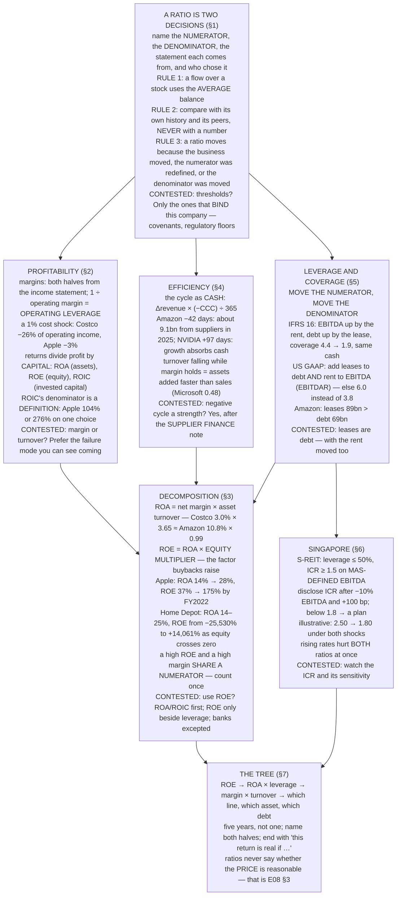

# E08 · §1 — Ratio Analysis: Every Ratio Is Two Decisions

> **Subject:** Economy & Finance *(hobby track)*
> **Module:** E08 — Analysing a Company
> **Section:** the **first section of E08**. E07 taught you to read each statement and the notes behind it.
> This section puts two numbers from those statements over each other and asks what the result can and cannot
> say: **profitability** (margins and returns), the **decomposition** that shows where a return comes from,
> **efficiency** (how fast money goes round), and **leverage and coverage** (how much can go wrong first).
> Several ratios were already taught where they first came up: the current ratio, the cash conversion cycle,
> and three leverage ratios in E07 §3, EBITDA in E07 §2. They are not taught again here. They are placed in a
> system, and the new work is the **returns** and the **decomposition**.
> **Status:** 🔵 **PREPARED 2026-11-08** — body drafted, awaiting your read; **§11 Applied** will be added once
> you have driven the session Q&A. Math in LaTeX, quantitative relationships drawn as real computed figures
> (all three from filed Form 10-K figures), key terms glossed in 中文 (大陆/台灣), per
> [`../../../agent-docs/authoring-conventions.md`](../../../agent-docs/authoring-conventions.md).

**Estimated study time:** 1.5–2 hours including reflection.
**Prerequisites:** all of E07, and in particular **E07 §2 §3** (the margin ladder), **E07 §3 §5** (the cash
conversion cycle and the three leverage ratios) and **E07 §5 §3–§4** (estimates that move profit, and numbers
the company defines for itself). Your own question from **E06 §2 §10** — *"if ratio, what is the denominator?"*
— is the organising idea of this whole section.

---

## Why this section exists (for *you*)

In E06 §2 §10 you asked the same question three times in different forms: **what is the denominator?** Each
time the missing denominator changed the sign or the size of the answer. Ratio analysis is that question
asked systematically. A ratio is a fraction, and both halves of it come from statements whose every line you
now know to be the result of a policy and a set of estimates (E07 §5 §1).

> **The organising instruction for this section: a ratio is a question, and the denominator is half of the
> question.** Before you read any ratio, name its numerator and denominator, the statement each comes from,
> and who chose the number. Most bad readings of a ratio are a good reading of the wrong denominator.

Four things this section establishes, each from filed accounts.

**One — the same return can come from opposite businesses.** Costco earns **3.0 cents** of net income on each
dollar of sales and turns its assets over **3.65 times** a year: return on assets **11.1%**. Amazon earns
**10.8 cents** and turns its assets **0.99 times**: return on assets **10.8%**. Ranked by net margin, Costco comes
last of eight large companies. Ranked by return on assets, it is fifth, ahead of Amazon.

**Two — a return on equity can be manufactured by shrinking the denominator.** Apple's return on assets went
from **14%** to **35%** in nine years. Its return on equity went from **37%** to **142%**, peaking at **175%**,
mostly because buybacks shrank the equity. Home Depot's return on assets stayed between **14% and 25%** for ten
years while its return on equity ran from **−25,530%** to **+14,061%**, because its equity crossed zero four
times.

**Three — what counts as "invested capital" is a definition, not a fact.** Apple's return on invested capital
is **104%** if you treat only its short-term securities as spare cash, and **276%** if you also treat its
80 billion of long-term securities as spare. Both are defensible. Neither is in any standard.

**Four — a ratio is only consistent if the numerator and denominator move together.** Amazon's lease
liabilities (**89 billion**) are larger than its debt (**69 billion**). Add them to debt and leave EBITDA
alone, and the leverage ratio more than doubles for a reason that has nothing to do with the business. In an
illustrative retailer (§5), the same leases under IFRS 16 move interest coverage from **4.4 times to 1.9** —
across the line a Singapore REIT must not fall below.

### How this section is shaped

E07 §5 §11 asked how you read. Your answer (2026-11-08): **closely, in one sitting, and you agreed** — and you
ask when something is unclear. So this section keeps E07 §5's shape: each content section ends in a
*Contested* box. As E07 §5 §11 set out for that answer, the change is in §9: **every self-check now has a computed
answer**, including the two that used to ask only for a position, so agreeing with the prose is not enough to
answer them. **§1 also opens with a reference card** (Table 1) of every ratio used, because a ratio section
needs one.

---

## 1. What a ratio is — and the three rules

<b>Vocabulary for this section</b> — ratios in general (click to expand)

**Abbreviations**

| Short | Stands for | Meaning |
|---|---|---|
| **ROA** | return on assets | net income ÷ average total assets |
| **ROE** | return on equity | net income ÷ average shareholders' equity |
| **ROIC** | return on invested capital | after-tax operating profit ÷ the capital that funds operations |
| **NOPAT** | net operating profit after tax | operating income × (1 − tax rate) |
| **EBITDA** | earnings before interest, tax, depreciation and amortisation | a subtotal no standard defines (E07 §2 §5.1) |
| **DSO / DIO / DPO** | days sales / inventory / payables outstanding | the three parts of the cash conversion cycle (E07 §3 §5.1) |
| **CCC** | cash conversion cycle | DSO + DIO − DPO |
| **COGS** | cost of goods sold | the cost line under revenue (E07 §2 §3) |
| **FY** | fiscal year | a company's accounting year, named by the calendar year it ends in (Apple FY2026 ends September 2026) |

**Terms**

| Term | Definition |
|---|---|
| **Flow** | a number measured over a period: revenue, profit, cash flow. From the income or cash flow statement |
| **Stock** (balance) | a number measured at an instant: assets, debt, equity. From the balance sheet (E07 §1 §1) |
| **Average balance** | (opening + closing) ÷ 2. The balance to use when a flow is divided by a stock |
| **Time-series comparison** | the same company's ratio over several years |
| **Cross-sectional comparison** | the same ratio across peers in the same year |
| **Covenant** | a ratio a lender writes into a loan contract, which the borrower must stay within |

A ratio divides one number by another so that companies of different sizes, or one company in different years,
can be compared. That is all it does. It adds no information that the two numbers did not already contain, and
it removes one piece: **the scale**. Everything useful about ratio analysis comes from choosing the two numbers
well, and everything misleading comes from not saying which two were chosen.

### 1.1 The reference card

**Table 1** — every ratio this section uses: what is divided by what, which statement each half comes from, the question it answers, and where its ceiling is taught.

| Family | Ratio | Formula | Numerator from | Denominator from | Answers | Ceiling |
|---|---|---|---|---|---|---|
| Profitability | Gross margin | (revenue − COGS) ÷ revenue | income | income | is the product economic? | E07 §2 §3 |
| | Operating margin | operating income ÷ revenue | income | income | is the business any good? | §2.1 |
| | Net margin | net income ÷ revenue | income | income | what was left after financing and tax | §2.1 |
| Returns | ROA | net income ÷ avg. assets | income | balance sheet | how hard do the assets work? | §2.2 |
| | ROE | net income ÷ avg. equity | income | balance sheet | what do the owners earn on their book capital? | §3.2 |
| | ROIC | NOPAT ÷ avg. invested capital | income | balance sheet | what does the operating business earn on the money in it? | §2.3 |
| Efficiency | Asset turnover | revenue ÷ avg. assets | income | balance sheet | how many dollars of sales per dollar of assets | §3.1 |
| | DSO, DIO, DPO, CCC | see E07 §3 §5.1 | income | balance sheet | who is financing whom | §4 |
| Liquidity | Current ratio | current assets ÷ current liabilities | balance sheet | balance sheet | a prompt, never a conclusion | E07 §3 §3.2 |
| Leverage | Debt ÷ equity | debt ÷ equity | balance sheet | balance sheet | breaks when equity is small | E07 §3 §5.2, §3.2 |
| | Net debt ÷ EBITDA | (debt − cash) ÷ EBITDA | balance sheet | income (undefined) | years of earnings to repay debt | §5 |
| Coverage | Interest coverage | operating income ÷ interest | income | income | how far profit can fall before interest is unpaid | §5 |

Read the two "from" columns before anything else. A ratio with both halves from the income statement
(margins, coverage) compares two flows over the same period. A ratio with a flow on top and a stock below
(every return, every turnover) compares a year of activity with a single day's photograph, and that is where
the first rule comes from.

### 1.2 Three rules

**Rule 1 — a flow over a stock uses the average balance.** Revenue accumulates over 365 days. Total assets are
measured on one of them. If assets grew from 100 to 140 during the year, dividing the year's revenue by 140
treats assets that existed for a few months as if they had been there all year. The usual repair is the
average of the opening and closing balances:

$$\text{ROA} = \frac{\text{Net income}_t}{\tfrac{1}{2}\left(\text{Assets}_{t-1} + \text{Assets}_t\right)}$$

It is an approximation (a business that grew all in the last month is still mismeasured), and it fails
completely when a balance changes sign, which is §3.2's subject. Every figure in this section uses averages.
**When you read a ratio someone else computed, ask whether they used averages or year-end balances.** For a
company growing 30% a year the two can differ by more than a tenth.

**Rule 2 — compare a ratio with something, never with a number.** There are two legitimate comparisons: the
**same company over time** (has its margin been eroding?) and **peers in the same year** (is its margin high
for a retailer?). A comparison across industries is almost always meaningless. Costco's 3.0% net margin and
NVIDIA's 55.6% are both correct, and neither is good or bad on its own.

**Rule 3 — each half of a ratio is somebody's decision.** The numerator may be a subtotal the company defined
(EBITDA, "adjusted" operating income, E07 §5 §4). The denominator may have been moved by a financing decision
(buybacks shrink equity, §3.2), by an accounting standard (IFRS 16 put leases on the balance sheet, §5), or by
an estimate (a longer server life raises operating income, E07 §5 §3). So a change in a ratio has at least three
possible causes: the business changed, the numerator was redefined, or the denominator was moved.

> ### Contested — are there thresholds worth knowing?
>
> **The question.** Textbooks give thresholds: a current ratio of at least 2, debt-to-equity below 1, interest
> coverage above 3. Are any of them worth remembering?
>
> **For thresholds.** They encode a century of lending experience. A lender who sees coverage of 1.2 does not
> need a model to know that a 20% fall in profit means a missed payment. And some thresholds are binding facts:
> a loan covenant at 3.0 times coverage, or the Monetary Authority of Singapore's (MAS) 1.5 times floor for
> a Singapore real estate investment trust (S-REIT, §6), is not advice, it is a line that triggers consequences.
>
> **Against.** E07 §3 §3.2 showed Delta at a current ratio of **0.40**, Apple at **0.89**, both solvent. Here
> Walmart is **0.79** (84,874 of current assets against 107,469 of current liabilities) and is one of the most
> reliable payers in the world, because its customers pay it within five days and its suppliers wait 41. A
> threshold applied across business models produces false alarms at exactly the strongest companies.
>
> **What the evidence settles.** Universal thresholds fail cross-sectionally: every large retailer in this
> section is below the textbook current ratio. **What it does not settle** is whether thresholds work
> *within* an industry, where business models are similar. There they are closer to useful.
>
> **Where this section comes down.** Remember **no** universal threshold. Remember instead **the thresholds
> that bind a specific company**: its covenants (in the debt note) and any regulatory floor. Those are facts
> about the company. **This would be wrong** for someone screening thousands of companies with no time to read
> notes, for whom a crude threshold is better than none.

---

## 2. Profitability — margins, returns, and which denominator

<b>Vocabulary for this section</b> — profitability (click to expand)

**Terms**

| Term | Definition |
|---|---|
| **Margin** | a profit line ÷ revenue. Both halves from the income statement |
| **Return** | a profit line ÷ a balance-sheet amount. Says how much profit the capital produced |
| **Operating leverage** | how much operating income moves for a given move in revenue or costs. High when the margin is thin or costs are fixed |
| **Invested capital** | the money tied up in operations: usually debt + equity − spare cash. **Defined by whoever computes it** |
| **Effective tax rate** | income tax expense ÷ pre-tax income |
| **Non-operating items** | gains and losses below operating income: interest income, investment gains, etc. |

### 2.1 Margins: which rung, and what a thin one implies

E07 §2 §3 built the margin ladder: gross margin asks whether the product is economic, operating margin
whether the business is any good, net margin what was left after financing and tax. Here it is for eight
companies, with the one column the ladder did not have.

**Table 2** — margins and returns, latest fiscal year, from each Form 10-K. The last column is the fall in operating income if costs rose by 1% of revenue and prices did not.

| Company | Gross margin | Operating margin | Net margin | ROA | ROE | Operating income lost if costs +1% of revenue |
|---|---|---|---|---|---|---|
| NVIDIA FY2026 | 71.1% | 60.4% | 55.6% | 75.4% | 101.5% | −1.7% |
| Microsoft FY2026 | 67.9% | 46.8% | 40.3% | 19.4% | 34.0% | −2.1% |
| Apple FY2026 | 48.8% | 33.0% | 27.6% | 34.6% | 142.3% | −3.0% |
| Home Depot FY2025 | 33.3% | 12.7% | 8.6% | 14.1% | 145.5% | −7.9% |
| Amazon 2025 | 50.3% | 11.2% | 10.8% | 10.8% | 22.3% | −9.0% |
| Target FY2025 | 27.9% | 4.9% | 3.5% | 6.3% | 24.0% | −20.5% |
| Walmart FY2026 | 24.2% | 4.2% | 3.1% | 8.0% | 23.0% | −23.7% |
| Costco FY2026 | 12.8% | 3.9% | 3.0% | 11.1% | 28.4% | −26.0% |

The last column is $1 / \text{operating margin}$, as a percentage. **A thin margin is a lever pointing the
wrong way.** If Costco's costs rose by one cent per dollar of sales and it could not pass that on, it would
lose a quarter of its operating income. Apple would lose 3%. That is **operating leverage**, and it is the
first thing a margin tells you: not how good the business is, but **how sensitive its profit is to a small
change in price or cost**.

Two cautions about the numerators.

- **Net margin includes things that are not the business.** Amazon's 2025 pre-tax income was **97.3 billion**
  against operating income of **80.0 billion**: non-operating items added 17.3 billion. That is why its net
  margin (10.8%) is almost equal to its operating margin (11.2%), when tax alone should open a gap of about a
  fifth. For a judgement about the business, use the operating rung.
- **Operating income contains every estimate in E07 §5 §3.** A server useful-life change was worth 3.5–4.6% of
  operating income at five of the largest companies. Before comparing two operating margins, read each
  company's note on useful lives.

### 2.2 Returns: what the capital produced

A margin says nothing about how much capital it took to earn. Costco needs 89 billion of assets to sell 303
billion of goods; Microsoft needs 758 billion of assets to sell 332 billion of software and cloud services.
**A return divides profit by capital**, and which capital is the whole question:

- **ROA** divides by **total assets**: everything the company controls, however funded. It answers *how hard
  do the assets work?* and it does not care whether they were paid for with debt or equity. (Strictly, net
  income is after interest, so ROA mixes an all-capital denominator with an owners-only numerator. Some
  analysts add back after-tax interest. For the companies here the difference is small; for a heavily
  indebted company it is not.)
- **ROE** divides by **shareholders' equity**: the owners' book capital. §3 shows why it is the easiest return
  to manufacture.
- **ROIC** divides **after-tax operating profit** by **the capital that funds the operations**. It is the one
  most analysts prefer, and it has no standard definition.

### 2.3 ROIC, and the capital nobody defines

$$\text{ROIC} = \frac{\text{NOPAT}}{\text{Invested capital}} \qquad \text{NOPAT} = \text{Operating income} \times (1 - t)
\qquad \text{Invested capital} \approx \text{Debt} + \text{Equity} - \text{Spare cash}$$

where $t$ is the effective tax rate. The numerator is clean: operating income, taxed as if the company had no
debt. **The denominator is a set of choices.** Is all cash spare, or does a retailer need some in its tills?
Are long-term investment securities spare cash? Are lease liabilities debt? Each answer is reasonable and each
changes the result.

**Table 3** — ROIC under stated choices, latest fiscal year. USD millions; invested capital is the average of opening and closing.

| Company | NOPAT | What is subtracted as spare cash | ROIC |
|---|---|---|---|
| Home Depot FY2025 | 15,897 | cash (1.4 billion) | **25.3%** |
| Walmart FY2026 | 22,539 | cash | **17.7%** |
| Amazon 2025 | 64,288 | cash and short-term securities | **21.4%** |
| Costco FY2026 | 8,800 | cash and short-term investments (21.3 billion) | **43.6%** |
| Apple FY2026 | 131,201 | cash and **short-term** securities only | **103.6%** |
| Apple FY2026 | 131,201 | also the **80.2 billion** of long-term securities | **275.5%** |

Apple's two lines are the point. Its long-term marketable securities are bonds it could sell next week, so
there is a case for treating them as cash. They are also held deliberately for years, so there is a case for
not. **The ratio nearly triples on that one choice.** Costco's 43.6% looks extraordinary for the same kind of
reason: it holds 21 billion of cash against 36 billion of equity, and subtracting all of it leaves a small
denominator. Whether a warehouse retailer that collects cash daily "needs" some of that cash is a judgement.

So when a company presents its own ROIC, which many do, **its definition is in the footnote of the slide**,
and it is as company-defined as any adjusted number in E07 §5 §4.

> ### Contested — is a high margin or a high turnover the better business?
>
> **The question.** Costco and Amazon earn almost the same return on assets, one with a 3.0% net margin and
> 3.65 turnover, the other with 10.8% and 0.99. Is either route safer?
>
> **For margin.** Table 2's last column. A cost shock of 1% of revenue removes 26% of Costco's operating income
> and 9% of Amazon's. A high-margin business can absorb a tariff, a wage rise or a price war without its profit
> disappearing. Thin margins leave no room for error.
>
> **For turnover.** Margins are what competitors attack. A 50% gross margin is an invitation to anyone who can
> do the job for 40%. Costco's margin is thin *by design*: it caps its markups and earns a large part of its
> profit from membership fees, which leaves very little room for a competitor to undercut it. A thin margin
> that has been stable for decades is evidence of a business no one has found a way to undercut.
>
> **What the evidence settles.** That the two routes have **different failure modes**: thin margin fails on a
> cost shock, high margin fails on a competitor. **What it does not settle** is which failure is more likely
> for a given company, which depends on the industry, not the ratio.
>
> **Where this section comes down.** Neither is better. **Prefer the business whose failure mode you can
> see coming**: a thin-margin business whose cost base you can watch (Costco's is mostly the price of goods it
> resells), or a high-margin business whose competitive barrier you can name. **This would be wrong** if one
> route were systematically mispriced by the market, which is an E09 question, not a ratio question.

---

## 3. Decomposing a return — DuPont, and the return you can manufacture

<b>Vocabulary for this section</b> — decomposition (click to expand)

**Terms**

| Term | Definition |
|---|---|
| **DuPont identity** | ROE = net margin × asset turnover × equity multiplier. Developed at the DuPont company in the 1910s–1920s |
| **Asset turnover** | revenue ÷ average total assets |
| **Equity multiplier** | average total assets ÷ average equity. A measure of financial leverage |
| **Buyback** (share repurchase) | the company buys its own shares. Cash and equity both fall by the amount spent (E07 §3 §4) |
| **Negative equity** | liabilities exceed assets on the books. Usually the result of buybacks and dividends, not losses |
| **Iso-ROA curve** | the set of margin and turnover pairs that give the same ROA |

### 3.1 Margin times turnover

ROA splits into two ratios you already have, and the split is an identity, not an approximation:

$$\underbrace{\frac{\text{Net income}}{\text{Assets}}}_{\text{ROA}} = \underbrace{\frac{\text{Net income}}{\text{Revenue}}}_{\text{net margin}} \times \underbrace{\frac{\text{Revenue}}{\text{Assets}}}_{\text{asset turnover}}$$

Revenue cancels. What the identity buys you is a picture: every company is a point on a plane whose axes are
margin and turnover, and the companies with the same ROA lie on the same curve.

![A scatter plot of net margin against asset turnover for eight companies in their latest fiscal year, with four grey curves marking return on assets of 5, 10, 20 and 40 per cent. NVIDIA sits far above all curves at a margin of 55.6 per cent and turnover of 1.36, for a return on assets of 75.4 per cent. Apple is at 27.6 per cent and 1.25, return 34.6 per cent. Microsoft is at 40.3 per cent and 0.48, return 19.4 per cent. Home Depot is at 8.6 per cent and 1.64, return 14.1 per cent. Amazon is at 10.8 per cent and 0.99, return 10.8 per cent. Costco is at 3.0 per cent and 3.65, return 11.1 per cent. Walmart is at 3.1 per cent and 2.59, return 8.0 per cent. Target is at 3.5 per cent and 1.79, return 6.3 per cent. Costco and Amazon lie on almost the same curve from opposite ends.](diagrams/01-ratio-analysis-fig1.svg)

**Figure 1** — margin × turnover = return on assets: eight companies on iso-ROA curves, latest fiscal year.

Three things to read off it.

- **Costco and Amazon sit on nearly the same curve from opposite ends.** The plane makes visible what a
  ranking by margin hides.
- **Walmart and Costco have the same margin and different returns.** Both earn about 3 cents per dollar.
  Costco turns its assets 3.65 times, Walmart 2.59. A warehouse with a limited range of goods sells more per
  square metre of building than a full supermarket does. That is the difference between an 11.1% and an 8.0%
  return, and it is a fact about turnover, not margin.
- **Microsoft's turnover is the lowest on the chart, 0.48.** Its total assets more than doubled in five
  years, from 334 billion to 758 billion, mostly data centres. A margin of 40% on that asset base gives a
  lower ROA (19.4%) than Apple's 27.6% margin on an asset base that has not grown. If the data-centre spending
  is to pay off, turnover has to rise, and that is the number to watch, not the margin.

### 3.2 Then multiply by leverage — and watch the denominator

ROE adds one more factor:

$$\text{ROE} = \text{net margin} \times \text{asset turnover} \times \underbrace{\frac{\text{Assets}}{\text{Equity}}}_{\text{equity multiplier}}$$

The third factor is leverage. A company with assets of 100 funded by 50 of equity has a multiplier of 2; the
same assets funded by 10 of equity have a multiplier of 10. **The business is identical. Its ROE is five times
higher.** And as E07 §3 §5.2 already warned for debt-to-equity, the equity is a residual that management can
shrink at will by buying back shares. So ROE is the one return a company can raise **without its business
earning a cent more.**

![A two-panel figure. The left panel shows Apple from fiscal 2017 to fiscal 2026: return on assets rises from 14 per cent to 35 per cent, while return on equity rises from 37 per cent to a peak of 175 per cent in fiscal 2022 and ends at 142 per cent. The right panel shows Home Depot from fiscal 2016 to fiscal 2025: return on assets as a line between 14 and 25 per cent, year-end shareholders' equity as bars that are negative in fiscal 2018, 2019 and 2021 and close to zero in several other years, and the return on equity for each year printed above, ranging from minus 25,530 per cent to plus 14,061 per cent.](diagrams/01-ratio-analysis-fig2.svg)

**Figure 2** — a return you can manufacture: Apple's ROE against its ROA, and Home Depot's ROE when equity
crosses zero.

**Apple.** Between FY2017 and FY2022 Apple's equity fell from **134.0 billion to 50.7 billion** while its
assets barely moved, because it spent more on buybacks and dividends than it earned. The equity multiplier
rose from **2.7 to 6.2**. Over the same years ROA doubled, which is a real improvement in the business. ROE
almost quintupled, and **most of the extra is the denominator shrinking**. A reader who saw only ROE would
credit the business with an improvement that came largely from its capital structure.

**Home Depot.** Its ROA ran between **14% and 25%** for ten years: a consistently good business. Its equity,
after years of debt-funded buybacks, crossed zero four times (from 4.3 billion at the end of FY2016 to −1.9
billion two years later, back to +3.3 billion, then to −1.7 billion). Look at what ROE does:

- When the average of opening and closing equity is slightly positive, ROE is **enormous**: +14,061% in
  FY2020, when average equity was 92 million against 12.9 billion of profit.
- When it is slightly negative, ROE is **enormously negative**: −25,530% in FY2022, when average equity was
  −67 million. A profitable year reported as a return of minus two hundred and fifty times.
- Neither number means anything. **When equity is near zero, ROE measures the denominator, not the business.**

This is E07 §5 §5.3's point about correlated flags, arriving as an identity. A high ROE and a high net margin
look like two pieces of good news. But net margin is the first factor of ROE: **they share a numerator**, and
counting both counts it twice. The independent information in ROE, beyond ROA, is exactly the equity multiplier,
which is leverage.

> ### Contested — should ROE be used at all?
>
> **The question.** ROE is the return most often quoted by companies, brokers and the financial press. After
> Figure 2, should it be used at all?
>
> **For ROE.** It is the return that belongs to shareholders. A shareholder does not own the assets; they own
> what is left after the lenders. Warren Buffett, in his 1979 letter to Berkshire Hathaway shareholders,
> called a high return on equity capital "the primary test of managerial economic performance", and he
> qualified it in the same sentence: "without undue leverage, accounting gimmickry, etc." And for **banks**,
> ROE is the right measure, because leverage *is* the business and the regulator caps it. Singapore's three
> banks report ROE as their headline return for that reason.
>
> **Against.** Buffett's qualification is the whole problem. ROE without a leverage check rewards borrowing and
> buybacks. Home Depot's ROE carried no information for most of a decade. Apple's ROE multiplied almost five
> times on a business whose ROA doubled.
>
> **What the evidence settles.** That ROE can move without the business moving, and that for a non-bank the
> independent content of ROE beyond ROA is leverage. **What it does not settle** is whether leverage is a good
> thing for a particular shareholder, which depends on how safe the cash flows are (§5).
>
> **Where this section comes down.** For a non-financial company, **read ROA or ROIC first and ROE only next to
> its equity multiplier**. Ignore ROE whenever equity is below about a tenth of assets. **This would be wrong**
> for banks and insurers, where ROE is the right measure and the regulatory capital ratio is the leverage check
> already built in.

---

## 4. Efficiency — turnover and the cycle, as a source of cash

<b>Vocabulary for this section</b> — efficiency (click to expand)

**Terms**

| Term | Definition |
|---|---|
| **Working capital** (operating) | receivables + inventory − payables. The money tied up in the trading cycle |
| **Negative cash conversion cycle** | the company is paid by customers before it pays suppliers. Its suppliers finance it |
| **Supplier finance** (reverse factoring) | a bank pays the supplier early and the company pays the bank later. Can make DPO look longer than the trade terms (E07 §4 §3.3) |
| **Seasonality** | a business whose balances swing during the year, so a year-end balance is unrepresentative |

E07 §3 §5.1 taught the cash conversion cycle and its ceiling. Figure 3 repeats it for this section's eight
companies, using average balances, because §1 rule 1 now applies.

**Figure 3** — the cash conversion cycle, DSO + DIO − DPO, latest fiscal year, average balances.

The new thing here is to turn the cycle from a description into an amount of cash. **When a company grows,
its working capital grows with it.** If the cycle is positive, growth absorbs cash. If it is negative, growth
*releases* cash, because the extra payables arrive faster than the extra receivables and inventory. A rough
size:

$$\text{Cash released by growth} \approx \Delta\text{Revenue} \times \frac{-\text{CCC}}{365}$$

(Strictly, the inventory and payables legs scale with cost of goods sold, not revenue. As an order of magnitude
it is enough.) Amazon's revenue grew by **79.0 billion** in 2025 and its cycle is **−42 days**:
$79.0 \times 42 / 365 \approx 9.1$ billion of cash supplied, interest-free, by its suppliers. NVIDIA, at
**+97 days**, needed the opposite: its revenue grew 85.4 billion, and inventory and receivables together grew
by 26.7 billion. That is E07 §4 §2.2's surprising gap between NVIDIA's profit and its cash, as a ratio.

**Turnover over time is more informative than turnover across companies.** Rule 2 says compare like with like,
and the most like thing is the same company last year. Two patterns are worth recognising:

- **Turnover falling while margin holds:** the company is adding assets faster than it adds revenue.
  Microsoft (§3.1) is the current example. It is an investment that has not yet paid, or one that will not.
- **DSO or DIO rising faster than revenue:** E07 §5 §5.1's red flags. And, as E07 §5 showed, the commonest
  innocent cause is fast growth, so check the growth rate before reading the flag.

> ### Contested — is a negative cash conversion cycle a strength?
>
> **The question.** Apple runs at −66 days, Amazon at −42. Is that a sign of strength, or is it supplier credit
> that can be withdrawn?
>
> **For strength.** It is a free loan that grows with the business. Amazon's suppliers lent it about 9 billion
> in 2025 alone. Only a company its suppliers cannot afford to lose can impose payment terms of more than 100
> days, so the long DPO is itself evidence of bargaining power.
>
> **For risk.** Supplier credit can be withdrawn faster than a bank loan. If sales fall, the cycle runs in
> reverse: payables shrink first and cash goes out. And part of a long DPO may be **supplier finance** (E07 §4
> §3.3), where a bank, not the supplier, is lending. That is debt in everything but name, and it shows up as a
> better efficiency ratio.
>
> **What the evidence settles.** That a negative cycle releases cash while revenue grows and absorbs it while
> revenue falls. **What it does not settle** is how much of any given company's DPO is supplier finance, which
> only the note can tell you. Since 2023 (US) and 2024 (IFRS) companies must disclose it.
>
> **Where this section comes down.** A strength, **after checking the supplier finance note**. If the note
> shows a programme that is large relative to payables, move that amount out of DPO and into debt, and
> recompute. **This would be wrong** for a business facing a long fall in revenue, where the same cycle becomes
> a drain.

---

## 5. Leverage and coverage — the numerator and denominator must move together

<b>Vocabulary for this section</b> — leverage and leases (click to expand)

**Abbreviations**

| Short | Stands for | Meaning |
|---|---|---|
| **IFRS 16** | International Financial Reporting Standard 16 | the lease standard outside the US, from 2019; SFRS(I) 16 in Singapore |
| **ASC 842** | Accounting Standards Codification Topic 842 | the US lease standard, from 2019 |
| **EBITDAR** | EBITDA before rent | EBITDA with lease costs also added back |

**Terms**

| Term | Definition |
|---|---|
| **Lease liability** | the present value of the lease payments a company is committed to (E07 §3 §3.5) |
| **Right-of-use asset** | the matching asset: the right to use the leased store, aircraft or office |
| **Operating lease (US GAAP)** | on the balance sheet since 2019, but its cost is still one straight-line rent line in operating expenses |
| **Front-loading** | under IFRS 16, interest is highest in a lease's early years, so total expense is higher early and lower late |

E07 §3 §5.2 taught the three leverage ratios and ranked them: debt-to-equity (weakest, because the denominator
is a residual), net debt to EBITDA, and interest coverage (most honest). This section adds one rule that all
three depend on.

> **If you move something into the numerator, move its matching flow into the denominator too.**

Leases are where this rule bites.

### 5.1 Are leases debt?

A store lease is a contract to pay a fixed amount for years, and the company cannot walk away. That looks like
debt. Since 2019 both standards put the lease liability on the balance sheet (E07 §3 §3.5). But they disagree
on what happens in the income statement, and that changes every ratio in this section.

- **Under US GAAP (ASC 842)**, an operating lease's cost stays as **one rent line inside operating expenses**.
  EBITDA is *after* rent. The lease liability sits on the balance sheet as "operating lease liabilities",
  usually not in the debt line.
- **Under IFRS 16** (and SFRS(I) 16 in Singapore), the rent disappears. It is replaced by **depreciation** of the
  right-of-use asset (below EBITDA) and **interest** on the lease liability (below operating income). EBITDA is
  *before* any lease cost.

So the same store, under the two standards, gives a different EBITDA, a different debt figure and a different
interest expense. Table 4 shows how much, with round numbers.

**Table 4** — one illustrative retailer, the same leases under the two standards, first year of the leases. Leases: 60 a year for 10 years, discounted at 8%, so the lease liability is $60 \times \frac{1 - 1.08^{-10}}{0.08} = 402.6$. Other debt 200 at 8%; other depreciation 30.

| | US GAAP (rent in operating expenses) | IFRS 16 | US GAAP, adjusted consistently |
|---|---|---|---|
| EBITDA | 100.0 | **160.0** (rent of 60 no longer deducted) | EBITDAR **160.0** |
| Depreciation | 30.0 | 30.0 + **40.3** (402.6 ÷ 10) | — |
| Operating income (EBIT) | 70.0 | **89.7** | — |
| Interest | 16.0 | 16.0 + **32.2** (8% × 402.6) | — |
| Pre-tax profit | 54.0 | **41.5** (front-loaded) | — |
| Debt | 200.0 | **602.6** | 602.6 |
| **Debt ÷ EBITDA** | **2.0** | **3.8** | **3.8** |
| **Interest coverage (EBIT ÷ interest)** | **4.4** | **1.9** | — |

The cash paid is **identical** in every column: 60 of rent, 16 of interest. Three readings follow.

1. **IFRS 16 raised EBITDA by the full rent** and raised debt by the full lease liability. Every lease-heavy
   company that reports under IFRS had a higher EBITDA in 2019 than in 2018 for no economic reason.
2. **Interest coverage fell from 4.4 to 1.9.** Operating income rose by 19.7, but interest tripled. A company
   comfortably covered under one standard is near a regulatory floor under the other.
3. **The consistent US GAAP adjustment reproduces IFRS 16.** If you add lease liabilities to debt, you must also
   add rent back to the denominator (EBITDAR). Do both and you get 3.8 either way. **Do only the first and you
   get 602.6 ÷ 100 = 6.0**, a leverage ratio that is wrong by more than half because it has the leases on top
   and the rent still deducted below.

### 5.2 How much it matters for real companies

**Table 5** — debt and operating lease liabilities, latest fiscal year, US GAAP. USD millions. EBITDA here is operating income plus depreciation and amortisation from the cash flow statement, which is a definition (E07 §2 §5.1).

| Company | Debt (incl. current and commercial paper) | Operating lease liabilities | Leases ÷ debt | Debt ÷ EBITDA | (Debt + leases) ÷ EBITDA, rent **not** added back |
|---|---|---|---|---|---|
| Amazon 2025 | 68,851 | 89,252 | **130%** | 0.47 | 1.09 |
| Walmart FY2026 | 44,762 | 15,572 | 35% | 1.02 | 1.37 |
| Target FY2025 | 16,456 | 3,834 | 23% | 1.99 | 2.46 |
| Home Depot FY2025 | 55,772 | 9,578 | 17% | 2.29 | 2.68 |

**Amazon's lease liabilities exceed its debt.** They are mostly property: warehouses, data centres and stores. Whether you count
them changes Amazon's leverage ratio from 0.47 to something above 1 — and the last column overstates it, because
it adds the leases without adding back the rent. To do it properly you need the lease cost from the lease note,
which is the kind of sentence E07 §5 sent you to read.

**And interest coverage, from the income statement only** (operating income ÷ interest expense, latest year):
NVIDIA **503**, Costco **81**, Microsoft **51**, Amazon **35**, Walmart **13**, Target **11.5**, Home Depot
**8.7**. None of these is near trouble. The useful question is not the level but **how far operating income
could fall before interest is uncovered**: for Home Depot, by 88% ($1 - 1/8.7$).

> ### Contested — are operating leases debt?
>
> **The question.** Should an analyst add US GAAP operating lease liabilities to debt?
>
> **For.** The payments are fixed and contractual, and the company cannot walk away. Credit rating agencies
> add lease obligations to debt for exactly that reason. Under IFRS 16, a company has no choice: they are debt.
> A comparison between a US retailer and a Singapore or European one is only fair if both are treated the same.
>
> **Against.** A lease ends. A store that stops paying its way can be closed when its lease expires, which a
> bond does not allow. Store leases are also matched to an asset that is producing the revenue that pays the
> rent. And, as Table 4 showed, adding the liability without adding back the rent makes the ratio *worse* than
> either standard would.
>
> **What the evidence settles.** That leases are fixed obligations for their term, and that the two standards
> disagree on presentation, not on the cash. **What it does not settle** is how much flexibility the expiry
> dates give a particular company, which is in the maturity table of the lease note.
>
> **Where this section comes down.** **Yes, include them — and move the rent into the denominator at the same
> time** (EBITDAR), so both standards give the same answer. **This would be wrong** for a company whose leases
> are short and genuinely cancellable, where the liability overstates the commitment.

---

## 6. Singapore and the region *(local lens)*

<b>Vocabulary for this section</b> — Singapore REIT ratios (click to expand)

**Abbreviations**

| Short | Stands for | Meaning |
|---|---|---|
| **MAS** | Monetary Authority of Singapore | the central bank and financial regulator |
| **S-REIT** | Singapore real estate investment trust | a listed trust holding income-producing property (E06 §2 §7) |
| **ICR** | interest coverage ratio | for an S-REIT: trailing 12 months' EBITDA ÷ trailing 12 months' interest and borrowing costs |
| **SFRS(I)** | Singapore Financial Reporting Standards (International) | IFRS, word for word |
| **bp** | basis point | one hundredth of a percentage point |

**Terms**

| Term | Definition |
|---|---|
| **Aggregate leverage** | an S-REIT's total borrowings and deferred payments ÷ its deposited property (total assets) |
| **Deposited property** | broadly, the REIT's total assets, mostly investment property at appraised value |
| **Sensitivity analysis** | the ratio recomputed under a stated shock |

E07 §3 §6 set out the rule: since 28 November 2024 every S-REIT must keep **aggregate leverage at or below
50%** and an **ICR of at least 1.5 times**. Two newer parts of the same MAS change turn those ratios into a
reading exercise. For financial periods ending on or after **31 March 2025**, an S-REIT must:

- disclose the **sensitivity of its ICR** to at least two shocks, a **10% fall in EBITDA** and a **100 basis
  point rise in interest rates**; and
- if its ICR falls **below 1.8 times**, have plans in place to improve it and disclose them.

Note that the ICR is computed on EBITDA as **MAS defines it**, which excludes fair value changes of derivatives
and investment properties and foreign exchange translation effects. This is a rare case where an otherwise
company-defined subtotal (E07 §2 §5.1) is defined by a regulator, so two S-REITs' ICRs are more comparable than
two companies' EBITDA margins.

Here is why the sensitivity matters. **Table 6** runs the two required shocks on an illustrative S-REIT.

**Table 6** — an illustrative S-REIT: EBITDA 100, borrowings 1,000 at an average 4.0%, all repricing within the year. Deposited property 2,500.

| Scenario | EBITDA | Interest | **ICR** |
|---|---|---|---|
| Today | 100 | 40 | **2.50** |
| EBITDA −10% | 90 | 40 | 2.25 |
| Rates +100 bp | 100 | 50 | 2.00 |
| **Both** | 90 | 50 | **1.80** — at the plan threshold |

A REIT comfortably above the 1.5 floor today reaches the 1.8 threshold under the two shocks MAS asks it to
publish. A real REIT will have part of its debt fixed or hedged, so the rate shock bites less in year one — and
that hedging, with its expiry dates, is in the notes.

**The other ratio has a denominator problem.** Aggregate leverage here is 1,000 ÷ 2,500 = **40%**. Its
denominator is mostly **appraised property values**, which fall when interest rates rise (E07 §3 §6: a Level 3
fair value). Mark the properties down 15% and leverage becomes 1,000 ÷ 2,125 = **47.1%** without a dollar
borrowed. **Both of the regulator's ratios get worse in the same environment** — rising rates raise the ICR's
denominator and shrink aggregate leverage's — which is the correlated-flags point again (§3.2).

> ### Contested — which S-REIT ratio should you watch?
>
> **The question.** You hold S-REITs through an exchange-traded fund (ETF), or might. Which of the two
> regulatory ratios tells you more?
>
> **For aggregate leverage.** It is the headline number every REIT reports, it is simple, and its denominator
> is appraised by independent valuers. It answers the lender's question: how much of the property is already
> pledged?
>
> **For the ICR.** Its numerator is a flow, closer to cash, and it measures the thing that actually fails
> first: the ability to pay interest. Appraisals lag the market, so aggregate leverage can look fine for a year
> after values have already fallen. MAS's own 2024 change made the ICR floor universal rather than a condition
> for borrowing more, which suggests the regulator reached the same view.
>
> **What the evidence settles.** That the two move together under rising rates, and that appraisals lag.
> **What it does not settle** is how fast a particular REIT's debt reprices, which depends on its hedging.
>
> **Where this section comes down.** **Watch the ICR, and the published sensitivity**, more than aggregate
> leverage. The "both shocks" line tells you how much room there is. **This would be wrong** for a REIT with
> long fixed-rate debt and short leases, where the risk is in falling rents, which the ICR shows only as they
> happen.

---

## 7. Putting it together — the tree, and what a ratio can never tell you

The ratios in this section are not twelve independent measurements. They are a **tree**, and reading it from
the top tells you where to look next.

**Table 7** — the ratio tree, read top-down: each step splits the ratio above it, and the question at each split.

| Step | Ratio | Splits into | The question that tells you which branch to follow |
|---|---|---|---|
| 1 | ROE | ROA × equity multiplier | is the return the business, or the capital structure? (§3.2) |
| 2 | ROA | net margin × asset turnover | is it earned on price, or on volume? (§3.1) |
| 3a | Net margin | gross → operating → net | which rung moved, and was it an estimate? (§2.1, E07 §5 §3) |
| 3b | Asset turnover | the cycle (DSO, DIO, DPO) and fixed-asset turnover | which asset grew faster than sales? (§4) |
| 4 | Equity multiplier | debt, leases, coverage | how much can go wrong first? (§5) |

Three habits make the tree work.

1. **Five years, not one.** Every ratio here is a single year. A ratio's trend over five years says far more
   than its level, and it averages out one-off items.
2. **Name both halves every time** (§1 rule 3). When a ratio moves, ask which half moved and why.
3. **End with the same kind of sentence as E07 §5 §7**: *"this return is real if …"*, with something a later
   filing could prove wrong. For Costco: *"its 11% ROA is real if its asset turnover stays above 3 while its
   membership fee income keeps growing."*

**What ratios can never tell you** is whether the share price is reasonable. Every number here comes from the
financial statements, and the price comes from the market. Putting the two together, as price-to-earnings and
enterprise value to EBITDA, is E08 §3.

---

## 8. The one-page mental model

<!-- DIAGRAM:START -->

Diagram source (Mermaid)

<!-- DIAGRAM:END -->

**Figure 4** — the one-page mental model for E08 §1: every ratio as two decisions, and the tree they form.

---

## 9. Check your understanding

1. You read that a company's ROA is 12%. Name the two halves, the statement each comes from, and the averaging
   choice you would want to know about. Why does the averaging matter more for a fast-growing company?
2. Walmart's current ratio is 0.79. Using §1 and E07 §3 §3.2, explain why that is not a warning, and name the
   kind of threshold that *would* be worth knowing for Walmart.
3. Costco's operating margin is 3.9% and Apple's 33.0%. Compute how much each company's operating income
   would fall if costs rose by 2% of revenue and prices did not move. What does that say about what a margin
   measures?
4. Amazon's net margin (10.8%) is almost equal to its operating margin (11.2%). Why should that make you
   suspicious, and which number would you use to judge the business?
5. Write the DuPont identity for ROE. Using Figure 1, explain how Costco and Amazon reach almost the same ROA,
   and why Walmart's ROA is lower than Costco's despite the same net margin.
6. Apple's ROE rose from 37% to 175% between FY2017 and FY2022, while its ROA doubled. Decompose the rise.
   What did the buybacks do to each factor?
7. Home Depot's ROE was −25,530% in FY2022, a year in which it earned 17.1 billion. Explain the number, and
   say what you would use instead.
8. Apple's FY2026 operating income was 158,063 million and its effective tax rate 17.0%. Its average invested
   capital, subtracting only cash and **short-term** securities, was 126.6 billion; its average **long-term**
   marketable securities were 79.0 billion. Compute NOPAT and ROIC under both definitions. By what factor does
   the one choice change the answer, and what single fact about the long-term securities would settle which
   definition fits Apple?
9. NVIDIA's cash conversion cycle is +97 days and Amazon's is −42. Each grew revenue a lot. Estimate which way
   growth moved each company's cash, and roughly by how much for Amazon.
10. In Table 4, explain why IFRS 16 raises EBITDA, raises debt, and lowers interest coverage, all for the same
    leases and the same cash. What goes wrong if an analyst adds a US company's lease liabilities to debt and
    stops there?
11. An S-REIT has an ICR of 2.4. Using the two shocks MAS requires it to disclose, estimate where it could land,
    and say what disclosure follows if it drops below 1.8.
12. A company has revenue 1,000, net income 150, average assets 2,000 and average equity 250. (a) Compute its
    net margin, asset turnover, ROA, equity multiplier and ROE, and check the identity. (b) At the start of the
    next year it spends 150 of cash on buybacks; nothing else changes (ignore the lost interest income). Recompute
    ROA and ROE. (c) How much of the change in ROE came from the business? Use the result to say whether a high
    ROE and a high net margin are one piece of good news or two.

<b>Answers</b> (open only after you have tried all twelve)

1. **Net income (income statement, a flow) over average total assets (balance sheet, a stock)** (Table 1).
   Ask whether the denominator is the average of opening and closing assets or the year-end figure (§1.2 rule 1).
   A company whose assets grew 30% during the year has a year-end balance well above the average, so a
   year-end ROA understates the return on the assets that actually existed over the year by more than a tenth.
2. **The current ratio ignores what the current liabilities are and how fast the trading cycle turns** (E07 §3
   §3.2). Walmart collects from customers in about 5 days and pays suppliers in about 41 (Figure 3), so its
   payables are settled from sales that arrive before they fall due. The thresholds worth knowing are the ones
   that **bind Walmart specifically**: covenants in its debt agreements, in the debt note (§1 Contested).
3. **Costco loses about 52%** ($2 / 3.85$), **Apple about 6%** ($2 / 33.0$). A margin measures **operating
   leverage**, the sensitivity of profit to a small change in price or cost, as much as it measures quality
   (§2.1). A thin margin multiplies small shocks.
4. **Because tax alone should make net margin about a fifth lower than operating margin.** The gap is closed
   by **non-operating items**: Amazon's pre-tax income was 97.3 billion against operating income of 80.0 billion
   (§2.1). Those items are not the business. Judge the business on **operating margin** (or ROIC, which uses
   operating income).
5. **$\text{ROE} = \text{net margin} \times \text{asset turnover} \times \text{equity multiplier}$** (§3.2).
   Costco: 3.0% × 3.65 = 11.1% ROA. Amazon: 10.8% × 0.99 = 10.8% ROA (§3.1). Walmart's margin is the same as
   Costco's, but its turnover is **2.59 against 3.65**: it needs more assets per dollar of sales, so the same
   margin gives a lower return (8.0%).
6. **ROA roughly doubled (14% to 28%) and the equity multiplier rose from 2.7 to 6.2**, and ROE is their
   product (§3.2). Buybacks reduce cash (an asset) and equity by the same amount. Assets fall a little, equity
   falls a lot, so **the multiplier rises**; ROA is barely affected. Most of the rise in ROE beyond the rise in
   ROA is the denominator shrinking (Figure 2a).
7. **Average equity in FY2022 was about −67 million** (−1,696 million opening, +1,562 million closing), so 17.1
   billion of profit divided by a tiny negative number gives an enormous negative ROE (§3.2). The number
   describes the denominator, not the business. Use **ROA** (23.1% that year) or **ROIC** (Table 3: 25.3% in
   FY2025), whose denominators do not cross zero.
8. **NOPAT $= 158{,}063 \times (1 - 0.170) \approx 131.2$ billion. ROIC $= 131.2 / 126.6 \approx 103.6\%$ with
   short-term securities only, and $131.2 / (126.6 - 79.0) = 131.2 / 47.6 \approx 276\%$ with long-term
   securities also treated as spare** (Table 3). One choice multiplies the answer by about **2.7**, because the
   long-term securities are 62% of the narrower invested capital. **The fact that settles it is how Apple uses
   them** (§2.3): if it sells them down to fund buybacks, dividends or operations, they behave like cash and the
   276% definition fits; if it holds them to maturity as a permanent reserve, the 104% definition does. Either
   way, **state the definition** next to the number.
9. **NVIDIA's growth absorbed cash; Amazon's released it** (§4). With a positive cycle, more sales mean more
   receivables and inventory before the payables catch up: NVIDIA's inventory and receivables grew by 26.7
   billion. With a negative cycle, payables grow faster: Amazon's 79.0 billion of revenue growth at 42 days is
   roughly $79.0 \times 42 / 365 \approx 9.1$ billion of cash from suppliers.
10. **IFRS 16 removes the rent from operating expenses** (so EBITDA rises by the rent), **puts the lease
    liability into debt**, and **replaces rent with depreciation plus interest**, so interest expense rises much
    more than operating income (Table 4: coverage 4.4 to 1.9). The cash is unchanged. An analyst who adds US
    lease liabilities to debt but leaves rent deducted in EBITDA gets **6.0 instead of 3.8**: leases on top,
    rent still subtracted below. **Add back the rent too (EBITDAR)** (§5.1).
11. **About 2.16 after a 10% EBITDA fall, about 1.92 after a 100 bp rise if all debt reprices, and about 1.73
    after both** (scale Table 6: $2.4 \times 0.9 = 2.16$; interest rises by a quarter at a 4% average cost, so
    $2.4 / 1.25 = 1.92$; together $2.16 / 1.25 \approx 1.73$). Below **1.8**, the manager must have plans to
    improve the ICR and disclose them; below **1.5** it may not borrow more (§6, E07 §3 §6). Hedged or fixed-rate
    debt would soften the rate shock.
12. **(a) Net margin 15%, turnover 0.5, ROA 7.5%, equity multiplier 8, ROE 60%**, and $15\% \times 0.5 \times 8
    = 60\%$ (§3.2). **(b) Assets fall to 1,850 and equity to 100: ROA $= 150 / 1{,}850 \approx 8.1\%$, ROE
    $= 150 / 100 = 150\%$.** **(c) Almost none.** Profit did not change; ROA rose only because the asset base
    shrank by the cash spent, and ROE rose two and a half times because the multiplier went from 8 to 18.5. So
    ROE's information beyond the net margin is turnover and leverage, and the margin is already inside it:
    **a high ROE and a high margin are one piece of good news, counted twice**, unless the ROE is also high
    because of turnover. When the extra comes from the multiplier, as here, it is not good news about the
    business at all.

---

## 10. Optional: take one apart yourself (30 minutes)

1. **Build the tree for one company you own** (or the largest holding in one of your ETFs). From its last two
   annual reports, compute net margin, asset turnover and the equity multiplier using average balances, and
   check that their product equals ROE (§3).
2. **Name the moving half.** Repeat for five years. For the ratio that moved most, say which half moved and
   whether it was the business, a redefinition, or the denominator (§1 rule 3).
3. **Find the leases.** In the lease note, find the lease liability and the lease cost. Recompute
   (debt + leases) ÷ EBITDAR (§5.1).
4. **For an S-REIT**, find the ICR sensitivity table in its latest results (required since periods ending
   31 March 2025) and read off the "both shocks" case (§6).
5. **Write the sentence**: *"this return is real if …"* (§7).

⚠ **XBRL reminder, for this section.** Ratios are not tagged; you compute them from tagged facts. Take flows from
10-K facts with a duration of about a year (330–400 days, the trap in E07 §1 §10b) and balances at each fiscal
year end, then average. Tag names vary between companies and over time (revenue has at least four common tags), and some lines are
missing: Target reports no receivables line, and Apple's interest expense is not tagged as `InterestExpense`
after FY2023. Say which tag you used.

---

## Key terms — English · 中文（中国大陆 / 台灣）

Ratio vocabulary is where Taiwan's 報酬 (return) and Mainland's 收益/回报 diverge most visibly, and the two
markets often build the same ratio name from different words.

| English | 中国大陆 (简体) | 台灣 (繁體) | Note |
|---|---|---|---|
| Ratio analysis | 比率分析 | 比率分析 | script only |
| Gross margin | 毛利率 | 毛利率 | same |
| Operating margin | 营业利润率 | 營業利益率 | ⚠ 利润 vs 利益 |
| Net margin | 净利率 | 純益率 | ⚠⚠ genuinely different |
| Return on assets (ROA) | 总资产收益率 | 資產報酬率 | ⚠⚠ 收益 vs 報酬 |
| Return on equity (ROE) | 净资产收益率 | 股東權益報酬率 | ⚠⚠ "net assets" vs "shareholders' equity" |
| Return on invested capital (ROIC) | 投入资本回报率 | 投入資本報酬率 | ⚠ 回报 vs 報酬 |
| Asset turnover | 总资产周转率 | 總資產週轉率 | ⚠ 周 vs 週 |
| DuPont analysis | 杜邦分析 | 杜邦分析 | script only |
| Equity multiplier | 权益乘数 | 權益乘數 | script only |
| Financial leverage | 财务杠杆 | 財務槓桿 | script only |
| Operating leverage | 经营杠杆 | 營運槓桿 | ⚠ 经营 vs 營運 |
| Current ratio | 流动比率 | 流動比率 | script only |
| Cash conversion cycle | 现金转换周期 | 現金轉換循環 | ⚠⚠ 周期 vs 循環 |
| Days sales outstanding | 应收账款周转天数 | 應收帳款週轉天數 | ⚠ 账 vs 帳 |
| Interest coverage | 利息保障倍数 | 利息保障倍數 | script only |
| Debt-to-equity | 产权比率 / 负债权益比 | 負債權益比 | ⚠⚠ Mainland's usual term is 产权比率 |
| Net debt | 净负债 | 淨負債 | script only |
| EBITDA | 息税折旧摊销前利润 | 稅息折舊及攤銷前利潤 | ⚠ word order differs |
| Lease liability | 租赁负债 | 租賃負債 | script only |
| Aggregate leverage (S-REIT) | 总杠杆率 | 總槓桿比率 | ⚠ 率 vs 比率 |
| Buyback | 股票回购 | 庫藏股買回 | ⚠⚠ Taiwan uses "treasury stock" |

---

## References (optional, for depth)

- **The filings.** Every number in Figures 1–3 and Tables 2, 3 and 5 is from each company's Form 10-K, through the
  SEC's [XBRL `companyfacts` API](https://www.sec.gov/edgar/sec-api-documentation). The script that computes
  them, with the identities asserted, is
  [`diagrams/01-figures.py`](diagrams/01-figures.py).
- **The regulator, on S-REIT ratios:** MAS,
  [*MAS Rationalises Leverage Requirements and Introduces Additional Disclosures for REITs*](https://www.mas.gov.sg/news/media-releases/2024/mas-rationalises-leverage-requirements-and-introduces-additional-disclosures-for-reits)
  (28 November 2024) — the 50% limit, the 1.5 times floor, the two sensitivity scenarios, the 1.8 times
  threshold, and MAS's definition of EBITDA.
- **On ROE and its qualification:** Warren Buffett,
  [1979 letter to Berkshire Hathaway shareholders](https://www.berkshirehathaway.com/letters/1979.html) — the
  "primary test of managerial economic performance" passage, with its own caveat about leverage.
- **On leases:** the IASB's [IFRS 16 *Leases*](https://www.ifrs.org/issued-standards/list-of-standards/ifrs-16-leases/)
  project page, including its effects analysis of how the standard changes EBITDA and leverage ratios.

---

### What's next
🔵 **PREPARED 2026-11-08.** You can now read a ratio as two numbers and two decisions: name each half and the
statement it comes from, average a stock under a flow, compare a ratio with its own history and its peers but
never with a number, split ROE into margin, turnover and leverage and see when the last one is doing the work,
recognise when ROE has stopped meaning anything, treat ROIC's denominator as a definition, turn a cash
conversion cycle into an amount of cash, and keep a leverage ratio consistent by moving the rent whenever you
move the leases.

Next, **E08 §2 — common-size and trend analysis, and reading a whole annual report**: every line as a share of
revenue or of assets, five and ten years at a time, and the order in which to read a 10-K or an SGX annual
report from cover to notes — the method that turns this section's ratios and E07's statements into one reading.

Read this one and bring any questions. **§11 Applied** will be added from that session, or will record a quiet
read as what it is: a read in which nothing needed clarifying.
