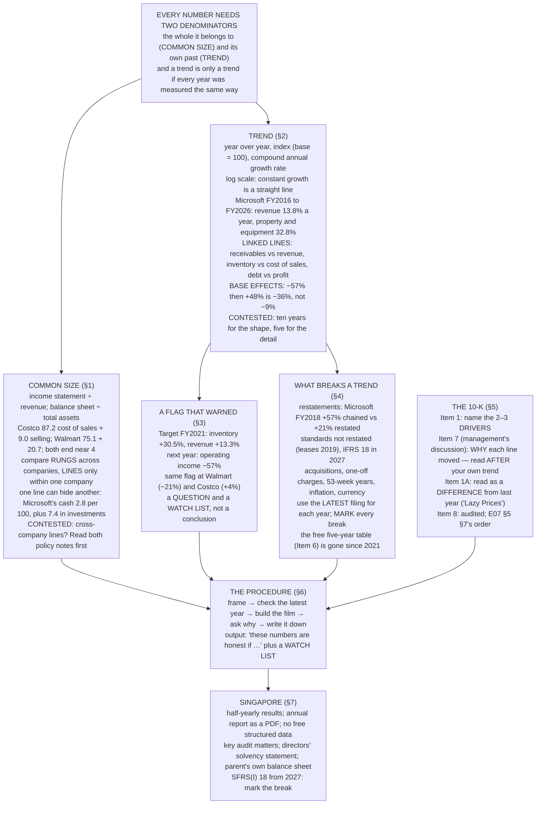

# E08 · §2 — Common Size, Trends, and Reading a Whole Annual Report

> **Subject:** Economy & Finance *(hobby track)*
> **Module:** E08 — Analysing a Company
> **Section:** the **second section of E08**. §1 divided two numbers and asked what the result could say. This
> section gives every line of a statement the same two reference points: **its share of the whole** (common
> size) and **its own past** (trend). It then takes the whole report apart, part by part, and sets out how to
> read one company across ten years and against its peers, not one report on its own.
> **Status:** 🔵 **PREPARED 2026-11-14** — body drafted, awaiting your read; **§11 Applied** will be added once
> you have driven the session Q&A. Math in LaTeX, quantitative relationships drawn as real computed figures
> (all four from filed Form 10-K figures), key terms glossed in 中文 (大陆/台灣), per
> [`../../../agent-docs/authoring-conventions.md`](../../../agent-docs/authoring-conventions.md).

**Estimated study time:** 1.5–2 hours including reflection.
**Prerequisites:** E08 §1 (every ratio is two decisions), and from E07: **E07 §2 §1.3** (two layouts of the income
statement), **E07 §4 §5.1** (five years, cumulative), **E07 §5 §1** (which parts of a report are audited) and
**E07 §5 §7** (the reading order for one report).

---

## Why this section exists (for *you*)

E07 §5 §7 gave you an order for reading **one** annual report: auditor first, then cash, then the estimates,
and so on, ending in a written judgement. That order finds problems in a single year. It cannot answer the
question an annual report is usually opened for: **is this business getting better or worse, and compared
with what?**

A single report is one frame of a film. A number in it means little until it has two reference points: its
size relative to the rest of the company that year, and its size relative to the same line in earlier years.
Those are the two techniques of this section, and both are §1's question again.

> **The organising instruction for this section: every number in a report needs two denominators before it
> means anything — the whole it belongs to (common size) and its own past (trend). And a trend is only a trend
> if every year in it was measured the same way.**

Four things this section establishes, each from filed accounts.

**One — the same operating margin can hide opposite cost structures, and some of the difference is
classification, not business.** Per 100 of revenue, Costco spends 87.2 on cost of sales and 9.0 on selling and
administration. Walmart spends 75.1 and 20.7. Both end near 4. Part of that gap is the business model (a
warehouse club does less selling), and part is where each company *chooses* to put the same kind of cost.

**Two — a trend can show a company changing what it is.** In FY2016, cash and short-term investments were
**58.5%** of Microsoft's assets and property and equipment **9.5%**. In FY2026 they were **10.1%** and **41.3%**.
Revenue grew 3.6 times over the decade. Net property and equipment grew 17 times.

**Three — trend analysis caught a real problem a year early, and also fired where nothing went wrong.** Target's
inventory grew **30.5%** in the year to January 2022 while its revenue grew **13.3%**. The next year its operating
income fell **57%**. The same flag fired at Walmart and at Costco. One of the three was fine.

**Four — a trend built across a restatement can invent growth.** Chain Microsoft's operating income as each
10-K first reported it and FY2018 grew **57%**. On the restated basis, after a new revenue standard, it grew
**21%**. Both sets of numbers were filed by the company, and both were correct under the rules of their year.

### How this section is shaped

As agreed after E07 §5: each content section ends in a *Contested* box, and every self-check in §9 has a
computed answer. **Table 1** in §1 is the reference card for the method, and **Table 6** in §5 is the map of the
10-K, so the two things you will come back to are each in one place.

---

## 1. Common size — one denominator for every line

<b>Vocabulary for this section</b> — common-size statements (click to expand)

**Abbreviations**

| Short | Stands for | Meaning |
|---|---|---|
| **SG&A** | selling, general and administrative expenses | the operating cost line below cost of sales: stores, staff, head office |
| **R&D** | research and development | a separate operating cost line at technology companies |
| **S&M / G&A** | sales and marketing / general and administrative | Microsoft splits SG&A into these two lines |
| **PP&E** | property, plant and equipment | buildings, equipment, data centres; "net" means after accumulated depreciation |
| **COGS** | cost of goods sold | same as cost of sales |
| **YoY** | year over year | the change from the same period a year earlier |
| **CAGR** | compound annual growth rate | the constant yearly growth that gets from the first value to the last |
| **FY** | fiscal year | the company's accounting year, named by the calendar year it ends in (Target's names the year it *starts* in — see §3) |

**Symbols used in the formulas**

| Symbol | Reads as | Meaning |
|---|---|---|
| $X_{t}$ | "X at t" | the value of a line in year $t$ |
| $X_{0}$ | "X nought" | the value in the base year, the first year of the series |
| $T$ | "T" | the number of years between the first and last value |

**Terms**

| Term | Definition |
|---|---|
| **Common-size statement** (vertical analysis) | every line divided by one total: revenue for the income statement, total assets for the balance sheet |
| **Trend analysis** (horizontal analysis) | the same line compared across years |
| **Classification** | which line a company puts a given cost or asset in. A policy choice, disclosed in the notes |
| **Function / nature layout** | income statements grouped by what the cost is *for* (cost of sales, selling) or by what it *is* (staff, depreciation). E07 §2 §1.3 |

A **common-size statement** divides every line by one total. The income statement goes over revenue, the
balance sheet over total assets. It is §1's idea applied to every line at once, with the same denominator for
all of them, and it does two things a raw statement does not: it removes size, so a 300-billion company sits
next to a 700-billion one, and it shows **structure** — where each unit of revenue goes, and what each unit of
assets is made of.

### 1.1 The method card

**Table 1** — the four calculations of this section: the formula, the denominator, and the question each answers.

| Calculation | Formula | Denominator | Answers | Main trap |
|---|---|---|---|---|
| Common size (income statement) | line ÷ revenue | this year's revenue | where does each unit of revenue go? | different companies put the same cost in different lines (§1.2) |
| Common size (balance sheet) | line ÷ total assets | this year's total assets | what is the company made of, and how is it funded? | one line can hide another (Microsoft's cash, §1.3) |
| Year-over-year change | $X_{t} / X_{t-1} - 1$ | last year's value | how much did this line move? | a small or unusual base year (§2.4) |
| Index | $100 \times X_{t} / X_{0}$ | the base year's value | how has the line grown since the base year, next to other lines? | the base year chosen (§2) |
| Compound annual growth rate | $\left(X_{T} / X_{0}\right)^{1/T} - 1$ | the first value, and the number of years | what steady yearly rate would produce the same change? | ignores the path in between (§2.1) |

### 1.2 The income statement per 100 of revenue

![A horizontal stacked bar chart showing four income statements per 100 of revenue, latest fiscal year. Walmart FY2026: cost of sales 75.1, selling general and administrative 20.7, operating income 4.2. Costco FY2026: cost of sales 87.2, selling general and administrative 9.0, operating income 3.9. Target FY2025: cost of sales 72.1, selling general and administrative 20.6, depreciation on its own line 2.5, operating income 4.9. Microsoft FY2026: cost of sales 32.1, research and development 10.7, sales marketing general and administrative 10.4, operating income 46.8.](diagrams/02-reading-an-annual-report-fig1.svg)

**Figure 1** — common-size income statements: where each 100 of revenue went, latest fiscal year, from each Form 10-K.

Three readings, each a warning about what a common-size line can and cannot say.

- **Costco's cost of sales is 87.2, Walmart's 75.1. That does not mean Costco buys worse.** Add the two cost
  lines and the companies are almost level: 96.2 for Costco and 95.8 for Walmart. Costco caps its markups and
  runs warehouses with little selling effort, so more of its cost is the goods themselves. But the split
  between "cost of sales" and "selling, general and administrative" is also a **classification policy**. Where a
  company puts warehouse and distribution costs, buying staff, or the cost of running its delivery network is
  stated in the policy note, and retailers do not all choose the same way.
- **Target shows depreciation on its own line (2.5 per 100); Walmart and Costco do not.** Their depreciation is
  inside the other cost lines. So Target's SG&A of 20.6 and Walmart's of 20.7 look the same and are not measured
  the same way. This is E07 §2 §1.3 again: a statement grouped by function hides some costs inside others, and
  companies draw the groups differently.
- **Microsoft's statement has a different shape altogether.** Cost of sales is 32 per 100, and the line that
  matters most after it is research and development. A retailer's common-size statement and a software
  company's are not two versions of one thing. Rule 2 from §1 applies: compare like with like.

**So the rule for comparing companies line by line: compare rungs, not lines.** Operating income per 100 of
revenue is defined the same way everywhere, because it is what is left after *all* operating costs, however they
are grouped. A single line above it can be compared across companies only after reading each one's policy on
what goes in it.

### 1.3 The balance sheet per 100 of assets

**Table 2** — common-size balance sheets, latest fiscal year end, each line as a percentage of total assets. From each Form 10-K.

| Line | Walmart FY2026 | Costco FY2026 | Target FY2025 | Microsoft FY2026 |
|---|---|---|---|---|
| Cash and cash equivalents | 3.8 | 22.7 | 9.2 | **2.8** |
| Receivables | 3.9 | 4.4 | — | 10.7 |
| Inventory | 20.7 | 21.7 | 20.7 | 0.2 |
| Net property and equipment | 47.8 | 40.0 | 56.7 | **41.3** |
| Operating lease right-of-use assets | 5.2 | 3.0 | 6.2 | 3.2 |
| Goodwill | 10.1 | 1.1 | 1.1 | 15.8 |
| *Funded by:* accounts payable | 22.2 | 25.4 | 21.2 | 5.6 |
| *Funded by:* shareholders' equity | 35.0 | 40.2 | 27.2 | 58.3 |

Read down the columns and each one describes a different kind of company.

- **The three retailers have nearly identical inventory, 20.7 to 21.7 per 100 of assets**, and payables of about
  the same size. Their suppliers fund their shelves (E08 §1 §4, the cash conversion cycle).
- **Walmart's goodwill is 10.1 per 100; Costco's and Target's about 1.** Walmart has grown partly by buying
  companies (Flipkart in India is the largest). Costco and Target have grown almost entirely by opening stores.
  That difference changes how far back a clean trend can go (§4).
- **Microsoft's cash line, 2.8 per 100, is misleading on its own.** Microsoft holds most of its liquid funds on a
  separate line, short-term investments: **55.9 billion**, a further 7.4 per 100. One line can hide another.
  **Before reading a common-size line, check whether the company splits the same thing across two lines.**

And Microsoft's column is not the one it would have had ten years ago. That is the subject of §2.

> ### Contested — can you compare common-size lines across companies at all?
>
> **The question.** If every company draws the line between cost of sales and SG&A in its own place, is a
> cross-company common-size comparison worth doing?
>
> **For.** It is the fastest way to see a business model. In one glance, Figure 1 shows that Costco runs on
> volume and a thin layer of operating cost, and Microsoft on a small cost of sales and heavy research. Table 2
> shows which companies grew by acquisition. None of those readings depends on where a single cost was put.
>
> **Against.** Every detailed reading does depend on it. "Walmart's SG&A is twice Costco's" is mostly true and
> partly classification, and the common-size table cannot tell you which part. From 2027, a company reporting
> under International Financial Reporting Standards (IFRS) that groups expenses by function must also disclose some of them by **nature** in a note,
> including depreciation and employee costs (IFRS 18), which suggests standard-setters found function-based
> lines too hard to compare.
>
> **What the evidence settles.** That rungs (gross, operating, net) are comparable across companies in the same
> industry and single lines often are not. **What it does not settle** is how much of any particular gap is
> classification. Only the policy notes say.
>
> **Where this section comes down.** **Compare rungs across companies, and lines only within one company over
> time**, where the classification is usually stable. When you must compare a line across companies, read both
> policy notes first. **This would be wrong** when one company changes its own classification, which turns a
> within-company trend into a cross-company comparison in disguise (§4).

---

## 2. Trends — the same company against its own past

<b>Vocabulary for this section</b> — measuring change over time (click to expand)

**Abbreviations**

| Short | Stands for | Meaning |
|---|---|---|
| **YoY** | year over year | the change from the same period a year earlier |
| **CAGR** | compound annual growth rate | $\left(X_{T}/X_{0}\right)^{1/T} - 1$ |
| **PP&E** | property, plant and equipment | "net" means after accumulated depreciation |
| **Capex** | capital expenditure | cash spent on property and equipment, from the investing section of the cash flow statement (E07 §4) |
| **DSO / DIO** | days sales / inventory outstanding | receivables and inventory measured in days (E07 §3 §5.1) |
| **MD&A** | management's discussion and analysis | Item 7 of the 10-K, where management explains why each line moved (§5) |

**Symbols used in the formulas**

| Symbol | Reads as | Meaning |
|---|---|---|
| $X_{t}$ | "X at t" | a line's value in year $t$ |
| $X_{0}$ | "X nought" | the base-year value |
| $X_{T}$ | "X at T" | the last value in the series |
| $T$ | "T" | the number of years between first and last |
| $g$ | "g" | a growth rate, as a decimal (0.10 = 10%) |

**Terms**

| Term | Definition |
|---|---|
| **Index** (base year = 100) | each year's value as a multiple of the base year's, times 100 |
| **Log scale** | an axis on which equal distances mean equal *ratios*. A line growing at a constant rate is straight |
| **Base effect** | a large percentage change caused mainly by an unusually high or low previous year |
| **Linked lines** | two lines that should grow at about the same rate because one drives the other (sales and receivables) |

### 2.1 Three ways to measure change

**Year-over-year change** is the familiar one, $X_{t} / X_{t-1} - 1$. It is the right tool for one step. Over
many steps it is awkward, because the percentages do not add (§2.4).

**An index** sets a base year to 100 and expresses every year as a multiple of it: $100 \times X_{t} / X_{0}$.
Its use is to put lines of very different sizes on one chart. Revenue of 300 billion and property and equipment
of 300 billion and capex of 100 billion all start at 100, so the eye compares their *growth*, not their size.

**The compound annual growth rate** summarises a whole period in one number:

$$\text{CAGR} = \left(\frac{X_{T}}{X_{0}}\right)^{1/T} - 1$$

It is the steady rate that would get from the first value to the last in $T$ years. It hides the path: a company
that doubled in year 1 and then went sideways for nine years has the same CAGR as one that grew 7.2% every year.

Two practical rules. **Plot an index on a log scale** when it grows a lot, because a constant growth rate is then
a straight line and a change in the rate is a change in slope. And **report a CAGR with its start and end years**,
because moving the base year by one changes it, sometimes by a lot (§2.4).

### 2.2 Microsoft, read as a film

![A two-panel figure for Microsoft, fiscal 2016 to fiscal 2026. The left panel is an index with fiscal 2016 equal to 100, on a log scale: revenue rises to 364, 13.8 per cent a year; operating income to 595, 19.5 per cent a year; capital expenditure to 1,390, 30.1 per cent a year; and net property and equipment to 1,706, 32.8 per cent a year. The right panel shows three common-size ratios over time: operating margin rises from 28.6 to 46.8 per cent; net property and equipment as a share of total assets rises from 9.5 to 41.3 per cent; and capital expenditure as a share of revenue rises from 9.2 to 34.9 per cent, most of the rise after fiscal 2023.](diagrams/02-reading-an-annual-report-fig2.svg)

**Figure 2** — Microsoft FY2016–FY2026: (a) four lines indexed to FY2016 = 100, on a log scale; (b) three common-size ratios over time.

Panel (a) is a trend, and panel (b) is common size over time. You need both.

- **Revenue compounded at 13.8% a year; net property and equipment at 32.8%.** On a log scale the gap between
  the two lines widens steadily: the company has been adding physical assets more than twice as fast as it has
  been adding revenue, for ten years.
- **The capex line bends upward after FY2023.** Capex was 9 to 13 per 100 of revenue until FY2023, then 18, 23
  and **35** per 100 in the last three years. That is a change in what the company is doing, and it shows as a
  change in slope, which is why the log scale is worth having.
- **Operating margin rose at the same time, from 28.6% to 46.8%.** So the business is not deteriorating on
  margins. It is converting more of each dollar into profit while needing far more assets per dollar. That is
  exactly the combination §1's DuPont tree splits apart: margin up, **asset turnover** down. Whether the new
  data-centre assets earn their keep shows up in turnover and in return on invested capital over the next few
  years, not in this year's margin.

Table 2 gave a single frame of this. Microsoft in FY2026 has the balance sheet of a company that owns
buildings and machines. In FY2016 it had the balance sheet of a company that owned a pile of cash. The trend is
the change of identity, and neither frame shows it on its own.

### 2.3 Lines that should move together

Most of the value of trend analysis comes from comparing two lines that **should grow at about the same rate**,
and noticing when they do not. Each pair below is linked by the business, so a gap between their growth rates
needs an explanation.

**Table 3** — linked lines: pairs that should grow together, what a gap usually means, and where to read the explanation.

| Faster-growing line | Than | Usually means | Innocent explanation to rule out first | Read |
|---|---|---|---|---|
| Receivables | revenue | customers are paying more slowly, or revenue is being booked early | a shift to customers on longer terms; a big sale near year end | revenue note, MD&A |
| Inventory | cost of sales | goods are not selling as planned | building stock ahead of a launch or a known shortage; rising prices | inventory note, MD&A (§3) |
| SG&A | revenue | costs are out of control | a deliberate investment in stores or staff | MD&A |
| Property and equipment | revenue | assets are being added ahead of the sales they are meant to produce | the investment is deliberate and early (Microsoft) | capex discussion in MD&A |
| Debt | operating income | leverage is rising | debt-funded buybacks (§1 §11) or an acquisition | debt note, cash flow statement |
| Operating income | operating cash flow | profit is not becoming cash | working capital growing with sales | E07 §4 §2 |

These pairs are the **trend version** of E07 §5 §5's red flags, and they inherit the same arithmetic: each one
fires much more often than something is actually wrong. §3 shows one that fired three times.

### 2.4 Percent of a percent — base effects

Percentage changes do not add, and they mislead most when the previous year was unusual. Target's operating
income went from 8,946 million to 3,848 million and then to 5,707 million:

- FY2022: $3{,}848 / 8{,}946 - 1 = -57.0$%
- FY2023: $5{,}707 / 3{,}848 - 1 = +48.3$%

A headline of "+48%" describes a recovery. But over the two years together, $5{,}707 / 8{,}946 - 1 = -36.2$%.
Adding the two changes gives −8.7%, which is wrong: a fall of 57% needs a rise of 133% to get back to where it
started. **The base was abnormally low, so the growth rate was abnormally high.** This is a **base effect**, and
a percentage change after a bad year (or a pandemic year) is the most common place to meet one.

The repair is the index. Measured against FY2021 = 100, Target's operating income was 43 in FY2022 and 64 in
FY2023. Nobody reads 64 as a strong year.

> ### Contested — how many years make a trend?
>
> **The question.** Three years, five, ten? E07 §4 §5.1 said five for cash flow. Is there a right answer?
>
> **For long (ten years).** A business cycle runs several years (E02 §4). Fewer than about seven years can sit
> entirely inside a boom, and Target's FY2018–FY2021 looked like a steady climb until FY2022. Ten years also
> shows changes of identity like Microsoft's, which happen slowly.
>
> **For short (three to five).** Companies change. A ten-year trend for Microsoft averages a cash-rich software
> company with a capital-intensive one, and the early years say little about the business today. Older years
> are also more likely to have been measured under different rules (§4), which makes a long series less
> consistent, not more informative.
>
> **What the evidence settles.** That one year is never enough and that a trend has to include at least one
> downturn to say anything about resilience. **What it does not settle** is how far back the company you are
> reading is still the same company.
>
> **Where this section comes down.** **Ten years for the shape, five for the detail**, and the start of the
> series set **after the last change of identity** you can find: a large acquisition, a change of business
> model, a change of accounting standard that was not restated. **This would be wrong** for a young company,
> where five years may be the whole history and you must say so.

---

## 3. A trend that warned — and fired where nothing was wrong

<b>Vocabulary for this section</b> — the 2022 inventory glut (click to expand)

**Abbreviations**

| Short | Stands for | Meaning |
|---|---|---|
| **DIO** | days inventory outstanding | inventory ÷ cost of sales × 365. Here on year-end inventory |
| **COGS** | cost of goods sold | cost of sales |
| **FY** | fiscal year | **Target's FY2021 ends on 29 January 2022**: Target names its fiscal year by the calendar year in which most of it falls. Walmart's FY2022 ends 31 January 2022. Same twelve months, different label |

**Terms**

| Term | Definition |
|---|---|
| **Inventory glut** | inventory well above what is selling, usually followed by markdowns |
| **Markdown** | a price cut to clear stock. Lowers gross margin |
| **False positive** | a flag that fires when nothing is wrong (E07 §5 §5.3) |
| **Nominal / real** | measured in current prices / adjusted for inflation |

Target's fiscal year 2021 ended on 29 January 2022. Its 10-K, filed in March 2022, showed a record year: revenue
up **13.3%** and operating income up **36.8%**. On the balance sheet, inventory was up **30.5%**, and year-end
inventory was 68 days of cost of sales, against 59 a year earlier.

![A two-panel figure for Target, fiscal 2018 to fiscal 2025, with fiscal 2021 shaded. The left panel indexes revenue, inventory and operating income to fiscal 2018 equal to 100. In fiscal 2021 inventory reaches 146 and revenue 141; inventory grew 30.5 per cent in that year and revenue 13.3 per cent. Operating income peaks at 218 in fiscal 2021 and falls to 94 in fiscal 2022, a drop of 57 per cent. The right panel shows gross margin, about 29.3 per cent from fiscal 2018 to fiscal 2021, falling to 24.6 per cent in fiscal 2022 and recovering to about 28 per cent; and operating margin rising from 5.5 per cent to 8.4 per cent in fiscal 2021, falling to 3.5 per cent in fiscal 2022 and settling near 5 per cent.](diagrams/02-reading-an-annual-report-fig3.svg)

**Figure 3** — Target FY2018–FY2025: (a) revenue, inventory and operating income indexed to FY2018; (b) gross and operating margin. FY2021 ends 29 January 2022.

In the following year, demand moved away from the categories Target had stocked up on, and Target cut prices to
clear the goods. Gross margin fell from 29.3% to 24.6%, and operating income fell **57%**. The flag in Table 3
— inventory growing faster than cost of sales — had fired in the filing a year earlier.

That sounds like a clean win for trend analysis. Now look at the same flag at Target's two largest peers, in
the fiscal years that cover the same period.

**Table 4** — the same flag at three retailers: inventory growth against revenue and cost-of-sales growth, and what happened to operating income the following year. From each Form 10-K.

| Company, fiscal year | Year ends | Revenue growth | Cost of sales growth | **Inventory growth** | Operating income, next year |
|---|---|---|---|---|---|
| Target FY2021 | 29 Jan 2022 | +13.3% | +13.3% | **+30.5%** | **−57.0%** |
| Walmart FY2022 | 31 Jan 2022 | +2.4% | +2.1% | **+25.7%** | **−21.3%** |
| Costco FY2022 | 28 Aug 2022 | +15.8% | +16.8% | **+26.0%** | **+4.1%** |

**The flag fired at all three, and was right about two.** Three things to take from that.

1. **The innocent explanations were real.** In 2021 retailers were short of goods because of shipping delays,
   and many deliberately ordered early and ordered more. And US consumer prices rose about 7% in 2021, so part
   of each inventory increase was price, not quantity. The flag could not tell those apart from "goods are not
   selling".
2. **What distinguished the cases was not in the flag.** Costco sells a narrow range of staple goods to members
   who come back every week. Target and Walmart had stocked more discretionary goods (home furnishings,
   electronics, clothing), which is where demand fell. The *mix* of the inventory, which the 10-K describes
   only in words, mattered more than its size.
3. **The flag was worth acting on as a question, not a conclusion.** The right response in March 2022 was to
   read the MD&A and the earnings call for what the company said the inventory was, and to watch the next
   quarter's gross margin. Target's first-quarter results in May 2022 showed the margin falling, and its share
   price fell by about a quarter in a day. A reader who had the question ready was not surprised.

This is E07 §5 §5.3's arithmetic, seen in one year: a flag with a high false-positive rate is useful only as a
reason to look closer, and the decisive information is usually somewhere the ratio does not reach.

> ### Contested — was Target's problem visible in the filing?
>
> **The question.** With hindsight, inventory growth of 30.5% against revenue of 13.3% looks obvious. Could a
> careful reader have seen it coming in March 2022?
>
> **Visible.** The numbers were on the face of the balance sheet. Days of inventory jumped from 59 to 68. The
> flag is in every textbook. A reader who ran the linked-lines check of Table 3 would have had a specific
> question to ask.
>
> **Not visible.** The same check fired at Costco, which was fine. The 10-K's explanation (stocking ahead of
> supply-chain delays, and higher prices) was true. The thing that went wrong — a shift in consumer demand
> away from goods bought during the pandemic — was a forecast about the economy, not a fact in the accounts.
>
> **What the evidence settles.** That the flag was there, and that it could not by itself separate Target from
> Costco. **What it does not settle** is whether the inventory mix was knowable from outside; the 10-K gave
> categories only in broad terms.
>
> **Where this section comes down.** **Visible as a question, not as an answer.** Trend analysis told a reader
> where to look and what to watch next (gross margin in the next quarter). It could not have told them the
> outcome. **This would be wrong** if the company had disclosed inventory by category and age, which some
> retailers do in their investor materials, and which turns the question into something closer to an answer.

---

## 4. What breaks a trend

<b>Vocabulary for this section</b> — consistency over time (click to expand)

**Abbreviations**

| Short | Stands for | Meaning |
|---|---|---|
| **ASC 606** | Accounting Standards Codification Topic 606 | the US revenue standard, effective 2018 (E07 §2 §2) |
| **ASC 842** | Accounting Standards Codification Topic 842 | the US lease standard, effective 2019 (E08 §1 §5) |
| **IFRS 18** | International Financial Reporting Standard 18 | the new presentation standard, effective 1 January 2027 |
| **TCJA** | Tax Cuts and Jobs Act | the US tax law of December 2017 that cut the corporate rate to 21% |
| **XBRL** | eXtensible Business Reporting Language | the tagged-data format of SEC filings (E07 §1 §9) |
| **SEC** | Securities and Exchange Commission | the US securities regulator |

**Terms**

| Term | Definition |
|---|---|
| **Restatement** | re-presenting prior years' numbers in a later filing. Either to correct an error, or to apply a new rule to the comparatives |
| **Full retrospective / modified retrospective** | apply a new standard to all comparative years shown / only from the first day of the year of adoption, with no restated comparatives |
| **Comparatives** | the prior-year columns printed next to the current year in a filing |
| **Organic growth** | growth excluding acquisitions, disposals and currency effects. Not defined by any standard |
| **53-week year** | a fiscal year that ends on a weekday (say, the Saturday nearest 31 January) has 53 weeks about every five or six years |
| **First-reported / latest-filed** | a year's numbers as in the first 10-K that showed them / as in the most recent 10-K that shows them |

§1 said a trend is only a trend if every year in it was measured the same way. This section lists the ways that
fails, starting with the largest.

### 4.1 Restatements

On 1 July 2017 Microsoft adopted the new US revenue standard, ASC 606. It chose the **full retrospective**
method, which means the 10-K for FY2018 re-presented FY2017 and FY2016 as if the new standard had always
applied. The main effect was on Windows 10: under the old rules, Microsoft had deferred much of the revenue
from Windows licences sold with new PCs. Under ASC 606 most of it was recognised when the licence was delivered.

![A two-panel figure for Microsoft, fiscal 2015 to fiscal 2019. Each panel shows two lines. Revenue as first reported was 93.6 billion in fiscal 2015, 85.3 in 2016, 90.0 in 2017, then 110.4 and 125.8. Restated revenue is 91.2 in 2016 and 96.6 in 2017. Fiscal 2018 revenue growth is 22.7 per cent chaining first-reported figures and 14.3 per cent on the restated basis. Operating income as first reported was 18.2, 20.2 and 22.3 billion in fiscal 2015 to 2017; restated it is 26.1 and 29.0 for fiscal 2016 and 2017. Fiscal 2018 operating income growth is 57.0 per cent chaining first-reported figures and 20.8 per cent restated.](diagrams/02-reading-an-annual-report-fig4.svg)

**Figure 4** — Microsoft FY2015–FY2019: revenue and operating income as each year was first reported, against the restated figures in later 10-Ks.

FY2017's operating income was **22.3 billion** in the FY2017 10-K and **29.0 billion** in the FY2018 10-K.
Both are correct: each is the number under the rules that applied when it was filed. But **a trend that takes
FY2017 from one filing and FY2018 from the next** shows operating income rising 57%, when on a consistent basis
it rose 21%. The 36 points in between are a change of rules, not a change in the business.

Two consequences.

- **Build a series from the latest filing that shows each year.** The newest 10-K shows three years of income
  statement on the current rules. For older years, use the earliest filing *after* the last restatement, and
  mark the year where the rules change. In the XBRL data this is the difference between taking the
  **latest-filed** and the **first-reported** value of each year, which is how Figure 4 was drawn.
- **A restatement to correct an error is a different thing** from a restatement to apply a new standard. The
  first is a red flag in its own right (E07 §5 §5); the second is routine. The 10-K says which, in a note near
  the start of the financial statements.

### 4.2 The checklist

**Table 5** — what breaks a trend, how to recognise it, and the repair.

| What breaks it | Real example | How you recognise it | Repair |
|---|---|---|---|
| **New standard, restated** | Microsoft, ASC 606 (FY2018) | prior years differ between two 10-Ks | use the latest filing for every year it covers; mark the break before that |
| **New standard, not restated** | most US companies adopted ASC 842 leases in 2019 **without** restating 2018 | a "cumulative effect" line in equity; a jump in assets and liabilities in one year | treat the year of adoption as a break; compare from it onwards |
| **Coming: IFRS 18 (2027)** | every IFRS reporter, including Singapore Exchange (SGX) companies | new subtotals (operating, investing, financing categories) in the income statement | IFRS 18 requires restated comparatives, so the 2027 report will show 2026 on the new basis; older years will not match |
| **Acquisition** | Microsoft bought LinkedIn (FY2017) and Activision Blizzard (FY2024); goodwill rose from 17.9 to 35.1 and from 67.9 to 119.2 billion | a step in goodwill; a jump in revenue | use the **organic** growth rate given in MD&A, if there is one, and say whose definition it is |
| **One-off items** | Microsoft's FY2018 net income fell to 16.6 billion from 25.5, after a 13.7 billion charge under the TCJA | a line called "impairment", "restructuring", or a tax charge with a footnote | trend operating income, not net income; or remove the item and say so |
| **53-week year** | Target FY2023 and Costco FY2023 had 53 weeks | the fiscal year end date moves by a week; the 10-K says so | scale revenue by 52/53 to compare (question 9) |
| **Inflation** | US consumer prices rose about 7% in 2021 | nominal growth of every line at once | compare growth with the inflation rate, or with volumes if the company gives them |
| **Currency** | a company reporting in US dollars with most sales abroad | MD&A gives a "constant currency" growth rate | use it, and remember it is company-defined (E07 §5 §4) |
| **Segment re-cut** | a company reorganises its segments | the segment note shows recast prior years, or does not | use the recast figures; if there are none, the segment trend stops there |

### 4.3 Where ten years of data now comes from

Until 2021, every 10-K included **Item 6, "Selected Financial Data"**: a five-year table of key figures, ready
for trend analysis. The SEC removed the requirement in 2021, and most companies have dropped the table. A 10-K
now gives three years of income statement and two of balance sheet.

So a ten-year series is something you build. You have three sources:

- **The filings themselves**, one every few years, taking each year from the latest filing that shows it (§4.1).
- **The SEC's XBRL data**, which gives every tagged fact from every filing, with the date it was filed. It is
  what this module's figures use. The traps are the ones in E07 §1 §10b and E08 §1 §10: tag names change,
  durations must be filtered, and the same year appears in several filings.
- **A data vendor**, which has done the work and made its own choices about restatements, usually without
  telling you which.

> ### Contested — first-reported or restated numbers?
>
> **The question.** When a company restates, which numbers belong in a trend: what it reported at the time, or
> the restated figures?
>
> **For restated.** They are measured the same way as the current year. A trend is a comparison, and a
> comparison across different rules is not one. Figure 4 shows the size of the error.
>
> **For first-reported.** They are what investors actually saw and priced at the time. If you are asking "did
> the market react sensibly to the information it had?" — an E09 question — the restated figures did not exist
> yet. And restated figures only go back two or three years, so a long series mixes both anyway.
>
> **What the evidence settles.** That mixing the two in one series produces growth that never happened.
> **What it does not settle** is which to use, because they answer different questions.
>
> **Where this section comes down.** **For judging the business, restated, with the break marked where they
> run out. For judging what investors knew, first-reported.** Never mix them without saying so. **This would be
> wrong** if the restatement corrected an error, in which case the first-reported numbers were not "what the
> company knew" but what it got wrong, and the restatement itself is the finding.

---

## 5. The 10-K, part by part

<b>Vocabulary for this section</b> — US filings (click to expand)

**Abbreviations**

| Short | Stands for | Meaning |
|---|---|---|
| **10-K / 10-Q** | SEC form numbers | the annual report / the quarterly report |
| **8-K** | SEC form number | the "current report", filed within four business days of a major event |
| **20-F** | SEC form number | the annual report of a foreign private issuer (Sea, Grab) |
| **DEF 14A** | SEC form code | the definitive proxy statement, sent before the annual meeting |
| **MD&A** | management's discussion and analysis | Item 7 of the 10-K: management's explanation of the results |
| **Regulation S-K** | — | the SEC rules that set out what each item of a filing must contain |
| **CAM** | critical audit matter | a matter the auditor found hardest to judge, described in the auditor's report (E07 §5 §2.1) |
| **EDGAR** | Electronic Data Gathering, Analysis and Retrieval | the SEC's public filing system |

**Terms**

| Term | Definition |
|---|---|
| **Large accelerated filer** | a company with at least 700 million dollars of shares held by the public. Files its 10-K within 60 days of the year end |
| **Incorporated by reference** | a 10-K item that says "see the proxy statement" instead of repeating it |
| **Known trends or uncertainties** | what Regulation S-K Item 303 requires MD&A to discuss: trends management knows of that are reasonably likely to affect future results |
| **Risk factor summary** | required at the front of Item 1A when the risk factors run longer than fifteen pages |
| **Furnished / filed** | an earnings release is *furnished* on an 8-K, with less legal liability than a *filed* document |

E07 §5 §1.1 sorted the report by audit standing. This section sorts the 10-K by **what you go to it for**.

### 5.1 The map

**Table 6** — the 10-K, item by item: what is in each, whether it is audited, and what to use it for.

| Item | Title | Audited? | Use it for | Time on a first read |
|---|---|---|---|---|
| **1** | Business | no | what the company sells, to whom, through which segments, against which competitors | 10 min |
| **1A** | Risk factors | no | **what changed since last year** (§5.3); otherwise mostly boilerplate | 10 min, as a diff |
| 1B | Unresolved staff comments | no | open disagreements with the SEC's reviewers; usually "none" | 1 min |
| **1C** | Cybersecurity | no | how cyber risk is governed; new since 2023 | skim |
| 2 | Properties | no | stores, plants, data centres: owned or leased, and where | skim |
| 3 | Legal proceedings | no | lawsuits large enough to mention; the amounts are in the contingencies note | 2 min |
| 5 | Market for the shares | no | buybacks by month, dividend policy | 2 min |
| 6 | [Reserved] | — | was "Selected financial data" until 2021 (§4.3) | — |
| **7** | **MD&A** | no | **why** each line moved; segment results; liquidity; **critical accounting estimates**; known trends | 30 min |
| 7A | Market risk | no | sensitivity to interest rates, currencies, commodity prices | 5 min |
| **8** | **Financial statements and notes** | **yes** | the numbers, the policies and the estimates; the auditor's report with its CAMs | E07 §5 §7's order |
| 9A | Controls and procedures | partly | management's assessment of internal control, and the auditor's opinion on it (E07 §5 §2.1) | 2 min |
| 10–14 | Directors, pay, ownership, related parties, audit fees | no | usually "incorporated by reference" to the proxy statement | read the proxy instead |
| 15 | Exhibits | — | debt agreements (with covenants), material contracts, subsidiaries | when you need a covenant |

The time column adds up to about an hour and a half for a first read of a company you do not know, most of it
in Items 7 and 8. A second year's 10-K for a company you already know takes much less, because most of Items 1
and 1A will be unchanged — and finding what *did* change is the job.

### 5.2 The other filings

**Table 7** — the other filings a company produces, how quickly, and what they add to the 10-K.

| Filing | When | What it adds | Audited? |
|---|---|---|---|
| **10-Q** (quarterly) | within 40 days of quarter end (large companies) | three quarters a year; condensed statements and an MD&A | reviewed, not audited |
| **8-K** (current report) | within 4 business days of an event | acquisitions, executive departures, auditor changes, **earnings releases** (furnished, Item 2.02) | no |
| **Earnings release** | the day results are announced, before the 10-K or 10-Q | the headline numbers, usually with "adjusted" measures (E07 §5 §4) | no |
| **DEF 14A** (proxy statement) | before the annual meeting | executive pay and how it is set, board members, related-party transactions | no |
| **20-F** | within 4 months of year end | the annual report of a foreign company listed in the US; similar content to a 10-K, IFRS allowed | yes (statements) |

Two practical points. **The earnings release comes first and is the least reliable**: unaudited, built around
the company's own adjusted numbers, and often published weeks before the 10-K. And **the proxy statement is
where incentives are**: if management is paid on adjusted earnings per share, that tells you which number they
are working to move (E07 §2 §5.4).

### 5.3 The narrative parts, and what they are good for

The audited statements are E07's subject. The parts that are not audited are not therefore useless; each one
answers a question the statements cannot.

- **Item 1, Business — what drives the numbers.** Read it once, with one aim: **name the two or three numbers
  that drive this business.** For Costco that is the number of members, the renewal rate and sales per
  warehouse. For a real estate investment trust (REIT) it is occupancy, rent per square metre and the cost of debt. Those are the lines to
  trend, and many of them are outside the financial statements.
- **Item 7, MD&A — why each line moved.** Regulation S-K requires management to discuss **known trends or
  uncertainties** reasonably likely to affect future results, and to explain material changes in each line.
  So MD&A is where Table 3's innocent explanations are offered. Read it **after** your own trend analysis,
  with a list of the lines that moved, and check whether each one is explained. **An unexplained move is the
  finding.**
- **Item 1A, Risk factors — read as a difference, not as text.** Most risk factors are boilerplate that lawyers
  copy from year to year. That is exactly what makes a change informative: a new paragraph, a deleted one, or a
  sentence that has become more specific. Put this year's and last year's side by side.

> ### Contested — is the text of a 10-K worth reading?
>
> **The question.** The narrative parts are unaudited, long and written by lawyers. Does reading them add
> anything to the numbers?
>
> **Not worth it.** A risk-factors section can run to thirty pages and is written to protect the company in
> court, not to inform. MD&A often restates the numbers in words. A professional reads the numbers; the text is
> what the company wants you to think.
>
> **Worth it, as a difference.** Lauren Cohen, Christopher Malloy and Quoc Nguyen ("Lazy Prices", *Journal of
> Finance*, 2020) compared every US 10-K and 10-Q filed between 1995 and 2014 with the company's previous one.
> Companies that changed their language — particularly about **risk factors, litigation and the executive
> team** — had lower future earnings and returns, and more bankruptcies. A portfolio buying non-changers and
> selling changers earned an abnormal return of up to 188 basis points a month. The market did not react when the filing came out,
> which suggests investors were not reading the changes.
>
> **What the evidence settles.** That **changes** in the text carry information, and that, in the period
> studied, the market was slow to use it. **What it does not settle** is whether that is still true now that
> software can compare filings automatically, or what any single change means.
>
> **Where this section comes down.** **Read the text as a difference from last year, not as a document.** Item 1
> once, to name the drivers. Item 7 against your own list of moved lines. Item 1A side by side with last year's.
> **This would be wrong** for your first year with a company, where there is no difference to read and the
> whole text is new information.

---

## 6. Reading a whole report — across years, in about two hours

<b>Vocabulary for this section</b> — the procedure (click to expand)

**Abbreviations**

| Short | Stands for | Meaning |
|---|---|---|
| **MD&A** | management's discussion and analysis | Item 7 |
| **XBRL** | eXtensible Business Reporting Language | the SEC's tagged data |
| **ROIC** | return on invested capital | E08 §1 §2.3 |

**Terms**

| Term | Definition |
|---|---|
| **Driver** | a quantity that the revenue or cost of the business depends on directly (members, stores, units shipped, occupancy) |
| **Watch list** | the two or three numbers to check first in the next filing, written down in advance |
| **Falsifiable** | stated so that a later filing could show it to be wrong (E07 §5 §7) |

E07 §5 §7 gave an order for finding problems in **one** report. This section wraps it in the two things a single
report cannot give you: the company's past, and its peers.

**Table 8** — reading a company across years: the five stages, where E07 §5 §7's order fits, and the output of each.

| Stage | Do | Using | Output |
|---|---|---|---|
| **1. Frame** (15 min) | read Item 1; name the 2–3 drivers; pick 2–3 peers | Item 1, the segment note | a sentence: *"this business makes money by …, and it depends on …"* |
| **2. Check the latest year** (45 min) | E07 §5 §7 steps 1–6: auditor, cash flow, estimates notes, income statement, balance sheet, adjusted numbers | Item 8, the earnings release | anything that stops the read; the year's changes in policy and estimate |
| **3. Build the film** (40 min) | common-size the income statement and balance sheet; ten-year index of the linked lines in Table 3; §1's ratio tree over five years; the same for one or two peers | XBRL or several 10-Ks; mark every break (Table 5) | a list of **lines that moved**, each with its direction and size |
| **4. Ask why** (20 min) | for each line that moved, find the explanation in MD&A; diff Item 1A against last year | Items 7 and 1A | a list of moves **without** a satisfactory explanation |
| **5. Write it down** (5 min) | E07 §5 §7 step 7, plus a watch list | — | *"these numbers are honest if …"*, and the 2–3 numbers to check first next quarter |

Two things about the order. **The trend work comes before MD&A**, so that management's explanation is
checked against your list instead of setting it. And **the output is a watch list, not a verdict.** For Target in
March 2022 the watch list would have read: *"gross margin in the first quarter, and inventory against sales."*
Both moved within two months.

The times assume a company you do not know. For one you already follow, stages 1 and 3 are an update, and the
whole read is closer to an hour.

---

## 7. Singapore and the region *(local lens)*

<b>Vocabulary for this section</b> — Singapore annual reports (click to expand)

**Abbreviations**

| Short | Stands for | Meaning |
|---|---|---|
| **SGX** | Singapore Exchange | the stock exchange; SGX RegCo is its regulatory arm |
| **SFRS(I)** | Singapore Financial Reporting Standards (International) | IFRS, word for word |
| **SFRS(I) 18** | — | the Singapore adoption of IFRS 18, effective for years beginning on or after 1 January 2027 |
| **SSA 701** | Singapore Standard on Auditing 701 | requires the auditor's report to describe key audit matters |
| **KAM** | key audit matter | the international equivalent of a CAM (E07 §5 §2.1) |
| **AGM** | annual general meeting | the yearly meeting of shareholders |
| **IPT** | interested person transaction | SGX's term for a transaction between a listed company and a director, controlling shareholder or their associates |
| **REIT** | real estate investment trust | E06 §2 §7 |
| **ISSB** | International Sustainability Standards Board | sets the climate disclosure standards Singapore is phasing in |

**Terms**

| Term | Definition |
|---|---|
| **Directors' statement** | a statement by the board, required by the Companies Act, that the accounts are true and fair and that there are reasonable grounds to believe the company can pay its debts as they fall due |
| **Comply or explain** | follow a provision of the Code of Corporate Governance, or explain why not |
| **Company-level balance sheet** | the parent company's own balance sheet, printed next to the group's |
| **Half-yearly reporting** | results every six months; SGX's default since 2020 |

A Singapore listed company's annual report is a printed document (a PDF, in practice), not a standard form, so
its parts come in the company's own order. The content overlaps a 10-K's, but the differences are useful to
know before you open one.

**Table 9** — a Singapore annual report against a 10-K: where each kind of information is, and what is different.

| You want | 10-K | SGX annual report | What is different |
|---|---|---|---|
| The audited statements | Item 8 | financial statements under SFRS(I) | **the company's own balance sheet is printed next to the group's**, which shows what the listed parent itself owns and owes |
| The auditor's hardest judgements | CAMs | **key audit matters** (SSA 701) | KAMs are required for every listed company (E07 §5 §6) |
| Management's explanation | MD&A, Item 7, with required content | an "operating and financial review" or chairman's and CEO's statements | **no prescribed equivalent of MD&A**: the format and depth are the company's choice, and most of it is unaudited |
| A solvency statement | none | **directors' statement**: reasonable grounds to believe the company can pay its debts | a direct statement by the board, signed |
| Governance | proxy statement | corporate governance report, **comply or explain** against the 2018 Code | read the "explain" parts; they are the deviations |
| Related-party dealings | proxy, related-party note | related-party note **and** the interested person transactions table | listing rules set thresholds for announcement and shareholder approval |
| Climate and sustainability | limited (US rules contested) | sustainability report; ISSB-based climate disclosures being phased in from FY2025 | more required than in the US |
| How often | 10-K yearly, 10-Q quarterly | full-year and **half-year** results (SGX Listing Rule 705); quarterly only for companies with audit or regulatory concerns since 7 February 2020 | half as many data points a year for trend work |
| Structured data | XBRL, free, from the SEC | no free equivalent of the SEC's companyfacts API | most people copy from the PDF or pay a data vendor |

Three consequences for trend work in Singapore.

- **Fewer and slower data points.** Half-yearly results and a PDF annual report mean that a ten-year trend for a
  Singapore company is twenty half-years typed in by hand, or a vendor's series whose restatement choices you
  cannot see. Keep the series short and mark its source.
- **The 2027 break is coming.** SFRS(I) 18 applies from financial years beginning 1 January 2027. The FY2027
  annual report will restate FY2026 into the new income statement categories, and FY2025 and earlier will not
  match. **Any Singapore trend you build that crosses 2026–2027 needs a marked break.**
- **Read the parent's own balance sheet.** Because Singapore prints it, you can see whether the listed company's
  debt sits at the top, where shareholders' dividends come from, or in subsidiaries, where lenders to the
  subsidiaries are paid first. A 10-K does not show this at all.

> ### Contested — is half-yearly reporting enough?
>
> **The question.** In 2020 SGX stopped requiring most companies to report quarterly. Is a reader worse off?
>
> **Worse off.** Target's warning (§3) came from the first quarterly report after the 10-K. A half-yearly reporter
> would have shown the same deterioration up to three months later. Fewer data points also make trends noisier.
>
> **Not worse off.** Continuous disclosure rules still require any material change to be announced when it
> happens, not at the next report. Quarterly reporting was criticised for encouraging short-term management,
> and it is costly for small companies. Many large Singapore companies, including the three local banks and many
> REITs, still publish quarterly figures or business updates voluntarily.
>
> **What the evidence settles.** That half-yearly reporting gives fewer, later data points, and that material
> events must still be announced. **What it does not settle** is how much difference that makes for a
> long-term holder, which depends on how fast the business changes.
>
> **Where this section comes down.** **Enough for a long-term holder of a stable business**, and not enough for
> one whose margins can move within a quarter. For the second kind, check whether the company publishes
> voluntary quarterly updates, and use them. **This would be wrong** if continuous disclosure were weakly
> enforced, in which case the half-year gap is when bad news waits.

---

## 8. The one-page mental model

<!-- DIAGRAM:START -->

Diagram source (Mermaid)

<!-- DIAGRAM:END -->

**Figure 5** — the one-page mental model for E08 §2: two denominators for every number, and the procedure that uses them.

---

## 9. Check your understanding

1. Costco's cost of sales is 87.2 per 100 of revenue and Walmart's 75.1. Compute each company's total operating
   costs per 100 of revenue from Figure 1. What can you conclude from the comparison, and what can you not?
2. A retailer reports revenue 2,000, cost of sales 1,400, SG&A 450 and depreciation on its own line 50.
   (a) Compute its common-size income statement and operating margin. (b) Its peer includes depreciation in
   SG&A. Restate the first company the same way. Which common-size lines change, and which do not?
3. Microsoft's cash and short-term investments were 113,240 million of total assets of 193,468 million in FY2016,
   and 76,843 of 758,376 in FY2026. Its net property and equipment was 18,356 and 313,076. Compute both lines as a
   share of total assets in both years, and describe the change in one sentence.
4. Microsoft's revenue went from 91,154 million in FY2016 to 331,839 million in FY2026, and net property and
   equipment from 18,356 million to 313,076 million. Compute both compound annual growth rates. What does the
   difference imply for asset turnover, and where in E08 §1 would you look next?
5. Target's operating income was 8,946 million in FY2021, 3,848 in FY2022 and 5,707 in FY2023. Compute both
   year-over-year changes and the two-year change. Why is adding the two yearly changes wrong, and what rise
   would FY2023 have needed to get back to FY2021?
6. A company's revenue grew 8% and its receivables 25%. Its days sales outstanding was 45 last year. Estimate
   it this year. Name one innocent explanation and say where in the 10-K you would check it.
7. Using Table 4, compute for each retailer the gap between inventory growth and cost-of-sales growth. Did the
   size of the gap separate the company that was fine from the two that were not? What did?
8. Microsoft's FY2017 operating income was 22,326 million as first reported and 29,025 million as restated; FY2018
   was 35,058 million. Compute FY2018 growth both ways. Which is right for judging the business, and how should a
   ten-year series be built so the error cannot happen?
9. Target's FY2023 had 53 weeks and revenue of 107,412 million. FY2024 had 52 weeks and revenue of 106,566
   million. Compute reported growth, then growth on a 52-week basis for FY2023. What does the adjustment ignore?
10. In Target's FY2021 inventory grew 30.5% and revenue 13.3%. Suppose prices of the goods rose 7% over the year.
    Estimate the real growth of each and say whether inflation explains the gap.
11. Where in a 10-K (or which other filing) would you find: (a) how much of Microsoft's FY2024 revenue growth came
    from Activision Blizzard; (b) the maturity dates of a retailer's leases; (c) what the CEO is paid on; (d)
    whether a new risk was added this year; (e) the auditor's hardest judgement; (f) a covenant in a loan
    agreement?
12. A Singapore company has a 31 December year end. (a) Under Listing Rule 705's 60-day limit, by when must its
    full-year results be announced? (b) Its FY2027 annual report is the first under SFRS(I) 18. Which years in
    a ten-year trend built in 2028 are on the new basis, and where is the break? (c) What does its directors'
    statement say that a 10-K does not?

<b>Answers</b> (open only after you have tried all twelve)

1. **Costco 87.2 + 9.0 = 96.2; Walmart 75.1 + 20.7 = 95.8**, so both keep about 4 per 100 as operating income
   (Figure 1). You can conclude that the two businesses have nearly the same total cost per unit of revenue, and
   that Costco's cost sits more in the goods. You **cannot** conclude that Costco buys worse or sells more
   cheaply from the split alone, because where each company puts distribution and other costs is a
   classification policy (§1.2). Compare the operating rung; read the policy notes before comparing lines.
2. **(a) Cost of sales 70.0%, SG&A 22.5%, depreciation 2.5%, operating margin 5.0%.** (b) Moving depreciation
   into SG&A gives **SG&A 25.0%**, no depreciation line, and **operating margin still 5.0%**. Only the lines
   inside the operating rung change; the rung itself does not (§1.2). That is why rungs compare across
   companies and lines do not.
3. **FY2016: cash and investments 58.5%, property and equipment 9.5%. FY2026: 10.1% and 41.3%** (§2.2, Table
   2). In one sentence: Microsoft has changed from a company whose assets were mostly cash into one whose assets
   are mostly data centres and equipment.
4. **Revenue: $(331{,}839 / 91{,}154)^{1/10} - 1 \approx 13.8$% a year. Property and equipment:
   $(313{,}076 / 18{,}356)^{1/10} - 1 \approx 32.8$% a year** (Figure 2). Assets in property and equipment grew
   much faster than revenue, so **asset turnover fell** (revenue per unit of assets). Look at E08 §1 §3.1, the
   DuPont split, and §2.3, ROIC: whether the investment pays off shows in turnover and return on invested
   capital, not in the margin, which rose.
5. **FY2022: −57.0%. FY2023: +48.3%. Two years: $5{,}707 / 8{,}946 - 1 = -36.2$%** (§2.4). Percentage changes
   compound, they do not add: $0.430 \times 1.483 = 0.638$. To get back from 3,848 to 8,946 needed
   $8{,}946 / 3{,}848 - 1 = +132.5$%. The +48% was large because the base was abnormally low.
6. **About 52 days**: receivables grew 25% and revenue 8%, so days outstanding scale by $1.25 / 1.08 \approx
   1.157$, and $45 \times 1.157 \approx 52$. Innocent explanations: a large sale near the year end, a shift to
   customers on longer terms, or an acquisition whose receivables arrived without a full year of its revenue.
   Check the **revenue note** (contract balances, customer concentration) and **MD&A** (Table 3).
7. **Target 30.5 − 13.3 = 17.2 points; Walmart 25.7 − 2.1 = 23.6 points; Costco 26.0 − 16.8 = 9.2 points.**
   Costco's gap was the smallest, and it was the one that was fine, so the size of the gap pointed the right
   way here. But Walmart's gap was larger than Target's and its fall was smaller (−21% against −57%), so the gap
   did not measure the damage. What separated them was **the mix of the inventory** — staples against
   discretionary goods — and the shift in demand that followed, neither of which the ratio shows (§3).
8. **Chained first-reported: $35{,}058 / 22{,}326 - 1 = +57.0$%. Restated: $35{,}058 / 29{,}025 - 1 =
   +20.8$%** (Figure 4). The restated figure is right for the business, because both years are measured under
   ASC 606. Build the series by taking **each year from the latest filing that shows it**, and mark the year
   before which no restated figures exist (§4.1).
9. **Reported: $106{,}566 / 107{,}412 - 1 = -0.8$%. On 52 weeks: $107{,}412 \times 52 / 53 \approx 105{,}385$,
   so growth is $106{,}566 / 105{,}385 - 1 \approx +1.1$%** (Table 5). The sign changes. The adjustment
   assumes the extra week was an average week; in fact it falls at a fixed point in the year (early February for
   Target), which may be busier or quieter than average.
10. **Real inventory growth $\approx 1.305 / 1.07 - 1 \approx 22$%; real revenue growth
    $\approx 1.133 / 1.07 - 1 \approx 5.9$%.** Inflation affects both lines, so it does not explain the gap; in
    real terms the gap is still about 16 points (§3, Table 5). It explains part of the *level* of inventory
    growth, not the difference between the two.
11. **(a) MD&A**, Item 7, where the effect of the acquisition on growth is discussed (Table 5). **(b) The lease
    note** in Item 8 (maturity table). **(c) The proxy statement**, DEF 14A (Table 7). **(d) Item 1A**, compared
    with last year's (§5.3). **(e) The auditor's report**, critical audit matters, at the start of Item 8. **(f)
    The exhibits**, Item 15, where the loan agreement is filed (Table 6).
12. **(a) By 1 March** (the 60th day after 31 December; 29 February in a leap year) (Table 9). **(b) FY2027 and
    FY2026** (restated as the comparative) are on the new basis; **FY2025 and earlier are not, so the break is
    between FY2025 and FY2026** (§7). Mark it, and do not chain income statement subtotals across it. **(c)** That
    the directors believe there are **reasonable grounds that the company can pay its debts as they fall due** —
    a signed solvency statement by the board (§7).

---

## 10. Optional: take one apart yourself (40 minutes)

1. **Frame one company you own** (or the largest holding of one of your ETFs, exchange-traded funds). Read
   Item 1 (or the business review in an SGX annual report) and write down the two or three drivers (§5.3).
2. **Common-size two years** of its income statement and balance sheet. Mark every line that moved by more than
   two points (§1).
3. **Index five to ten years** of revenue, cost of sales, inventory, receivables, property and equipment and
   debt to the first year = 100. Find the linked pair with the largest gap (Table 3). Use the latest filing for
   each year, and mark any break from Table 5.
4. **Check the explanation.** For each moved line, find management's explanation. Write down any that has none.
5. **Diff the risk factors** against last year's 10-K (for a Singapore company, the risk section of the annual
   report, if there is one). Note what was added.
6. **Write the sentence and the watch list** (§6).

⚠ **XBRL reminder, for this section.** To build a series of latest-filed values, keep, for each fiscal year end,
the fact from the **most recent** 10-K that reports it; for first-reported values, the **earliest**. Filter flows
to durations of 330–400 days, as before. For a company with a 52/53-week year, fiscal year ends move by a few
days, so key the series by the fiscal year, not by an exact date.

---

## Key terms — English · 中文（中国大陆 / 台灣）

Trend vocabulary is where the two sides of the strait differ most in everyday financial news: Mainland
reporting says 同比 for year over year, Taiwan's says 年增率.

| English | 中国大陆 (简体) | 台灣 (繁體) | Note |
|---|---|---|---|
| Common-size statement | 共同比报表 | 共同比報表 | script only |
| Vertical analysis | 垂直分析（纵向分析） | 垂直分析（縱向分析） | script only |
| Horizontal / trend analysis | 水平分析 / 趋势分析 | 水平分析 / 趨勢分析 | script only |
| Year over year | 同比 | 年增率 / 年成長率 | ⚠⚠ genuinely different |
| Compound annual growth rate | 复合年增长率 | 年複合成長率 | ⚠⚠ 增长 vs 成長, and word order |
| Base effect | 基数效应 | 基期效應 | ⚠ 基数 vs 基期 |
| Index (base year = 100) | 定基指数 | 指數（基期 = 100） | ⚠ Mainland names the fixed base |
| Restatement | 追溯重述 | 追溯重編 | ⚠ 重述 vs 重編 |
| Organic growth | 内生增长 | 有機成長 | ⚠⚠ genuinely different |
| Annual report | 年度报告（年报） | 年度報告（年報） | script only |
| MD&A | 管理层讨论与分析 | 管理階層討論與分析 | ⚠ 层 vs 階層 |
| Risk factors | 风险因素 | 風險因素 | script only |
| Key audit matter | 关键审计事项 | 關鍵查核事項 | ⚠⚠ 审计 vs 查核 |
| Proxy statement | 委托书 / 股东大会通函 | 委託書 | ⚠ |
| Directors' statement | 董事声明 | 董事聲明 | script only |
| Sustainability report | 可持续发展报告 | 永續報告書 | ⚠⚠ genuinely different |
| Related-party transaction | 关联交易 | 關係人交易 | ⚠⚠ 关联 vs 關係人; SGX's "interested person transaction" is a narrower listing-rule term |
| Inventory | 存货 | 存貨 | script only |
| Markdown | 降价清货 | 降價促銷 / 減價 | ⚠ |
| Capital expenditure | 资本开支 | 資本支出 | ⚠ 开支 vs 支出 |

---

## References (optional, for depth)

- **The filings.** Every number in Figures 1–4 and Tables 2 and 4 is from each company's Form 10-K, through the
  SEC's [XBRL `companyfacts` API](https://www.sec.gov/edgar/sec-api-documentation). The script that draws the
  figures and recomputes every growth rate quoted in the text is
  [`diagrams/02-figures.py`](diagrams/02-figures.py).
- **On the text of filings:** Lauren Cohen, Christopher Malloy and Quoc Nguyen,
  [*Lazy Prices*](https://www.nber.org/papers/w25084), *Journal of Finance* 75(3), 2020 — changes in 10-K
  language and future returns.
- **On the 10-K's items:** the SEC's investor guide,
  [*How to Read a 10-K*](https://www.sec.gov/answers/reada10k.htm), and Regulation S-K for what each item must
  contain.
- **On Singapore reporting:** SGX RegCo's 2020 change to quarterly reporting, summarised in
  [Allen & Gledhill's note](https://www.allenandgledhill.com/sg/perspectives/articles/14171/sgkh-sgx-provides-guidance-to-issuers-on-quarterly-dividends-and-other-corporate-actions)
  of 7 February 2020; and the International Accounting Standards Board's (IASB)
  [IFRS 18 *Presentation and Disclosure in Financial Statements*](https://www.ifrs.org/issued-standards/list-of-standards/ifrs-18-presentation-and-disclosure-in-financial-statements/),
  which Singapore adopts as SFRS(I) 18 from 2027.

---

### What's next
🔵 **PREPARED 2026-11-14.** You can now give every number in a report its two denominators: common-size a
statement and compare rungs, not lines, across companies; index a series, read it on a log scale, and quote a
compound growth rate with its years; spot a base effect; check linked lines and treat a gap as a question with a
watch list attached; recognise the things that break a trend and build a series from the latest filing for each
year; find what you need in a 10-K and read its text as a difference from last year; and read a Singapore
annual report knowing what it adds and what it lacks.

Next, **E08 §3 — valuation basics**: putting the market price next to the statements for the first time —
price-to-earnings and enterprise value to EBITDA (earnings before interest, tax, depreciation and amortisation), what a discounted cash flow is really assuming, and why price
and value are different things.

Read this one and bring any questions. **§11 Applied** will be added from that session.
